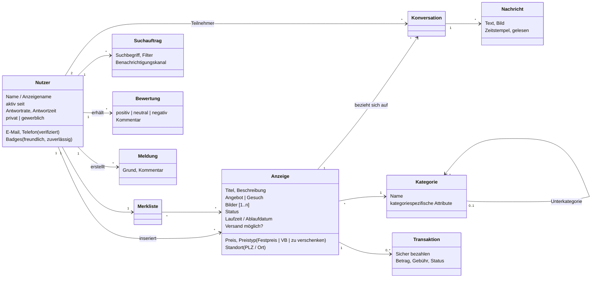
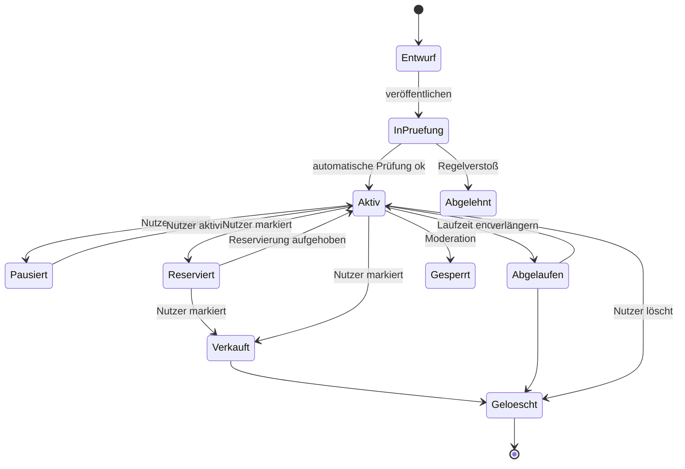
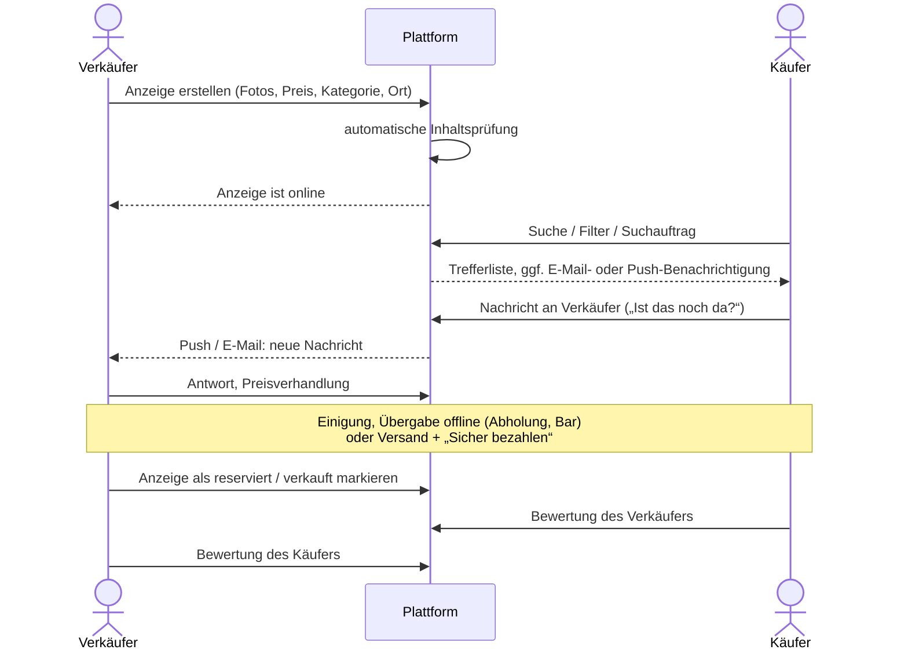

# Reverse Engineering: Kleinanzeigen (ehem. eBay Kleinanzeigen)

**Ziel:** Das Fachkonzept des Marktführers für private Kleinanzeigen in Deutschland ableiten: Domänenobjekte, Prozesse, Regeln und Geschäftsmodell. Danach entscheiden wir, was wir **übernehmen**, **anpassen** oder **weglassen**.

**Methode:** Analyse der öffentlich sichtbaren Nutzerführung (Web und App), der Hilfeseiten und der Fachpresse. Wir analysieren nur von außen beobachtbares Verhalten (Black-Box). Interne Implementierungsdetails sind nicht bekannt und werden nicht behauptet.

> Stand der Fakten: Oktober 2026. Gebühren und Konditionen ändern sich häufig, daher vor der Abgabe noch einmal prüfen.

---

## 1. Kernidee in einem Satz

Kleinanzeigen ist ein **kostenloses, lokales Schwarzes Brett**. Privatpersonen stellen Angebote und Gesuche ein, Interessenten kontaktieren sie über einen **plattforminternen Chat**, und der Abschluss findet meist **offline** statt (Abholung, Barzahlung). Die Plattform verdient an Werbung und optionalen Zusatzleistungen, nicht am Abschluss selbst.

## 2. Akteure

| Akteur | Beschreibung |
|---|---|
| Besucher (nicht angemeldet) | Darf suchen und Anzeigen ansehen, aber nicht kontaktieren oder inserieren |
| Privatnutzer | Inseriert und kontaktiert, ist Käufer und Verkäufer zugleich (keine getrennten Rollen) |
| Gewerblicher Nutzer / PRO | Händler mit Shop-Seite und kostenpflichtigen Paketen |
| Moderation / Trust & Safety | Prüft gemeldete und automatisch markierte Inhalte und sperrt Konten |
| Zahlungsdienstleister (Adyen) | Treuhandabwicklung bei „Sicher bezahlen“ |
| Versanddienstleister (Hermes, DHL) | Versandetiketten aus der Plattform heraus |
| Werbenetzwerke | Hauptsächliche Erlösquelle |

## 3. Domänenmodell (abgeleitet)

**Wichtige Beobachtung:** Eine Konversation hängt immer an **genau einer Anzeige** und **zwei Nutzern**. So weiß der Verkäufer bei jeder Nachricht, worum es geht. Diese Bindung übernehmen wir.

## 4. Lebenszyklus einer Anzeige (abgeleitet)

## 5. Kernprozesse

### 5.1 Hauptprozess „Gegenstand verkaufen“ (Happy Path)

### 5.2 Weitere beobachtete Prozesse

| Prozess | Beobachtetes Verhalten |
|---|---|
| Registrierung | E-Mail + Passwort oder Social Login. Verifizierung per E-Mail-Link. Für bestimmte Funktionen zusätzlich die Telefonnummer |
| Suche | Freitext, Kategoriebaum, Ort + Umkreis, Preis von/bis, Angebot/Gesuch, privat/gewerblich, Versand ja/nein. Sortierung nach Datum, Preis oder Entfernung |
| Suchauftrag | Gespeicherte Suche, die über neue Treffer per Push oder E-Mail informiert |
| Merkliste | Anzeigen merken. Hinweis bei Preisänderung oder Verkauf |
| Chat | Anzeigenbezogen. Text, Bilder, Lesebestätigung, Sicherheitshinweise bei verdächtigen Mustern (externe Links, Bezahlung außerhalb der Plattform) |
| Melden | Anzeige, Nutzer oder Nachricht melden, mit Grund |
| Bewertung | Nach einer Interaktion. Daraus abgeleitete Badges („freundlich“, „zuverlässig“) |
| Ablauf | Anzeigen haben eine begrenzte Laufzeit, mit Erinnerung und Verlängerungsoption |
| Sicher bezahlen | Optional. Käufer zahlt 0,50 € + 4,5 % Gebühr. Geld liegt treuhänderisch bei Adyen. Käuferschutz nur bei Versand innerhalb Deutschlands. Seit 07/2026 ist auch Klarna eine Zahlungsart |

## 6. Geschäftsmodell

| Erlösquelle | Mechanik | Relevanz für uns |
|---|---|---|
| Display-Werbung | Werbeflächen in Suche und Anzeige | **Weglassen.** Kein Tracking im Hochschulkontext |
| Zusatzoptionen | Hochschieben, Top-Anzeige, Highlight | Weglassen (ggf. als kostenlose, limitierte Funktion) |
| PRO-Abos für Gewerbe | Shop-Seite, Pakete | Weglassen. Nur Privatpersonen |
| Transaktionsgebühr | Käufergebühr bei „Sicher bezahlen“ | **Backlog** (Bezahlfunktion) |
| Versandmarge | Vergünstigte Labels | Weglassen. Übergabe auf dem Campus |

## 7. Schwachstellen des Vorbilds (Chancen für uns)

1. **Betrug und Fake-Profile:** Anonyme Konten, Phishing über gefälschte Bezahllinks, Vorkasse-Betrug. *Bei uns:* Jedes Konto ist an eine echte Hochschulidentität gebunden.
2. **No-Shows und Spam:** Unverbindliche Anfragen, „Was letzte Preis?“. *Bei uns:* Soziale Kontrolle durch die Campus-Community, Bewertungen und Blockieren.
3. **Lokale Übergabe ist unsicher und umständlich:** Treffen bei Fremden zu Hause. *Bei uns:* Feste, öffentliche Übergabepunkte auf dem Campus.
4. **Werbung und Tracking:** Überladene UI. *Bei uns:* Werbefrei und datensparsam.
5. **Kein Studienbezug:** Keine Filter nach Modul oder Studiengang. *Bei uns:* Studienspezifische Kategorien und Attribute.

## 8. Ableitung: übernehmen, anpassen, weglassen

| Konzept | Entscheidung | Begründung |
|---|---|---|
| Anzeige (Angebot/Gesuch) mit Kategorie, Bildern, Preis | **Übernehmen** | Kernkonzept |
| Preistypen Festpreis / VB / zu verschenken | **Anpassen**: zusätzlich **„Tausch“** | Auftrag „Tauschbörse“ |
| Standort PLZ + Umkreis | **Anpassen**: Übergabeort = Campus-Standort (Ludwigshafen, Neustadt Weincampus, …) | Alle Nutzer sind auf wenige Campus verteilt |
| Anzeigenbezogener Chat | **Übernehmen** | Kernkonzept, gefordert |
| E-Mail-Benachrichtigungen | **Übernehmen** | Gefordert |
| Suchaufträge, Merkliste | **Übernehmen** (Should/Could) | Hoher Nutzen bei geringem Aufwand |
| Bewertungen | **Anpassen**: einfach (Daumen + optionaler Text), nur nach bestätigter Übergabe | Weniger Missbrauch |
| Registrierung mit beliebiger E-Mail / Social Login | **Ersetzen** durch Hochschul-E-Mail mit Domain-Whitelist | Gefordert, und das ist das Alleinstellungsmerkmal |
| Telefonverifizierung | **Weglassen** | Durch die Hochschul-E-Mail ersetzt |
| Gewerbliche Nutzer / PRO | **Weglassen** | Zielgruppe ist privat |
| Werbung, bezahlte Hervorhebung | **Weglassen** | Kein Erlösmodell nötig |
| Sicher bezahlen / Versand | **Backlog** | Bezahlfunktion vorerst nicht im Scope, aber architektonisch vorbereitet |
| Melden + Moderation | **Übernehmen** | Rechtlich nötig (DSA Art. 16, Melde- und Abhilfeverfahren) |
| Laufzeit / Ablauf von Anzeigen | **Übernehmen** | Hält den Bestand aktuell |
