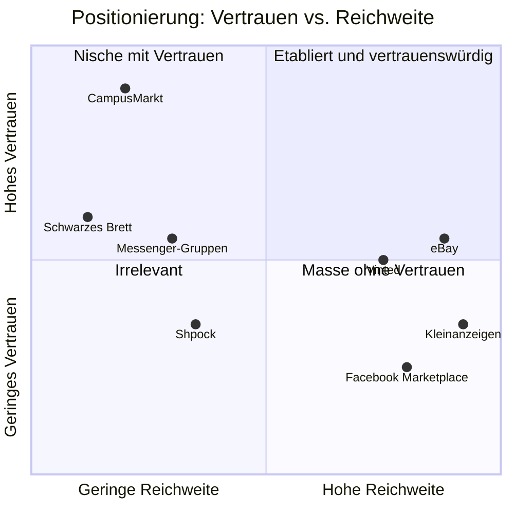

# Wettbewerbsanalyse

**Fragestellung:** Wo kaufen, verkaufen und tauschen Studierende der HWG LU heute? Welche Lücke kann eine hochschulgebundene Plattform füllen?

> Stand: Oktober 2026. Preise und Gebühren laut Quellen am Ende des Dokuments. Mit einem Stern (\*) markierte Angaben sind Annahmen aus Beobachtung und vor der Abgabe zu verifizieren.

## 1. Betrachtete Wettbewerber

Wir unterscheiden **direkte** Wettbewerber (allgemeine C2C-Marktplätze), **indirekte** Wettbewerber (informelle Campus-Kanäle) und **Substitute** (Ankaufdienste).

| # | Plattform | Typ | Kurzprofil |
|---|---|---|---|
| W1 | **Kleinanzeigen** | direkt | Marktführer für lokale private Anzeigen in DE. Kostenlos, Chat, optional „Sicher bezahlen“ (0,50 € + 4,5 % Käufergebühr über Adyen, seit 07/2026 auch Klarna) |
| W2 | **Vinted** | direkt | Second-Hand-Marktplatz, ursprünglich Mode, inzwischen breiter. Versandfokus, Käuferschutzgebühr 0,70 € + 5–8 %. Das KG Berlin hat 2026 die *Voreinstellung* des kostenpflichtigen Käuferschutzes untersagt, Vinted geht in Berufung |
| W3 | **eBay** | direkt | Auktion + Sofortkauf, überregional und versandorientiert. Für Privatverkäufer in DE seit 2023 gebührenfrei |
| W4 | **Facebook Marketplace / FB-Gruppen** | direkt | Hohe Reichweite, Identität über das Meta-Konto, lokale Gruppen (z. B. „Flohmarkt Ludwigshafen“\*). Datenschutzbedenken, Betrugsfälle |
| W5 | **Shpock** | direkt | Mobile-first-Flohmarkt-App (Schibsted). In DE nach Restrukturierung deutlich weniger präsent |
| W6 | **Messenger- und Social-Gruppen** (WhatsApp, Telegram, Discord, Jodel) | indirekt | Semester- oder Studiengangsgruppen, in denen Bücher, Möbel und WG-Zimmer angeboten werden\*. Sehr niedrige Hürde, aber unstrukturiert, ohne Suche und flüchtig |
| W7 | **Schwarzes Brett** (physisch, Lernplattform-Foren, AStA-Seite) | indirekt | Hochschulbezug ist gegeben, aber kaum Reichweite, keine Benachrichtigungen, veraltete Aushänge |
| W8 | **momox / rebuy (Ankauf)** | Substitut | Sofortverkauf von Büchern und Elektronik zu niedrigen Preisen, ohne Verhandlung und ohne Treffen |

**Analogie mit Vorbildcharakter:** *nebenan.de* verifiziert die Zugehörigkeit über die **Wohnadresse**, wir verifizieren sie über die **Hochschul-E-Mail**. Und *Facebook* selbst ist 2004 nur mit `.edu`-Adressen gestartet, also mit genau der Whitelist-Strategie, die wir planen.

## 2. Feature-Matrix

Legende: ● vorhanden · ◐ teilweise · ○ nicht vorhanden

| Merkmal | W1 Kleinanz. | W2 Vinted | W3 eBay | W4 FB | W5 Shpock | W6 Gruppen | W7 Brett | **CampusMarkt (Ziel)** |
|---|---|---|---|---|---|---|---|---|
| Verifizierte Zugehörigkeit zur Hochschule | ○ | ○ | ○ | ○ | ○ | ◐ | ◐ | **●** |
| Kostenlos für Käufer und Verkäufer | ● | ◐ | ◐ | ● | ◐ | ● | ● | **●** |
| Werbefrei, ohne Tracking | ○ | ○ | ○ | ○ | ○ | ◐ | ● | **●** |
| Strukturierte Suche und Filter | ● | ● | ● | ◐ | ● | ○ | ○ | **●** |
| Suchauftrag / Benachrichtigung | ● | ● | ● | ◐ | ● | ○ | ○ | **●** |
| Integrierter Chat | ● | ● | ● | ● | ● | ● | ○ | **●** |
| Tausch als eigener Angebotstyp | ◐ | ○ | ○ | ○ | ○ | ◐ | ◐ | **●** |
| Studienbezug (Modul, Studiengang) | ○ | ○ | ○ | ○ | ○ | ◐ | ◐ | **●** |
| Sichere Übergabe vor Ort (Campus-Treffpunkte) | ○ | ○ | ○ | ○ | ○ | ○ | ○ | **●** |
| Bewertungen / Reputation | ● | ● | ● | ◐ | ● | ○ | ○ | **◐** (MVP einfach) |
| Integrierte Bezahlung / Käuferschutz | ● | ● | ● | ◐ | ● | ○ | ○ | **○ → Backlog** |
| Versandintegration | ● | ● | ● | ○ | ● | ○ | ○ | **○** (Won't) |
| Native App | ● | ● | ● | ● | ● | ● | ○ | **◐** (PWA) |

## 3. Bewertung nach Kriterien (1 = schlecht, 5 = sehr gut)

Gewichtung aus Sicht unserer Zielgruppe (Studierende und Beschäftigte, lokal, wenig Budget, Sicherheitsbedürfnis):

| Kriterium | Gewicht | W1 | W2 | W3 | W4 | W6 | W7 | **Ziel** |
|---|---|---|---|---|---|---|---|---|
| Vertrauen / Betrugsschutz | 25 % | 2 | 3 | 3 | 2 | 3 | 3 | **5** |
| Reichweite / Angebot | 20 % | 5 | 4 | 5 | 4 | 2 | 1 | **2** |
| Kosten für Nutzer | 15 % | 5 | 3 | 4 | 5 | 5 | 5 | **5** |
| Bequemlichkeit der Übergabe | 15 % | 3 | 3 | 2 | 3 | 4 | 3 | **5** |
| Relevanz für den Studienalltag | 15 % | 2 | 1 | 2 | 2 | 4 | 4 | **5** |
| Datenschutz | 10 % | 2 | 2 | 2 | 1 | 2 | 4 | **5** |
| **Gewichtete Summe** |  | **3,20** | **2,80** | **3,15** | **2,90** | **3,30** | **3,15** | **4,40** |

> Die Bewertung ist eine **Hypothese** des Teams, keine Messung. Sie sollte durch eine kurze Umfrage unter Studierenden validiert werden (siehe Review, Q-6).

**Erkenntnis:** Unser einziger klarer Nachteil ist die **Reichweite**. Das ist das klassische Henne-Ei-Problem zweiseitiger Märkte: Ohne Anzeigen kommen keine Käufer, ohne Käufer keine Anzeigen. Bei rund 4.200 Studierenden plus Beschäftigten ist der Markt klein. Daraus folgen strategische Anforderungen (siehe Abschnitt 6).

## 4. Positionierung

**Positionierungsaussage:**
> Für Studierende und Beschäftigte der HWG LU, die gebrauchte Dinge schnell, sicher und ohne Gebühren loswerden oder finden wollen, ist CampusMarkt der Marktplatz, auf dem **jeder Nutzer nachweislich zur Hochschule gehört** und die Übergabe **zwischen zwei Vorlesungen auf dem Campus** stattfindet. Anders als Kleinanzeigen oder Facebook ist CampusMarkt werbefrei, verifiziert und studienbezogen.

## 5. SWOT-Analyse CampusMarkt

| | Positiv | Negativ |
|---|---|---|
| **Intern** | **Stärken:** verifizierte Identität · geschlossene Community · Campus-Übergabe · keine Gebühren · studienbezogene Kategorien · werbefrei | **Schwächen:** kleine Nutzerbasis · keine Versand- und Bezahlfunktion im MVP · begrenzte Entwicklungs- und Betriebsressourcen (Studienprojekt) · keine native App |
| **Extern** | **Chancen:** Semesterzyklen (Semesterstart, Auszug, Abschluss) erzeugen planbare Nachfrage-Peaks · Kooperation mit AStA / Hochschulmarketing · Nachhaltigkeitsthema (Re-Use) · Erweiterung auf weitere Hochschulen der Metropolregion | **Risiken:** kritische Masse wird nicht erreicht · Zustellbarkeit der E-Mails an Hochschul-Mailserver (Spamfilter) · rechtliche Pflichten als Plattformbetreiber (DSA, DSGVO, Impressum) · Betrieb nach Projektende ungeklärt · Exmatrikulierte behalten ggf. ihre Postfächer |

## 6. Abgeleitete strategische Anforderungen

| Erkenntnis | Abgeleitete Anforderung (siehe Katalog) |
|---|---|
| Kritische Masse ist das Hauptrisiko | Niedrige Einstiegshürde: Anzeige in unter 2 Minuten erstellen, **Gesuche** und **„zu verschenken“** gleichwertig unterstützen, später weitere Domains (REQ-LST-001, REQ-LST-002, Backlog EPIC-10) |
| Vertrauen ist das Alleinstellungsmerkmal | Domain-Whitelist, E-Mail-Verifikation, regelmäßige Re-Verifikation, Melden und Blockieren (REQ-AUTH-001…006, REQ-MOD-*) |
| Übergabe auf dem Campus | Übergabeort als Pflichtattribut mit Campus-Standorten (REQ-LST-004) |
| Studienbezug | Kategorien „Bücher & Skripte“ mit optionalem Attribut Studiengang/Modul (REQ-LST-005) |
| Gebührenfreiheit ist bei Vinted und eBay ein Streitthema | Bezahlfunktion später **optional** und **nicht voreingestellt** (siehe KG Berlin zu Vinted). Als Anforderung an EPIC-09 hinterlegt |
| Messenger-Gruppen sind schnell, aber flüchtig | Gute Benachrichtigungen (E-Mail, später Web Push) und Teilen-Links für Anzeigen (REQ-NOTI-*, REQ-LST-009) |

## Quellen

- [Kleinanzeigen „Sicher bezahlen“: Gebühren, Fristen, Ausnahmen (monsterdealz.de)](https://www.monsterdealz.de/magazin/kleinanzeigen-sicher-bezahlen)
- [Kleinanzeigen holt Klarna zurück (onlinemarktplatz.de)](https://onlinemarktplatz.de/269058/klarna-bei-kleinanzeigen/)
- [Vinted darf kostenpflichtigen Käuferschutz nicht voreinstellen (vzbv.de)](https://www.vzbv.de/urteile/vinted-darf-kostenpflichtigen-kaeuferschutz-nicht-voreinstellen)
- [Berliner Gericht untersagt voreingestellten Käuferschutz bei Vinted (fashionunited.de)](https://fashionunited.de/nachrichten/business/berliner-gericht-untersagt-voreingestellten-kauferschutz-bei-vinted/2026030665720)
- [Wie funktioniert Vinted? Gebühren 2026 (monsterdealz.de)](https://www.monsterdealz.de/magazin/wie-funktioniert-vinted)
- [Shpock: neue Strategie kostet 82 Jobs (futurezone.at)](https://futurezone.at/amp/start-ups/flohmarkt-app-shpock-neue-strategie-kostet-82-jobs-in-wien/400318488)
- [HWG LU Profil, ca. 4.200 Studierende (mygermanuniversity.com)](https://www.mygermanuniversity.com/de/universities/Ludwigshafen-University-of-Business-and-Society)
