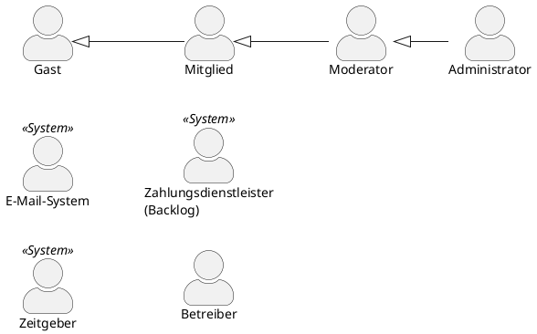
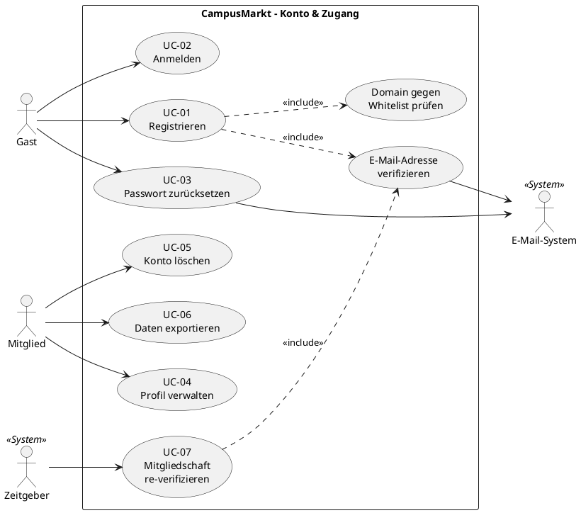
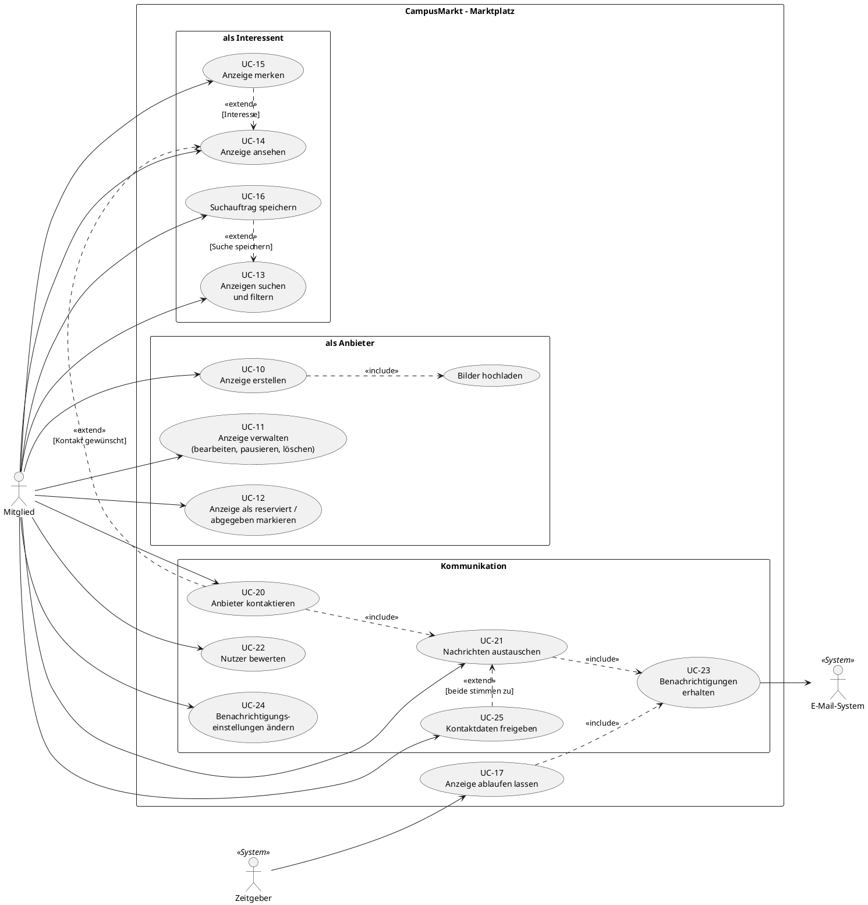
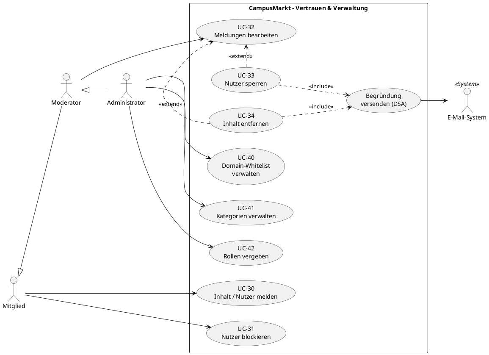
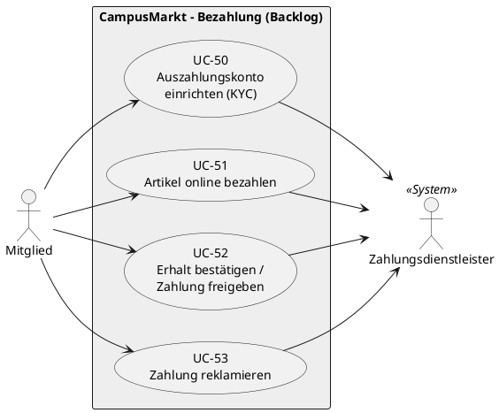
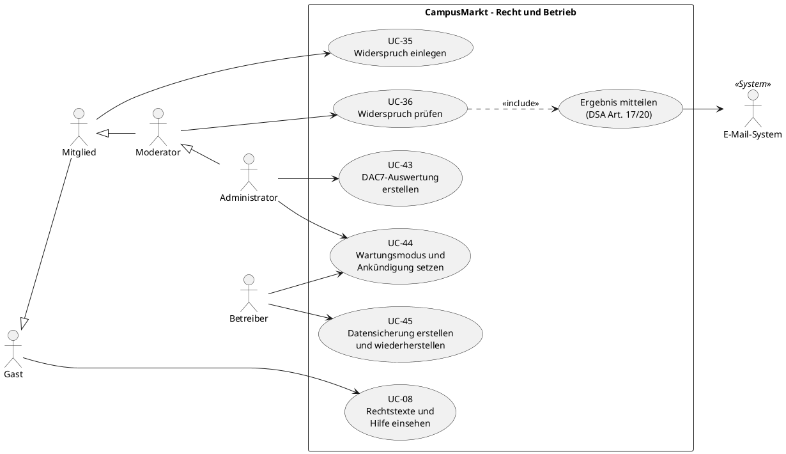
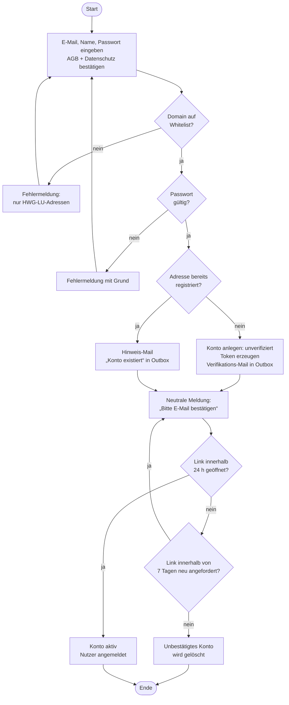
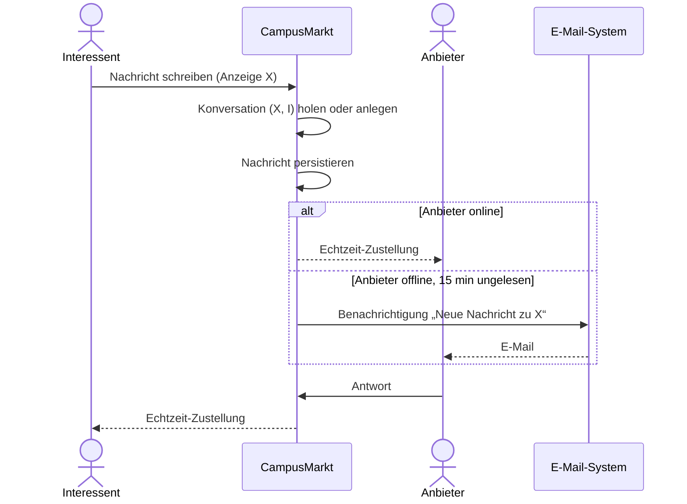
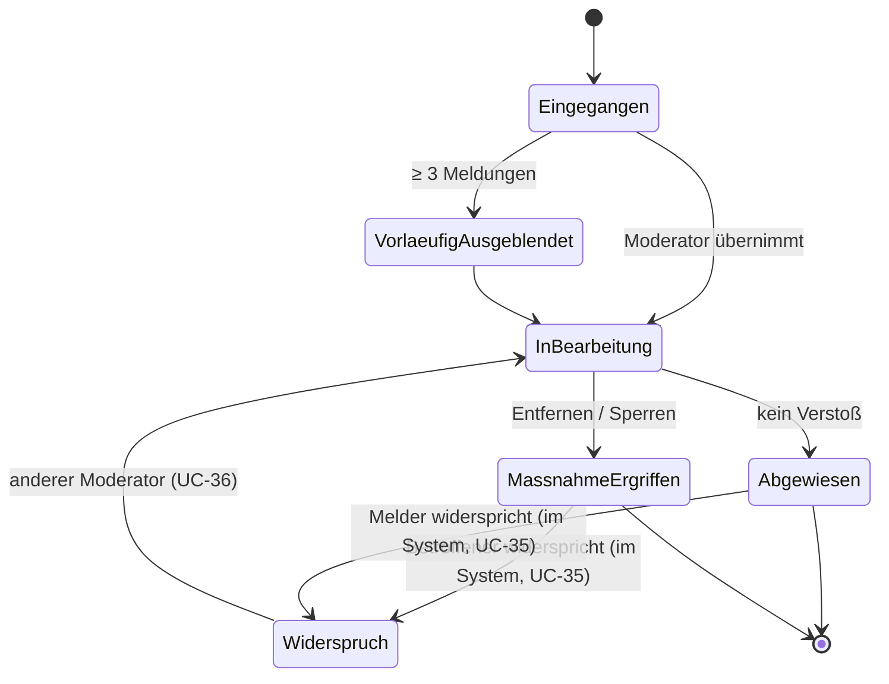
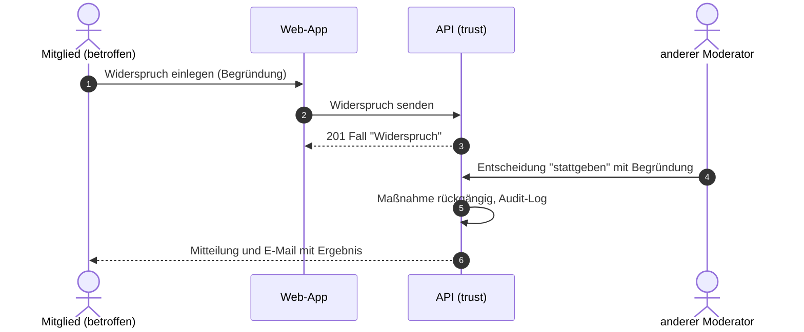

# Use-Case-Modell

Nach UML 2.5 (Use-Case-Diagramme) und Cockburn (Use-Case-Spezifikation, Template „fully dressed“ für die Kern-Use-Cases, „casual“ für den Rest).

**Use Case oder User Story? (Fallstudie FS-M10)** Use Cases nutzen wir dort, wo ein zusammenhängender Ablauf mit vielen Varianten und Ausnahmen beschrieben werden muss oder wo Fehlinterpretationen teuer sind (Registrierung, Anzeige erstellen, Chat, Kontaktfreigabe, Moderation, Löschung). Die planbaren Umsetzungseinheiten sind die User Stories und Regeln in [req/](req/); jeder Use Case verweist auf sie.

**Aufbau eines Use-Case-Dokuments (Fallstudie FS-M11).** Die Felder des Cockburn-Templates decken den Aufbau aus der Vorlesung vollständig ab:

| Vorlesung (Folie 22) | Feld in diesem Dokument |
|---|---|
| Name | Überschrift „UC-NN Name“ |
| Description | **Beschreibung (Zweck/Nutzen)** und **Ziel** |
| Actors | **Primärakteur**, **Sekundärakteure** |
| Preconditions | **Vorbedingung** |
| Auslöser (Folie 21) | **Auslöser** |
| Normal Flow | **Hauptszenario** |
| Alternate Flows | **Erweiterungen** (Nummer = Schritt, an dem abgezweigt wird) |
| Postconditions | **Nachbedingung (Erfolg/Fehlschlag)** |

## 1. Akteure

| Akteur | Typ | Beschreibung |
|---|---|---|
| **Gast** | primär, menschlich | Nicht angemeldete Person. Sieht nur die Startseite, Hilfe, Rechtsseiten (Impressum, Datenschutz, Nutzungsbedingungen, Barrierefreiheit, Kontakt) und die Statusseite und kann sich registrieren oder anmelden |
| **Mitglied** | primär, menschlich | Verifizierte Person mit Adresse `@hwg-lu.de` (Beschäftigte) oder `@studmail.hwg-lu.de` (Studierende). Ist **Anbieter und Interessent zugleich**. Die Rollen „Verkäufer“ und „Käufer“ sind **kontextabhängig**, keine eigenen Akteure |
| **Moderator** | primär, menschlich | Mitglied mit Moderationsrechten (z. B. AStA, Hilfskraft). Spezialisiert *Mitglied* |
| **Administrator** | primär, menschlich | Technische und fachliche Verwaltung (Whitelist, Kategorien, Rollen). Spezialisiert *Moderator* |
| **E-Mail-System** | sekundär, System | SMTP-Server. Im Docker-Beispiel **Mailpit**, das alle Mails abfängt und in einer Weboberfläche anzeigt (ADR-0010) |
| **Zeitgeber** | primär, System | Löst zeitgesteuerte Abläufe aus (Ablauf von Anzeigen, Re-Verifikation, Löschfristen) |
| **Zahlungsdienstleister** | sekundär, System | *Backlog (EPIC-09).* Wickelt Zahlungen ab |
| **Betreiber** | primär, menschlich | Technischer Betrieb des Systems (Start, Wartung, Datensicherung). Im Docker-Beispiel die Person, die `docker compose` ausführt; kein Konto im System (Q-23) |

> **Designentscheidung:** Verkäufer und Käufer sind keine eigenen Akteure, weil dieselbe Person in derselben Sitzung beides sein kann. Im Diagramm stehen die Rollen daher als Paketnamen, nicht als Akteure. Das entspricht dem Lehrbuchrat, Akteure nach **Rollen gegenüber dem System** zu bilden und nicht nach Personen.

## 2. Use-Case-Diagramme

### 2.1 Übersicht: Konto und Zugang

### 2.2 Übersicht: Anzeigen, Suche, Kommunikation

### 2.3 Übersicht: Vertrauen, Sicherheit, Verwaltung

### 2.4 Ausblick: Bezahlfunktion (Backlog, EPIC-09)

### 2.5 Übersicht: Recht und Betrieb (EPIC-13)

## 3. Use-Case-Liste

| ID | Name | Primärakteur | Priorität (MVP) | Detail |
|---|---|---|---|---|
| UC-01 | Registrieren | Gast | Must | [§4.1](#41-uc-01-registrieren) |
| UC-02 | Anmelden / Abmelden | Gast / Mitglied | Must | casual |
| UC-03 | Passwort zurücksetzen | Gast | Must | casual |
| UC-04 | Profil verwalten | Mitglied | Must | casual |
| UC-05 | Konto löschen | Mitglied | Must (DSGVO) | [§4.6](#46-uc-05-konto-löschen) |
| UC-06 | Daten exportieren | Mitglied | Should (DSGVO) | casual |
| UC-07 | Mitgliedschaft re-verifizieren | Zeitgeber | Should (R2, Q-14) | [§4.7](#47-uc-07-mitgliedschaft-re-verifizieren) |
| UC-08 | Rechtstexte und Hilfe einsehen | Gast / Mitglied | Must (DDG, DSGVO, DSA) | casual |
| UC-10 | Anzeige erstellen | Mitglied | Must | [§4.2](#42-uc-10-anzeige-erstellen) |
| UC-11 | Anzeige verwalten | Mitglied | Must | casual |
| UC-12 | Anzeige als reserviert / abgegeben markieren | Mitglied | Must | casual |
| UC-13 | Anzeigen suchen und filtern | Mitglied | Must | [§4.3](#43-uc-13-anzeigen-suchen-und-filtern) |
| UC-14 | Anzeige ansehen | Mitglied | Must | casual |
| UC-15 | Anzeige merken | Mitglied | Should | casual |
| UC-16 | Suchauftrag speichern | Mitglied | Could | casual |
| UC-17 | Anzeige ablaufen lassen | Zeitgeber | Should | casual |
| UC-20 | Anbieter kontaktieren | Mitglied | Must | [§4.4](#44-uc-20--uc-21-anbieter-kontaktieren-und-nachrichten-austauschen) |
| UC-21 | Nachrichten austauschen | Mitglied | Must | [§4.4](#44-uc-20--uc-21-anbieter-kontaktieren-und-nachrichten-austauschen) |
| UC-22 | Nutzer bewerten | Mitglied | Could | casual |
| UC-23 | Benachrichtigungen erhalten | Mitglied (sekundär: E-Mail-System) | Must | casual |
| UC-24 | Benachrichtigungseinstellungen ändern | Mitglied | Should | casual |
| UC-25 | Kontaktdaten freigeben | Mitglied | Must (Fallstudie FS-C1) | [§4.8](#48-uc-25-kontaktdaten-freigeben) |
| UC-30 | Inhalt / Nutzer melden | Mitglied | Must (DSA) | [§4.5](#45-uc-30--uc-32-melden-und-moderieren) |
| UC-31 | Nutzer blockieren | Mitglied | Should | casual |
| UC-32 | Meldungen bearbeiten | Moderator | Must (DSA) | [§4.5](#45-uc-30--uc-32-melden-und-moderieren) |
| UC-33 | Nutzer sperren | Moderator | Must | casual |
| UC-34 | Inhalt entfernen | Moderator | Must | casual |
| UC-35 | Widerspruch gegen Moderationsentscheidung einlegen | Mitglied (betroffen oder meldend) | Must (DSA Art. 20, Q-22) | [§4.9](#49-uc-35-widerspruch-gegen-eine-moderationsentscheidung-einlegen) |
| UC-36 | Widerspruch prüfen | Moderator (nicht der ursprüngliche Entscheider) | Must (DSA Art. 20) | casual |
| UC-40 | Domain-Whitelist verwalten | Administrator | Should (MVP: Konfiguration) | casual |
| UC-41 | Kategorien verwalten | Administrator | Could (MVP: Seed-Daten) | casual |
| UC-42 | Rollen vergeben | Administrator | Must | casual |
| UC-43 | DAC7-Auswertung erstellen | Administrator | Should (Q-26) | casual |
| UC-44 | Wartungsmodus und Ankündigung setzen | Betreiber / Administrator | Should | casual |
| UC-45 | Datensicherung erstellen und wiederherstellen | Betreiber | Must (EPIC-13) | casual |
| UC-50…53 | Bezahlung | Mitglied | **Won't (MVP)**, Backlog EPIC-09 | – |

## 4. Use-Case-Spezifikationen (fully dressed)

### 4.1 UC-01 Registrieren

| Feld | Inhalt |
|---|---|
| **Beschreibung (Zweck/Nutzen)** | Gäste mit Hochschuladresse legen ein Konto an und bestätigen ihre Adresse. Nutzen: Nur echte Hochschulangehörige nehmen am Marktplatz teil (BG-1). |
| **Ziel** | Ein Hochschulangehöriger erhält ein verifiziertes Konto |
| **Primärakteur** | Gast |
| **Sekundärakteure** | E-Mail-System |
| **Stakeholder & Interessen** | *Gast:* schnell und unkompliziert. *Community:* nur echte Hochschulangehörige. *Betreiber:* DSGVO-konforme Einwilligungen |
| **Vorbedingung** | Gast hat keine aktive Sitzung (Adressen, die bereits registriert sind, behandelt Erweiterung 2b) |
| **Auslöser** | Gast wählt „Registrieren“ |
| **Nachbedingung (Erfolg)** | Konto im Status `aktiv`, E-Mail verifiziert, Rolle `Mitglied`, Typ `Studierende` oder `Beschäftigte` aus der Domain abgeleitet, Zustimmung zu AGB und Datenschutz mit Zeitstempel und Version gespeichert |
| **Nachbedingung (Fehlschlag)** | Kein aktives Konto. Ein unbestätigtes Konto wird 7 Tage nach der Registrierung gelöscht (Q-13, REQ-AUTH-002, REQ-PRIV-003) |

**Hauptszenario**
1. Gast gibt E-Mail-Adresse, Anzeigenamen und Passwort ein und bestätigt AGB und Datenschutzhinweis.
2. System normalisiert die E-Mail-Adresse und prüft die Domain gegen die Whitelist (REQ-AUTH-001, Geschäftsregel BR-01).
3. System prüft die Passwortrichtlinie (REQ-SEC-003).
4. System legt das Konto im Status `unverifiziert` an und erzeugt ein einmaliges, zeitlich begrenztes Verifikations-Token.
5. System beauftragt das E-Mail-System mit dem Versand des Verifikationslinks.
6. System zeigt den Hinweis „Bitte bestätige deine E-Mail-Adresse“ an, **unabhängig davon, ob die Adresse schon existiert** (keine Konto-Enumeration).
7. Gast öffnet den Link aus der E-Mail.
8. System validiert das Token, setzt das Konto auf `aktiv` und meldet den Nutzer an.

**Erweiterungen**
- 2a. *Domain nicht auf der Whitelist:* System zeigt „Nur Adressen der HWG LU (@hwg-lu.de, @studmail.hwg-lu.de) sind zugelassen“. Zurück zu Schritt 1.
- 2b. *Adresse ist bereits einem aktiven Konto zugeordnet:* weiter mit Schritt 6. Das System sendet stattdessen eine E-Mail „Du hast bereits ein Konto – Passwort vergessen?“.
- 3a. *Passwort zu schwach oder in bekannter Leak-Liste:* System nennt den Grund. Zurück zu Schritt 1.
- 5a. *E-Mail-System nicht erreichbar:* Der Versandauftrag bleibt in der Outbox und wird mit Backoff erneut versucht (REQ-NOTI-005). Der Gast sieht trotzdem Schritt 6.
- 7a. *Link abgelaufen (> 24 h):* System bietet „Link erneut senden“ an (höchstens 3 pro Stunde und Adresse); möglich, solange das unbestätigte Konto existiert (7 Tage).
- 7b. *Link bereits verwendet:* System leitet zur Anmeldung weiter.
- \*a. *Mehr als 3 Registrierungsversuche je Adresse oder mehr als 30 je IP und Stunde:* System verlangt eine Wartezeit (REQ-SEC-005, Q-18).

**Sonderanforderungen:** REQ-AUTH-001…004, REQ-SEC-003, REQ-SEC-005, REQ-PRIV-001.
**Offene Punkte:** Q-2 (Beschäftigte mit Funktionspostfächern, z. B. `asta@hwg-lu.de`?).

#### Aktivitätsdiagramm UC-01

---

### 4.2 UC-10 Anzeige erstellen

| Feld | Inhalt |
|---|---|
| **Beschreibung (Zweck/Nutzen)** | Ein Mitglied stellt einen Gegenstand ein, den es anbietet, verschenkt, tauscht oder sucht. Nutzen: Dinge finden schnell neue Besitzer auf dem Campus (BG-2, BG-3). |
| **Ziel** | Mitglied veröffentlicht ein Angebot oder Gesuch |
| **Primärakteur** | Mitglied (als Anbieter) |
| **Vorbedingung** | Mitglied ist angemeldet und nicht gesperrt |
| **Nachbedingung (Erfolg)** | Anzeige im Status `aktiv` mit Ablaufdatum (+60 Tage), in der Suche auffindbar (≤ 10 s) |

**Hauptszenario**
1. Mitglied wählt „Anzeige aufgeben“.
2. Mitglied wählt den Anzeigentyp: **Angebot** oder **Gesuch**.
3. Mitglied wählt die Kategorie.
4. Mitglied gibt Titel und Beschreibung ein und wählt den **Preistyp**: Festpreis · Verhandlungsbasis (VB) · zu verschenken · Tausch (mit optionalem Freitext „Suche im Tausch“).
5. Mitglied lädt 0–8 Bilder hoch (*include* „Bilder hochladen“; JPEG, PNG, WebP). Das System entfernt Metadaten wie Standortangaben und erzeugt Vorschaubilder.
6. Mitglied wählt einen oder mehrere **Übergabeorte** (Campus-Standorte) und optional den Zustand.
7. System validiert die Eingaben (Pflichtfelder, Längen, Preisbereich, Wortfilter für verbotene Artikel).
8. Mitglied veröffentlicht.
9. System setzt die Anzeige auf `aktiv` und macht sie in der Suche auffindbar (≤ 10 s).

**Erweiterungen**
- 5a. *Datei kein unterstütztes Bild oder über 10 MB:* Ablehnung mit Hinweis. HEIC folgt in R2 (REQ-LST-012); ein Malware-Scan ist Won't (Q-16), Bilder werden stattdessen neu kodiert.
- 7a. *Inhaltsprüfung schlägt an (z. B. Waffen, Medikamente):* Anzeige geht in den Status `in Prüfung` und wird in die Moderations-Queue gestellt. Das Mitglied wird informiert.
- 7b. *Mitglied hat bereits 30 aktive Anzeigen:* Hinweis auf das Limit (Spam-Schutz).

---

### 4.3 UC-13 Anzeigen suchen und filtern

| Feld | Inhalt |
|---|---|
| **Beschreibung (Zweck/Nutzen)** | Ein Mitglied durchsucht die Anzeigen per Freitext und Filter. Nutzen: passende Angebote ohne langes Stöbern finden. |
| **Ziel** | Mitglied findet relevante Anzeigen |
| **Primärakteur** | Mitglied |
| **Vorbedingung** | Mitglied ist angemeldet (Q-1: Sollen Gäste suchen dürfen?) |
| **Nachbedingung** | Trefferliste wird angezeigt. Anzeigen von blockierten Nutzern sind ausgeblendet |

**Hauptszenario**
1. Mitglied gibt einen Suchbegriff ein (optional).
2. Mitglied setzt Filter: Kategorie, Angebot/Gesuch, Preistyp, Preis von/bis, Übergabeort, Zustand, und wählt die Sortierung (neueste, Preis auf-/absteigend, mit Suchbegriff auch Relevanz) (REQ-SRCH-002).
3. System liefert eine paginierte Trefferliste (Standard: neueste zuerst; alternativ Preis auf- oder absteigend), p95 < 500 ms (REQ-PERF-001).
4. Mitglied öffnet eine Anzeige (UC-14).

**Erweiterungen**
- 3a. *Keine Treffer:* System schlägt vor, ein Gesuch aufzugeben (UC-10). Suchaufträge (UC-16) folgen später (Could).
- 3b. *Suchindex nicht verfügbar:* Fallback auf eine einfache Titelsuche, mit Hinweis auf eingeschränkte Ergebnisse (degradierter Modus).

---

### 4.4 UC-20 / UC-21 Anbieter kontaktieren und Nachrichten austauschen

| Feld | Inhalt |
|---|---|
| **Beschreibung (Zweck/Nutzen)** | Interessent und Anbieter tauschen sich anzeigenbezogen aus, ohne Kontaktdaten preiszugeben. Nutzen: sichere, nachvollziehbare Absprache bis zur Übergabe (BG-3). |
| **Ziel** | Interessent und Anbieter vereinbaren eine Übergabe |
| **Primärakteur** | Mitglied (Interessent bzw. beide Teilnehmer) |
| **Sekundärakteur** | E-Mail-System |
| **Vorbedingung** | Anzeige ist `aktiv` oder `reserviert`. Interessent ≠ Anbieter. Keiner hat den anderen blockiert |
| **Nachbedingung** | Es existiert genau **eine Konversation pro (Anzeige, Interessent)**. Nachrichten sind persistent gespeichert |

**Hauptszenario**
1. Interessent wählt in der Anzeige „Nachricht schreiben“.
2. System legt die Konversation an oder öffnet sie, falls sie schon existiert.
3. Interessent schreibt eine Nachricht (max. 2.000 Zeichen) und sendet sie.
4. System speichert die Nachricht und stellt sie dem Anbieter in Echtzeit zu, wenn er online ist (p95 < 2 s, REQ-PERF-002).
5. Ist der Anbieter offline bzw. liest er die Nachricht nicht innerhalb von 15 Minuten, sendet das System **eine** gebündelte E-Mail-Benachrichtigung (ohne Nachrichteninhalt, mit Link), REQ-NOTI-002.
6. Anbieter antwortet. Der Austausch wiederholt die Schritte 3–5 in beide Richtungen.
7. Die Teilnehmer vereinbaren eine Übergabe. Der Anbieter markiert die Anzeige optional für diesen Interessenten als `reserviert` (UC-12).

**Erweiterungen**
- 3a. *Nachricht enthält externe Links, IBAN oder Telefonnummer:* System zeigt beiden einen Sicherheitshinweis (keine Blockade).
- 3b. *Mehr als 20 neue Konversationen pro Stunde von einem Konto:* Rate-Limit (Spam-Schutz).
- 4a. *Echtzeitverbindung getrennt:* Der Client verbindet sich automatisch neu und lädt verpasste Nachrichten nach (at-least-once, Deduplizierung über die Client-Message-ID).
- 6a. *Anzeige wird gelöscht oder abgegeben:* Die Konversation bleibt lesbar, aber mit dem Hinweis „Anzeige nicht mehr verfügbar“.
- \*a. *Teilnehmer meldet die Konversation (UC-30):* Die gemeldete Nachricht wird für die Moderation freigegeben (nur gemeldeter Ausschnitt, REQ-PRIV-004).

#### Sequenzdiagramm (fachlich)

---

### 4.5 UC-30 / UC-32 Melden und Moderieren

| Feld | Inhalt |
|---|---|
| **Beschreibung (Zweck/Nutzen)** | Mitglieder melden problematische Inhalte, Moderatoren entscheiden begründet. Nutzen: Vertrauen in die Community und Erfüllung der DSA-Pflichten (BG-1, BG-4). |
| **Ziel** | Rechtswidrige oder regelwidrige Inhalte werden zeitnah entfernt (DSA Art. 16, 17) |
| **Primärakteur** | Mitglied (UC-30), Moderator (UC-32) |
| **Vorbedingung** | Inhalt (Anzeige, Nachricht, Profil) existiert |
| **Nachbedingung** | Meldung dokumentiert. Entscheidung mit Begründung an Meldenden und Betroffenen versendet |

**Hauptszenario**
1. Mitglied wählt „Melden“ an einer Anzeige, einer Nachricht oder einem Profil.
2. Mitglied wählt einen Grund (verbotener Artikel, Betrug, Belästigung, Spam, Sonstiges) und ergänzt optional eine Begründung.
3. System bestätigt den Eingang in der Oberfläche und stellt die Meldung in die Moderations-Queue (sichtbar ≤ 10 s).
4. Moderator öffnet die Meldung und sieht den gemeldeten Inhalt mit Kontext.
5. Moderator entscheidet: *keine Maßnahme* · *Inhalt entfernen* (UC-34) · *Nutzer verwarnen oder sperren* (UC-33).
6. System protokolliert die Entscheidung (Audit-Log) und informiert beide Seiten per E-Mail und Mitteilung im Konto mit Begründung, verletzter Regel und Hinweis auf den Widerspruch im System (DSA Art. 17, REQ-LEGAL-006, UC-35).

**Erweiterungen**
- 2a. *Gleicher Inhalt mehrfach gemeldet (≥ 3 unterschiedliche Mitglieder):* Inhalt wird vorläufig ausgeblendet, bis ein Moderator entscheidet.
- 5a. *Verdacht auf Straftat:* Moderator kennzeichnet die Entscheidung; das System protokolliert, benachrichtigt die Administratoren und sichert die Inhalte. Die Information der Strafverfolgung folgt dem Prozess in `docs/06-recht/dsa-prozesse.md` (DSA Art. 18, REQ-LEGAL-008, Q-4).

---

### 4.6 UC-05 Konto löschen

| Feld | Inhalt |
|---|---|
| **Beschreibung (Zweck/Nutzen)** | Ein Mitglied lässt sein Konto und seine personenbezogenen Daten löschen. Nutzen: Recht auf Löschung (Art. 17 DSGVO), mit Karenzzeit gegen versehentliches Löschen. |
| **Ziel** | Konto und personenbezogene Daten sind nach Ablauf der Karenz endgültig gelöscht |
| **Primärakteur** | Mitglied |
| **Sekundärakteure** | Zeitgeber, E-Mail-System |
| **Vorbedingung** | Mitglied ist angemeldet |
| **Auslöser** | Mitglied wählt im Profil „Konto löschen“ |
| **Nachbedingung (Erfolg)** | Nach 14 Tagen: Konto, Anzeigen, Bilder, Merkliste, Blockierungen und eigene Nachrichtentexte gelöscht; in fremden Konversationen erscheint „Ehemaliges Mitglied“; Meldungen ohne Personenbezug aufbewahrt; Bestätigungsmail versendet |
| **Nachbedingung (Fehlschlag)** | Konto unverändert aktiv |

**Hauptszenario**
1. Mitglied wählt „Konto löschen“ und bestätigt mit seinem Passwort.
2. System prüft das Passwort, setzt das Konto auf `zur Löschung vorgemerkt`, beendet alle Sitzungen und sendet eine E-Mail mit dem Löschdatum.
3. Anzeigen des Mitglieds sind ab sofort nicht mehr sichtbar.
4. Nach 14 Tagen löscht der Zeitgeber das Konto endgültig (siehe Nachbedingung) und sendet eine Bestätigung an die bisherige Adresse.

**Erweiterungen**
- 1a. *Passwort falsch:* System lehnt ab, Konto bleibt aktiv.
- 2a. *Mitglied meldet sich innerhalb der 14 Tage an:* Löschung wird abgebrochen, das Konto ist wieder aktiv, das System weist darauf hin.
- 4a. *Offene Moderationsmaßnahme gegen das Mitglied:* Beweisdaten werden gemäß REQ-PRIV-003 getrennt und ohne Personenbezug aufbewahrt.

**Sonderanforderungen:** REQ-ACC-002, REQ-PRIV-003, REQ-NOTI-001.

### 4.7 UC-07 Mitgliedschaft re-verifizieren

| Feld | Inhalt |
|---|---|
| **Beschreibung (Zweck/Nutzen)** | Das System prüft regelmäßig, ob ein Mitglied seine Hochschuladresse noch besitzt. Nutzen: Exmatrikulierte und ausgeschiedene Beschäftigte verlieren den Zugang, die Community bleibt „nur Hochschulangehörige“ (BG-1, Risiko R-3). |
| **Ziel** | Mitgliedschaft ist für weitere 12 Monate bestätigt oder das Konto ist eingeschränkt |
| **Primärakteur** | Zeitgeber |
| **Sekundärakteure** | Mitglied, E-Mail-System |
| **Vorbedingung** | Letzte Verifikation liegt 12 Monate zurück |
| **Auslöser** | Täglicher Lauf des Zeitgebers |
| **Nachbedingung (Erfolg)** | Verifikationsdatum aktualisiert |
| **Nachbedingung (Fehlschlag)** | Konto eingeschränkt: nur lesen, keine neuen Anzeigen oder Nachrichten |

**Hauptszenario**
1. Zeitgeber findet Konten, deren letzte Verifikation 12 Monate zurückliegt.
2. System sendet einen Bestätigungslink an die Hochschuladresse.
3. Mitglied öffnet den Link innerhalb von 30 Tagen.
4. System setzt das Verifikationsdatum neu.

**Erweiterungen**
- 3a. *Kein Klick innerhalb von 30 Tagen:* System schränkt das Konto ein und informiert per E-Mail; ein späterer Klick hebt die Einschränkung auf.
- 3b. *Adresse nicht mehr zustellbar:* wie 3a. Nur im Echtbetrieb erkennbar (Bounce-Verarbeitung, EPIC-12).

**Sonderanforderungen:** REQ-AUTH-007, REQ-NOTI-001.

### 4.8 UC-25 Kontaktdaten freigeben

| Feld | Inhalt |
|---|---|
| **Beschreibung (Zweck/Nutzen)** | Zwei Teilnehmer einer Konversation tauschen ihre Hochschul-E-Mail-Adressen aus, aber nur, wenn **beide** zustimmen (Fallstudie FS-C1). Nutzen: Absprachen außerhalb der Plattform werden möglich, ohne Kontaktdaten einseitig preiszugeben. |
| **Ziel** | Beide Teilnehmer sehen gegenseitig ihre Kontaktdaten |
| **Primärakteur** | Mitglied (Anbieter oder Interessent) |
| **Sekundärakteure** | anderes Mitglied der Konversation |
| **Vorbedingung** | Konversation existiert; keiner hat den anderen blockiert; beide Konten aktiv |
| **Auslöser** | Ein Teilnehmer wählt im Chat „Kontaktdaten teilen“ |
| **Nachbedingung (Erfolg)** | Beide Zustimmungen gespeichert; jeder sieht die Adresse des anderen; Systemnachricht „Kontaktdaten wurden ausgetauscht“ im Verlauf |
| **Nachbedingung (Fehlschlag)** | Keine Adresse sichtbar |

**Hauptszenario**
1. Teilnehmer A wählt „Kontaktdaten teilen“ und bestätigt den Hinweis, dass die Adresse erst nach Zustimmung beider sichtbar wird.
2. System speichert die Zustimmung von A und zeigt B „A möchte Kontaktdaten austauschen“.
3. B stimmt zu.
4. System speichert die Zustimmung von B, zeigt beiden die bei der Registrierung eingegebene Adresse des anderen als Angabe zur Konversation (nie als Nachrichtentext) und schreibt eine Systemnachricht ohne Adressen in den Verlauf.

**Erweiterungen**
- 2a. *A zieht die Zustimmung zurück, bevor B zustimmt:* Die Anfrage verschwindet bei B.
- 3a. *B lehnt ab:* A sieht „B möchte keine Kontaktdaten austauschen“; eine erneute Anfrage ist frühestens nach 24 h und höchstens dreimal je Teilnehmer und Konversation möglich.
- \*a. *Ein Teilnehmer widerruft:* Die Adressen werden für beide wieder ausgeblendet.
- \*b. *Blockierung, Sperre oder Löschung eines Kontos:* Freigabe nicht möglich bzw. Adressen werden ausgeblendet.
- \*c. *Anzeige abgegeben oder gelöscht:* Die Freigabe bleibt in der bestehenden Konversation möglich.

**Sonderanforderungen:** REQ-CHAT-010, REQ-PRIV-002, REQ-CHAT-001, REQ-SEC-006.

### 4.9 UC-35 Widerspruch gegen eine Moderationsentscheidung einlegen

| Feld | Inhalt |
|---|---|
| **Beschreibung (Zweck/Nutzen)** | Ein Mitglied, das von einer Moderationsentscheidung betroffen ist oder die Meldung erstattet hat, lässt die Entscheidung von einem anderen Moderator überprüfen. Nutzen: Schutz vor Fehlentscheidungen und Erfüllung von DSA Art. 20 (BG-4). |
| **Ziel** | Die Entscheidung ist innerhalb kurzer Zeit von einer zweiten Person überprüft; das Ergebnis ist begründet mitgeteilt |
| **Primärakteur** | Mitglied (betroffen oder meldend); bei gesperrtem Konto die betroffene Person ohne Anmeldung |
| **Sekundärakteure** | Moderator (UC-36), E-Mail-System |
| **Auslöser** | Mitteilung über eine Moderationsentscheidung (REQ-LEGAL-006) |
| **Vorbedingung** | Mitteilung der Entscheidung liegt höchstens 6 Monate zurück; die Person hat zu dieser Entscheidung noch keinen Widerspruch eingelegt |
| **Nachbedingung (Erfolg)** | Fall „Widerspruch“ in der Moderations-Queue, Eingangsbestätigung angezeigt, Audit-Log-Eintrag |
| **Nachbedingung (Fehlschlag)** | Kein Fall; Hinweis auf den Grund (Frist abgelaufen, schon widersprochen, Link ungültig) und auf den Rechtsweg |
| **Anforderungen** | REQ-LEGAL-007, REQ-LEGAL-006, REQ-MOD-002, REQ-MOD-003 |

**Hauptszenario**
1. Mitglied öffnet „Meine Mitteilungen“ und wählt bei der Entscheidung „Widerspruch einlegen“.
2. System zeigt Entscheidung, Begründung und Frist und fragt eine Begründung des Widerspruchs ab (20–2.000 Zeichen).
3. Mitglied sendet den Widerspruch ab.
4. System legt einen Fall „Widerspruch“ an, sperrt ihn für den ursprünglichen Entscheider und bestätigt den Eingang.
5. Ein anderer Moderator entscheidet (UC-36): *stattgeben* oder *zurückweisen*, jeweils mit Begründung.
6. System setzt die Entscheidung um (bei Stattgeben: Inhalt wiederherstellen bzw. Konto entsperren), protokolliert sie und teilt beiden Seiten das Ergebnis mit.

**Erweiterungen**
- 1a. *Konto gesperrt:* Die Person öffnet den einmaligen Link aus der E-Mail (gültig 6 Monate ab Mitteilung); das System zeigt das Widerspruchsformular ohne Anmeldung. Weiter mit 2.
- 1b. *Link ungültig, benutzt oder abgelaufen:* System zeigt „Dieser Link ist nicht mehr gültig“ und den Hinweis auf die Kontaktstelle (REQ-LEGAL-005). Ende.
- 3a. *Frist abgelaufen oder bereits widersprochen:* System lehnt ab und nennt den Grund. Ende.
- 5a. *Nur ein Moderator vorhanden:* Ein Administrator entscheidet.
- 6a. *Inhalt inzwischen vom Anbieter gelöscht:* Stattgeben wird mitgeteilt, eine Wiederherstellung entfällt.

---

## 5. Casual-Use-Cases (Kurzform)

| ID | Kurzbeschreibung |
|---|---|
| UC-02 | Anmeldung mit Hochschuladresse und Passwort (Anmeldeverfahren austauschbar, ADR-0013). Nach 5 Fehlversuchen derselben Kombination aus Konto und IP in 15 Minuten muss gewartet werden; das Konto wird nicht gesperrt (REQ-SEC-005, Q-18). Abmelden beendet die Sitzung serverseitig |
| UC-03 | Gast gibt E-Mail ein. Unabhängig von der Existenz erscheint eine neutrale Meldung. Der Link ist 1 h gültig und einmalig. Nach dem Zurücksetzen werden alle Sitzungen beendet |
| UC-04 | Anzeigename, Studiengang (optional), Profilbild (R2, REQ-ACC-004), bevorzugte Übergabeorte. Die E-Mail-Adresse ist **nicht** öffentlich sichtbar (Ausnahme: beidseitige Freigabe, UC-25) |
| UC-08 | Gast oder Mitglied öffnet aus dem Seitenfuß Impressum, Datenschutzerklärung, Nutzungsbedingungen und Community-Regeln, Erklärung zur Barrierefreiheit, Kontakt oder Hilfe; alle Seiten ohne Anmeldung, auch im Wartungsmodus (REQ-LEGAL-001…005, REQ-UX-004…006). Inhalte stammen aus versionierten Markdown-Dateien mit Platzhaltern (Q-23) |
| UC-06 | Export aller personenbezogenen Daten als JSON-Datei zum sofortigen Download (Profil, Einwilligungen, Anzeigen, eigene Nachrichten, Merkliste, Meldungen, Blockierungen, Kontaktfreigaben) (REQ-ACC-003) |
| UC-11 | Bearbeiten (Änderungshistorie für die Moderation), pausieren, reaktivieren, verlängern, löschen |
| UC-12 | Status `reserviert` (direkt oder im Chat für eine bestimmte Person, REQ-CHAT-011) und `abgegeben`. Abgegebene Anzeigen verschwinden sofort aus der Suche und werden nach 30 Tagen gelöscht; Reservierungen fallen nach 30 Tagen auf `aktiv` zurück (Zustandsmodell Ü-10, Ü-13, Ü-17) |
| UC-14 | Detailansicht mit Bildern, Beschreibung, Preis, Zustand, Übergabeorten, Profil-Kurzinfo (Anzeigename, Studierende/Beschäftigte, Mitglied seit) sowie den Aktionen Merken, Nachricht, Melden, Blockieren (REQ-LST-001, REQ-SRCH-004, REQ-CHAT-001, REQ-MOD-001). Bewertungen und Teilen-Link folgen später (Could) |
| UC-15 | Anzeige zur Merkliste hinzufügen oder entfernen. Optional Hinweis bei Preisänderung |
| UC-16 | Suche mit Filtern speichern. Täglicher E-Mail-Digest mit neuen Treffern (max. 10 Suchaufträge pro Mitglied) |
| UC-17 | 7 Tage vor Ablauf eine Erinnerungs-E-Mail mit Link zur Anzeige; dort genügt eine Aktion zum Verlängern. Nach 60 Tagen (pausiert: 90 Tage) Status `abgelaufen`. Nach 90 Tagen im Status `abgelaufen` wird die Anzeige gelöscht (REQ-LST-008) |
| UC-22 | Nach Status `abgegeben` können beide Konversationsteilnehmer einander einmal bewerten (👍/👎 + max. 280 Zeichen) |
| UC-23 | Transaktionale E-Mails: Verifikation, „Konto existiert“, Passwort, neue Nachricht (ohne Inhalt), Ablauf-Erinnerung, Moderationsentscheidung, Löschbestätigung (REQ-NOTI-001); Suchauftrag und Re-Verifikation folgen mit UC-16 bzw. UC-07 |
| UC-24 | Opt-out pro Kategorie (Nachrichten, Erinnerungen; Suchaufträge ab UC-16). Sicherheitsrelevante Mails sind nicht abwählbar |
| UC-31 | Nach dem Blockieren können beide einander keine Nachrichten mehr senden und sehen die Anzeigen des anderen nicht mehr in der Suche (gegenseitig, REQ-MOD-005, REQ-SRCH-006) |
| UC-33 | Verwarnung oder dauerhafte Sperre, mit Begründung nach DSA Art. 17 (REQ-LEGAL-006). Die Sperre gilt für die **E-Mail-Adresse**, damit sich der Nutzer nicht erneut registrieren kann. Befristete Sperren laufen nicht im System (Q-15); der Widerspruch läuft im System über einen einmaligen Link aus der E-Mail (UC-35, Q-22) |
| UC-36 | Moderator öffnet einen Fall „Widerspruch“ mit ursprünglicher Entscheidung, Begründung und Widerspruchsbegründung. Der ursprüngliche Entscheider kann ihn nicht bearbeiten. Entscheidung *stattgeben* (Maßnahme wird rückgängig gemacht) oder *zurückweisen*, jeweils mit Begründung; beide Seiten erhalten das Ergebnis (REQ-LEGAL-007) |
| UC-40 | Domain hinzufügen, deaktivieren und dem Nutzertyp zuordnen (`studmail.` → Studierende). MVP: per Konfiguration bzw. Datenbank-Seed |
| UC-42 | Rollen Mitglied, Moderator und Administrator vergeben bzw. entziehen. Wird protokolliert |
| UC-43 | Administrator wählt ein Kalenderjahr; System zeigt die Anbieter, die 30 Verkäufe oder 2.000 € erreichen, mit Summen je Quartal, und bietet einen CSV-Export an. Jeder Abruf wird protokolliert (REQ-LEGAL-009, Q-26) |
| UC-44 | Betreiber schaltet den Wartungsmodus per Konfiguration ein (alle Seiten 503 außer Health, Status und Rechtsseiten); Administrator setzt oder entfernt eine Ankündigung, die als Banner und auf der Statusseite erscheint (REQ-OPS-006, REQ-OPS-007) |
| UC-45 | Betreiber erstellt mit einem Befehl eine Sicherung (Datenbank-Dump und Uploads-Archiv mit Prüfsumme) und stellt sie in ein leeres System wieder her; die Wiederherstellung wird in CI regelmäßig getestet (REQ-AVAIL-003) |
