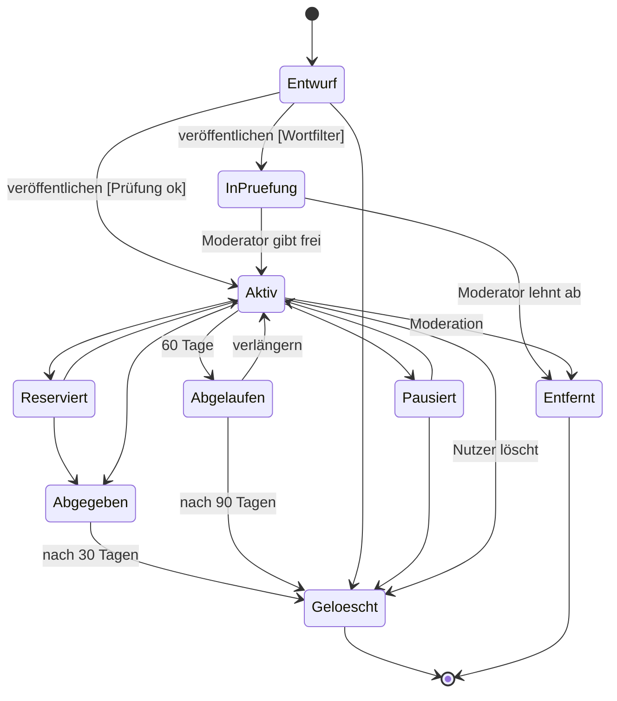
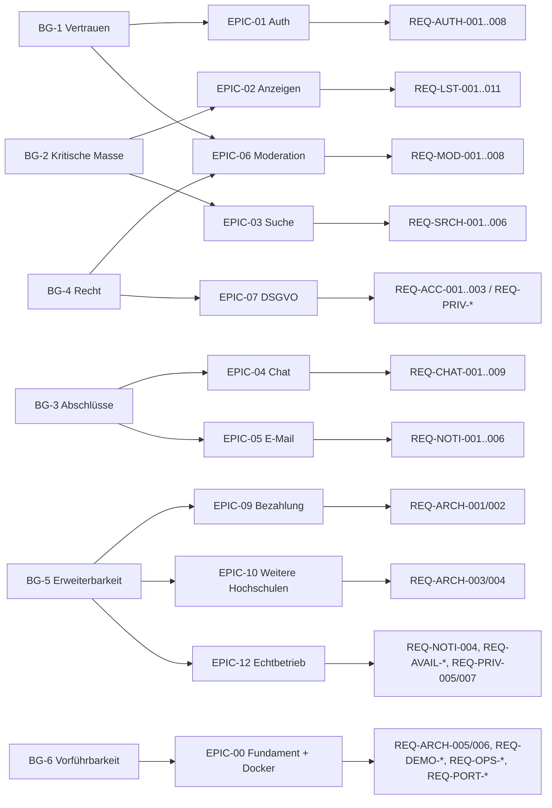

# Anforderungskatalog

> **v0.2:** Kein öffentliches Hosting, Auslieferung als Docker-Beispiel ([ADR-0010](../03-architektur/decisions/0010-docker-demo-deployment.md)). Anforderungen, die nur im Echtbetrieb Sinn ergeben, sind **explizit als N/A (Beispiel)** markiert und nach EPIC-12 verschoben, nicht gelöscht (Guideline: N/A nie stillschweigend).

Gemäß DEV Guideline Kap. 01: **typgerechte Darstellung** (User Story nur für nutzersichtbares Verhalten), **MoSCoW je Release** (hier: Release `MVP`), **Given–When–Then nur für Verhalten**, NFRs nach **ISO/IEC 25010** und als **SLI/SLO**.

> **Abweichung (vorläufig):** Die Guideline empfiehlt YAML-Front-Matter **pro Anforderung**. In der Entwurfsphase pflegen wir alle Anforderungen in diesem Katalog, damit sie sich leichter iterieren lassen. Nach der Freigabe (`approved`) wird jede Anforderung in eine eigene Datei `docs/02-anforderungen/req/REQ-XXX-NNN.md` mit Front Matter überführt (siehe Review, D-2).

**Spalten:** `M/S/C/W` = MoSCoW für Release MVP · `Risiko` = niedrig/mittel/hoch · `UC` = Herkunft · `Nachweis` = geplante Verifikation

## 0. Geschäftsziele (Traceability-Anker)

| ID | Ziel | Messgröße |
|---|---|---|
| BG-1 | Vertrauenswürdiger Marktplatz nur für Hochschulangehörige | 100 % der aktiven Konten mit verifizierter Whitelist-Domain |
| BG-2 | Niedrige Einstiegshürde (Gegenmittel zur kritischen Masse in einem späteren Echtbetrieb) | Usability-Test mit 5 Studierenden: Registrierung + erste Anzeige in < 5 min, ohne Hilfe |
| BG-3 | Abschlüsse ermöglichen | Der End-to-End-Ablauf „Anzeige → Chat → reserviert → abgegeben → Bewertung“ ist im Beispiel vollständig vorführbar (E2E-Test) |
| BG-4 | Rechtskonform **konzipiert** (Privacy by Design) | DSGVO-Betroffenenrechte und DSA-Meldeverfahren sind umgesetzt. Impressum und Datenschutzerklärung sind N/A (kein Betrieb) → EPIC-12 |
| BG-5 | Erweiterbarkeit | Bezahlfunktion, weitere Domains und Echtbetrieb ohne Umbau des Kerns nachrüstbar |
| BG-6 | Vorführbarkeit | Ein Befehl startet ein vollständig befülltes Beispiel (REQ-ARCH-005, REQ-DEMO-001) |

---

## 1. Funktionale Anforderungen

### 1.1 Registrierung & Authentifizierung (EPIC-01)

| ID | Anforderung | Typ | M/S/C/W | Risiko | UC | Nachweis |
|---|---|---|---|---|---|---|
| REQ-AUTH-001 | Das System **muss** die Registrierung nur mit E-Mail-Adressen zulassen, deren Domain **exakt** auf der Whitelist steht (Geschäftsregel BR-01) | Geschäftsregel | M | hoch | UC-01 | Entscheidungstabellen-Test |
| REQ-AUTH-002 | Als Gast möchte ich meine Hochschuladresse per Link bestätigen, damit nur ich mit meiner Adresse ein Konto eröffnen kann | User Story | M | hoch | UC-01 | Akzeptanztest (GWT) |
| REQ-AUTH-003 | Das System **muss** den Nutzertyp aus der Domain ableiten (`studmail.hwg-lu.de` → Studierende, `hwg-lu.de` → Beschäftigte) | Geschäftsregel | S | niedrig | UC-01 | Unit-/Entscheidungstabellen-Test |
| REQ-AUTH-004 | Das System **darf nicht** offenlegen, ob eine E-Mail-Adresse bereits registriert ist (Registrierung, Login, Passwort-Reset) | Security | M | hoch | UC-01/02/03 | Security-Test (Antwortinhalt und -zeit gleich) |
| REQ-AUTH-005 | Als Mitglied möchte ich mich mit E-Mail und Passwort anmelden und abmelden, damit ich die Plattform nutzen kann | User Story | M | mittel | UC-02 | Akzeptanztest |
| REQ-AUTH-006 | Als Gast möchte ich mein Passwort per E-Mail-Link zurücksetzen (1 h gültig, einmalig), damit ich den Zugang wiederherstellen kann | User Story | M | mittel | UC-03 | Akzeptanztest |
| REQ-AUTH-007 | Das System **soll** die Mitgliedschaft alle 12 Monate per E-Mail re-verifizieren und nicht bestätigte Konten nach 30 Tagen einschränken | Geschäftsregel | S | mittel | UC-07 | Szenario-Test mit Zeitsteuerung |
| REQ-AUTH-008 | Gesperrte E-Mail-Adressen **dürfen nicht** erneut registriert werden | Geschäftsregel | M | mittel | UC-33 | Akzeptanztest |

**Geschäftsregel BR-01: Domain-Prüfung (Entscheidungstabelle)**

Normalisierung vor der Prüfung: Leerzeichen trimmen, Domain in Kleinbuchstaben umwandeln. Der lokale Teil bleibt unverändert, `+`-Suffixe werden für die Eindeutigkeit entfernt.

| # | Eingabe | Domain exakt auf Whitelist? | Whitelist-Eintrag aktiv? | Ergebnis |
|---|---|---|---|---|
| 1 | `max.muster@studmail.hwg-lu.de` | ja | ja | ✅ zulassen, Typ Studierende |
| 2 | `M.Muster@HWG-LU.DE` | ja (nach Normalisierung) | ja | ✅ zulassen, Typ Beschäftigte |
| 3 | `max@mail.hwg-lu.de` | nein (Subdomain ≠ Eintrag) | – | ❌ ablehnen |
| 4 | `max@hwg-lu.de.evil.com` | nein | – | ❌ ablehnen |
| 5 | `max@uni-mannheim.de` | nein | – | ❌ ablehnen (Backlog EPIC-10) |
| 6 | `max+test@studmail.hwg-lu.de` | ja | ja | ✅ zulassen, Eindeutigkeit auf `max@studmail.hwg-lu.de` |
| 7 | beliebige Adresse einer Domain mit Status `deaktiviert` | ja | nein | ❌ ablehnen |

**Akzeptanzkriterien REQ-AUTH-002 (GWT)**
```gherkin
Szenario: Erfolgreiche Verifikation
  Angenommen ich habe mich mit "lea@studmail.hwg-lu.de" registriert
  Wenn ich den Verifikationslink innerhalb von 24 Stunden öffne
  Dann ist mein Konto aktiv
  Und ich bin angemeldet

Szenario: Abgelaufener Link
  Angenommen mein Verifikationslink ist älter als 24 Stunden
  Wenn ich ihn öffne
  Dann sehe ich "Link abgelaufen" und die Option "Link erneut senden"
  Und mein Konto bleibt unverifiziert

Szenario: Link wird ein zweites Mal verwendet
  Angenommen ich habe mein Konto bereits verifiziert
  Wenn ich denselben Link erneut öffne
  Dann wird kein neuer Login erzeugt
  Und ich werde zur Anmeldeseite weitergeleitet
```

### 1.2 Anzeigen (EPIC-02)

| ID | Anforderung | Typ | M/S/C/W | Risiko | UC | Nachweis |
|---|---|---|---|---|---|---|
| REQ-LST-001 | Als Mitglied möchte ich ein **Angebot oder Gesuch** mit Titel, Beschreibung, Kategorie, Preistyp und Bildern in < 2 Minuten erstellen, damit ich Dinge schnell anbieten oder suchen kann | User Story | M | mittel | UC-10 | Akzeptanztest + Usability-Test (Median-Zeit) |
| REQ-LST-002 | Das System **muss** die Preistypen *Festpreis*, *VB*, *zu verschenken* und *Tausch* unterstützen. Bei *Festpreis* und *VB* gilt: 0 < Preis ≤ 10.000 €, 2 Nachkommastellen | Datenanforderung | M | niedrig | UC-10 | Schema-Test |
| REQ-LST-003 | Das System **muss** bis zu 8 Bilder (JPEG/PNG/WebP/HEIC, je ≤ 10 MB) annehmen, EXIF-Daten entfernen und Vorschaubilder in 2 Größen erzeugen | Datenanforderung / Privacy | M | mittel | UC-10 | Integrationstest |
| REQ-LST-004 | Jede Anzeige **muss** mindestens einen Übergabeort aus der Liste der Campus-Standorte haben (konfigurierbar, Startwerte: Ludwigshafen Hauptcampus, Ludwigshafen Ostasieninstitut, Weincampus Neustadt) | Geschäftsregel | M | niedrig | UC-10 | Schema-Test |
| REQ-LST-005 | Die Kategorie *Bücher & Skripte* **soll** optionale Attribute *Studiengang*, *Modul* und *ISBN* anbieten | Datenanforderung | S | niedrig | UC-10 | Schema-Test |
| REQ-LST-006 | Als Anbieter möchte ich meine Anzeige bearbeiten, pausieren, reaktivieren und löschen, damit sie aktuell bleibt | User Story | M | niedrig | UC-11 | Akzeptanztest |
| REQ-LST-007 | Als Anbieter möchte ich meine Anzeige als *reserviert* oder *abgegeben* markieren, damit Interessenten den Stand sehen | User Story | M | niedrig | UC-12 | Akzeptanztest |
| REQ-LST-008 | Anzeigen **sollen** nach 60 Tagen ablaufen. 7 Tage vorher erinnert eine E-Mail, Verlängern ist mit einem Klick möglich. 90 Tage nach Ablauf wird die Anzeige gelöscht | Geschäftsregel | S | niedrig | UC-17 | Szenario-Test mit Zeitsteuerung |
| REQ-LST-009 | Jede Anzeige **soll** einen teilbaren Link haben. Für Nicht-Mitglieder zeigt er nur eine Vorschau (Titel, erstes Bild, Preis) plus Login-Hinweis (Q-1) | User Story | C | mittel | UC-14 | Akzeptanztest |
| REQ-LST-010 | Das System **muss** Anzeigen mit Begriffen aus der Verbotsliste (z. B. Waffen, verschreibungspflichtige Medikamente, Prüfungslösungen) vor der Veröffentlichung in die Moderation leiten | Security / Geschäftsregel | M | mittel | UC-10 | Decision-Table-Test |
| REQ-LST-011 | Ein Mitglied **darf** höchstens 30 aktive Anzeigen gleichzeitig haben | Geschäftsregel | S | niedrig | UC-10 | Unit-Test |

**Zustandsmodell Anzeige (normativ)**



### 1.3 Suche & Entdecken (EPIC-03)

| ID | Anforderung | Typ | M/S/C/W | Risiko | UC | Nachweis |
|---|---|---|---|---|---|---|
| REQ-SRCH-001 | Als Mitglied möchte ich per Freitext (Titel und Beschreibung, deutsche Wortstämme, Tippfehlertoleranz) suchen, damit ich passende Anzeigen finde | User Story | M | mittel | UC-13 | Akzeptanztest mit Testkorpus |
| REQ-SRCH-002 | Als Mitglied möchte ich nach Kategorie, Angebot/Gesuch, Preistyp, Preisspanne, Übergabeort und Zustand filtern und nach Datum oder Preis sortieren | User Story | M | niedrig | UC-13 | Akzeptanztest |
| REQ-SRCH-003 | Neue oder geänderte Anzeigen **müssen** innerhalb von 10 s in der Suche erscheinen | Performance | S | niedrig | UC-10/13 | Integrationstest |
| REQ-SRCH-004 | Als Mitglied möchte ich Anzeigen merken und meine Merkliste sehen | User Story | S | niedrig | UC-15 | Akzeptanztest |
| REQ-SRCH-005 | Als Mitglied möchte ich eine Suche als Suchauftrag speichern und täglich per E-Mail über neue Treffer informiert werden (max. 10 Suchaufträge) | User Story | C | niedrig | UC-16 | Akzeptanztest |
| REQ-SRCH-006 | Anzeigen blockierter Nutzer und gesperrter Konten **dürfen nicht** in Suchergebnissen erscheinen | Geschäftsregel | M | mittel | UC-13/31 | Szenario-Test |

### 1.4 Chat (EPIC-04)

| ID | Anforderung | Typ | M/S/C/W | Risiko | UC | Nachweis |
|---|---|---|---|---|---|---|
| REQ-CHAT-001 | Als Interessent möchte ich den Anbieter über einen anzeigenbezogenen Chat kontaktieren, ohne dass E-Mail-Adressen offengelegt werden | User Story | M | hoch | UC-20 | Akzeptanztest |
| REQ-CHAT-002 | Es **muss** genau eine Konversation pro (Anzeige, Interessent) existieren | Datenanforderung | M | mittel | UC-20 | DB-Constraint + Test |
| REQ-CHAT-003 | Als Teilnehmer möchte ich neue Nachrichten in Echtzeit erhalten, ohne die Seite neu zu laden | User Story | M | mittel | UC-21 | E2E-Test |
| REQ-CHAT-004 | Nachrichten **müssen** genau einmal angezeigt werden, auch wenn sie nach einem Verbindungsabbruch erneut gesendet werden (Idempotenz über die Client-Message-ID) | Geschäftsregel / Reliability | M | mittel | UC-21 | Contract- + Resilienztest |
| REQ-CHAT-005 | Als Teilnehmer möchte ich ungelesene Nachrichten erkennen (Zähler, „gelesen“-Status) | User Story | S | niedrig | UC-21 | Akzeptanztest |
| REQ-CHAT-006 | Das System **soll** bei externen Links, IBAN- oder Telefonnummernmustern einen Sicherheitshinweis anzeigen | Security | S | niedrig | UC-21 | Decision-Table-Test |
| REQ-CHAT-007 | Nachrichten sind auf 2.000 Zeichen begrenzt. Ein Konto darf max. 20 neue Konversationen pro Stunde und 60 Nachrichten pro Minute starten bzw. senden | Security (Abuse) | M | mittel | UC-20/21 | Rate-Limit-Test |
| REQ-CHAT-008 | Als Teilnehmer möchte ich Bilder im Chat senden | User Story | C | mittel | UC-21 | Akzeptanztest |
| REQ-CHAT-009 | Als Teilnehmer möchte ich einen Preisvorschlag als strukturierte Nachricht senden, die der Anbieter annehmen oder ablehnen kann | User Story | C | niedrig | UC-21 | Akzeptanztest. **Vorbereitung für EPIC-09** |

**Akzeptanzkriterien REQ-CHAT-001 (GWT)**
```gherkin
Szenario: Erste Kontaktaufnahme
  Angenommen Anzeige "Statistik-Buch" von Ben ist aktiv
  Und ich bin als Lea angemeldet
  Wenn ich "Ist das noch da?" an Ben sende
  Dann existiert eine Konversation zwischen Lea und Ben zur Anzeige "Statistik-Buch"
  Und Ben sieht die Nachricht ohne Neuladen, falls er online ist
  Und weder Lea noch Ben sehen die E-Mail-Adresse des anderen

Szenario: Eigene Anzeige
  Angenommen ich bin Ben
  Wenn ich meine eigene Anzeige öffne
  Dann wird mir "Nachricht schreiben" nicht angeboten

Szenario: Blockiert
  Angenommen Ben hat Lea blockiert
  Wenn Lea eine Nachricht an Ben senden will
  Dann wird die Nachricht abgelehnt mit "Kontakt nicht möglich"
  Und Ben wird nicht benachrichtigt
```

### 1.5 Benachrichtigungen & E-Mail (EPIC-05)

| ID | Anforderung | Typ | M/S/C/W | Risiko | UC | Nachweis |
|---|---|---|---|---|---|---|
| REQ-NOTI-001 | Das System **muss** transaktionale E-Mails versenden: Verifikation, Passwort-Reset, Hinweis „Konto existiert“, neue Nachricht, Ablauf-Erinnerung, Moderationsentscheidung, Re-Verifikation, Löschbestätigung | Funktional | M | hoch | UC-23 | Integrationstest mit Mail-Catcher |
| REQ-NOTI-002 | Benachrichtigungen über neue Nachrichten **müssen** gebündelt werden: höchstens 1 E-Mail pro Konversation innerhalb von 15 min, nur bei ungelesenen Nachrichten, **ohne Nachrichteninhalt** | Geschäftsregel / Privacy | M | mittel | UC-21/23 | Szenario-Test |
| REQ-NOTI-003 | Als Mitglied möchte ich Benachrichtigungen pro Kategorie abbestellen. Sicherheitsrelevante E-Mails sind ausgenommen | User Story | S | niedrig | UC-24 | Akzeptanztest |
| REQ-NOTI-004 | E-Mails **müssen** über eine Domain mit gültigem SPF, DKIM und DMARC (p=quarantine oder strenger) versendet werden | Betrieb / Security | **N/A (Beispiel)** → EPIC-12 | hoch | UC-23 | Konfigurationsprüfung (mail-tester ≥ 9/10) |
| REQ-NOTI-005 | Der Mailversand **muss** entkoppelt erfolgen (transaktional eingereihter Job), mit max. 5 Versuchen und exponentiellem Backoff. Danach landet der Auftrag in der Dead-Letter-Queue, sichtbar im Log und im Admin-Bereich | Reliability | M | mittel | UC-23 | Resilienztest (Mailpit-Container stoppen, QS-3) |
| REQ-NOTI-007 | Der SMTP-Server **muss** allein per Umgebungsvariablen konfigurierbar sein. Default im Beispiel ist Mailpit | Architektur-Constraint | M | niedrig | UC-23 | Konfigurationstest |
| REQ-NOTI-006 | Als Mitglied möchte ich Web-Push-Benachrichtigungen (PWA) erhalten | User Story | C | niedrig | UC-23 | E2E-Test |

### 1.6 Vertrauen & Moderation (EPIC-06)

| ID | Anforderung | Typ | M/S/C/W | Risiko | UC | Nachweis |
|---|---|---|---|---|---|---|
| REQ-MOD-001 | Als Mitglied möchte ich Anzeigen, Nachrichten und Profile mit Grund melden, damit regelwidrige Inhalte entfernt werden (DSA Art. 16) | User Story | M | hoch | UC-30 | Akzeptanztest |
| REQ-MOD-002 | Als Moderator möchte ich eine Queue offener Meldungen mit Kontext bearbeiten und die Entscheidungen *keine Maßnahme*, *entfernen*, *verwarnen* und *sperren* treffen | User Story | M | hoch | UC-32 | Akzeptanztest |
| REQ-MOD-003 | Jede Moderationsentscheidung **muss** mit Begründung an die Betroffenen gesendet und unveränderlich protokolliert werden (DSA Art. 17) | Rechtlich / Audit | M | hoch | UC-32 | Audit-Log-Test |
| REQ-MOD-004 | Ab 3 Meldungen unterschiedlicher Mitglieder **soll** ein Inhalt vorläufig ausgeblendet werden | Geschäftsregel | S | mittel | UC-30 | Szenario-Test |
| REQ-MOD-005 | Als Mitglied möchte ich andere Mitglieder blockieren | User Story | S | niedrig | UC-31 | Akzeptanztest |
| REQ-MOD-006 | Als Mitglied möchte ich nach einer Übergabe den anderen Teilnehmer bewerten (👍/👎 + Text) | User Story | C | mittel | UC-22 | Akzeptanztest |
| REQ-MOD-007 | Als Administrator möchte ich Rollen vergeben und entziehen, protokolliert | User Story | M | hoch | UC-42 | Akzeptanztest + Audit |
| REQ-MOD-008 | Als Administrator möchte ich Whitelist-Domains über eine Oberfläche verwalten | User Story | C | mittel | UC-40 | Akzeptanztest. MVP: Konfiguration |

### 1.7 Konto & Datenschutzrechte (EPIC-07)

| ID | Anforderung | Typ | M/S/C/W | Risiko | UC | Nachweis |
|---|---|---|---|---|---|---|
| REQ-ACC-001 | Als Mitglied möchte ich Anzeigename, Profilbild, Studiengang und bevorzugte Übergabeorte pflegen | User Story | M | niedrig | UC-04 | Akzeptanztest |
| REQ-ACC-002 | Als Mitglied möchte ich mein Konto löschen (14 Tage Karenz, danach endgültig), damit mein Recht auf Löschung umgesetzt wird (Art. 17 DSGVO) | User Story | M | hoch | UC-05 | Szenario-Test + Löschprüfung in der DB |
| REQ-ACC-003 | Als Mitglied möchte ich meine Daten als JSON exportieren (Art. 15, 20 DSGVO) | User Story | S | mittel | UC-06 | Akzeptanztest |

---

## 2. Nicht-funktionale Anforderungen (ISO/IEC 25010)

### 2.1 Performance & Zuverlässigkeit (SLI/SLO)

Kritische Nutzerreisen (Guideline-Regel: jede braucht mindestens ein SLI/SLO): **Registrieren/Anmelden**, **Suchen**, **Anzeige erstellen**, **Nachricht senden**.

> Kurzform hier. Nach der Freigabe wird je Zeile eine Datei nach [Template](https://github.com/CaRo10Robert/dev_guideline/blob/main/templates/nfr-slo-template.md) angelegt.
> **Messkontext im Projekt:** Ohne Produktivbetrieb gibt es keine Felddaten. Die Latenz-SLOs werden als **Lasttest gegen das Docker-Beispiel** (k6, Seed mit 10.000 Anzeigen, Referenzrechner: Standard-Laptop, 4 Kerne) verifiziert. Das Messfenster „28 Tage“ gilt erst im Echtbetrieb.

| ID | Reise | SLI | SLO | Fenster | Lastprofil | Degradiertes Verhalten |
|---|---|---|---|---|---|---|
| REQ-PERF-001 | Suchen | Serverseitige Latenz `GET /listings?…` (HTTP 2xx) | p95 < 500 ms, p99 < 1.500 ms | 28 Tage | 20 req/s, 10.000 Anzeigen | Fallback auf Titelsuche, Hinweis „eingeschränkte Suche“ |
| REQ-PERF-002 | Nachricht senden | Zeit vom Eingang beim Server bis zur Zustellung an den verbundenen Empfänger | p95 < 2 s | 28 Tage | 200 gleichzeitige Verbindungen, 5 msg/s | Polling-Fallback (alle 10 s), Nachricht bleibt persistiert |
| REQ-PERF-003 | Anzeige erstellen | Latenz `POST /listings` (ohne Bild-Upload) | p95 < 800 ms | 28 Tage | 2 req/s | – |
| REQ-PERF-004 | Registrieren | Zeit von der Registrierung bis zur Annahme der Mail durch den SMTP-Server (Mailpit) | p95 < 10 s | Lasttest | 50 Registrierungen/min | Job-Retries, UI-Hinweis „E-Mail kann einige Minuten dauern“ |
| REQ-AVAIL-001 | alle | Anteil erfolgreicher Requests (nicht 5xx) an allen Requests der kritischen Endpunkte | ≥ 99,5 % | **N/A (Beispiel)** → EPIC-12. Im Projekt nur als Lasttest-Kriterium: 0 % 5xx bei QS-7 | – | – |
| REQ-AVAIL-002 | Datenhaltung | – | **RPO ≤ 1 h**, **RTO ≤ 4 h** | **N/A (Beispiel)** → EPIC-12. Daten im Beispiel sind reproduzierbar (Seed) | – | – |
| REQ-PERF-005 | Frontend | Core Web Vitals (**Lab**, Lighthouse CI gegen das Docker-Beispiel) | LCP < 2,5 s, TBT < 200 ms, CLS < 0,1 bei Mobile-Emulation | je CI-Lauf | – | – |

### 2.2 Sicherheit (OWASP ASVS)

| ID | Anforderung | M/S/C/W | Risiko | Nachweis |
|---|---|---|---|---|
| REQ-SEC-001 | Das System **muss** ASVS 5.0 **Level 2** erfüllen (personenbezogene Daten, private Kommunikation) | M | hoch | ASVS-Checkliste + Pentest-Light |
| REQ-SEC-002 | Passwörter **müssen** mit Argon2id gehasht werden (OWASP-Parameter) | M | hoch | Code-Review + Unit-Test |
| REQ-SEC-003 | Passwortrichtlinie: ≥ 12 Zeichen, Prüfung gegen eine **lokal mitgelieferte** Leak-Liste (offline-fähig), keine Kompositionsregeln (NIST SP 800-63B) | M | mittel | Unit-Test |
| REQ-SEC-004 | Sitzungen **müssen** über `HttpOnly`-, `Secure`- und `SameSite=Lax`-Cookies laufen, mit serverseitigem Widerruf. Zusätzlich CSRF-Schutz für zustandsändernde Requests | M | hoch | Security-Test |
| REQ-SEC-005 | Rate-Limits (Store hinter einem Port; Beispiel: Postgres) für Login (5 Fehlversuche / 15 min pro Konto + IP), Registrierung (5/h pro IP), Passwort-Reset (3/h pro Adresse) und Chat (REQ-CHAT-007) | M | hoch | Rate-Limit-Test |
| REQ-SEC-006 | Autorisierung **muss** serverseitig pro Ressource geprüft werden (Besitz der Anzeige, Teilnahme an der Konversation, Rolle) und standardmäßig verweigern | M | hoch | Autorisierungs-Testmatrix |
| REQ-SEC-007 | Uploads: Typprüfung per Magic Bytes, Neu-Kodierung der Bilder, Speicherung außerhalb des Web-Roots, Auslieferung über signierte URLs | M | mittel | Security-Test |
| REQ-SEC-008 | Die CI-Pipeline **muss** SAST, Dependency-Scan (SCA), Secret-Scan, Container-Image-Scan und SBOM-Erzeugung enthalten | M | mittel | Pipeline-Nachweis |
| REQ-SEC-010 | Das Anwendungs-Image **muss** als Non-root-User mit Read-only-Root-Filesystem laufen und darf keine Secrets enthalten | M | mittel | Image-Inspektion in CI |
| REQ-SEC-009 | Threat Model (STRIDE) für Registrierung, Chat und Upload vor dem Implementierungsstart | M | hoch | Dokument im Repo |

### 2.3 Datenschutz (DSGVO)

| ID | Anforderung | M/S/C/W | Risiko | Nachweis |
|---|---|---|---|---|
| REQ-PRIV-001 | Einwilligung zu AGB und Datenschutzhinweis wird **versioniert und mit Zeitstempel** gespeichert, getrennt von optionalen Einwilligungen (z. B. Suchauftrag-Mails) | M | mittel | Schema-Test |
| REQ-PRIV-002 | Datenminimierung: Die E-Mail-Adresse ist nie öffentlich. Kein Klarname nötig (Anzeigename). IP-Adressen werden nur gehasht und max. 7 Tage für den Missbrauchsschutz gespeichert | M | hoch | Datenklassifikation + Review |
| REQ-PRIV-003 | Löschkonzept mit Fristen je Datenkategorie (siehe Architektur §8.4). Backups werden spätestens nach 30 Tagen überschrieben | M | hoch | Löschtest + Dokumentation |
| REQ-PRIV-004 | Moderatoren sehen Chat-Inhalte **nur**, wenn sie gemeldet wurden, und nur den gemeldeten Kontext (gemeldete Nachricht ± 5). Jeder Zugriff wird protokolliert | M | hoch | Autorisierungstest + Audit |
| REQ-PRIV-005 | Hosting und alle Auftragsverarbeiter (Mail-Provider, Storage) in der EU/im EWR, mit AV-Vertrag | **N/A (Beispiel)** → EPIC-12 | hoch | Vertragsnachweis |
| REQ-PRIV-006 | Kein Tracking, keine Werbe-Cookies, keine Drittanbieter-Ressourcen (Fonts, CDNs). Ausschließlich technisch notwendige Cookies (§ 25 Abs. 2 TDDDG) | M | mittel | Cookie- und Netzwerk-Scan (Playwright: keine externen Requests) |
| REQ-PRIV-007 | Vor einem Echtbetrieb wird geprüft, ob eine DSFA nötig ist (private Kommunikation, Moderation) | **N/A (Beispiel)** → EPIC-12 | mittel | Prüfprotokoll |

### 2.4 Benutzbarkeit, Barrierefreiheit, Wartbarkeit, Portabilität

| ID | Anforderung | M/S/C/W | Nachweis |
|---|---|---|---|
| REQ-A11Y-001 | WCAG 2.2 Level AA für alle Nutzer-Oberflächen (die Hochschule ist öffentliche Stelle, BITV 2.0) | M | axe-core in CI + manueller Screenreader-Test |
| REQ-UX-001 | Mobile-first, responsiv ab 360 px Breite. Installierbar als PWA | M | E2E-Tests auf Mobile-Viewport |
| REQ-UX-002 | Oberflächensprache Deutsch, Internationalisierung vorbereitet (Englisch für internationale Studierende, Should im nächsten Release) | M (i18n-fähig) | Review |
| REQ-MAINT-001 | Testabdeckung ≥ 80 % Zeilen in den Domain-Modulen, Mutation-Score ≥ 60 % in BR-Logik | S | CI-Report |
| REQ-MAINT-002 | Modulgrenzen werden per Fitness-Function geprüft (kein Modul greift auf Tabellen oder Interna eines anderen zu) | M | dependency-cruiser in CI |
| REQ-PORT-001 | Lokale Entwicklungsumgebung mit einem Befehl startbar, Dev/Demo-Parität (gleiches Postgres-Image in Entwicklung, CI und Beispiel) | M | Onboarding-Test |
| REQ-PORT-002 | Das Anwendungs-Image **muss** für `linux/amd64` und `linux/arm64` gebaut werden (Prüfrechner mit Apple Silicon bzw. Windows/x86) | M | CI-Build-Matrix |

### 2.5 Architektur-Constraints

| ID | Anforderung | M/S/C/W | Nachweis |
|---|---|---|---|
| REQ-ARCH-001 | Die Bezahlfunktion **muss** später als eigenes Modul hinter einem Port (`PaymentPort`) ergänzt werden können, **ohne** Schemaänderungen an bestehenden Tabellen außer additiven (siehe ADR-0006) | M | ADR + Review |
| REQ-ARCH-002 | Die Plattform **darf** Kundengelder **niemals** selbst entgegennehmen oder halten. Zahlungen laufen ausschließlich über einen lizenzierten Zahlungsdienstleister mit Marktplatzprodukt (ZAG) | M (für EPIC-09) | ADR-0006 |
| REQ-ARCH-003 | Die Whitelist ist Daten, nicht Code: Neue Domains werden ohne Deployment ergänzt (Vorbereitung EPIC-10) | M | Test |
| REQ-ARCH-004 | Mandantenfähigkeit vorbereitet: Jedes Mitglied hat eine `institution_id` (MVP: genau eine Institution) | S | Schema-Review |
| REQ-ARCH-005 | Die Plattform **muss** als Docker-Compose-Setup ausgeliefert werden (`app` + `db` + `mailpit`), das mit `docker compose up` ohne externe Konten, API-Schlüssel oder Internetzugang (nach dem Build) startet (ADR-0010) | M | CI-Smoke-Test |
| REQ-ARCH-006 | Jede Infrastruktur, die im Beispiel vereinfacht ist (Mail, Storage, Realtime-Fan-out, Rate-Limit-Store, Job-Queue), **muss** hinter einem Port liegen | M | Fitness Function (dependency-cruiser) |

### 2.6 Betrieb und Demo

| ID | Anforderung | M/S/C/W | Nachweis |
|---|---|---|---|
| REQ-OPS-001 | Health-Endpunkte für Liveness und Readiness (Docker-`HEALTHCHECK`), Graceful Shutdown ≤ 30 s | M | Test |
| REQ-OPS-002 | Strukturierte JSON-Logs ohne personenbezogene Daten, Korrelations-ID, `/metrics`. OpenTelemetry per Konfiguration aktivierbar. Alarme sind N/A (Beispiel) | M | Review |
| REQ-OPS-003 | README mit Schnellstart und Troubleshooting (Port belegt, ARM/x86, Reset mit `down -v`). Runbooks für den Echtbetrieb → EPIC-12 | M | Onboarding-Test durch teamfremde Person |
| REQ-OPS-004 | Reproduzierbarer Image-Build in CI, versioniertes Image (SemVer-Tag) in der GitHub Container Registry | M | Pipeline-Nachweis |
| REQ-OPS-005 | Datenbankmigrationen laufen beim Start automatisch und idempotent | M | Integrationstest (zweimal starten) |
| REQ-DEMO-001 | Mit `SEED_DEMO=true` **muss** das System Demo-Daten anlegen: Institution HWG LU inkl. Whitelist und Campus-Standorte, Kategorien, je ein Demo-Konto Mitglied, Moderator und Admin, ca. 30 realistische Anzeigen mit Bildern, Beispielkonversationen und eine offene Meldung | M | Smoke-Test |
| REQ-DEMO-002 | Für die Vorführung zeitgesteuerter Abläufe (Ablauf, Re-Verifikation, Löschfristen) **soll** ein Admin-Werkzeug fällige Jobs sofort auslösen können (nur bei `DEMO_MODE=true`) | S | Akzeptanztest |

---

## 3. Traceability (Auszug)



| Use Case | Anforderungen |
|---|---|
| UC-01 | REQ-AUTH-001…004, REQ-SEC-002/003/005, REQ-PRIV-001, REQ-NOTI-001/004/005, REQ-PERF-004 |
| UC-10 | REQ-LST-001…005, 010, 011, REQ-SEC-007, REQ-PERF-003 |
| UC-13 | REQ-SRCH-001…003, 006, REQ-PERF-001 |
| UC-20/21 | REQ-CHAT-001…009, REQ-NOTI-002, REQ-PERF-002 |
| UC-30/32 | REQ-MOD-001…004, REQ-PRIV-004 |
| UC-05/06 | REQ-ACC-002/003, REQ-PRIV-003 |
