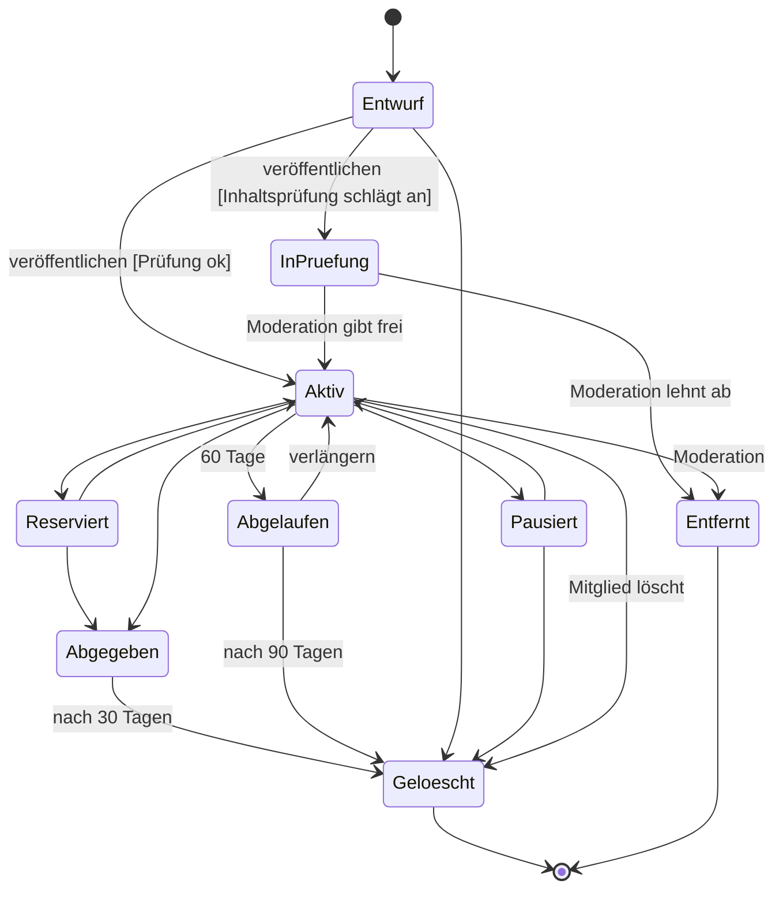
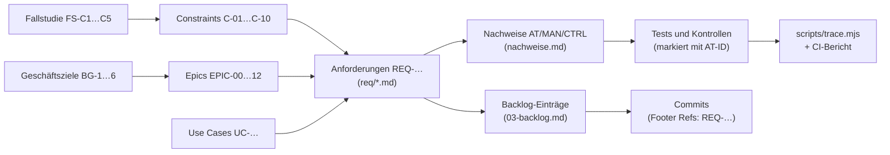

# Anforderungskatalog

> **v1.0:** Umstellung auf **eine Datei pro Anforderung** mit maschinenlesbarem Front Matter (Guideline Kap. 01, Review D-2) und Abgleich mit der Fallstudie MWI131 Kap. 2 ([00-fallstudie-abgleich.md](00-fallstudie-abgleich.md)). Die Inhalte des Katalogs v0.2 stehen vollständig in den Einzeldateien; der alte Stand ist in der Versionsverwaltung nachvollziehbar. Keine ID wurde umnummeriert oder gelöscht.

## Aufbau der Anforderungsdokumentation

| Dokument | Inhalt |
|---|---|
| [00-fallstudie-abgleich.md](00-fallstudie-abgleich.md) | Anforderungen der Fallstudie, Abweichungen, offene Entscheidung Q-12 |
| [01-use-cases.md](01-use-cases.md) | Akteure, Use-Case-Diagramme, Use-Case-Dokumente |
| **Dieses Dokument** | Geschäftsziele, Scope, Constraints, Zustandsmodell, Katalog-Index |
| [req/](req/) | Je Anforderung eine Datei (Vorlage: [req/_TEMPLATE.md](req/_TEMPLATE.md)) |
| [nachweise.md](nachweise.md) | Katalog der Nachweise (Tests, manuelle Prüfungen, Kontrollen) |
| [03-backlog.md](03-backlog.md) | Product Backlog mit Kano, Risiko, Abhängigkeiten, Story Points, WSJF; Release-Plan |
| [04-vorgehen.md](04-vorgehen.md) | Vorgehensmodell, Definition of Ready/Done, Schätzung, Nachverfolgbarkeit, Change-Management |

**Darstellung je Typ (Guideline Kap. 01):** User Stories mit Akzeptanzkriterien (Given–When–Then) und INVEST-Prüfung, Geschäftsregeln mit Entscheidungstabelle, Datenanforderungen mit Schema und Grenzwerten, Qualitätsanforderungen mit **Qualitätsmerkmal, Metrik, Akzeptanzkriterium, Messverfahren und -kontext** (Fallstudie FS-M3), Sicherheitsanforderungen als Kontrolle oder Abuse Case, Architektur-Constraints als Shall-Satz mit ADR und Konformitätsprüfung.

**Klassen (Fallstudie FS-M2):** `functional` (was das System leistet), `quality` (wie gut), `domain` (Regeln des Problembereichs, z. B. Whitelist, Nutzertypen, Campus-Standorte, Preistypen), `constraint` (vorgegebene Beschränkungen, z. B. aus der Fallstudie, aus Gesetzen oder vom Auftraggeber).

**Kano (Fallstudie FS-M4):** `basis` (Fehlen erzeugt Unzufriedenheit, z. B. Datenschutz, Zugangsbeschränkung), `leistung` (mehr ist besser, z. B. Suchqualität, Antwortzeit), `begeisterung` (unerwartet, z. B. Echtzeit-Lesestatus), `n/a` (nicht kundenwirksam, z. B. Betrieb und Architektur).

## 1. Geschäftsziele (Traceability-Anker)

| ID | Ziel | Messgröße |
|---|---|---|
| BG-1 | Vertrauenswürdiger Marktplatz nur für Hochschulangehörige | 100 % der aktiven Konten mit verifizierter Whitelist-Domain |
| BG-2 | Niedrige Einstiegshürde | Usability-Test mit 5 Studierenden: Registrierung + erste Anzeige in < 5 min ohne Hilfe |
| BG-3 | Abschlüsse ermöglichen | Ablauf „Anzeige → Chat → reserviert → abgegeben“ im Beispiel vollständig vorführbar (E2E-Test) |
| BG-4 | Rechtskonform **konzipiert** (Privacy by Design, Barrierefreiheit) | DSGVO-Betroffenenrechte, DSA-Meldeverfahren und Tastaturbedienbarkeit umgesetzt und getestet |
| BG-5 | Erweiterbarkeit | Bezahlung, weitere Hochschulen, Hochschul-SSO und Echtbetrieb ohne Umbau des Kerns nachrüstbar |
| BG-6 | Vorführbarkeit | Ein Befehl startet ein vollständig befülltes Beispiel |

## 2. Scope: Prozesse im und außerhalb des Prototyps

Antwort auf Aufgabe II a) der Fallstudie. „Im Scope“ heißt: im Release R1 prototypisch umgesetzt und im Docker-Beispiel vorführbar.

| Prozess | Prozessschritte im Scope | Out of Scope (R1) | Anforderungen |
|---|---|---|---|
| P1 Zugang | Registrieren mit Hochschuladresse, Adresse bestätigen, Anmelden, Abmelden, Passwort zurücksetzen | Anmeldung per Hochschul-SSO (Q-12, Option C: Port vorbereitet), Re-Verifikation nach 12 Monaten (S, nachgelagert), MFA | REQ-AUTH-*, REQ-SEC-002…005 |
| P2 Anbieten | Angebot/Gesuch erstellen inkl. Bilder, automatische Inhaltsprüfung, bearbeiten, pausieren, verlängern, löschen, Ablauf | HEIC-Fotos (Konvertierung), teilbarer Vorschau-Link für Nicht-Mitglieder (C) | REQ-LST-*, REQ-SEC-011 |
| P3 Finden | Freitextsuche, Filter, Sortierung, Merkliste | Suchaufträge mit E-Mail-Digest (C) | REQ-SRCH-* |
| P4 Kontakt und Absprache | Anbieter kontaktieren, Nachrichten in Echtzeit, Lesestatus, **Kontaktdaten nach beidseitiger Zustimmung freigeben**, für Interessenten reservieren, als abgegeben markieren | Bilder im Chat (C), strukturierter Preisvorschlag (C), Web-Push (C) | REQ-CHAT-*, REQ-NOTI-* |
| P5 Übergabe und Abschluss | Abschluss im System markieren (Deal) | Die Übergabe selbst (offline auf dem Campus), Bezahlung (EPIC-09), Versand, Bewertungen (C) | REQ-CHAT-009, REQ-ARCH-001/002 |
| P6 Vertrauen und Moderation | Melden, automatisch ausblenden, Moderations-Queue, Entscheidung mit Begründung, Blockieren, Sperren | Widerspruchsverfahren als eigener Ablauf (per E-Mail-Antwort), Bewertungen | REQ-MOD-* |
| P7 Konto und Datenschutz | Profil pflegen, Daten exportieren, Konto mit Karenz löschen, Benachrichtigungen abbestellen | Profilbild (Should, nachgelagert) | REQ-ACC-*, REQ-PRIV-* |
| P8 Administration | Rollen vergeben, Audit-Log, Job-Übersicht, Demo-Werkzeug | Whitelist- und Kategorienverwaltung per Oberfläche (C) | REQ-MOD-007/008, REQ-DEMO-* |
| P9 Betrieb | Start per Docker Compose, Migrationen, Health, Logs, Metriken | Öffentliches Hosting und alle Betreiberpflichten (EPIC-12), weitere Hochschulen (EPIC-10), native Apps (EPIC-11), gewerbliche Anbieter, Wohnungsbörse, Werbung | REQ-OPS-*, REQ-ARCH-005/006 |

## 3. Constraints und ihre Operationalisierung

Antwort auf Aufgabe II b) der Fallstudie: Jeder vorgegebene Constraint wird in überprüfbare Anforderungen überführt (Operationalisierung, FS-C5). Die Nachweise stehen in den verlinkten Anforderungen und im [Nachweiskatalog](nachweise.md); `node scripts/trace.mjs` prüft die Kette automatisch.

| ID | Constraint | Quelle | Operationalisiert in | Prüfbarkeit |
|---|---|---|---|---|
| C-01 | Kontaktdaten von Käufern und Verkäufern erst nach beidseitiger Zustimmung sichtbar | Fallstudie FS-C1 | REQ-CHAT-010, REQ-PRIV-002, REQ-CHAT-001 | Automatisierter Test: einseitige Zustimmung → keine Adresse; beidseitig → Adresse; Widerruf → ausgeblendet; Fremde → 404 |
| C-02 | Angebotsformular und zentrale Funktionen vollständig per Tastatur bedienbar und barrierearm | Fallstudie FS-C2, BITV 2.0 | REQ-A11Y-002, REQ-A11Y-001 | Automatisierter Browser-Test nur mit Tastatur über alle Kernabläufe; axe-core 0 Verstöße `serious`/`critical`; manueller Screenreader-Durchlauf |
| C-03 | Anmeldung über die Hochschulkennung | Fallstudie FS-C3 | REQ-AUTH-001, REQ-AUTH-002, REQ-AUTH-009 | Entscheidungstabellen-Test BR-01; offene Entscheidung Q-12 |
| C-04 | Angebote ausschließlich von verifizierten Nutzern | Fallstudie FS-C4 | REQ-SEC-011, REQ-AUTH-002 | Abuse-Case-Tests: unverifiziert, gesperrt, Löschung beantragt, ohne Sitzung → kein Angebot möglich |
| C-05 | Zugang nur für Hochschulangehörige mit Whitelist-Domain | Auftraggeber | REQ-AUTH-001, REQ-AUTH-008, REQ-ARCH-003 | Entscheidungstabellen-Test, Smoke-Test mit fremder Domain |
| C-06 | Kein öffentliches Hosting; Auslieferung als Docker-Beispiel, offline lauffähig | Auftraggeber (ADR-0010) | REQ-ARCH-005, REQ-OPS-001…005, REQ-DEMO-001 | Smoke-Test gegen frisch gestartetes Compose-Setup |
| C-07 | Bezahlung später ohne Umbau nachrüstbar; keine Kundengelder auf der Plattform | Auftraggeber, ZAG | REQ-ARCH-001, REQ-ARCH-002 | Architektur-Konformitätsprüfung (Modulgrenzen), Review gegen ADR-0006 |
| C-08 | Datenschutz nach DSGVO (Privacy by Design) | Gesetz | REQ-PRIV-001…007, REQ-ACC-002/003 | Export- und Löschtests, Audit-Log-Prüfung, Netzwerk-Scan ohne Drittanbieter |
| C-09 | Melde- und Abhilfeverfahren nach DSA | Gesetz | REQ-MOD-001…003 | Akzeptanztests Melden/Entscheiden, Audit-Log unveränderlich |
| C-10 | Vorgaben der DEV Guideline | Projekt | REQ-MAINT-002, REQ-ARCH-006, REQ-SEC-008 | Fitness Functions in CI |

## 4. Zustandsmodell Anzeige (normativ)

Referenziert von REQ-LST-006, REQ-LST-007, REQ-LST-008, REQ-LST-010 und REQ-MOD-002.

## 5. Traceability

## 6. Katalog-Index

<!-- req-index:start (generiert mit `node scripts/trace.mjs --write`, nicht von Hand bearbeiten) -->

**Stand:** 100 Anforderungen · R1-Must verifiziert: 0 von 70 (0 %)

| Status | Stufe (Vorlesung) | Anzahl |
|---|---|---|
| draft | Platzhalter | 4 |
| in-review | Konkretisiert | 36 |
| implemented | Umsetzung | 60 |

| ID | Titel | Klasse | MoSCoW (R1) | Kano | Risiko | Status | Nachweise |
|---|---|---|---|---|---|---|---|
| [REQ-A11Y-001](req/REQ-A11Y-001.md) | Barrierefreiheit nach WCAG 2.2 AA | quality | M | basis | high | in-review | AT-A11Y-001, MAN-A11Y-001 |
| [REQ-A11Y-002](req/REQ-A11Y-002.md) | Vollständige Tastaturbedienbarkeit der Kernabläufe | constraint | M | basis | high | draft | AT-A11Y-002, AT-A11Y-002-2, MAN-A11Y-002 |
| [REQ-ACC-001](req/REQ-ACC-001.md) | Profil pflegen | functional | M | basis | low | in-review | AT-ACC-001 |
| [REQ-ACC-002](req/REQ-ACC-002.md) | Konto löschen mit Karenzzeit | functional | M | basis | high | in-review | AT-ACC-002, AT-ACC-002-2 |
| [REQ-ACC-003](req/REQ-ACC-003.md) | Daten exportieren | functional | S | leistung | medium | implemented | AT-ACC-003 |
| [REQ-ARCH-001](req/REQ-ARCH-001.md) | Bezahlung als späteres Modul hinter einem Port | constraint | M | n/a | high | implemented | CTRL-DEPCRUISE, MAN-ARCH-001 |
| [REQ-ARCH-002](req/REQ-ARCH-002.md) | Keine Verwahrung von Kundengeldern | constraint | M | n/a | high | in-review | MAN-ARCH-002 |
| [REQ-ARCH-003](req/REQ-ARCH-003.md) | Whitelist als Daten statt Code | domain | M | n/a | medium | implemented | AT-ARCH-003 |
| [REQ-ARCH-004](req/REQ-ARCH-004.md) | Mandantenfähigkeit vorbereitet | domain | S | n/a | low | implemented | MAN-ARCH-004 |
| [REQ-ARCH-005](req/REQ-ARCH-005.md) | Auslieferung als lokales Docker-Compose-Setup | constraint | M | n/a | high | implemented | AT-ARCH-005 |
| [REQ-ARCH-006](req/REQ-ARCH-006.md) | Vereinfachte Infrastruktur hinter Ports | constraint | M | n/a | medium | implemented | CTRL-DEPCRUISE |
| [REQ-AUTH-001](req/REQ-AUTH-001.md) | Registrierung nur mit Hochschul-Domain (BR-01) | domain | M | basis | high | implemented | AT-AUTH-001, AT-AUTH-001-2 |
| [REQ-AUTH-002](req/REQ-AUTH-002.md) | Hochschuladresse per Link bestätigen | functional | M | basis | high | implemented | AT-AUTH-002, AT-AUTH-002-2, AT-AUTH-002-3 |
| [REQ-AUTH-003](req/REQ-AUTH-003.md) | Nutzertyp aus der Domain ableiten | domain | S | n/a | low | implemented | AT-AUTH-003, AT-AUTH-003-2 |
| [REQ-AUTH-004](req/REQ-AUTH-004.md) | Keine Offenlegung bestehender Konten | quality | M | basis | high | implemented | AT-AUTH-004, AT-AUTH-004-2 |
| [REQ-AUTH-005](req/REQ-AUTH-005.md) | Anmelden und Abmelden | functional | M | basis | medium | implemented | AT-AUTH-005, AT-AUTH-005-2 |
| [REQ-AUTH-006](req/REQ-AUTH-006.md) | Passwort per E-Mail-Link zurücksetzen | functional | M | basis | medium | implemented | AT-AUTH-006 |
| [REQ-AUTH-007](req/REQ-AUTH-007.md) | Mitgliedschaft jährlich re-verifizieren | domain | S | n/a | medium | in-review | AT-AUTH-007 |
| [REQ-AUTH-008](req/REQ-AUTH-008.md) | Gesperrte Adressen nicht erneut registrieren | functional | M | basis | medium | implemented | AT-AUTH-008 |
| [REQ-AUTH-009](req/REQ-AUTH-009.md) | Anmeldeverfahren austauschbar (Hochschulkennung) | constraint | S | n/a | high | draft | CTRL-DEPCRUISE, AT-AUTH-009 |
| [REQ-AVAIL-001](req/REQ-AVAIL-001.md) | Verfügbarkeit der kritischen Funktionen | quality | W | basis | medium | in-review | AT-AVAIL-001 |
| [REQ-AVAIL-002](req/REQ-AVAIL-002.md) | Wiederherstellungsziele der Datenhaltung | quality | W | n/a | medium | in-review | MAN-AVAIL-002 |
| [REQ-CHAT-001](req/REQ-CHAT-001.md) | Anbieter über anzeigenbezogenen Chat kontaktieren | functional | M | basis | high | implemented | AT-CHAT-001, AT-CHAT-001-2, AT-CHAT-001-3, AT-CHAT-001-4 |
| [REQ-CHAT-002](req/REQ-CHAT-002.md) | Genau eine Konversation pro Anzeige und Interessent | functional | M | basis | medium | implemented | AT-CHAT-002 |
| [REQ-CHAT-003](req/REQ-CHAT-003.md) | Nachrichten in Echtzeit empfangen | functional | M | leistung | medium | implemented | AT-CHAT-003, AT-CHAT-003-2 |
| [REQ-CHAT-004](req/REQ-CHAT-004.md) | Nachrichten genau einmal anzeigen, keine verlieren | quality | M | basis | medium | implemented | AT-CHAT-004, AT-CHAT-004-2 |
| [REQ-CHAT-005](req/REQ-CHAT-005.md) | Ungelesene Nachrichten erkennen | functional | S | leistung | low | implemented | AT-CHAT-005 |
| [REQ-CHAT-006](req/REQ-CHAT-006.md) | Sicherheitshinweis bei Links, IBAN und Telefonnummern | functional | S | basis | low | implemented | AT-CHAT-006 |
| [REQ-CHAT-007](req/REQ-CHAT-007.md) | Begrenzung von Nachrichtenlänge und Sendehäufigkeit | constraint | M | n/a | medium | implemented | AT-CHAT-007, AT-CHAT-007-2 |
| [REQ-CHAT-008](req/REQ-CHAT-008.md) | Bilder im Chat senden | functional | C | begeisterung | medium | in-review | AT-CHAT-008 |
| [REQ-CHAT-009](req/REQ-CHAT-009.md) | Preisvorschlag und Reservierung (Deal) im Chat | functional | C | begeisterung | low | in-review | AT-CHAT-009, AT-CHAT-009-2 |
| [REQ-CHAT-010](req/REQ-CHAT-010.md) | Kontaktdaten erst nach beidseitiger Zustimmung freigeben | constraint | M | basis | high | draft | AT-CHAT-010, AT-CHAT-010-2 |
| [REQ-DEMO-001](req/REQ-DEMO-001.md) | Demo-Daten auf Knopfdruck | functional | M | n/a | low | implemented | AT-DEMO-001 |
| [REQ-DEMO-002](req/REQ-DEMO-002.md) | Zeitgesteuerte Abläufe sofort auslösen | functional | S | n/a | low | implemented | AT-DEMO-002 |
| [REQ-LST-001](req/REQ-LST-001.md) | Angebot oder Gesuch schnell erstellen | functional | M | basis | medium | implemented | AT-LST-001, MAN-LST-001 |
| [REQ-LST-002](req/REQ-LST-002.md) | Preistypen und Preisgrenzen | domain | M | basis | low | implemented | AT-LST-002, AT-LST-002-2 |
| [REQ-LST-003](req/REQ-LST-003.md) | Bilder hochladen, Metadaten entfernen, Vorschaubilder | functional | M | leistung | medium | in-review | AT-LST-003, AT-LST-003-2, AT-LST-003-3 |
| [REQ-LST-004](req/REQ-LST-004.md) | Übergabeort aus Campus-Standorten | domain | M | basis | low | implemented | AT-LST-004 |
| [REQ-LST-005](req/REQ-LST-005.md) | Studienbezogene Attribute für Bücher und Skripte | domain | S | begeisterung | low | implemented | AT-LST-005 |
| [REQ-LST-006](req/REQ-LST-006.md) | Eigene Anzeige bearbeiten, pausieren, reaktivieren, löschen | functional | M | basis | low | implemented | AT-LST-006, AT-LST-006-2 |
| [REQ-LST-007](req/REQ-LST-007.md) | Anzeige als reserviert oder abgegeben markieren | functional | M | basis | low | implemented | AT-LST-007, AT-LST-007-2 |
| [REQ-LST-008](req/REQ-LST-008.md) | Ablauf, Erinnerung, Verlängerung und Löschfristen von Anzeigen | functional | S | leistung | low | implemented | AT-LST-008 |
| [REQ-LST-009](req/REQ-LST-009.md) | Teilbarer Link mit Vorschau für Nicht-Mitglieder | functional | C | begeisterung | medium | in-review | AT-LST-009 |
| [REQ-LST-010](req/REQ-LST-010.md) | Verbotene Inhalte vor Veröffentlichung in die Moderation | constraint | M | basis | medium | implemented | AT-LST-010, AT-LST-010-2 |
| [REQ-LST-011](req/REQ-LST-011.md) | Höchstens 30 aktive Anzeigen pro Mitglied | functional | S | n/a | low | implemented | AT-LST-011 |
| [REQ-MAINT-001](req/REQ-MAINT-001.md) | Testabdeckung der Fachlogik | quality | S | n/a | medium | in-review | CTRL-COVERAGE, CTRL-MUTATION |
| [REQ-MAINT-002](req/REQ-MAINT-002.md) | Geprüfte Modulgrenzen | constraint | M | n/a | medium | implemented | CTRL-DEPCRUISE |
| [REQ-MOD-001](req/REQ-MOD-001.md) | Inhalte und Mitglieder melden | functional | M | basis | high | implemented | AT-MOD-001, AT-MOD-001-2 |
| [REQ-MOD-002](req/REQ-MOD-002.md) | Moderations-Queue bearbeiten | functional | M | basis | high | implemented | AT-MOD-002, AT-MOD-002-2 |
| [REQ-MOD-003](req/REQ-MOD-003.md) | Entscheidungen begründen und unveränderlich protokollieren | constraint | M | basis | high | implemented | AT-MOD-003, AT-MOD-003-2 |
| [REQ-MOD-004](req/REQ-MOD-004.md) | Vorläufiges Ausblenden ab drei Meldungen | functional | S | basis | medium | in-review | AT-MOD-004 |
| [REQ-MOD-005](req/REQ-MOD-005.md) | Mitglieder blockieren | functional | S | leistung | medium | implemented | AT-MOD-005 |
| [REQ-MOD-006](req/REQ-MOD-006.md) | Übergabepartner bewerten | functional | C | begeisterung | medium | in-review | AT-MOD-006 |
| [REQ-MOD-007](req/REQ-MOD-007.md) | Rollen vergeben und entziehen | functional | M | n/a | high | implemented | AT-MOD-007, AT-MOD-007-2 |
| [REQ-MOD-008](req/REQ-MOD-008.md) | Whitelist-Domains über eine Oberfläche verwalten | domain | C | n/a | medium | in-review | AT-MOD-008 |
| [REQ-NOTI-001](req/REQ-NOTI-001.md) | Transaktionale E-Mails | functional | M | basis | high | in-review | AT-NOTI-001, AT-NOTI-001-2 |
| [REQ-NOTI-002](req/REQ-NOTI-002.md) | Gebündelte Benachrichtigung über neue Nachrichten ohne Inhalt | functional | M | leistung | medium | implemented | AT-NOTI-002 |
| [REQ-NOTI-003](req/REQ-NOTI-003.md) | Benachrichtigungen pro Kategorie abbestellen | functional | S | leistung | low | implemented | AT-NOTI-003 |
| [REQ-NOTI-004](req/REQ-NOTI-004.md) | Authentifizierter E-Mail-Versand (SPF, DKIM, DMARC) | quality | W | basis | high | in-review | MAN-NOTI-004 |
| [REQ-NOTI-005](req/REQ-NOTI-005.md) | Zuverlässige E-Mail-Zustellung | quality | M | basis | medium | implemented | AT-NOTI-005, CTRL-DLQ |
| [REQ-NOTI-006](req/REQ-NOTI-006.md) | Web-Push-Benachrichtigungen | functional | C | begeisterung | low | in-review | AT-NOTI-006 |
| [REQ-NOTI-007](req/REQ-NOTI-007.md) | Mailserver per Konfiguration austauschbar | constraint | M | n/a | low | implemented | AT-NOTI-007 |
| [REQ-OPS-001](req/REQ-OPS-001.md) | Gesundheitsprüfung und geordnetes Herunterfahren | quality | M | n/a | medium | implemented | AT-OPS-001, AT-OPS-001-2 |
| [REQ-OPS-002](req/REQ-OPS-002.md) | Beobachtbarkeit ohne personenbezogene Daten | quality | M | n/a | medium | in-review | AT-OPS-002, MAN-OPS-002 |
| [REQ-OPS-003](req/REQ-OPS-003.md) | Schnellstart und Fehlerbehebung dokumentiert | quality | M | n/a | low | implemented | MAN-OPS-003 |
| [REQ-OPS-004](req/REQ-OPS-004.md) | Reproduzierbarer, versionierter Image-Build | quality | M | n/a | medium | in-review | CTRL-CI-IMAGE |
| [REQ-OPS-005](req/REQ-OPS-005.md) | Automatische, idempotente Datenbankmigration | quality | M | n/a | medium | implemented | AT-OPS-005 |
| [REQ-PERF-001](req/REQ-PERF-001.md) | Antwortzeit der Suche | quality | M | leistung | medium | in-review | AT-PERF-001 |
| [REQ-PERF-002](req/REQ-PERF-002.md) | Zustellzeit von Chatnachrichten | quality | M | leistung | medium | in-review | AT-PERF-002 |
| [REQ-PERF-003](req/REQ-PERF-003.md) | Antwortzeit beim Erstellen einer Anzeige | quality | M | leistung | low | in-review | AT-PERF-003 |
| [REQ-PERF-004](req/REQ-PERF-004.md) | Zeit bis zum Versand der Bestätigungsmail | quality | M | basis | medium | in-review | AT-PERF-004 |
| [REQ-PERF-005](req/REQ-PERF-005.md) | Ladeverhalten der Oberfläche | quality | M | leistung | low | in-review | AT-PERF-005 |
| [REQ-PORT-001](req/REQ-PORT-001.md) | Entwicklungsumgebung mit einem Befehl | quality | M | n/a | low | implemented | MAN-PORT-001 |
| [REQ-PORT-002](req/REQ-PORT-002.md) | Lauffähig auf x86- und ARM-Rechnern | quality | M | n/a | medium | in-review | CTRL-CI-MULTIARCH |
| [REQ-PRIV-001](req/REQ-PRIV-001.md) | Versionierte Einwilligungen | constraint | M | n/a | medium | implemented | AT-PRIV-001 |
| [REQ-PRIV-002](req/REQ-PRIV-002.md) | Datenminimierung und Schutz der Kontaktdaten | constraint | M | basis | high | in-review | AT-PRIV-002, AT-PRIV-002-2 |
| [REQ-PRIV-003](req/REQ-PRIV-003.md) | Löschkonzept mit Fristen je Datenkategorie | constraint | M | n/a | high | in-review | AT-PRIV-003, AT-PRIV-003-2 |
| [REQ-PRIV-004](req/REQ-PRIV-004.md) | Moderation sieht nur gemeldeten Chat-Kontext | constraint | M | basis | high | implemented | AT-PRIV-004 |
| [REQ-PRIV-005](req/REQ-PRIV-005.md) | Hosting und Auftragsverarbeiter in der EU | constraint | W | n/a | high | in-review | MAN-PRIV-005 |
| [REQ-PRIV-006](req/REQ-PRIV-006.md) | Kein Tracking, keine Drittanbieter-Ressourcen | constraint | M | basis | medium | implemented | AT-PRIV-006, AT-PRIV-006-2 |
| [REQ-PRIV-007](req/REQ-PRIV-007.md) | Prüfung der Datenschutz-Folgenabschätzung | constraint | W | n/a | medium | in-review | MAN-PRIV-007 |
| [REQ-SEC-001](req/REQ-SEC-001.md) | OWASP ASVS Level 2 | quality | M | basis | high | in-review | MAN-SEC-001 |
| [REQ-SEC-002](req/REQ-SEC-002.md) | Passwörter mit Argon2id speichern | constraint | M | n/a | high | implemented | AT-SEC-002 |
| [REQ-SEC-003](req/REQ-SEC-003.md) | Passwortrichtlinie | constraint | M | basis | medium | implemented | AT-SEC-003 |
| [REQ-SEC-004](req/REQ-SEC-004.md) | Sichere Sitzungen und CSRF-Schutz | quality | M | basis | high | implemented | AT-SEC-004, AT-SEC-004-2, AT-SEC-004-3 |
| [REQ-SEC-005](req/REQ-SEC-005.md) | Begrenzung von Anfragen (Rate-Limits) | quality | M | n/a | high | implemented | AT-SEC-005, AT-SEC-005-2 |
| [REQ-SEC-006](req/REQ-SEC-006.md) | Autorisierung pro Ressource, standardmäßig verweigern | quality | M | basis | high | implemented | AT-SEC-006, AT-SEC-006-2 |
| [REQ-SEC-007](req/REQ-SEC-007.md) | Sicherer Umgang mit hochgeladenen Bildern | quality | M | basis | medium | in-review | AT-SEC-007, AT-SEC-007-2, AT-SEC-007-3, AT-SEC-007-4 |
| [REQ-SEC-008](req/REQ-SEC-008.md) | Sicherheitsprüfungen in der CI-Pipeline | constraint | M | n/a | medium | in-review | CTRL-CI-SCAN |
| [REQ-SEC-009](req/REQ-SEC-009.md) | Threat Model für Registrierung, Chat und Upload | constraint | M | n/a | high | in-review | MAN-SEC-009 |
| [REQ-SEC-010](req/REQ-SEC-010.md) | Gehärtetes Anwendungs-Image | constraint | M | n/a | medium | implemented | CTRL-IMAGE-INSPECT |
| [REQ-SEC-011](req/REQ-SEC-011.md) | Angebote nur von verifizierten Mitgliedern | constraint | M | basis | high | draft | AT-SEC-011, AT-SEC-011-2 |
| [REQ-SRCH-001](req/REQ-SRCH-001.md) | Freitextsuche mit Wortstämmen und Tippfehlertoleranz | functional | M | leistung | medium | implemented | AT-SRCH-001, AT-SRCH-001-2 |
| [REQ-SRCH-002](req/REQ-SRCH-002.md) | Filtern und Sortieren | functional | M | leistung | low | implemented | AT-SRCH-002 |
| [REQ-SRCH-003](req/REQ-SRCH-003.md) | Aktualität der Suche | quality | S | leistung | low | implemented | AT-SRCH-003 |
| [REQ-SRCH-004](req/REQ-SRCH-004.md) | Anzeigen merken | functional | S | leistung | low | implemented | AT-SRCH-004 |
| [REQ-SRCH-005](req/REQ-SRCH-005.md) | Suchaufträge mit täglicher E-Mail | functional | C | begeisterung | low | in-review | AT-SRCH-005 |
| [REQ-SRCH-006](req/REQ-SRCH-006.md) | Keine Anzeigen blockierter oder gesperrter Nutzer in der Suche | functional | M | basis | medium | implemented | AT-SRCH-006 |
| [REQ-UX-001](req/REQ-UX-001.md) | Mobile Nutzung und Installierbarkeit | quality | M | basis | medium | implemented | AT-UX-001, AT-UX-001-2 |
| [REQ-UX-002](req/REQ-UX-002.md) | Deutsche Oberfläche, übersetzbar vorbereitet | quality | M | basis | low | in-review | MAN-UX-002 |

<!-- req-index:end -->
