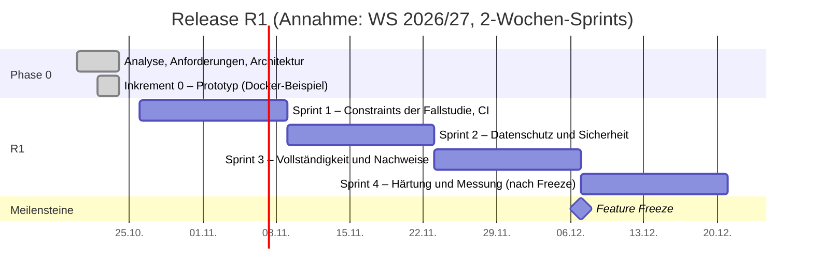

# Product Backlog und Release-Planung

Das Product Backlog sammelt alle offenen Arbeiten, geordnet nach Abhängigkeiten und **WSJF** innerhalb des per MoSCoW festgelegten Release-Umfangs (Verfahren: [04-vorgehen.md §4–5](04-vorgehen.md#4-aufwandsschätzung)). Jeder Eintrag verweist auf Anforderungen in [req/](req/); der Status der Anforderungen steht im [Katalog-Index](02-anforderungen.md#6-katalog-index). Oben stehen konkretisierte Einträge, unten Platzhalter (Fallstudie FS-M12).

## 1. Epics

| Epic | Titel | Ziel | Release |
|---|---|---|---|
| EPIC-00 | Fundament & Docker-Beispiel | Repo, CI, Dockerfile + Compose (app, db, mailpit), Seed-Daten, Threat Model | R1 + laufend |
| EPIC-01 | Registrierung & Authentifizierung | Nur verifizierte Hochschulangehörige | R1 |
| EPIC-02 | Anzeigen | Angebote und Gesuche inkl. Tausch und Verschenken | R1 |
| EPIC-03 | Suche & Entdecken | Finden, Filtern, Merken, Suchaufträge | R1 / R2 |
| EPIC-04 | Chat | Anzeigenbezogene Echtzeit-Kommunikation inkl. Kontaktdaten-Freigabe | R1 |
| EPIC-05 | Benachrichtigungen & E-Mail | Zuverlässige Zustellung | R1 |
| EPIC-06 | Vertrauen & Moderation | Melden, Moderieren, Blockieren, Bewerten | R1 / R2 |
| EPIC-07 | Konto, Datenschutz & Barrierefreiheit | DSGVO-Rechte, Tastaturbedienbarkeit | R1 |
| EPIC-08 | Administration | Rollen, Whitelist-UI, Kategorien-UI, Statistiken | R1 / R2 |
| **EPIC-09** | **Bezahlung (Backlog)** | Optionale Online-Zahlung mit Käuferschutz | R4+ |
| **EPIC-10** | **Weitere Hochschulen (Backlog)** | Domains weiterer Hochschulen freischalten | R3+ |
| EPIC-11 | Native Apps (Backlog) | iOS/Android, falls die PWA nicht reicht | offen |
| **EPIC-12** | **Echtbetrieb (Backlog)** | Öffentliches Hosting inkl. Betreiberpflichten | nicht Teil des Projekts |

## 2. Product Backlog (R1)

**Spalten:** SP = Story Points · NW = Nutzerwert · ZK = Zeitkritikalität · RR = Risikoreduktion · CoD = NW + ZK + RR · WSJF = CoD / SP. Skala für NW, ZK, RR: 1, 2, 3, 5, 8, 13. **NW folgt strikt aus der Kano-Kategorie der ersten genannten Anforderung** (Basis 8, Leistung 5, Begeisterung 3, n/a 1); Kano und Risiko werden aus dem Front Matter übernommen und von `scripts/trace.mjs` gegengeprüft. ZK = 13 für Einträge, die die Fallstudie bis zur nächsten Veranstaltung verlangt. Die Story Points sind eine **Erstschätzung** (Analogie zum Prototyp) und werden im Refinement per Planning Poker bestätigt.

**Reihenfolge:** (1) Abhängigkeiten vor WSJF, (2) Spikes vor dem abhängigen Eintrag mit fester Timebox (ohne WSJF, eingeplant nach Zeitkritikalität), (3) sonst absteigend nach WSJF innerhalb des Sprints. **Ziel für die Verifikationsquote** (aus `trace.mjs`): ≥ 40 % der R1-Must nach Sprint 1, ≥ 70 % nach Sprint 3, 100 % vor der Abgabe.

| # | Eintrag | Typ | Anforderungen | Kano | Risiko | Abhängig von | SP | NW | ZK | RR | CoD | WSJF | Sprint |
|---|---|---|---|---|---|---|---|---|---|---|---|---|---|
| S-01 | **Spike** Q-12: Anmeldung über die Hochschulkennung mit dem RZ klären (SAML/OIDC, Attribute, Plus-Adressen Q-2) | Spike (Timebox 1 Tag) | REQ-AUTH-009 | – | – | – | 1 | – | 13 | 8 | – | – | 1 |
| B-03 | Angebote nur von verifizierten Nutzern: Abuse-Case-Tests (Anlegen, Bild-Upload, Bearbeiten) | Feature/Test | REQ-SEC-011 | basis | hoch | – | 2 | 8 | 13 | 8 | 29 | 14,5 | 1 |
| B-07 | CI-Grundgerüst: Typprüfung, Unit-Tests, `lint:deps`, `trace.mjs`, Image-Build, Smoke-Test gegen Compose | Enabler | REQ-OPS-004, REQ-ARCH-005, REQ-MAINT-002 | n/a | mittel | – | 2 | 1 | 13 | 8 | 22 | 11,0 | 1 |
| B-04 | Nachverfolgbarkeit: vorhandene Tests mit Nachweis-IDs markieren, Status pflegen | Enabler | alle mit vorhandenen Tests (FS-M14), u. a. REQ-ARCH-003, REQ-ARCH-006, REQ-AUTH-001, REQ-AUTH-004, REQ-CHAT-002, REQ-CHAT-003, REQ-CHAT-011, REQ-DEMO-001, REQ-LST-002, REQ-LST-003, REQ-LST-010, REQ-MOD-002, REQ-MOD-003, REQ-NOTI-001, REQ-NOTI-007, REQ-OPS-001, REQ-OPS-003, REQ-OPS-005, REQ-PRIV-004, REQ-PRIV-006, REQ-SEC-002, REQ-SEC-003, REQ-SEC-007, REQ-SEC-010, REQ-SRCH-001, REQ-UX-001 | – | – | B-07 | 3 | 1 | 13 | 5 | 19 | 6,3 | 1 |
| B-21 | Nachweise automatisieren EPIC-01 und Sicherheit (Abmelden, Reset, Sperre, Cookie-Eigenschaften, Rate-Limits, Autorisierung) | Test | REQ-AUTH-005, REQ-AUTH-006, REQ-AUTH-008, REQ-SEC-004, REQ-SEC-005, REQ-SEC-006 | basis | mittel | B-04 | 2 | 8 | 5 | 5 | 18 | 9,0 | 1 |
| B-01 | Kontaktdaten nach beidseitiger Zustimmung freigeben | Feature | REQ-CHAT-010, REQ-PRIV-002, REQ-CHAT-001 | basis | hoch | – | 5 | 8 | 13 | 5 | 26 | 5,2 | 1 |
| B-02 | Tastaturbedienbarkeit der Kernabläufe, automatisiert mit axe-core | Feature/Test | REQ-A11Y-002, REQ-A11Y-001 | basis | hoch | B-01 | 5 | 8 | 13 | 5 | 26 | 5,2 | 1 |
| B-34 | Rate-Limit Registrierung je Adresse und je IP (Q-18) | Feature | REQ-SEC-005 | n/a | hoch | – | 1 | 1 | 3 | 5 | 9 | 9,0 | 2 |
| B-22 | Kontolöschung: eigene Nachrichten löschen, Konversation für das Gegenüber erhalten („Ehemaliges Mitglied“) | Feature | REQ-ACC-002, REQ-PRIV-003 | basis | hoch | – | 3 | 8 | 3 | 8 | 19 | 6,3 | 2 |
| B-12 | Aufbewahrungsfristen: unbestätigte Konten (7 Tage), Chats, Meldungen, entfernte Anzeigen, Tokens, Audit-Log | Feature | REQ-PRIV-003, REQ-AUTH-002 | n/a | hoch | B-22 | 5 | 1 | 3 | 8 | 12 | 2,4 | 2 |
| B-16 | axe-core auf allen Routen und manueller Screenreader-Durchlauf (NVDA) | Test | REQ-A11Y-001 | basis | hoch | B-02 | 3 | 8 | 3 | 5 | 16 | 5,3 | 2 |
| B-09 | Threat Model (STRIDE) für Registrierung, Chat, Upload, Kontaktfreigabe | Enabler | REQ-SEC-009 | n/a | hoch | – | 3 | 1 | 5 | 8 | 14 | 4,7 | 2 |
| B-29 | Nachweise automatisieren EPIC-02/03 (Übergabeorte, Attribute, Limit, Filter, Merkliste, Blockierung in der Suche) | Test | REQ-LST-004, REQ-LST-005, REQ-LST-011, REQ-SRCH-002, REQ-SRCH-004, REQ-SRCH-006 | basis | niedrig | B-04 | 3 | 8 | 3 | 3 | 14 | 4,7 | 2 |
| B-32 | Zustandsmodell nachziehen: pausiert läuft nach 90 Tagen ab, Reservierung fällt nach 30 Tagen zurück, Löschen aus allen Zuständen außer entfernt | Feature | REQ-LST-008, REQ-LST-007, REQ-LST-006 | leistung | niedrig | – | 3 | 5 | 2 | 3 | 10 | 3,3 | 3 |
| B-30 | Nachweise automatisieren EPIC-04/05 (Nachladen, Grenzen, Bündelung, Ausfall des Mailservers) | Test | REQ-CHAT-004, REQ-CHAT-007, REQ-NOTI-002, REQ-NOTI-005 | basis | mittel | B-04 | 3 | 8 | 2 | 3 | 13 | 4,3 | 3 |
| B-31 | Nachweise automatisieren EPIC-06/07 (Melden, Ausblenden, Blockieren, Rollen, Profil, Löschung, Export) | Test | REQ-MOD-001, REQ-MOD-004, REQ-MOD-005, REQ-MOD-007, REQ-ACC-001, REQ-ACC-002 | basis | hoch | B-22 | 3 | 8 | 2 | 3 | 13 | 4,3 | 3 |
| B-15 | Ausblenden ab 3 Meldungen auch für Nachrichten und Profile | Feature | REQ-MOD-004 | basis | mittel | – | 3 | 8 | 2 | 3 | 13 | 4,3 | 3 |
| B-25 | Einwilligungen: veraltete Version ablehnen, erneute Zustimmung bei neuer Version | Feature/Test | REQ-PRIV-001 | n/a | mittel | – | 2 | 1 | 2 | 3 | 6 | 3,0 | 3 |
| B-05 | Anmeldung hinter `IdentityProviderPort` kapseln (ADR-0013) | Enabler | REQ-AUTH-009 | n/a | hoch | S-01 | 3 | 1 | 3 | 5 | 9 | 3,0 | 3 |
| B-08 | Multi-Arch-Image (amd64, arm64) im CI | Enabler | REQ-PORT-002 | n/a | mittel | B-07 | 2 | 1 | 3 | 3 | 7 | 3,5 | 3 |
| B-23 | ASVS-L2-Checkliste für die im Beispiel relevanten Kapitel | Test | REQ-SEC-001 | basis | hoch | B-09 | 3 | 8 | 2 | 5 | 15 | 5,0 | 4 |
| B-27 | Usability-Test „Anzeige in < 2 min“ mit 5 Studierenden | Test | REQ-LST-001 | basis | mittel | – | 2 | 8 | 2 | 2 | 12 | 6,0 | 4 |
| B-10 | Lasttests (k6) für Suche, Chat, Anzeige, Registrierung | Test | REQ-PERF-001, REQ-PERF-002, REQ-PERF-003, REQ-PERF-004 | leistung | mittel | B-07 | 5 | 5 | 2 | 3 | 10 | 2,0 | 4 |
| B-06 | CI-Sicherheitsscans: SAST, SCA, Secret-Scan, Image-Scan, SBOM | Enabler | REQ-SEC-008 | n/a | mittel | B-07 | 8 | 1 | 3 | 5 | 9 | 1,1 | 4 |
| B-18 | Testabdeckung und Mutation-Score messen | Enabler | REQ-MAINT-001 | n/a | mittel | B-07 | 2 | 1 | 2 | 2 | 5 | 2,5 | R2 |

**Release R2 (nicht in R1, Q-14):** B-11 Re-Verifikation (REQ-AUTH-007, 5 SP), B-13 Profilbild (REQ-ACC-004, 3 SP), S-02 Spike HEIC und B-14 HEIC-Fotos (REQ-LST-012, 1 + 8 SP), B-17 Texte in i18n-Ressourcen (REQ-UX-002, 5 SP), B-24 Lighthouse-Messung (REQ-PERF-005, 1 SP), B-26 zuschaltbares Tracing (REQ-OPS-002, 2 SP), B-18 Abdeckung/Mutation (falls R1-Kapazität fehlt).

**Platzhalter (Could, R2-Kandidaten):** REQ-CHAT-009 Preisvorschlag (5 SP), REQ-MOD-006 Bewertungen (5 SP), REQ-LST-009 Vorschau-Link (3 SP), REQ-MOD-008 Whitelist-Oberfläche (3 SP), REQ-CHAT-008 Bilder im Chat (5 SP), REQ-SRCH-005 Suchaufträge (8 SP), REQ-NOTI-006 Web-Push (8 SP). Werden erst konkretisiert, wenn sie in den Release-Umfang rücken.

**Erledigt (Inkrement 0, Prototyp vom 2026-10-23):** alle Anforderungen mit Status `implemented` bzw. `verified` im [Katalog-Index](02-anforderungen.md#6-katalog-index).

## 3. Release- und Sprint-Plan

| Sprint | Sprint-Ziel | Einträge | SP |
|---|---|---|---|
| 1 | Die Constraints der Fallstudie sind umgesetzt und automatisiert nachgewiesen; CI prüft jede Änderung | S-01, B-03, B-07, B-04, B-21, B-01, B-02 | 20 |
| 2 | Datenschutz- und Sicherheitslücken geschlossen | B-34, B-22, B-12, B-16, B-09, B-29 | 18 |
| 3 | Alle R1-Funktionen vollständig und nachgewiesen | B-25, B-32, B-30, B-31, B-15, B-05, B-08 | 19 |
| 4 | Nach Feature Freeze: nur Messung, Nachweise, Fehlerbehebung | B-23, B-27, B-10, B-06 | 18 |

## 4. Backlog: EPIC-09 Bezahlfunktion

**Ziel:** Optionale Online-Zahlung, z. B. für Beschäftigte, die nicht bar zahlen wollen, oder für spätere Versandabwicklung zwischen Hochschulen.

| ID | Item | Typ | Notiz |
|---|---|---|---|
| PAY-01 | **Spike:** PSP-Auswahl (Stripe Connect, Mangopay, Adyen for Platforms) nach Kriterien: Marktplatz-Lizenz, KYC-Flow, Gebühren, EU-Datenhaltung, Sandbox | Discovery | Ergebnis: ADR |
| PAY-02 | **Spike:** Rechtliche Prüfung: ZAG (keine eigene Geldverwahrung), DAC7/PStTG-Meldepflichten, Verbraucherrecht (Käuferschutz **nicht voreinstellen**), Gebührenmodell | Discovery | mit Hochschul-Justiziariat |
| PAY-03 | Als Anbieter möchte ich ein Auszahlungskonto beim PSP einrichten (KYC beim PSP, nicht bei uns) | User Story | UC-50 |
| PAY-04 | Als Interessent möchte ich einen angenommenen Preisvorschlag online bezahlen | User Story | UC-51, baut auf REQ-CHAT-009 (Deal) auf |
| PAY-05 | Als Käufer möchte ich den Erhalt bestätigen, damit die Zahlung freigegeben wird (sonst automatische Freigabe nach X Tagen) | User Story | UC-52 |
| PAY-06 | Als Käufer möchte ich eine Zahlung reklamieren (Dispute) | User Story | UC-53 |
| PAY-07 | Webhook-Empfang mit Signaturprüfung, Idempotenz und Outbox | Technisch | ADR-0006 |
| PAY-08 | Revisionssicheres Zahlungs-Ledger (append-only) | Datenanforderung | ADR-0006 |
| PAY-09 | DAC7-Meldedaten erfassen, falls Schwellen überschritten werden (30 Verkäufe oder 2.000 € pro Jahr) | Rechtlich | abhängig von PAY-02 |

**Vorleistungen im MVP** (damit EPIC-09 später additiv ist): Deal-Konzept, Domain Events `DealAgreed`, `DealCompleted`, `DealCancelled`, Geldbeträge als Integer in Cent mit Währung, Ports & Adapters (REQ-ARCH-001/002).

## 5. Backlog: EPIC-10 Weitere Hochschulen

| ID | Item | Notiz |
|---|---|---|
| INST-01 | Whitelist-Verwaltung per Admin-UI (REQ-MOD-008) | Daten bereits mandantenfähig (REQ-ARCH-004) |
| INST-02 | Entscheidung: **eine** gemeinsame Community (Metropolregion Rhein-Neckar) oder **getrennte** Communities pro Hochschule | Produktentscheidung |
| INST-03 | Campus-Standorte pro Institution | Datenmodell vorbereitet |
| INST-04 | Anmeldung über Hochschul-SSO (DFN-AAI / Shibboleth, SAML oder OIDC) | hängt an Q-12 / S-01, REQ-AUTH-009 |
| INST-05 | Onboarding-Prozess für neue Hochschulen (Ansprechpartner, Moderation vor Ort) | Organisatorisch |

## 6. Backlog: EPIC-12 Echtbetrieb (nicht Teil des Projekts)

| ID | Item | Bezug |
|---|---|---|
| OPS-01 | Betreiber klären (Hochschule, AStA), Impressum (DDG), Datenschutzerklärung, AGB, Nutzungsregeln | Review O-1 |
| OPS-02 | Hosting in der EU / im Hochschul-RZ, AV-Verträge | REQ-PRIV-005 |
| OPS-03 | Echter SMTP-Relay mit SPF/DKIM/DMARC, Bounce-Verarbeitung | REQ-NOTI-004 |
| OPS-04 | Verfügbarkeits-SLO, RTO/RPO, Backups mit PITR, Restore-Übung | REQ-AVAIL-001/002 |
| OPS-05 | Monitoring, Alarme, Runbooks, Incident-Prozess | Guideline Kap. 11 |
| OPS-06 | Skalierung: `api`/`worker` getrennt, `PgNotifyAdapter`, S3-Adapter | ADR-0004, 0007 |
| OPS-07 | DSFA-Prüfung, DSA-Prozesse mit realen Moderator/innen | REQ-PRIV-007 |
| OPS-08 | Hochschul-SSO | INST-04 |

## 7. Ideen (ungepriorisiert)

- Kategorie „Leihen“ (z. B. Taschenrechner für die Klausur, Werkzeug)
- Semesterstart-Kampagne „Erstsemester-Paket“
- Englische Oberfläche (REQ-UX-002)
- Nachhaltigkeits-Statistik („X kg Re-Use“)
- Übergabe-Bestätigung per QR-Code auf dem Campus
