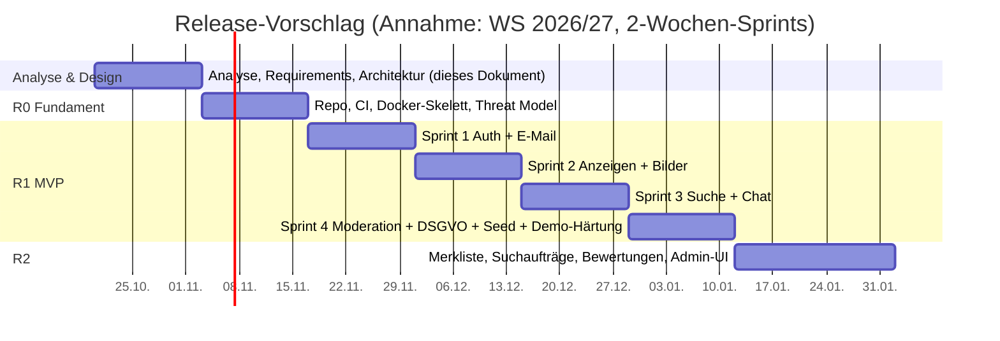

# Backlog & Release-Planung

MoSCoW gilt **pro Release** (Guideline Kap. 01, MoSCoW-Governance). Die Releases sind Vorschläge und hängen vom Semesterplan ab (Q-5).

## 1. Epics

| Epic | Titel | Ziel | Release |
|---|---|---|---|
| EPIC-00 | Fundament & Docker-Beispiel | Repo, CI, Dockerfile + Compose (app, db, mailpit), Seed-Daten, Threat Model | R0 + laufend |
| EPIC-01 | Registrierung & Authentifizierung | Nur verifizierte Hochschulangehörige | R1 (MVP) |
| EPIC-02 | Anzeigen | Angebote und Gesuche inkl. Tausch und Verschenken | R1 |
| EPIC-03 | Suche & Entdecken | Finden, Filtern, Merken, Suchaufträge | R1 / R2 |
| EPIC-04 | Chat | Anzeigenbezogene Echtzeit-Kommunikation | R1 |
| EPIC-05 | Benachrichtigungen & E-Mail | Zuverlässige Zustellung | R1 |
| EPIC-06 | Vertrauen & Moderation | Melden, Moderieren, Blockieren, Bewerten | R1 / R2 |
| EPIC-07 | Konto & Datenschutzrechte | DSGVO-Rechte im Produkt | R1 |
| EPIC-08 | Administration | Rollen, Whitelist-UI, Kategorien-UI, Statistiken | R2 |
| **EPIC-09** | **Bezahlung (Backlog)** | Optionale Online-Zahlung mit Käuferschutz | R4+ |
| **EPIC-10** | **Weitere Hochschulen (Backlog)** | Domains weiterer Hochschulen freischalten | R3+ |
| EPIC-11 | Native Apps (Backlog) | iOS/Android, falls die PWA nicht reicht | offen |
| **EPIC-12** | **Echtbetrieb (Backlog)** | Öffentliches Hosting inkl. Betreiberpflichten | offen, nicht Teil des Projekts |

## 2. Release-Plan

## 3. MoSCoW Release R1 (MVP)

| Must | Should | Could | Won't (R1) |
|---|---|---|---|
| REQ-AUTH-001, 002, 004, 005, 006, 008 | REQ-AUTH-003, 007 | REQ-LST-009 | Bezahlung (EPIC-09) |
| REQ-LST-001…004, 006, 007, 010 | REQ-LST-005, 008, 011 | REQ-SRCH-005 | Versand |
| REQ-SRCH-001, 002, 006 | REQ-SRCH-003, 004 | REQ-CHAT-008, 009 | Weitere Domains (EPIC-10) |
| REQ-CHAT-001…004, 007 | REQ-CHAT-005, 006 | REQ-NOTI-006 | Native Apps |
| REQ-NOTI-001, 002, 005, 007 | REQ-NOTI-003 | REQ-MOD-006, 008 | Gewerbliche Anbieter |
| REQ-ARCH-005, 006, REQ-DEMO-001, REQ-OPS-001…005, REQ-PORT-001/002 | REQ-DEMO-002 | Compose-Profile `tls` / `observability` | Echtbetrieb (EPIC-12) |
| REQ-MOD-001…003, 007 | REQ-MOD-004, 005 | | Werbung / bezahlte Hervorhebung |
| REQ-ACC-001, 002 | REQ-ACC-003 | | Wohnungs- und WG-Börse |
| alle NFR mit M | | | |

> **Must-Prüfung (Guideline):** Jedes Must erfüllt mindestens eins der Kriterien: (1) Release-Ziel sonst unerreichbar, (2) rechtliches oder sicherheitsrelevantes Risiko, (3) sonst nicht betreibbar. Die DSA- und DSGVO-Anforderungen sind Must nach Kriterium (2), auch wenn sie keinen sichtbaren Feature-Wert haben.

## 4. Backlog: EPIC-09 Bezahlfunktion

**Ziel:** Optionale Online-Zahlung, z. B. für Beschäftigte, die nicht bar zahlen wollen, oder für spätere Versandabwicklung zwischen Hochschulen.

| ID | Item | Typ | Notiz |
|---|---|---|---|
| PAY-01 | **Spike:** PSP-Auswahl (Stripe Connect, Mangopay, Adyen for Platforms) nach Kriterien: Marktplatz-Lizenz, KYC-Flow, Gebühren, EU-Datenhaltung, Sandbox | Discovery | Ergebnis: ADR |
| PAY-02 | **Spike:** Rechtliche Prüfung: ZAG (keine eigene Geldverwahrung), DAC7/PStTG-Meldepflichten, Verbraucherrecht (Käuferschutz **nicht voreinstellen**, vgl. KG Berlin zu Vinted 2026), Gebührenmodell | Discovery | mit Hochschul-Justiziariat |
| PAY-03 | Als Anbieter möchte ich ein Auszahlungskonto beim PSP einrichten (KYC beim PSP, nicht bei uns) | User Story | UC-50 |
| PAY-04 | Als Interessent möchte ich einen angenommenen Preisvorschlag online bezahlen | User Story | UC-51. Baut auf REQ-CHAT-009 (Deal) auf |
| PAY-05 | Als Käufer möchte ich den Erhalt bestätigen, damit die Zahlung freigegeben wird (sonst automatische Freigabe nach X Tagen) | User Story | UC-52 |
| PAY-06 | Als Käufer möchte ich eine Zahlung reklamieren (Dispute) | User Story | UC-53 |
| PAY-07 | Webhook-Empfang mit Signaturprüfung, Idempotenz und Outbox | Technisch | ADR-0006 |
| PAY-08 | Revisionssicheres Zahlungs-Ledger (append-only) | Datenanforderung | ADR-0006 |
| PAY-09 | DAC7-Meldedaten erfassen, falls Schwellen überschritten werden (30 Verkäufe oder 2.000 € pro Jahr) | Rechtlich | abhängig von PAY-02 |

**Vorleistungen im MVP** (damit EPIC-09 später additiv ist):
1. **Deal-Konzept** existiert ab R1 bzw. R2: Reservierung bzw. angenommener Preisvorschlag erzeugt einen `Deal` (Anzeige, Anbieter, Interessent, vereinbarter Preis, Status).
2. **Domain Events** `DealAgreed`, `DealCompleted`, `DealCancelled` werden schon im MVP publiziert (Outbox).
3. **Geldbeträge** werden überall als Integer in Cent mit Währung gespeichert (`amount_cents`, `currency`).
4. **Ports & Adapters** sind etabliert (ADR-0010). Für eine Vorführung genügt ein **Fake-PSP-Adapter**, der Zahlungen simuliert, ohne externe Konten.

## 5. Backlog: EPIC-10 Weitere Hochschulen

| ID | Item | Notiz |
|---|---|---|
| INST-01 | Whitelist-Verwaltung per Admin-UI (REQ-MOD-008) | Daten bereits mandantenfähig (REQ-ARCH-004) |
| INST-02 | Entscheidung: **eine** gemeinsame Community (Metropolregion Rhein-Neckar) oder **getrennte** Communities pro Hochschule mit optionaler Sichtbarkeit | Produktentscheidung |
| INST-03 | Campus-Standorte pro Institution | Datenmodell vorbereitet |
| INST-04 | Alternative Verifikation über DFN-AAI / Shibboleth (SAML) als SSO | ersetzt ggf. E-Mail + Passwort, siehe Review A-3 |
| INST-05 | Onboarding-Prozess für neue Hochschulen (Ansprechpartner, Moderation vor Ort) | Organisatorisch |

## 6. Backlog: EPIC-12 Echtbetrieb (nicht Teil des Projekts)

Gesammelt, damit nichts verloren geht, was im Docker-Beispiel bewusst N/A ist:

| ID | Item | Bezug |
|---|---|---|
| OPS-01 | Betreiber klären (Hochschule, AStA), Impressum (DDG), Datenschutzerklärung, AGB, Nutzungsregeln | ehem. Review O-1 |
| OPS-02 | Hosting in der EU / im Hochschul-RZ, AV-Verträge | REQ-PRIV-005 |
| OPS-03 | Echter SMTP-Relay mit SPF/DKIM/DMARC, Bounce-Verarbeitung, Zustellbarkeitstest an `@studmail.hwg-lu.de` | REQ-NOTI-004 |
| OPS-04 | Verfügbarkeits-SLO, RTO/RPO, Backups mit PITR, Restore-Übung | REQ-AVAIL-001/002 |
| OPS-05 | Monitoring, Alarme, Runbooks, Incident-Prozess | Guideline Kap. 11 |
| OPS-06 | Skalierung: `api`/`worker` getrennt, `PgNotifyAdapter`, S3-Adapter | ADR-0004, 0007 |
| OPS-07 | DSFA-Prüfung, DSA-Prozesse mit realen Moderator/innen, Eskalationsweg (Q-4) | REQ-PRIV-007 |
| OPS-08 | Hochschul-SSO (Shibboleth / DFN-AAI) | INST-04 |

## 7. Weitere Backlog-Ideen (ungepriorisiert)

- Kategorie „Leihen“ (z. B. Taschenrechner für die Klausur, Werkzeug)
- Semesterstart-Kampagne „Erstsemester-Paket“ (Gesuche bündeln)
- Englische Oberfläche (REQ-UX-002)
- Statistik-Dashboard für Nachhaltigkeit („X kg Re-Use“)
- Übergabe-Bestätigung per QR-Code auf dem Campus (stärkt Bewertungen und spätere Zahlungsfreigabe)
