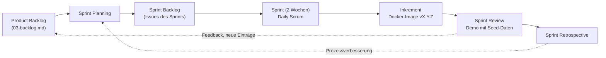
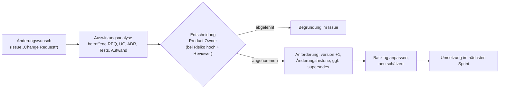

# Vorgehen: iterative Entwicklung und Anforderungsmanagement

Wie das Team Anforderungen erhebt, validiert, plant, umsetzt, nachweist und ändert. Grundlage sind die DEV Guideline (Kap. 01, 10, 12) und die Fallstudie MWI131 Kap. 2 (FS-M1, FS-M7, FS-M9, FS-M12 … FS-M15).

## 1. Vorgehensmodell: Scrum mit Tailoring

Wir arbeiten iterativ nach **Scrum** (Scrum Guide 2020) in **zweiwöchigen Sprints**. Jeder Sprint endet mit einem lauffähigen Inkrement: einem versionierten Docker-Image, das mit `docker compose up` startet und den Smoke-Test besteht.

### Rollen

| Scrum-Rolle | Im Projekt | Verantwortung |
|---|---|---|
| Product Owner (`product-owner`) | ein Teammitglied, Abstimmung mit Dozent/in als Auftraggeber | Produktnutzen, Priorisierung, Freigabe von Anforderungen, Entscheidung über Change Requests |
| Scrum Master | ein Teammitglied, rotierend pro Sprint | Einhaltung der Regeln, Beseitigen von Blockern, Moderation der Events |
| Developers | gesamtes Team | Architektur, UX, Entwicklung, Test, Dokumentation |
| Zusatzrollen (Hüte) | `security-lead`, `architecture-lead`, `qa-lead` | Pflicht-Reviewer für Anforderungen mit hohem Risiko (Guideline Kap. 01) und für ADRs |

### Events und Artefakte

| Event | Inhalt | Ergebnis |
|---|---|---|
| Backlog Refinement (wöchentlich, 1 h) | Einträge konkretisieren, INVEST und Definition of Ready prüfen, schätzen | Einträge „ready“ |
| Sprint Planning | Sprint-Ziel, Auswahl nach WSJF und Kapazität | Sprint Backlog |
| Daily Scrum (15 min, 3× pro Woche) | Fortschritt, Hindernisse | Abstimmung |
| Sprint Review | Demo des Inkrements am Docker-Beispiel | Feedback, Backlog-Anpassung |
| Sprint Retrospective | Prozess verbessern | Maßnahmen für den nächsten Sprint |

| Artefakt | Ort | Verpflichtung (Commitment) |
|---|---|---|
| Product Backlog | [03-backlog.md](03-backlog.md) | Produktziel: Release R1 laut Backlog |
| Sprint Backlog | Issues/Board des Sprints | Sprint-Ziel |
| Inkrement | Docker-Image mit SemVer-Tag | Definition of Done (§3) |

### Tailoring (Abweichungen von Scrum)

| Anpassung | Grund |
|---|---|
| Daily Scrum 3× pro Woche statt täglich | Studienprojekt neben Vorlesungen |
| Product Owner ist Teammitglied, nicht Kunde | Auftraggeber (Dozent/in) ist nur im Review verfügbar |
| Phase 0 „Analyse und Design“ vor Sprint 1 | Prüfungsleistung verlangt Analyse- und Architekturdokumente vorab |
| KI-Agenten erstellen Entwürfe für Dokumente und Code | Beschleunigung; Review und Verantwortung bleiben beim Team (Guideline Kap. 13) |

**Alternative Kanban:** Für die Wartungsphase nach der Abgabe (nur Fehlerbehebung) ist Kanban mit WIP-Limit 2 pro Spalte „In Arbeit“ geeigneter, weil kein Sprint-Ziel mehr geplant wird.

## 2. Definition of Ready (risikobasiert)

Nach Guideline Kap. 01. Ein Eintrag geht in einen Sprint, wenn die **Mindestkriterien** erfüllt sind. Bei Risiko „mittel“ oder „hoch“ (Front Matter `risk`) gelten zusätzlich die erweiterten Kriterien.

**Mindestkriterien**
- [ ] Zweck und erwartetes Ergebnis sind verstanden (User Story mit „damit …“ bzw. Begründung).
- [ ] Owner ist benannt.
- [ ] Akzeptanzkriterien bzw. Metrik sind prüfbar formuliert; Nachweis-ID ist vergeben.
- [ ] Abhängigkeiten (`depends_on`) und unmittelbare Risiken sind bekannt.
- [ ] Typ ist korrekt (Feature, Defekt, Enabler, Spike, Betrieb).
- [ ] INVEST erfüllt bzw. Story ≤ 8 Story Points; sonst aufteilen.

**Zusätzlich bei Risiko mittel/hoch**
- [ ] Betroffene Nutzerreisen und Rollen sind benannt.
- [ ] Sicherheits- und Datenschutzwirkung ist bewertet (bei `high`: Reviewer `security-lead` hat zugestimmt).
- [ ] Datenklassifikation und Löschfristen sind festgelegt.
- [ ] Fehler- und Missbrauchsfälle sind beschrieben (Abschnitt in der Anforderung).
- [ ] Migrations- und Rückfallweg ist bekannt.

## 3. Definition of Done

Nach Guideline Kap. 01, zugeschnitten auf das Docker-Beispiel. Nicht zutreffende Punkte werden **ausdrücklich** als N/A markiert, nicht weggelassen. Die DoD wird in jeder Retrospektive geprüft und bei Bedarf angepasst (Fallstudie FS-M9).

| Bereich | Kriterium | Prüfung |
|---|---|---|
| Anforderung | Akzeptanzkriterien erfüllt | Review + Nachweis |
| Anforderung | Anforderung und Nachweis verknüpft; Status im Front Matter aktualisiert (`implemented` bzw. `verified`) | `node scripts/trace.mjs` grün |
| Anforderung | Dokumentation aktualisiert (README, Use Case, ADR) | Review |
| Code | Code-Review durch mindestens eine weitere Person | Pull Request |
| Code | Typprüfung und Unit-Tests grün | `pnpm typecheck`, `pnpm test` |
| Code | Keine Verletzung der Modulgrenzen | `pnpm lint:deps` |
| Code | Architekturrelevante Entscheidung als ADR dokumentiert | Review |
| Test | Akzeptanztests (Smoke- und E2E-Tests) grün, Tests mit AT-ID markiert | `node scripts/smoke-test.mjs`, `pnpm e2e` |
| Test | Regressionstest für jeden behobenen Fehler | Review |
| Test | Tastatur- und axe-Prüfung grün für geänderte Oberflächen | `pnpm e2e` |
| Sicherheit/Daten | Keine bekannten kritischen Schwachstellen, keine Secrets im Code | CI-Scans (geplant, REQ-SEC-008) |
| Sicherheit/Daten | Logs ohne personenbezogene Daten | Review |
| Sicherheit/Daten | Löschfristen umgesetzt, falls neue Daten gespeichert werden | Review + Test |
| Auslieferung | Image baut reproduzierbar, `docker compose up` startet ohne Fehler | Smoke-Test gegen frisches Setup |
| Auslieferung | Migrationen vorwärtskompatibel und idempotent | Zweimaliger Start |
| Betrieb | Monitoring-Alarme, Runbooks, SLO im Betrieb | **N/A** (kein Echtbetrieb, EPIC-12) |

## 4. Aufwandsschätzung

| Aspekt | Festlegung |
|---|---|
| Einheit | Story Points (Fibonacci 1, 2, 3, 5, 8, 13); > 8 wird vor dem Sprint geteilt |
| Verfahren | **Planning Poker** (Expertenschätzung im Team) im Refinement; Referenz-Story: REQ-SRCH-004 „Merkliste“ = 2 SP |
| Aufbau | Bottom-up: Story Points pro Eintrag; Top-down-Plausibilisierung über die Velocity (Ziel 20 SP pro Sprint im Studienprojekt) |
| Erstschätzung | Die Werte im Backlog sind eine **Analogie- und Expertenschätzung** auf Basis des bereits umgesetzten MVP (Ist-Aufwand bekannter Funktionen) und werden im nächsten Refinement vom Team bestätigt |
| Unsicherheit | Hohe Unsicherheit wird nicht in Punkte „eingepreist“, sondern über einen **Spike** (zeitlich begrenzte Klärung) abgebaut |
| Aktualisierung | Nach jedem Sprint: Ist-Velocity, Schätzabweichungen in der Retrospektive besprechen |

## 5. Priorisierung (WSJF)

Weighted Shortest Job First: **WSJF = Cost of Delay / Job Size**, mit
**Cost of Delay = Nutzerwert + Zeitkritikalität + Risikoreduktion**, jeweils relativ auf der Skala 1, 2, 3, 5, 8, 13; Job Size = Story Points.

- Nutzerwert wird aus der Kano-Kategorie abgeleitet: Basis = 8, Leistung = 5, Begeisterung = 3, nicht kundenwirksam = 1 (Anpassung im Refinement möglich).
- Zeitkritikalität: Abgabetermin, Abhängigkeiten anderer Einträge, Vorführbarkeit im Review.
- Risikoreduktion: senkt ein Sicherheits-, Rechts- oder Technikrisiko oder ermöglicht weitere Einträge.
- MoSCoW legt den Release-Umfang fest; WSJF legt die Reihenfolge **innerhalb** dieses Umfangs fest. Constraints (Sicherheit, Recht) werden nicht wegen geringen sichtbaren Werts abgewertet (Guideline Kap. 01, MoSCoW-Governance).

## 6. Nachverfolgbarkeit

### Identifikatoren

| Objekt | Format | Beispiel |
|---|---|---|
| Anforderung | `REQ-<BEREICH>-<NNN>` | REQ-CHAT-010 |
| Use Case | `UC-<NN>` | UC-25 |
| Constraint | `C-<NN>` | C-01 |
| Nachweis | `AT-…` automatisierter Test, `MAN-…` manuell, `CTRL-…` Kontrolle | AT-CHAT-010 |
| Architekturentscheidung | `ADR-<NNNN>` | ADR-0012 |

### Lebenszyklus einer Anforderung

Der Status im Front Matter folgt der Guideline; die Zuordnung zum Stufenmodell der Vorlesung (Folie 26) zeigt die Tabelle.

| Status (Guideline) | Stufe (Vorlesung) | Bedeutung im Projekt |
|---|---|---|
| `draft` | Platzhalter | Erfasst, noch nicht validiert |
| `in-review` | Konkretisiert | Ausformuliert, Requirements-Review läuft |
| `approved` | Konkretisiert, bereit für Design/Architektur | Review bestanden, Definition of Ready erfüllt |
| `implemented` | Umsetzung | Im Code umgesetzt, Nachweis noch nicht vollständig automatisiert |
| `verified` | Test | Alle Nachweise vorhanden und grün |
| `operational` | Freigabe/Lieferung | In einem freigegebenen Release (Docker-Image mit Tag) enthalten |
| `rejected`, `deprecated`, `obsolete` | – | Bleiben als Datei erhalten; Ersatz über `supersedes` |

### Kette von der Anforderung bis zum Code

1. **Anforderung** (`req/REQ-….md`) nennt ihre Nachweise in `verification`.
2. **Test** trägt die Nachweis-ID im Namen, z. B. `check('[AT-CHAT-010] …')`.
3. **Commit** nennt die Anforderung im Footer: `Refs: REQ-CHAT-010` (Conventional Commits). Damit führt `git log --grep REQ-CHAT-010` bzw. `git blame` vom Code zurück zur Anforderung.
4. **`node scripts/trace.mjs`** prüft die Kette (IDs eindeutig, Verweise gültig, Nachweise vorhanden, verifizierte Anforderungen haben markierte Tests) und erzeugt den Index mit aggregierten Ständen (`--write`, z. B. „R1-Must verifiziert: x %“). In CI läuft das Skript bei jedem Pull Request.

## 7. Change-Management

Anforderungen ändern sich. Damit der Überblick erhalten bleibt, durchläuft **jede** Änderung an einer Anforderung mit Status `approved` oder später den folgenden Prozess (Fallstudie FS-M15, Guideline: genehmigte Anforderungen nie ohne Versionshistorie ändern).

**Regeln**
- Änderungen an `approved`-Anforderungen werden nur an der **Sprint-Grenze** wirksam (Sprint Planning), nicht mitten im Sprint – außer bei Sicherheitsvorfällen (Notfallpfad, Nachweise werden nachgeholt).
- Inhaltliche Änderung ⇒ `version` erhöhen und Zeile in der Änderungshistorie; grundlegend neue Bedeutung ⇒ neue ID mit `supersedes`, alte Anforderung auf `deprecated`.
- IDs werden nie umnummeriert oder gelöscht.
- **Feature Freeze** zwei Wochen vor der Abgabe: danach nur noch Fehlerbehebungen und Dokumentation.
- Change Requests nutzen die Vorlage: Anlass · betroffene IDs · gewünschte Änderung · Nutzen · Aufwand (SP) · Risiko · Entscheidung (wer, wann).

## 8. Validierung der Anforderungen

Jede Anforderung durchläuft vor `approved` ein Review mit der Checkliste aus Guideline Kap. 01 (abgeleitet aus IEEE 29148) und den Validierungszielen der Vorlesung (Folie 16):

| Kriterium | Prüffrage |
|---|---|
| notwendig | Gibt es eine Quelle (BG, Constraint, Stakeholder)? |
| eindeutig, verständlich | Gibt es nur eine Lesart; verstehen Fachanwender den Text? |
| machbar | Im Docker-Beispiel und in der Teamkapazität umsetzbar? |
| verifizierbar | Gibt es Akzeptanzkriterien bzw. Metrik und Nachweis-ID? |
| nachverfolgbar | ID, Owner, Quelle, Epic, Use Case gesetzt? |
| lösungsneutral | Keine Technik im Text, außer bei Constraints mit ADR? |
| widerspruchsfrei | Kein Konflikt mit anderen Anforderungen, Use Cases oder ADRs? |
| abgegrenzt, anpassbar | Scope klar; Änderung betrifft nur wenige Stellen? |
| INVEST | Nur User Stories: unabhängig, verhandelbar, wertvoll, schätzbar, klein, testbar |

Ergebnisse stehen in [docs/04-review/](../04-review/).
