# Architekturdokumentation CampusMarkt (arc42, kompakt)

> **v1.1:** Befunde aus dem [Architektur-Review v1.0](../04-review/review-v1.0-architektur.md) behoben: Soll und Ist getrennt (Spalte „Stand“ mit Backlog-ID), Datenbankzugriff und Modulabhängigkeiten in der Komponentensicht, Löschung und Anonymisierung im Datenmodell, Schlüsselkonzept für die IP-Pseudonymisierung ([ADR-0014](decisions/0014-ip-pseudonymisierung.md)), Laufzeitsichten an den Code angeglichen, Qualitätsszenarien an die Anforderungen angeglichen.
>
> **v1.0:** Bausteinsicht, Kontext und Verteilung im **C4-Modell** (Mermaid-C4, [ADR-0012](decisions/0012-c4-notation.md)); angeglichen an Anforderungen v1 und die Fallstudie (Kontaktfreigabe, Anmeldung hinter `IdentityProviderPort`, [ADR-0013](decisions/0013-anmeldung-identity-provider-port.md)).
>
> **v0.2:** Kein öffentliches Hosting. Das Ergebnis ist ein lauffähiges **Docker-Beispiel** ([ADR-0010](decisions/0010-docker-demo-deployment.md)). Betriebsthemen für einen späteren Echtbetrieb stehen in EPIC-12 im [Backlog](../02-anforderungen/03-backlog.md).

**Soll und Ist.** Diese Architektur beschreibt den Zielzustand für Release R1. Wo ein Baustein noch nicht umgesetzt ist, nennt die Spalte bzw. Markierung **„Stand“** den Backlog-Eintrag und den Sprint (z. B. „geplant B-01, Sprint 1“). Der Umsetzungsstand je Anforderung steht im generierten [Katalog-Index](../02-anforderungen/02-anforderungen.md#6-katalog-index).

## 1. Einführung und Ziele

### 1.1 Aufgabenstellung
Ein Marktplatz für Angehörige der HWG LU zum Verkaufen, Tauschen, Verschenken und Suchen von Gegenständen. Er hat einen integrierten Chat und versendet E-Mails. Der Zugang ist auf verifizierte Hochschuladressen beschränkt. Ausgeliefert wird er als lokal startbares Docker-Setup. Details: [Use Cases](../02-anforderungen/01-use-cases.md), [Anforderungen](../02-anforderungen/02-anforderungen.md).

### 1.2 Qualitätsziele (Top 5, priorisiert)

| Prio | Qualitätsmerkmal (ISO 25010) | Ziel | Szenario |
|---|---|---|---|
| 1 | **Sicherheit** (Authentizität, Vertraulichkeit) | Nur Hochschulangehörige, private Chats bleiben privat, Kontaktdaten nur nach beidseitiger Zustimmung | QS-1, QS-2, QS-10, QS-13, QS-14 |
| 2 | **Wartbarkeit** (Modularität, Erweiterbarkeit) | Bezahlung, weitere Hochschulen und Produktivbetrieb ohne Umbau der Fachlogik | QS-5, QS-6, QS-8 |
| 3 | **Portabilität** (Installierbarkeit) | Image-Build ≤ 10 min (mit Internet); danach `docker compose up` bis zum Login mit Demo-Konto ≤ 3 min, offline, ohne externe Konten (REQ-OPS-003) | QS-9 |
| 4 | **Zuverlässigkeit** | Keine verlorenen Nachrichten oder E-Mails | QS-3, QS-4, QS-12 |
| 5 | **Benutzbarkeit** (inkl. Barrierefreiheit) | Anzeige in < 2 min, WCAG 2.2 AA, Kernabläufe vollständig per Tastatur | REQ-LST-001, REQ-A11Y-001, REQ-A11Y-002, QS-11 |

### 1.3 Stakeholder

| Rolle | Erwartung |
|---|---|
| Studierende, Beschäftigte (Zielnutzer, im Projekt durch Personas und Testnutzer vertreten) | Einfach, sicher, kostenlos |
| Projektteam (Studierende SWeng) | Machbar im Semester, gut lernbar, guideline-konform |
| Dozent/in, Prüfer/in | Nachvollziehbare Methodik (UML, arc42, C4, ADRs, Traceability), Demo mit einem Befehl startbar |

## 2. Randbedingungen

| Typ | Randbedingung |
|---|---|
| Organisatorisch | Studienprojekt, kleines Team, Semester-Zeitrahmen, kein Budget |
| Organisatorisch | DEV Guideline ist verbindlich. Abweichungen nur per ADR oder Exception |
| **Technisch** | **Kein öffentliches Hosting. Auslieferung als Docker-Image + Compose-Datei, lokal lauffähig, ohne Internetzugang** (ADR-0010) |
| Technisch | Web-first (PWA). Keine native App |
| Rechtlich | Kein Produktivbetrieb, daher keine Betreiberpflichten im Projekt. DSGVO, DSA und BITV werden **konzeptionell** berücksichtigt (Privacy by Design), damit ein Echtbetrieb möglich bliebe |
| Fachlich | Domain-Whitelist `hwg-lu.de`, `studmail.hwg-lu.de` |
| Fallstudie (MWI131) | Kontaktdaten erst nach beidseitiger Zustimmung (C-01), Tastaturbedienbarkeit (C-02), Anmeldung über die Hochschulkennung (C-03, dokumentierte Abweichung, ADR-0013), Angebote nur von verifizierten Nutzern (C-04) – siehe [Constraints](../02-anforderungen/02-anforderungen.md#3-constraints-und-ihre-operationalisierung) |

## 3. Kontextabgrenzung

### 3.1 C4 Ebene 1: Systemkontext

Zeigt CampusMarkt als **ein** Softwaresystem mit seinen Nutzern und Nachbarsystemen. Nachbarsysteme mit dem Zusatz **„geplant“** sind noch nicht angebunden; Mermaid-C4 kann Beziehungen nicht gestrichelt darstellen, daher steht der Status in Beschriftung und Tabelle.

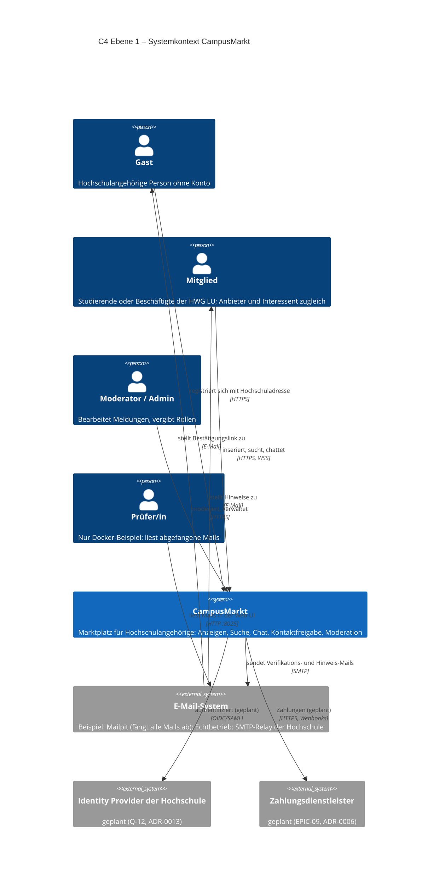

| Element | Art | Verantwortung | Bezug | Stand |
|---|---|---|---|---|
| Gast | Person | Registrierung mit Whitelist-Adresse | UC-01, REQ-AUTH-001 | umgesetzt |
| Mitglied | Person | Anbieter und Interessent; Rollen „Käufer/Verkäufer“ sind kontextabhängig | UC-10 … UC-25 | umgesetzt |
| Moderator / Admin | Person | Meldungen entscheiden, Rollen vergeben | UC-32, UC-42 | umgesetzt |
| Prüfer/in | Person (nur Beispiel) | Verifikations- und Hinweis-Mails in Mailpit lesen | ADR-0010 | umgesetzt |
| CampusMarkt | Softwaresystem (Scope dieses Dokuments) | Alle fachlichen Funktionen | alle REQ | teilweise, siehe Index |
| E-Mail-System | Externes System | Zustellung transaktionaler Mails | REQ-NOTI-*, ADR-0005 | umgesetzt (Mailpit) |
| Identity Provider der Hochschule | Externes System | Anmeldung über die Hochschulkennung | Fallstudie FS-C3, Q-12 | **geplant** (Spike S-01) |
| Zahlungsdienstleister | Externes System | Zahlungsabwicklung ohne eigene Geldverwahrung | ADR-0006, REQ-ARCH-002 | **geplant** (EPIC-09) |

### 3.2 Technischer Kontext

| Schnittstelle | Protokoll | Daten | Richtung |
|---|---|---|---|
| Browser ↔ CampusMarkt | HTTP auf `localhost:8080` (Echtbetrieb: HTTPS) | SPA-Dateien, REST/JSON `/api/v1` | bidirektional |
| Browser ↔ CampusMarkt | WebSocket `/ws` | Chat-Ereignisse (JSON, Typen in `packages/contracts`) | bidirektional |
| CampusMarkt → E-Mail-System | SMTP (`mailpit:1025`), per Umgebungsvariablen austauschbar | E-Mails | ausgehend |
| Browser → Mailpit-UI | HTTP `localhost:8025` | abgefangene E-Mails (nur Beispiel) | – |
| *(geplant)* CampusMarkt ↔ IdP | OIDC oder SAML (Umleitung + Rückruf) | Identität, Hochschulkennung | bidirektional |
| *(geplant)* CampusMarkt ↔ PSP | HTTPS-API + signierte Webhooks | Zahlungen | bidirektional |

## 4. Lösungsstrategie

| Ziel / Problem | Lösungsansatz | ADR |
|---|---|---|
| Kleines Team, schnelle Iteration, später erweiterbar | **Modularer Monolith** mit klaren fachlichen Modulen, **ein** Anwendungs-Image | [ADR-0001](decisions/0001-modularer-monolith.md) |
| Ein Image, wenige Konzepte | **TypeScript**: React-SPA (Vite), ausgeliefert durch Fastify. PostgreSQL mit handgeschriebenem SQL über ein parametrisierendes `sql`-Template (kein ORM, [ADR-0011](decisions/0011-mvp-umsetzung.md) Nr. 1). Kein Redis, kein S3 | [ADR-0002](decisions/0002-tech-stack.md) |
| Vertrauen durch Hochschulzugehörigkeit | Eigene, schlanke Authentifizierung mit E-Mail-Verifikation und Domain-Whitelist, Sessions in Postgres | [ADR-0003](decisions/0003-authentifizierung.md) |
| Echtzeit-Chat | Empfang per WebSocket, Senden per REST (idempotent), Postgres als Quelle der Wahrheit, Fan-out hinter einem `RealtimeBroker`-Port | [ADR-0004](decisions/0004-chat-echtzeit.md) |
| Zuverlässiger E-Mail-Versand | Jobs werden mit **pg-boss transaktional** eingereiht (Outbox-Muster), `MailPort` → Mailpit; Wiederholungsplan überbrückt ≥ 30 min Ausfall | [ADR-0005](decisions/0005-email-versand.md) |
| Bezahlung später ohne Umbau | **Ports & Adapters**: `PaymentPort`, Deal-Konzept und Domain Events (publish/subscribe) schon im MVP | [ADR-0006](decisions/0006-bezahlung-erweiterungspunkt.md) |
| Bilder | Docker-Volume hinter `StoragePort`, Verarbeitung im Job | [ADR-0007](decisions/0007-bildspeicherung.md) |
| Suche ohne Zusatzinfrastruktur | **PostgreSQL-Volltextsuche** + `pg_trgm` | [ADR-0008](decisions/0008-suche-postgres.md) |
| API-Vertrag | **REST + OpenAPI 3.1**, Schema-first aus TypeBox-Schemas in `packages/contracts`; WebSocket-Ereignisse als TypeScript-Typen im selben Paket (kein AsyncAPI-Dokument) | [ADR-0009](decisions/0009-api-rest-openapi.md), [ADR-0011](decisions/0011-mvp-umsetzung.md) Nr. 2 |
| Kein Hosting, trotzdem vorführbar | **Docker Compose**: `app` + `db` + `mailpit`, Seed-Daten mit Demo-Konten | [ADR-0010](decisions/0010-docker-demo-deployment.md) |
| Anmeldung über die Hochschulkennung (FS-C3) später ohne Umbau | Anmeldeverfahren hinter einem zweistufigen `IdentityProviderPort`; im Beispiel Hochschuladresse + Passwort (Stand: umgesetzt B-05; SSO-Adapter nach S-01) | [ADR-0013](decisions/0013-anmeldung-identity-provider-port.md) |
| Kontaktdaten nur nach beidseitiger Zustimmung (FS-C1) | Zustimmungen als Zustand der Konversation; Adresse nur als Konversationsangabe, nie als Nachricht (Stand: umgesetzt B-01) | REQ-CHAT-010 |
| IP-Adressen nur pseudonymisiert | HMAC-SHA256 mit zufälligem, täglich rotiertem Schlüssel in der Datenbank (Stand: geplant B-35, Sprint 2) | [ADR-0014](decisions/0014-ip-pseudonymisierung.md) |
| Architektur verständlich und prüfbar dokumentieren | **C4-Modell** als Mermaid-C4-Diagramme, eine Ebene je Diagramm, gerendert mit `scripts/check-diagrams.mjs` (in CI, B-07) | [ADR-0012](decisions/0012-c4-notation.md) |

**Leitprinzip:** Alles, was im Beispiel bewusst einfacher gelöst ist (Fan-out, Storage, Mail, Rate-Limit-Store, Suche, Job-Queue), steckt hinter einem **Port**. Ein späterer Echtbetrieb (EPIC-12) tauscht Adapter, nicht Fachlogik.

## 5. Bausteinsicht (C4 Ebene 2 und 3)

**Notation:** C4-Modell nach Simon Brown, als Mermaid-C4-Diagramme im Markdown ([ADR-0012](decisions/0012-c4-notation.md)). Jedes Diagramm zeigt genau **eine** Ebene und nennt sie im Titel (Guideline Kap. 02). Die Ebenen verfeinern sich: Das Softwaresystem aus 3.1 wird in 5.1 in Container zerlegt, die Container „Anwendung“ und „Web-App“ in 5.2 und 5.3 in Komponenten. Die vierte C4-Ebene (Code) wird bewusst nicht gezeichnet; sie ergibt sich aus dem Quellcode. Beziehungen zwischen Komponenten im selben Prozess sind Funktionsaufrufe (TypeScript, in-process), sofern nicht anders beschriftet.

| C4-Begriff | Bedeutung im Projekt |
|---|---|
| Softwaresystem | CampusMarkt als Ganzes (Scope dieser Architektur) |
| Container | separat ausführbare bzw. Daten haltende Einheit: Web-App im Browser, Anwendungsprozess, Datenbank, Dateiablage. *Nicht zu verwechseln mit Docker-Containern* (siehe Verteilungssicht 7.1) |
| Komponente | Baustein innerhalb eines Containers mit klarer Schnittstelle: Fachmodul (`apps/server/src/modules/*`), Port, Adapter, eingehender Adapter |

### 5.1 C4 Ebene 2: Container

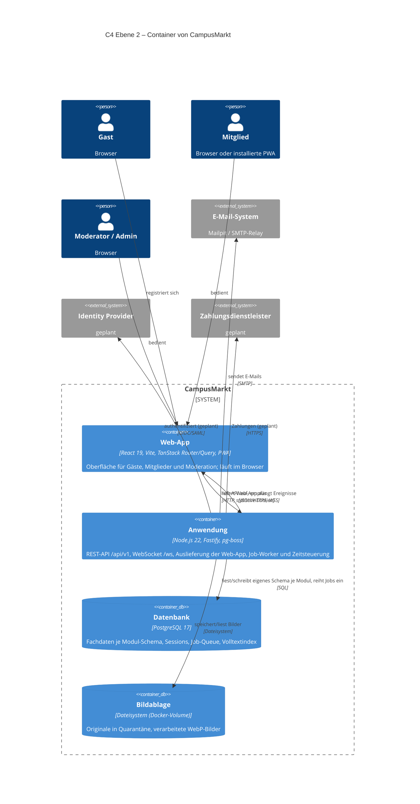

| Container | Technologie | Verantwortung | Qualitätsziele / Anforderungen | ADR | Stand |
|---|---|---|---|---|---|
| Web-App | React-SPA (Vite), PWA | Darstellung, Tastaturbedienung, Echtzeit-Empfang, Degradation auf Polling | REQ-A11Y-001/002, REQ-UX-001, REQ-CHAT-003 | 0002 | umgesetzt (Kontaktfreigabe B-01, Tastatur-E2E B-02) |
| Anwendung | Node.js 22, Fastify, pg-boss | Fachlogik aller Module, Autorisierung, Jobs (E-Mail, Bilder, Fristen) | REQ-SEC-*, REQ-NOTI-005, REQ-OPS-* | 0001, 0002, 0004, 0005 | umgesetzt; offene Teile siehe 5.2 |
| Datenbank | PostgreSQL 17 | Quelle der Wahrheit, transaktionale Outbox (Jobs im selben Commit), Volltextsuche | REQ-CHAT-004, REQ-SRCH-001, REQ-PERF-001 | 0005, 0008 | umgesetzt |
| Bildablage | Docker-Volume `uploads` hinter `StoragePort` | Bilder außerhalb des Web-Roots, Auslieferung nur über die Anwendung | REQ-LST-003, REQ-SEC-007 | 0007 | umgesetzt |
| Identity Provider | extern | Anmeldung mit Hochschulkennung | REQ-AUTH-009 | 0013 | geplant (S-01) |
| Zahlungsdienstleister | extern | Zahlungen | REQ-ARCH-001/002 | 0006 | geplant (EPIC-09) |

**Startmodi:** Die Anwendung kennt die Modi `all` (Standard im Beispiel), `api` und `worker` (`APP_MODE`). Im Docker-Beispiel laufen API und Worker in **einem** Prozess mit getrennten Concurrency-Pools (Bulkhead). Für einen Echtbetrieb werden daraus zwei Container gleicher Codebasis **ohne Änderung der Fachlogik**; nötig sind nur Betriebsanpassungen (siehe 7.2): Healthcheck des Worker-Containers per Kommando statt HTTP, `TRUST_PROXY` hinter einem Reverse Proxy und ein `PgNotifyAdapter`, damit Ereignisse aus Jobs WebSockets erreichen (Stand: Health und `TRUST_PROXY` geplant B-41, Sprint 2).

### 5.2 C4 Ebene 3: Komponenten der Anwendung

Die Anwendung ist ein **modularer Monolith** (ADR-0001). Drei Diagramme derselben Ebene (ADR-0012 Regel 4): 5.2.1 zeigt die eingehenden Adapter und Fachmodule, 5.2.2 die Fachmodule mit Plattform, Ports und Adaptern, 5.2.3 die Abhängigkeiten zwischen den Fachmodulen.

#### 5.2.1 Eingehende Adapter und Fachmodule

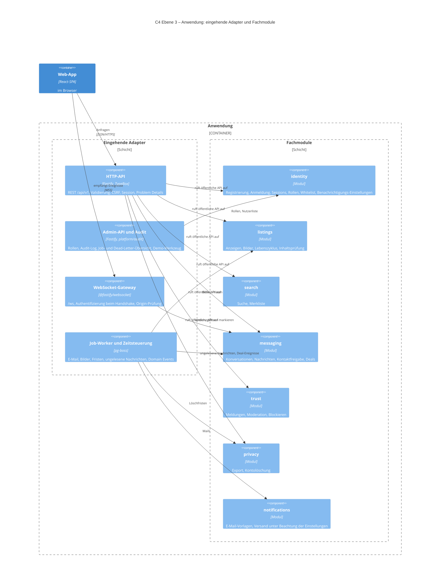

#### 5.2.2 Fachmodule, Plattform, Ports und Adapter

Port und zugehöriger Adapter sind in einem Kasten zusammengefasst („Port → Adapter“), damit das Diagramm lesbar bleibt; im Code liegen die Ports in `platform/ports/`, die Adapter in `platform/adapters/` und werden nur in `main.ts` verdrahtet.

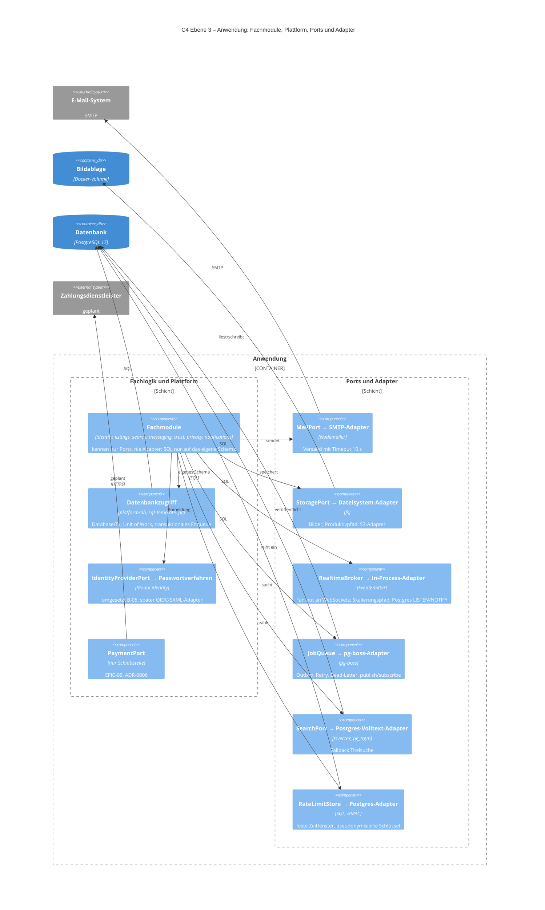

#### 5.2.3 Abhängigkeiten zwischen den Fachmodulen

Module rufen einander nur über ihr öffentliches API (`index.ts`, späte Bindung über `ModuleDeps.modules`) oder über Domain Events (pg-boss, im selben Commit eingereiht). **Abhängigkeitsrichtung (Entscheidung OE-1):** `messaging` darf `listings` synchron aufrufen; `listings` informiert `messaging` nur über Domain Events. Heute ruft `listings` noch synchron `messaging.onListingStatusChanged` und `findConversationId` auf (Stand: Umstellung geplant B-39, R2).

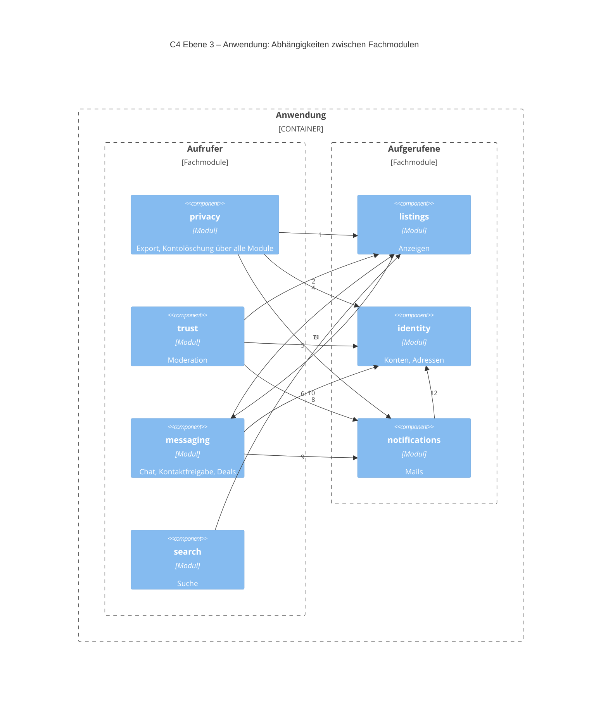

| # | Von → Nach | Zweck (Aufruf der öffentlichen API, TypeScript in-process) |
|---|---|---|
| 1 | privacy → listings | Export, Löschung |
| 2 | privacy → identity | Export, Löschung |
| 3 | privacy → notifications | Löschbestätigung |
| 4 | trust → listings | entfernen, ausblenden |
| 5 | trust → identity | sperren, Namen |
| 6 | trust → notifications | Entscheidungs-Mail |
| 7 | messaging → listings | Anzeige lesen, Deal-Status |
| 8 | messaging → identity | Namen, freigegebene Adresse |
| 9 | messaging → notifications | Hinweis-Mail |
| 10 | search → listings | Karten laden |
| 11 | listings → messaging | Statuswechsel (heute synchron; Ziel: Domain Event, B-39) |
| 12 | notifications → identity | Adresse, Einstellungen |

Weitere Aufrufe: `trust → messaging` (Nachrichtenkontext, Entfernen), `messaging`/`search → trust` (Blockierungen), `listings → trust` (Fall der Inhaltsprüfung) und `listings → search` (Merkliste). Alle über das öffentliche API.

| Komponente | Ort im Code | Verantwortung | Wichtige Anforderungen | Stand |
|---|---|---|---|---|
| HTTP-API | `apps/server/src/platform/http/` + `routes.ts` je Modul | Validierung gegen den Vertrag (`packages/contracts`), Session, CSRF, Fehlerformat | REQ-SEC-004, REQ-SEC-006 | umgesetzt |
| Admin-API und Audit | `modules/admin.ts`, `platform/audit.ts` | Rollen, Audit-Log (append-only), Job- und Dead-Letter-Übersicht, Demo-Werkzeug | REQ-MOD-007, REQ-NOTI-005, REQ-DEMO-002 | umgesetzt |
| WebSocket-Gateway | `modules/messaging/routes.ts` (`websocketRoute`) | Echtzeit-Empfang, Origin-Prüfung; Senden per WS nur als Alternative, die Web-App sendet per REST | REQ-CHAT-003 | umgesetzt |
| Job-Worker und Zeitsteuerung | `platform/adapters/pg-boss-queue.ts`, `registerJobs` je Modul | Asynchrone Arbeit, Retry, Dead-Letter; Zeitgeber Ü-11/Ü-17/Ü-18 (`listings-maintenance`, stündlich) und Kontolöschung (`privacy-purge`, täglich 03:17); Zeitgeber Ü-12, Ü-13 (inkl. `DealCancelled` und Hinweis-Mail) und Ü-19 | REQ-NOTI-005, REQ-LST-007/008, REQ-PRIV-003 | umgesetzt; Ü-12/Ü-13/Ü-19 geplant B-32 (Sprint 3) |
| identity | `modules/identity/` | Zugang, BR-01, Rollen, Benachrichtigungs-Einstellungen (`PATCH /me`) | REQ-AUTH-*, REQ-SEC-002…005, REQ-SEC-011 | umgesetzt, inkl. `IdentityProviderPort` (B-05) und Registrierungsgrenzen Q-18 (B-34) |
| listings | `modules/listings/` | Anzeigen und Bilder | REQ-LST-* | umgesetzt |
| search | `modules/search/` | Suche, Merkliste | REQ-SRCH-* | umgesetzt |
| messaging | `modules/messaging/` | Chat, **Kontaktfreigabe**, Deals | REQ-CHAT-*, REQ-PRIV-002 | umgesetzt (Kontaktfreigabe B-01) |
| trust | `modules/trust/` | Meldungen, Moderation, Blockieren | REQ-MOD-* | umgesetzt |
| privacy | `modules/privacy/` | Export, Löschung über alle Module | REQ-ACC-002/003, REQ-PRIV-003 | umgesetzt; Anonymisierung statt Löschen fremder Konversationen geplant B-22 (Sprint 2) |
| notifications | `modules/notifications/` | Vorlagen, Versand über MailPort unter Beachtung der Einstellungen aus `identity` | REQ-NOTI-* | umgesetzt; Wiederholungsplan ≥ 30 min geplant B-36 (Sprint 2) |
| Datenbankzugriff | `platform/db.ts`, `platform/sql.ts` | Verbindung, Unit of Work, parametrisiertes SQL | REQ-SEC-001 (Injection) | umgesetzt |
| Ports + Adapter | `platform/ports/`, `platform/adapters/` | Austauschbare Infrastruktur | REQ-ARCH-006 | umgesetzt; HMAC-Schlüssel im RateLimitStore geplant B-35, publish/subscribe geplant B-40 (Sprint 2) |
| IdentityProviderPort | `modules/identity/` (Passwortverfahren intern), später SSO-Adapter in `platform/adapters/` | Anmeldeverfahren austauschbar (ADR-0013) | REQ-AUTH-009 | umgesetzt B-05; SSO-Adapter nach S-01 |
| PaymentPort | `modules/payments/payment-port.ts` | Erweiterungspunkt Bezahlung | REQ-ARCH-001/002 | Schnittstelle vorhanden, Adapter EPIC-09 |

**Modulregeln und ihre Prüfung (Fitness Functions, REQ-MAINT-002):**

| # | Regel | Prüfung | Stand |
|---|---|---|---|
| 1 | Ein Modul hat ein öffentliches API (`index.ts`); alles andere ist intern | dependency-cruiser `module-internals` (`pnpm lint:deps`) | umgesetzt. Hinweis: Bei `listings` und `messaging` ist das API heute der ganze Service; schmale Schnittstellen geplant B-42 (R2) |
| 2 | Module greifen nie auf Tabellen anderer Module zu; jedes Modul hat ein eigenes Postgres-Schema | Test, der SQL-Texte in `modules/<m>/**` auf andere Schemas als `<m>.` prüft (dependency-cruiser sieht nur Importe) | geplant B-38 (Sprint 2); bis dahin Code-Review |
| 3 | Kommunikation zwischen Modulen synchron über das öffentliche API oder asynchron über Domain Events (Jobs im selben Commit) | Regel 1 + Review | umgesetzt (Zyklus `listings ↔ messaging` bis B-39) |
| 4 | `domain.ts` ist frei von Frameworks und Plattform | dependency-cruiser `domain-is-pure` | umgesetzt |
| 5 | Fachmodule kennen nur Ports, nie Adapter; die Plattform kennt keine Fachmodule | dependency-cruiser `modules-only-know-ports`, `no-infrastructure-libs-in-modules`, `platform-independent-of-modules` | umgesetzt |

### 5.3 C4 Ebene 3: Komponenten der Web-App

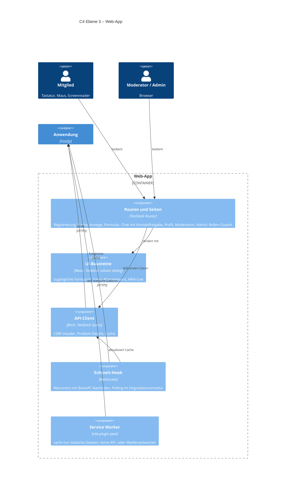

| Komponente | Ort im Code | Verantwortung | Bezug zu den 9 Kernabläufen (REQ-A11Y-002) | Stand |
|---|---|---|---|---|
| Routen und Seiten | `apps/web/src/routes/`, `router.tsx` | Seiten je Use Case, Rollen-Guards für Moderation und Admin | Registrierung, Anmeldung, Passwort zurücksetzen, Suche, Anzeige erstellen inkl. Bild, Anzeige verwalten, Nachricht senden, Melden, Kontaktfreigabe | umgesetzt |
| UI-Bausteine | `apps/web/src/components/` | Zugängliche Grundbausteine, sichtbarer Fokus, ARIA-Live im Chat | alle 9 | umgesetzt; Tastatur-E2E und axe-core in `e2e/` (B-02) |
| API-Client | `apps/web/src/api/` | Aufrufe, CSRF-Header, Fehlerbehandlung | alle 9 | umgesetzt |
| Echtzeit-Hook | `apps/web/src/lib/realtime.ts` | WebSocket, Reconnect, Nachladen per `?after=`, Polling | Nachricht senden | umgesetzt |
| Service Worker | erzeugt durch `vite-plugin-pwa` | Installierbarkeit (PWA); cacht ausschließlich statische Dateien, damit keine personenbezogenen Antworten im Gerät verbleiben | – | umgesetzt |

### 5.4 Fachliches Datenmodell (Auszug)

Modulübergreifende Bezüge sind **Referenzen (ID, kein Fremdschlüssel)**, weil jedes Modul ein eigenes Schema hat (Modulregel 2); sie sind im Diagramm als `ref` gekennzeichnet. Echte Fremdschlüssel (`FK`) gibt es nur innerhalb eines Moduls.

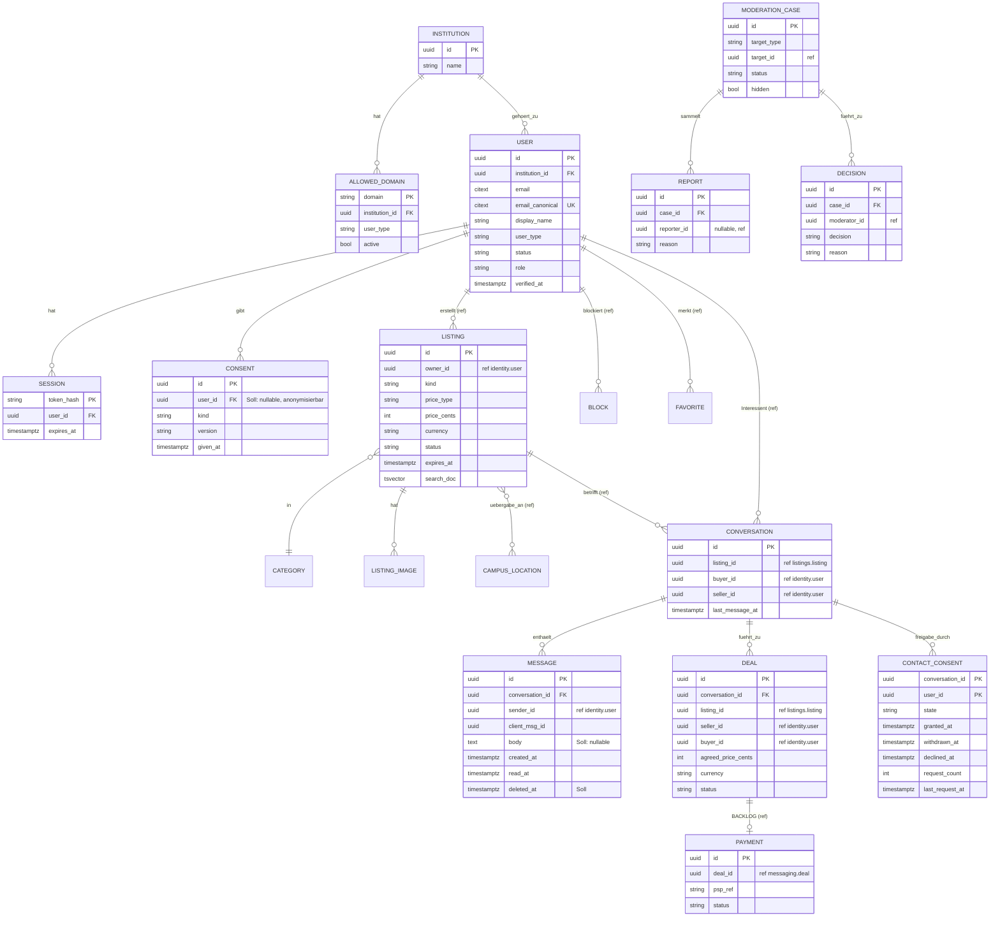

`CONTACT_CONSENT` hält je Teilnehmer und Konversation den Zustand der Kontaktfreigabe (REQ-CHAT-010): `state` ∈ {`granted`, `withdrawn`, `declined`}, mit Zeitpunkten für Zustimmung, Widerruf und Ablehnung sowie Zähler und Zeitpunkt der letzten Anfrage für die Sperrfrist (24 h) und die Höchstzahl (3). Die Adresse selbst bleibt im Modul `identity` und wird nur bei beidseitiger Zustimmung über ein schmales API gelesen (siehe 8.1). Ein Deal je Konversation kann nach Storno neu entstehen; offen ist höchstens einer je Anzeige. (Stand: umgesetzt B-01, Migration `0002_contact_consent.sql`.)

Unique-Constraints (Auszug): `USER(email_canonical)` · `CONVERSATION(listing_id, buyer_id)` (REQ-CHAT-002) · `MESSAGE(conversation_id, client_msg_id)` (REQ-CHAT-004, Idempotenz) · `DEAL(listing_id) WHERE status = 'agreed'` · `ALLOWED_DOMAIN(domain)`. Die Job-Tabellen verwaltet pg-boss in einem eigenen Schema `pgboss`.

#### Löschung und Anonymisierung (Soll-Modell, REQ-PRIV-003, REQ-ACC-002)

| Datenobjekt | Bei Kontolöschung | Modellierung | Stand |
|---|---|---|---|
| Konto, Sessions, Tokens | gelöscht | `identity.user` + `ON DELETE CASCADE` | umgesetzt |
| Anzeigen, Bilder, Merkliste, Blockierungen | gelöscht | je Modul über `privacy` | umgesetzt |
| Eigene Nachrichten | Text gelöscht, Nachricht bleibt als Platzhalter; das Gegenüber behält die Konversation | `message.body` nullable + `deleted_at`; „Ehemaliges Mitglied“ entsteht, weil `sender_id` nicht mehr auflösbar ist | geplant B-22 (Sprint 2); heute werden ganze Konversationen gelöscht |
| Meldungen des Mitglieds | bleiben für die Frist, ohne Personenbezug | `report.reporter_id := NULL` | umgesetzt |
| Einwilligungen | Nachweis bleibt ohne Profilbezug | `consent.user_id` nullable, `anonymized_at` | geplant B-22 (Sprint 2) |
| Kontaktfreigaben | mit der Konversation gelöscht bzw. für das Gegenüber ausgeblendet | `CONTACT_CONSENT` | Kaskade mit der Konversation umgesetzt (B-01); Ausblenden geplant B-22 |

## 6. Laufzeitsicht

Teilnehmernamen folgen den C4-Sichten (ADR-0012 Regel 5): Web-App, Anwendung: &lt;Komponente&gt;, Datenbank, E-Mail-System (Mailpit).

### 6.1 Registrierung mit E-Mail-Verifikation

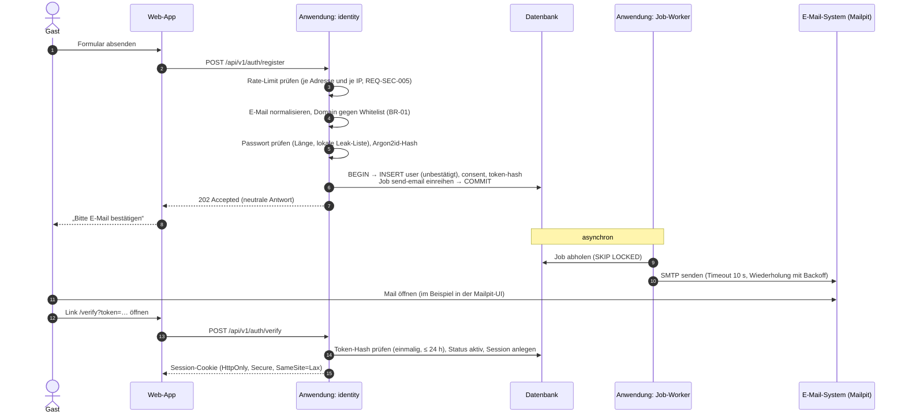

### 6.2 Chat-Nachricht senden

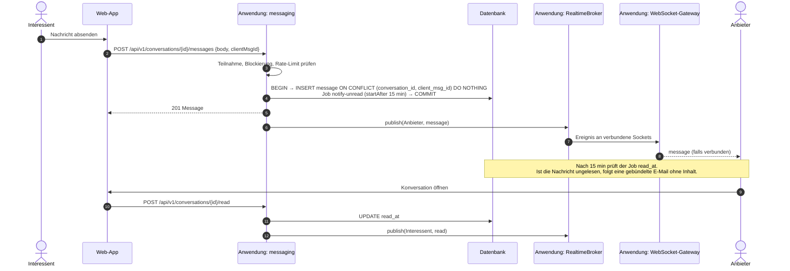

**Senden:** Die Web-App sendet per REST (idempotent über `clientMsgId`, bis zu drei Wiederholungen mit derselben ID); das WebSocket-Gateway nimmt `send`- und `read`-Ereignisse ebenfalls an, die Web-App nutzt sie aber nicht. **Wiederherstellung nach Verbindungsabbruch:** Nach dem Reconnect lädt der Client Verpasstes per REST mit `GET /conversations/{id}/messages?after=<letzte ID>` nach; solange keine Verbindung besteht, fragt er alle 10 s ab. Die Zustellung ist **at-least-once**, die Idempotenz entsteht über `client_msg_id` (REQ-CHAT-004).
**Skalierungspfad (nicht im Beispiel):** Der `RealtimeBroker`-Adapter wird gegen `PgNotifyAdapter` (Postgres `LISTEN/NOTIFY`) getauscht. Danach sind mehrere `api`-Instanzen möglich, und Ereignisse aus Worker-Prozessen erreichen WebSockets.

### 6.3 Anzeige mit Bildern veröffentlichen

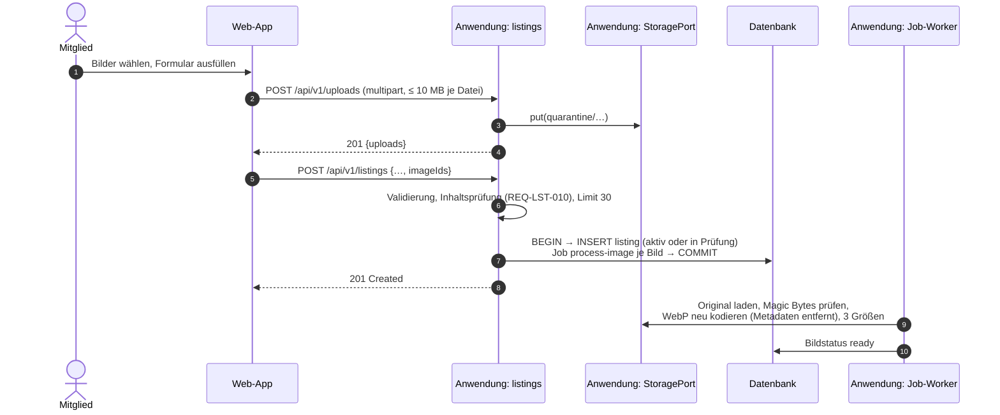

### 6.4 Kontaktdaten freigeben (UC-25, REQ-CHAT-010) – Soll (B-01, Sprint 1)

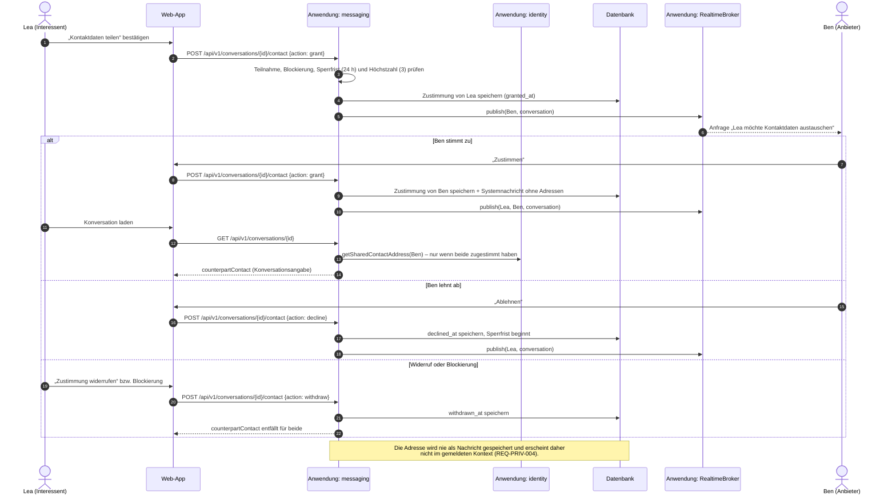

## 7. Verteilungssicht

### 7.1 C4 Verteilungsdiagramm: Docker-Beispiel (verbindlich für das Projekt)

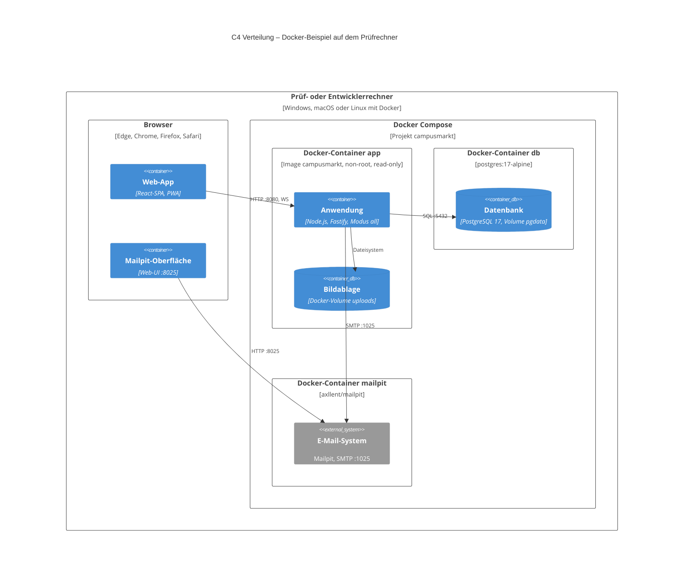

**Hinweise:** Mailpit ist im C4-Modell ein **externes System** (es vertritt den SMTP-Relay des Echtbetriebs), wird im Beispiel aber lokal als dritter Compose-Dienst betrieben. Das Volume `uploads` ist in den Container `app` eingehängt und deshalb dort gezeichnet.

| Aspekt | Festlegung |
|---|---|
| Start | `docker compose up --build` |
| Start-Reihenfolge | `app` wartet per Healthcheck auf `db` |
| Migrationen | laufen beim Start automatisch, idempotent (REQ-OPS-005) |
| Seed-Daten | `SEED_DEMO=true`: Institution, Whitelist, Standorte, Kategorien, Demo-Konten, 30 Anzeigen, Chats, offene Meldung (REQ-DEMO-001) |
| Konfiguration | nur Umgebungsvariablen (`.env.example`), keine Secrets im Image |
| Health | `/health/live`, `/health/ready`, Docker-`HEALTHCHECK` (Modus `all`/`api`) |
| Logs | JSON auf stdout, ohne personenbezogene Daten |
| Reset | `docker compose down -v` |

| Umgebung | Zweck | Infrastruktur | Stand |
|---|---|---|---|
| `local` | Entwicklung | `compose.dev.yaml` (db + mailpit), App per `pnpm dev` | umgesetzt |
| `ci` | Tests | GitHub Actions: Typprüfung, Unit-Tests, `lint:deps`, `trace.mjs`, Image-Build, E2E- und Smoke-Test gegen das Compose-Setup | umgesetzt B-07 (`.github/workflows/ci.yml`) |
| `demo` | Abgabe / Vorführung | `docker compose up` | umgesetzt |

### 7.2 Ausblick Echtbetrieb (nicht Teil des Projekts, EPIC-12)
Gleiches Image. Getrennte `api`- und `worker`-Instanzen, managed Postgres mit PITR, echter SMTP-Relay (SPF/DKIM/DMARC), S3-Adapter, `PgNotifyAdapter`, Reverse Proxy mit TLS, Tracing (geplant R2). Dazu kommen die Betreiberpflichten (Impressum, Datenschutzerklärung, DSA-Prozesse). Die **Fachlogik** ändert sich nicht; nötig sind folgende Betriebsanpassungen:
- **Health im Worker-Modus:** Der Worker startet keinen HTTP-Server; sein Healthcheck läuft per Kommando (Datenbank erreichbar, pg-boss aktiv) statt über `/health/ready` (geplant B-41, Sprint 2).
- **`TRUST_PROXY`:** Hinter einem Reverse Proxy muss die Client-IP aus `X-Forwarded-For` übernommen werden, sonst teilen sich alle Nutzer einen Rate-Limit-Schlüssel (geplant B-41, Sprint 2).
- **Ereignisse aus Jobs:** erreichen WebSockets erst mit dem `PgNotifyAdapter`, weil der In-Process-Broker nur innerhalb eines Prozesses verteilt.
- **`/metrics`:** nur intern erreichbar (eigener Port oder Proxy-Regel), nicht öffentlich.

## 8. Querschnittliche Konzepte

### 8.1 Sicherheit
- **Authentifizierung:** serverseitige Sessions (gehashtes Opaque-Token in Postgres), Cookie `HttpOnly; Secure; SameSite=Lax`. Siehe ADR-0003. Nur Konten mit Status `aktiv` erhalten eine gültige Sitzung; eine Sperre oder Löschung entzieht jeden Zugriff sofort (REQ-SEC-011).
- **Autorisierung:** zentrale Prüfung pro Ressource in den Fachmodulen, *deny by default*; fremde Ressourcen liefern 404 (REQ-SEC-006).
- **Eingaben:** Validierung an der Grenze gegen die TypeBox-Schemas aus `packages/contracts` (Fastify), aus denen auch die OpenAPI-Spezifikation erzeugt wird. Ausgabe-Encoding durch React. Strikte CSP (die SPA kommt vom selben Origin). CSRF-Schutz über Pflicht-Header und Origin-Prüfung (ADR-0011).
- **Container-Härtung:** Non-root-User, Read-only-Root-FS, `no-new-privileges`, keine Secrets im Image, minimales Base-Image. Image-Scan (Trivy), Renovate, SCA, Secret-Scan und SBOM sind geplant (B-06, Sprint 4).
- **Rate-Limits (REQ-SEC-005, Q-18):** Anmeldung 5 Fehlversuche je (Adresse, IP) in 15 min, Registrierung 3 je Adresse und 30 je IP und Stunde; immer Wartezeit statt Kontosperre. Der Zählerspeicher liegt in derselben Datenbank; ist sie nicht erreichbar, wird die Anfrage abgelehnt (**fail closed**). Schlüssel enthalten keine Klartext-Adressen oder -IPs, sondern HMAC-Pseudonyme (ADR-0014). (Stand: Grenzen umgesetzt B-34; HMAC-Schlüssel geplant B-35, Sprint 2.)
- **Pseudonymisierte IP-Adressen (ADR-0014):** HMAC-SHA256 mit einem zufälligen 256-Bit-Schlüssel aus `platform.ip_pepper`. Er wird beim Start erzeugt, falls keiner gültig ist, und täglich per Job gewechselt; der Vorgänger bleibt 1 h gültig (längstes Zählfenster) und wird dann gelöscht. Kein Standardwert im Code, kein Secret im Image; für mehrere Instanzen tragfähig. Gespeicherte Werte sind ohne den Schlüssel nicht zurückrechenbar und höchstens 7 Tage vorhanden (REQ-PRIV-002). (Stand: geplant B-35, Sprint 2; heute fester Salt.)
- **Vertrauensgrenze Kontaktfreigabe (REQ-CHAT-010, REQ-PRIV-002):** Die Entscheidung „darf die Adresse sehen“ ist eine reine Funktion in `messaging/domain.ts` (beide Zustimmungen erteilt, keine Blockierung, Gegenüber aktiv) und wird tabellarisch getestet. `identity` stellt dafür ein schmales API `getSharedContactAddress(userId)` bereit, das nur die bei der Registrierung eingegebene Adresse liefert; das bestehende `getContact` bleibt dem Versand von E-Mails (`notifications`) vorbehalten. In `packages/contracts` tragen nur `Me`, `AdminUser` und `ContactShare.counterpartEmail` E-Mail-Felder; die Smoke-Prüfung AT-CHAT-001-2 stellt sicher, dass Konversationen und Nachrichten außerhalb von `contact` keine Adresse enthalten. Die Adresse ist nie Teil einer Nachricht, daher sieht die Moderation sie auch im gemeldeten Kontext nicht. Zustimmungen erscheinen im Datenexport. Missbrauchsschutz über Sperrfrist (24 h) und Höchstzahl (3). (Stand: umgesetzt B-01.)
- **Demo-spezifisch:** Demo-Passwörter stehen nur in der Seed-Dokumentation und werden nur bei `SEED_DEMO=true` angelegt.

### 8.2 Zuverlässigkeit
- **Transaktionales Enqueue** (pg-boss im selben Commit) für alle Seiteneffekte. Kein Seiteneffekt geht verloren, keiner wird ohne Commit ausgeführt.
- **Timeouts** für alle externen Aufrufe (SMTP 10 s), **Retry** nur idempotent mit Backoff, Dead-Letter-Queue mit Übersicht im Admin-Bereich.
- **Wiederholungsplan E-Mail (REQ-NOTI-005, ADR-0005):** `retryLimit: 4`, `retryDelaySeconds: 120`, exponentiell → Wartezeiten von mindestens 2 + 4 + 8 + 16 = 30 min (mit Zufallsanteil bis 60 min). Ein Ausfall des Mailservers bis 30 min wird ohne Verlust überbrückt; danach steht die Mail in der Dead-Letter-Übersicht. (Stand: geplant B-36, Sprint 2; heute 10 s Grundabstand.)
- **Domain Events per publish/subscribe:** Ereignisse wie `DealAgreed` werden pro Konsument in eine eigene Queue verteilt, damit weitere Konsumenten (z. B. `payments`) rein additiv hinzukommen (geplant B-40, Sprint 2).
- **Graceful Shutdown** bei `SIGTERM` (`docker compose stop`): keine neuen Requests annehmen, WebSockets schließen (Client verbindet neu), laufende Jobs beenden (≤ 30 s).
- **Degradation:** Chat fällt auf Polling zurück. Suche fällt auf Titel-ILIKE zurück.

### 8.3 E-Mail-Konzept
- Vorlagen als TypeScript-Funktionen (HTML + Text) im Modul `notifications`, deutsch und i18n-fähig ([ADR-0011](decisions/0011-mvp-umsetzung.md) Nr. 3).
- **Keine Chatinhalte** in E-Mails, nur Hinweise mit Link.
- Im Beispiel landen alle Mails in Mailpit. Damit ist auch die Registrierung mit echten Adressformaten wie `@studmail.hwg-lu.de` gefahrlos vorführbar, weil nichts das Rechnernetz verlässt.
- Zustellbarkeit (SPF/DKIM/DMARC, Bounces) ist N/A für das Beispiel → EPIC-12.

### 8.4 Datenschutz: Datenklassen und verantwortliche Löschläufe

> Die Fristen sind verbindlich in [REQ-PRIV-003](../02-anforderungen/req/REQ-PRIV-003.md) festgelegt. Diese Übersicht ordnet die Datenklassen den Modulen und Löschläufen zu; sie nennt bewusst keine eigenen Fristen. Welche Fristen bereits automatisch durchgesetzt werden, zeigt der [Katalog-Index](../02-anforderungen/02-anforderungen.md#6-katalog-index) (REQ-PRIV-003 ist erst teilweise umgesetzt).

| Datenkategorie | Klasse | Modul | Löschlauf |
|---|---|---|---|
| E-Mail-Adresse, Passwort-Hash, Sessions, Tokens | vertraulich | identity | Kontolöschung über `privacy-purge` (täglich 03:17); unbestätigte Konten und Tokens geplant B-12 |
| Einwilligungen | vertraulich (Nachweis) | identity | Anonymisierung bei Kontolöschung geplant B-22 |
| Anzeigen, Bilder | intern (nur Mitglieder) | listings | `listings-maintenance` (stündlich); Ü-12/Ü-13/Ü-19 geplant B-32 |
| Merkliste | intern | search | mit dem Konto |
| Chatnachrichten, Deals, Kontaktfreigaben | **vertraulich** | messaging | Fristen für Chats geplant B-12; Kontolöschung mit Anonymisierung geplant B-22 |
| Meldungen, Moderationsentscheidungen, Blockierungen | vertraulich | trust | Fristen geplant B-12 |
| Audit-Log (Admin- und Moderationsaktionen) | vertraulich | platform | Frist geplant B-12 |
| Zählerspeicher Rate-Limit (pseudonymisierte IP und Adresse) | vertraulich | platform | täglich in `privacy-purge` |
| IP-Pseudonymisierungsschlüssel | geheim | platform | Rotation täglich, Vorgänger nach 1 h gelöscht (ADR-0014, geplant B-35) |
| Anwendungs-Logs | intern, **ohne PII** | – | Container-Logs, nicht persistiert |

### 8.5 Erweiterungspunkt Bezahlung (ADR-0006)

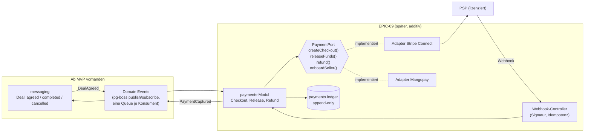

**Kernaussagen:**
- Geld fließt **nur** über den PSP (Marktplatz- bzw. Split-Produkt). Die Plattform ist nie im Geldfluss (ZAG).
- KYC der Verkäufer übernimmt der PSP.
- `payments` hängt von `messaging` nur über Events ab. Umgekehrt gibt es **keine** Abhängigkeit.
- Domain Events werden per **publish/subscribe** verteilt: Jeder Konsument (heute ein protokollierender Konsument, später `payments`) hat eine eigene Queue und erhält eine Kopie, statt mit anderen um dieselben Jobs zu konkurrieren. So bleibt `payments` rein additiv (Stand: geplant B-40, Sprint 2; heute eine Queue `deal-events` mit einem Konsumenten).
- Bezahlung ist pro Deal **opt-in** und nie voreingestellt (Verbraucherrecht, vgl. KG Berlin / Vinted).
- Im Docker-Beispiel wäre ein **Fake-PSP-Adapter** (Sandbox-Simulation) ausreichend, um den Ablauf zu zeigen, ohne externe Konten.

### 8.6 Observability (Beispiel-Niveau)
Strukturierte JSON-Logs (pino) mit Korrelations-ID, `/metrics` im Prometheus-Format (Request-Latenzen, Job-Durchsatz, WS-Verbindungen), Health-Endpunkte. Im Beispiel ist `/metrics` ohne Anmeldung auf Port 8080 erreichbar; im Echtbetrieb gehört es auf einen internen Port bzw. hinter eine Proxy-Regel. Zuschaltbares Tracing (OpenTelemetry) ist geplant (R2); ein Compose-Profil `observability` mit Grafana ist Could.

### 8.7 Barrierefreiheit und UX
Die neun Kernabläufe aus REQ-A11Y-002 (Registrierung, Anmeldung, Passwort zurücksetzen, Suche, Anzeige erstellen inkl. Bild, Anzeige verwalten, Nachricht senden, Melden, Kontaktfreigabe) sind vollständig per Tastatur bedienbar und werden automatisiert nur mit Tastatur durchlaufen; axe-core prüft die Kernseiten (Fallstudie FS-C2; Stand: automatisierter Test umgesetzt B-02, `e2e/tests/keyboard.spec.ts`). Die Auswahl im Dateidialog des Betriebssystems wird manuell geprüft (MAN-A11Y-002). Eigene zugängliche Basisbausteine (Tailwind, natives `<dialog>`, [ADR-0011](decisions/0011-mvp-umsetzung.md) Nr. 6), sichtbarer Fokus, Fokus-Management im Chat (ARIA-Live-Region für neue Nachrichten).

## 9. Architekturentscheidungen

| ADR | Titel | Status |
|---|---|---|
| [0001](decisions/0001-modularer-monolith.md) | Modularer Monolith statt Microservices | Accepted |
| [0002](decisions/0002-tech-stack.md) | Tech-Stack: TypeScript, React-SPA + Fastify, PostgreSQL, pg-boss (teilweise präzisiert durch 0011) | Accepted |
| [0003](decisions/0003-authentifizierung.md) | Eigene Authentifizierung mit Hochschul-E-Mail-Verifikation (ergänzt durch 0013) | Accepted |
| [0004](decisions/0004-chat-echtzeit.md) | Chat über WebSocket, Fan-out hinter einem Port | Accepted |
| [0005](decisions/0005-email-versand.md) | E-Mail über transaktionale pg-boss-Jobs und MailPort | Accepted |
| [0006](decisions/0006-bezahlung-erweiterungspunkt.md) | Bezahlung als späteres Modul hinter PaymentPort | Accepted |
| [0007](decisions/0007-bildspeicherung.md) | Bilder auf Docker-Volume hinter StoragePort (teilweise präzisiert durch 0011) | Accepted |
| [0008](decisions/0008-suche-postgres.md) | Suche mit PostgreSQL-Volltext | Accepted |
| [0009](decisions/0009-api-rest-openapi.md) | REST + OpenAPI 3.1 (Umsetzung Schema-first, präzisiert durch 0011) | Accepted |
| [0010](decisions/0010-docker-demo-deployment.md) | Auslieferung als lokales Docker-Beispiel | Accepted |
| [0011](decisions/0011-mvp-umsetzung.md) | Umsetzungsentscheidungen im MVP (SQL ohne ORM, Schema-first-Vertrag, CSRF, HEIC) | Accepted |
| [0012](decisions/0012-c4-notation.md) | C4-Modell als Notation, Mermaid-C4-Diagramme | Accepted |
| [0013](decisions/0013-anmeldung-identity-provider-port.md) | Anmeldung hinter einem IdentityProviderPort (Hochschulkennung, Q-12) | Proposed (Abstimmung mit Dozent/in) |
| [0014](decisions/0014-ip-pseudonymisierung.md) | Pseudonymisierung von IP-Adressen mit rotierendem Schlüssel | Proposed |

## 10. Qualitätsszenarien

| ID | Merkmal | Szenario (Stimulus → Reaktion → Messgröße) |
|---|---|---|
| QS-1 | Sicherheit | Ein Angreifer registriert sich mit `x@hwg-lu.de.evil.com` → das System lehnt ab → 0 Konten mit nicht gelisteter Domain (Decision-Table-Test, REQ-AUTH-001) |
| QS-2 | Vertraulichkeit | Ein Mitglied ruft `GET /conversations/{fremde-id}` auf → 404 (keine Existenzpreisgabe) → 100 % der Autorisierungsmatrix grün |
| QS-3 | Zuverlässigkeit | Der Mailserver (Mailpit) ist während einer Registrierung **30 min** nicht erreichbar und startet danach neu → der Job bleibt in der Queue → Mail erscheint nach dem Neustart, 0 verloren; in CI mit verkürzter Zeitbasis geprüft (REQ-NOTI-005) |
| QS-4 | Zuverlässigkeit | Die Netzverbindung des Browsers fällt aus und kehrt zurück → nach Wiederherstellung des Netzes verbindet die Web-App ≤ 5 s neu (Backoff wird beim Ereignis `online` zurückgesetzt) und lädt Verpasstes per `?after=` nach → keine verlorene oder doppelte Nachricht (REQ-CHAT-003/004) |
| QS-5 | Erweiterbarkeit | Ein PSP-Adapter wird ergänzt → nur das neue Modul `payments`, eine weitere Queue für Domain Events und additive Migrationen → 0 Änderungen in `listings`, `identity` und `messaging` |
| QS-6 | Erweiterbarkeit | Hochschule B wird freigeschaltet → Eintrag in `institution` + `allowed_domain` → ohne neues Image, < 1 h Aufwand |
| QS-7 | Performance | Lasttest gegen das Docker-Beispiel (k6, 20 Such-req/s, 10.000 Seed-Anzeigen) → Such-p95 < 500 ms und p99 < 1.500 ms auf einem Standard-Laptop (REQ-PERF-001) |
| QS-8 | Erweiterbarkeit | Echtbetrieb soll S3 statt Volume nutzen → neuer `StoragePort`-Adapter + Konfiguration → 0 Änderungen in Fachmodulen |
| QS-9 | Portabilität | Prüfer/in klont das Repo auf einem Rechner mit Docker → Image-Build ≤ 10 min (mit Internet) → `docker compose up` bis zum Login mit Demo-Konto ≤ 3 min, ohne Internet (REQ-OPS-003) |
| QS-10 | Vertraulichkeit | Lea stimmt der Kontaktfreigabe zu, Ben noch nicht → keiner sieht die Adresse des anderen; ein Moderator öffnet den gemeldeten Kontext → keine Adresse sichtbar (REQ-CHAT-010) |
| QS-11 | Benutzbarkeit | Ein Mitglied ohne Maus durchläuft die **9 Kernabläufe** (Registrierung, Anmeldung, Passwort zurücksetzen, Suche, Anzeige erstellen inkl. Bild, Anzeige verwalten, Nachricht senden, Melden, Kontaktfreigabe) → alle Schritte nur mit Tastatur möglich, Fokus jederzeit sichtbar; axe-core meldet 0 Verstöße `serious`/`critical` auf den Kernseiten; die Dateiauswahl im Systemdialog ist manuell geprüft (MAN-A11Y-002) (REQ-A11Y-002) |
| QS-12 | Performance | 200 gleichzeitige WebSocket-Verbindungen, 5 Nachrichten/s → Zeit vom Eingang beim Server bis zur Zustellung an den verbundenen Empfänger p95 < 2 s (REQ-PERF-002) |
| QS-13 | Sicherheit | Ein Konto wird gesperrt, während es noch eine gültige Sitzung hat → die nächste Anfrage mit der alten Sitzung (z. B. Anzeige anlegen, Bild hochladen) wird abgewiesen → 0 Aktionen gesperrter oder unbestätigter Konten (REQ-SEC-011) |
| QS-14 | Verfügbarkeit / Sicherheit | Zum Semesterstart registrieren sich 30 Studierende über dieselbe öffentliche Campus-IP innerhalb einer Stunde → alle 30 Registrierungen werden angenommen, die 31. erhält eine Wartezeit; eine Adresse kann höchstens 3-mal je Stunde registrieren (REQ-SEC-005, Q-18) |

## 11. Risiken und technische Schulden

| ID | Risiko | Eintritt / Auswirkung | Maßnahme |
|---|---|---|---|
| R-1 | Kritische Masse ist im Beispiel nicht erlebbar, die Plattform wirkt leer | hoch / mittel | Seed-Daten mit realistischen Anzeigen und Konversationen (REQ-DEMO-001) |
| R-2 | ~~Hochschul-Spamfilter blockieren Mails~~ | entfällt (Mailpit) | → EPIC-12 |
| R-3 | Exmatrikulierte behalten Postfächer | mittel / mittel | Re-Verifikation alle 12 Monate (REQ-AUTH-007) ist für **R2** geplant (Q-14) und **nicht umgesetzt**; bis dahin bleibt das Risiko bestehen |
| R-4 | ~~Betreiberrolle ungeklärt~~ | entfällt (kein Hosting) | → EPIC-12 |
| R-5 | Eigene Auth ist fehleranfällig | mittel / hoch | Bewährte Bibliotheken, ASVS-L2-Checkliste, Tests (ADR-0003) |
| R-6 | Docker-Setup läuft auf Prüfrechnern nicht (ARM vs. x86, Ports belegt, Docker-Version) | mittel / **hoch** | Basis-Images sind multi-arch und das Image wird lokal gebaut; Multi-Arch-Build in CI geplant (B-08); Ports per `.env` änderbar; Smoke-Test von `docker compose up` (in CI, B-07); README mit Troubleshooting |
| R-7 | Teamkapazität | mittel / mittel | Schlanker Stack (ADR-0010), MoSCoW konsequent anwenden |
| R-8 | Fallstudien-Constraint FS-C3 (Anmeldung über die Hochschulkennung) wird nicht anerkannt | mittel / hoch | Dokumentierte Abweichung, ADR-0013, Abstimmung mit Dozent/in (Q-12, Spike S-01) |
| R-9 | Mermaid-C4 ist experimentell, Layout begrenzt | mittel / niedrig | Kleine Diagramme, Prüfung mit `scripts/check-diagrams.mjs`; Ausweg Structurizr DSL (ADR-0012) |
| R-10 | Zyklus `listings ↔ messaging` über späte Bindung | mittel / mittel | Abhängigkeitsrichtung festgelegt (OE-1), Umstellung auf Domain Events B-39 |

## 12. Glossar

| Begriff | Bedeutung |
|---|---|
| Anzeige | Angebot oder Gesuch eines Mitglieds |
| C4-Modell | Notation für Softwarearchitektur mit den Ebenen Systemkontext, Container, Komponente, Code (Simon Brown) |
| Container (C4) | Separat ausführbare oder Daten haltende Einheit eines Softwaresystems (Web-App, Anwendung, Datenbank); nicht gleichbedeutend mit Docker-Container |
| Kontaktfreigabe | Beidseitige Zustimmung zweier Konversationsteilnehmer, einander die Hochschul-E-Mail-Adresse anzuzeigen |
| Inhaltsprüfung | Automatische Prüfung einer Anzeige vor der Veröffentlichung (REQ-LST-010); im MVP als Wortliste umgesetzt |
| Angebot / Gesuch | Anzeigentyp: Ich biete etwas an / ich suche etwas |
| Preistyp | Festpreis, VB (Verhandlungsbasis), zu verschenken, Tausch |
| Übergabeort | Campus-Standort, an dem die Übergabe stattfinden kann |
| Konversation | Chatverlauf zwischen Anbieter und genau einem Interessenten zu genau einer Anzeige |
| Deal | Vereinbarung über einen Preis bzw. eine Übergabe innerhalb einer Konversation. Grundlage der späteren Bezahlung |
| Whitelist | Liste zugelassener E-Mail-Domains |
| Outbox-Muster | Seiteneffekte werden transaktional mit der Fachänderung gespeichert und danach asynchron verarbeitet (hier: pg-boss-Jobs) |
| Mailpit | Mail-Catcher für Entwicklung und Demo: nimmt SMTP an und zeigt die Mails in einer Weboberfläche, ohne sie zuzustellen |
| Port / Adapter | Schnittstelle der Fachlogik nach außen / austauschbare technische Implementierung |
| Pseudonymisierung | Ersetzen eines Merkmals (z. B. IP-Adresse) durch einen Wert, der ohne zusätzlichen, getrennt aufbewahrten Schlüssel nicht zurückgeführt werden kann |
| PSP | Payment Service Provider, Zahlungsdienstleister |
| DSA | Digital Services Act (EU-Verordnung 2022/2065) |
