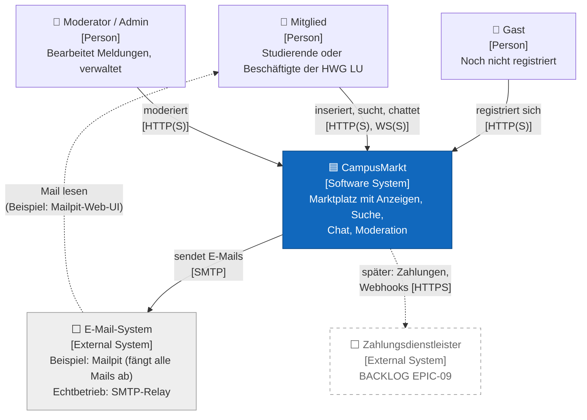
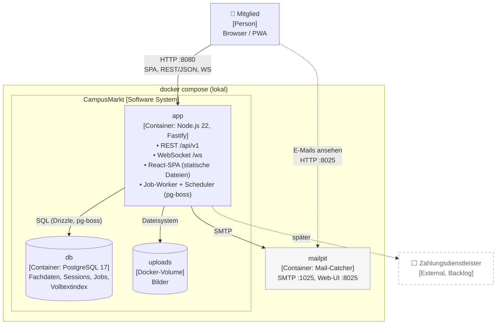
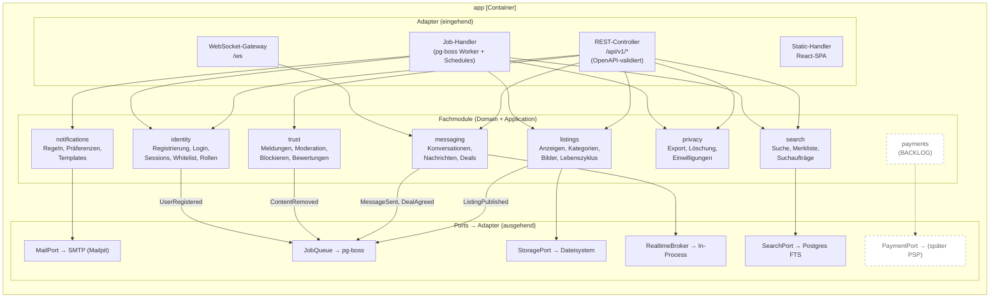
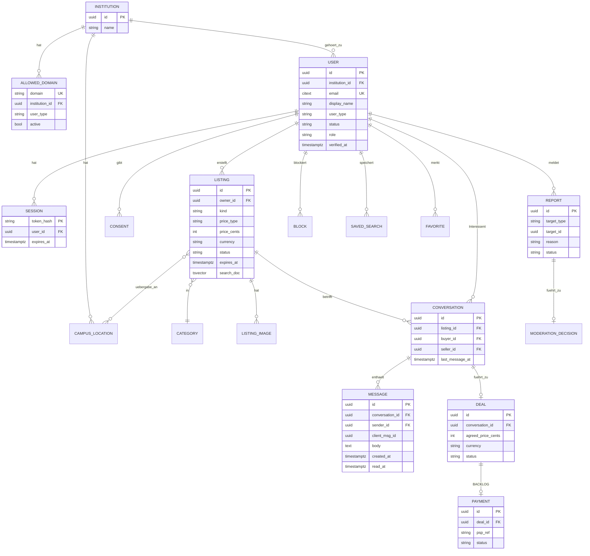
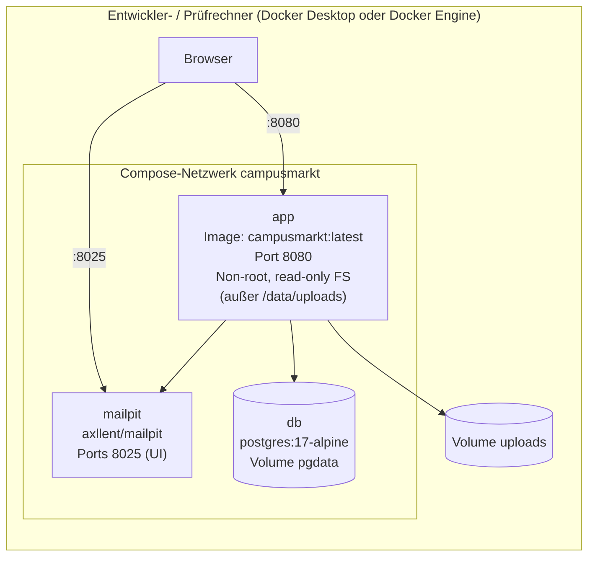

# Architekturdokumentation CampusMarkt (arc42, kompakt)

> **v0.2:** Kein öffentliches Hosting. Das Ergebnis ist ein lauffähiges **Docker-Beispiel** ([ADR-0010](decisions/0010-docker-demo-deployment.md)). Betriebsthemen für einen späteren Echtbetrieb stehen in EPIC-12 im [Backlog](../02-anforderungen/03-backlog.md).

## 1. Einführung und Ziele

### 1.1 Aufgabenstellung
Ein Marktplatz für Angehörige der HWG LU zum Verkaufen, Tauschen, Verschenken und Suchen von Gegenständen. Er hat einen integrierten Chat und versendet E-Mails. Der Zugang ist auf verifizierte Hochschuladressen beschränkt. Ausgeliefert wird er als lokal startbares Docker-Setup. Details: [Use Cases](../02-anforderungen/01-use-cases.md), [Anforderungen](../02-anforderungen/02-anforderungen.md).

### 1.2 Qualitätsziele (Top 5, priorisiert)

| Prio | Qualitätsmerkmal (ISO 25010) | Ziel | Szenario |
|---|---|---|---|
| 1 | **Sicherheit** (Authentizität, Vertraulichkeit) | Nur Hochschulangehörige, private Chats bleiben privat | QS-1, QS-2 |
| 2 | **Wartbarkeit** (Modularität, Erweiterbarkeit) | Bezahlung, weitere Hochschulen und Produktivbetrieb ohne Umbau der Fachlogik | QS-5, QS-6, QS-8 |
| 3 | **Portabilität** (Installierbarkeit) | `docker compose up` → lauffähig in < 1 min, offline, ohne externe Konten | QS-9 |
| 4 | **Zuverlässigkeit** | Keine verlorenen Nachrichten oder E-Mails | QS-3, QS-4 |
| 5 | **Benutzbarkeit** (inkl. Barrierefreiheit) | Anzeige in < 2 min, WCAG 2.2 AA | REQ-LST-001, REQ-A11Y-001 |

### 1.3 Stakeholder

| Rolle | Erwartung |
|---|---|
| Studierende, Beschäftigte (Zielnutzer, im Projekt durch Personas und Testnutzer vertreten) | Einfach, sicher, kostenlos |
| Projektteam (Studierende SWeng) | Machbar im Semester, gut lernbar, guideline-konform |
| Dozent/in, Prüfer/in | Nachvollziehbare Methodik (UML, arc42, ADRs, Traceability), Demo mit einem Befehl startbar |

## 2. Randbedingungen

| Typ | Randbedingung |
|---|---|
| Organisatorisch | Studienprojekt, kleines Team, Semester-Zeitrahmen, kein Budget |
| Organisatorisch | DEV Guideline ist verbindlich. Abweichungen nur per ADR oder Exception |
| **Technisch** | **Kein öffentliches Hosting. Auslieferung als Docker-Image + Compose-Datei, lokal lauffähig, ohne Internetzugang** (ADR-0010) |
| Technisch | Web-first (PWA). Keine native App |
| Rechtlich | Kein Produktivbetrieb, daher keine Betreiberpflichten im Projekt. DSGVO, DSA und BITV werden **konzeptionell** berücksichtigt (Privacy by Design), damit ein Echtbetrieb möglich bliebe |
| Fachlich | Domain-Whitelist `hwg-lu.de`, `studmail.hwg-lu.de` |

## 3. Kontextabgrenzung

### 3.1 Fachlicher Kontext (C4 Level 1: System Context)



### 3.2 Technischer Kontext

| Schnittstelle | Protokoll | Daten | Richtung |
|---|---|---|---|
| Browser bzw. PWA ↔ App | HTTP auf `localhost:8080` (optional HTTPS über ein Caddy-Profil) | HTML/JS (SPA), JSON | bidirektional |
| Browser ↔ App | WebSocket `/ws` | Chat-Events (JSON) | bidirektional |
| App → E-Mail-System | SMTP (`mailpit:1025`), per Umgebungsvariablen austauschbar | E-Mails | ausgehend |
| Browser → Mailpit-UI | HTTP `localhost:8025` | Abgefangene E-Mails (nur Beispiel) | – |
| *(später)* App ↔ PSP | HTTPS-API + signierte Webhooks | Zahlungen | bidirektional |

## 4. Lösungsstrategie

| Ziel / Problem | Lösungsansatz | ADR |
|---|---|---|
| Kleines Team, schnelle Iteration, später erweiterbar | **Modularer Monolith** mit klaren fachlichen Modulen, **ein** Anwendungs-Image | [ADR-0001](decisions/0001-modularer-monolith.md) |
| Ein Image, wenige Konzepte | **TypeScript**: React-SPA (Vite), ausgeliefert durch Fastify. PostgreSQL + Drizzle. Kein Redis, kein S3 | [ADR-0002](decisions/0002-tech-stack.md) |
| Vertrauen durch Hochschulzugehörigkeit | Eigene, schlanke Authentifizierung mit E-Mail-Verifikation und Domain-Whitelist, Sessions in Postgres | [ADR-0003](decisions/0003-authentifizierung.md) |
| Echtzeit-Chat | WebSocket, Postgres als Quelle der Wahrheit, Fan-out hinter einem `RealtimeBroker`-Port | [ADR-0004](decisions/0004-chat-echtzeit.md) |
| Zuverlässiger E-Mail-Versand | Jobs werden mit **pg-boss transaktional** eingereiht (Outbox-Muster), `MailPort` → Mailpit | [ADR-0005](decisions/0005-email-versand.md) |
| Bezahlung später ohne Umbau | **Ports & Adapters**: `PaymentPort`, Deal-Konzept und Domain Events schon im MVP | [ADR-0006](decisions/0006-bezahlung-erweiterungspunkt.md) |
| Bilder | Docker-Volume hinter `StoragePort`, Verarbeitung im Job | [ADR-0007](decisions/0007-bildspeicherung.md) |
| Suche ohne Zusatzinfrastruktur | **PostgreSQL-Volltextsuche** + `pg_trgm` | [ADR-0008](decisions/0008-suche-postgres.md) |
| API-Vertrag | **REST + OpenAPI 3.1** (Design-first), AsyncAPI für WebSocket | [ADR-0009](decisions/0009-api-rest-openapi.md) |
| Kein Hosting, trotzdem vorführbar | **Docker Compose**: `app` + `db` + `mailpit`, Seed-Daten mit Demo-Konten | [ADR-0010](decisions/0010-docker-demo-deployment.md) |

**Leitprinzip:** Alles, was im Beispiel bewusst einfacher gelöst ist (Fan-out, Storage, Mail, Rate-Limit-Store), steckt hinter einem **Port**. Ein späterer Echtbetrieb (EPIC-12) tauscht Adapter, nicht Fachlogik.

## 5. Bausteinsicht

### 5.1 Ebene 2: Container (C4 Level 2)



**Ein Image, mehrere Rollen:** Das Image `campusmarkt` kennt die Startmodi `all` (Default im Beispiel), `api` und `worker`. Im Beispiel laufen API und Worker in **einem** Prozess, aber in getrennten Concurrency-Pools, damit langsame Jobs (Bilder, Mail) die Request-Latenz nicht blockieren (Bulkhead, Guideline Kap. 05). Für einen Echtbetrieb lassen sich beide Modi getrennt skalieren, ohne Codeänderung.

### 5.2 Ebene 3: Komponenten des App-Containers (C4 Level 3)



**Modulregeln (Fitness Functions, REQ-MAINT-002):**
1. Ein Modul hat ein **öffentliches API** (`index.ts`). Alles andere ist intern.
2. Module greifen **nie** auf Tabellen anderer Module zu. Jedes Modul hat ein eigenes Postgres-Schema (`identity.*`, `listings.*`, …).
3. Kommunikation zwischen Modulen erfolgt synchron über das öffentliche API (Abfragen) oder **asynchron über Domain Events** (als pg-boss-Jobs transaktional eingereiht).
4. Innerhalb eines Moduls gilt Schichtung `domain ← application ← infrastructure`. `domain` importiert keine Frameworks.
5. Fachmodule kennen nur **Ports**, nie konkrete Adapter (Nodemailer, fs, pg-boss).
6. Wird in CI mit `dependency-cruiser` geprüft.

### 5.3 Fachliches Datenmodell (Auszug)



Unique-Constraints (Auszug): `USER(email)` · `CONVERSATION(listing_id, buyer_id)` (REQ-CHAT-002) · `MESSAGE(conversation_id, client_msg_id)` (REQ-CHAT-004, Idempotenz) · `ALLOWED_DOMAIN(domain)`. Die Job-Tabellen verwaltet pg-boss in einem eigenen Schema `pgboss`.

## 6. Laufzeitsicht

### 6.1 Registrierung mit E-Mail-Verifikation

```mermaid
sequenceDiagram
    autonumber
    actor G as Gast
    participant SPA as SPA (Browser)
    participant A as app: identity
    participant DB as PostgreSQL
    participant J as app: Job-Worker
    participant MP as Mailpit

    G->>SPA: Formular absenden
    SPA->>A: POST /api/v1/auth/register
    A->>A: Rate-Limit prüfen
    A->>A: E-Mail normalisieren, Domain gegen Whitelist (BR-01)
    A->>A: Passwort prüfen (Länge, lokale Leak-Liste), Argon2id-Hash
    A->>DB: BEGIN; INSERT user (unverifiziert), consent, token-hash;<br/>pg-boss send(send-email, verify); COMMIT
    A-->>SPA: 202 Accepted (neutrale Antwort)
    SPA-->>G: „Bitte E-Mail bestätigen“
    Note over DB,J: asynchron
    J->>DB: Job abholen (SKIP LOCKED)
    J->>MP: SMTP senden (Timeout 10 s, Retry mit Backoff)
    G->>MP: Mail in Mailpit-UI öffnen (Beispiel)
    G->>SPA: Link /verify?token=… öffnen
    SPA->>A: POST /api/v1/auth/verify
    A->>DB: Token-Hash prüfen (einmalig, ≤ 24 h), user.status = aktiv, Session anlegen
    A-->>SPA: Set-Cookie session (HttpOnly, Secure, SameSite=Lax)
```

### 6.2 Chat-Nachricht senden

```mermaid
sequenceDiagram
    autonumber
    actor I as Interessent
    participant WS as app: WS-Gateway
    participant MSG as app: messaging
    participant DB as PostgreSQL
    participant RB as RealtimeBroker
    actor V as Anbieter

    I->>WS: send {conversationId, clientMsgId, body}
    WS->>MSG: sendMessage(cmd)
    MSG->>MSG: Teilnahme, Block, Rate-Limit prüfen
    MSG->>DB: BEGIN; INSERT message ON CONFLICT (conversation_id, client_msg_id) DO NOTHING;<br/>pg-boss send(notify-unread, startAfter 15 min); COMMIT
    MSG-->>WS: ok {messageId, createdAt}
    WS-->>I: ack
    MSG->>RB: publish(V, message)
    RB-->>V: WS push (falls verbunden)
    Note over V,DB: Nach 15 min prüft der Job read_at.<br/>Ist die Nachricht ungelesen, folgt eine gebündelte E-Mail ohne Inhalt.
    V->>WS: read {messageId}
    WS->>MSG: markRead
    MSG->>DB: UPDATE read_at
    MSG->>RB: publish(I, read-receipt)
```

**Wiederherstellung nach Verbindungsabbruch:** Der Client sendet beim Reconnect `since=<lastMessageId>` und lädt Verpasstes per REST nach. Die Zustellung ist **at-least-once**, die Idempotenz entsteht über `client_msg_id` (REQ-CHAT-004).
**Skalierungspfad (nicht im Beispiel):** Der `RealtimeBroker`-Adapter wird gegen `PgNotifyAdapter` (Postgres `LISTEN/NOTIFY`) getauscht. Danach sind mehrere `api`-Instanzen möglich.

### 6.3 Anzeige mit Bildern veröffentlichen

```mermaid
sequenceDiagram
    autonumber
    actor M as Mitglied
    participant SPA as SPA
    participant L as app: listings
    participant ST as StoragePort (Volume)
    participant DB as PostgreSQL
    participant J as app: Job-Worker

    M->>SPA: Bilder wählen, Formular ausfüllen
    SPA->>L: POST /api/v1/uploads (multipart, ≤ 10 MB/Datei)
    L->>ST: put(quarantine/…)
    L-->>SPA: 201 {uploadIds}
    SPA->>L: POST /api/v1/listings {…, uploadIds}
    L->>L: Validierung, Wortfilter (REQ-LST-010), Limit 30
    L->>DB: BEGIN; INSERT listing (aktiv | in_pruefung);<br/>send(process-image ×n), send(match-saved-searches); COMMIT
    L-->>SPA: 201 Created
    J->>ST: Original laden, Magic Bytes prüfen,<br/>WebP neu kodieren (EXIF weg), Thumbnails
    J->>DB: listing_image.status = ready
```

## 7. Verteilungssicht

### 7.1 Docker-Beispiel (verbindlich für das Projekt)



| Aspekt | Festlegung |
|---|---|
| Start | `docker compose up` (baut das Image oder zieht es aus der GitHub Container Registry) |
| Start-Reihenfolge | `app` wartet per Healthcheck auf `db` (`depends_on: condition: service_healthy`) |
| Migrationen | Laufen beim App-Start automatisch (drizzle-kit migrate), idempotent |
| Seed-Daten | Optional per `SEED_DEMO=true`: Institution HWG LU, Whitelist, Campus-Standorte, Kategorien, Demo-Konten (Mitglied, Moderator, Admin), ca. 30 Beispielanzeigen (REQ-DEMO-001) |
| Konfiguration | Nur Umgebungsvariablen (`.env.example` im Repo, keine Secrets im Image) |
| Health | `GET /health/live`, `GET /health/ready` (DB erreichbar), Docker-`HEALTHCHECK` |
| Logs | JSON auf stdout (`docker compose logs app`) |
| Reset | `docker compose down -v` löscht alle Daten |
| HTTPS (optional) | Compose-Profil `tls` mit Caddy und lokalem Zertifikat |

| Umgebung | Zweck | Infrastruktur |
|---|---|---|
| `local` | Entwicklung | `docker compose -f compose.dev.yaml up` (nur db + mailpit), App per `pnpm dev` mit Hot Reload |
| `ci` | Tests | Testcontainers (gleiches Postgres-Image), Image-Build, Smoke-Test des Compose-Setups |
| `demo` | Abgabe / Vorführung | `docker compose up`, siehe oben |

### 7.2 Ausblick Echtbetrieb (nicht Teil des Projekts, EPIC-12)
Gleiches Image. Getrennte `api`- und `worker`-Instanzen, managed Postgres mit PITR, echter SMTP-Relay (SPF/DKIM/DMARC), S3-Adapter, `PgNotifyAdapter`, Reverse Proxy mit TLS, OpenTelemetry. Dazu kommen die Betreiberpflichten (Impressum, Datenschutzerklärung, DSA-Prozesse). Keine Fachlogik ändert sich.

## 8. Querschnittliche Konzepte

### 8.1 Sicherheit
- **Authentifizierung:** serverseitige Sessions (gehashtes Opaque-Token in Postgres), Cookie `HttpOnly; Secure; SameSite=Lax`. Siehe ADR-0003.
- **Autorisierung:** zentrale Policy-Funktionen pro Ressource (`canEditListing(user, listing)`), *deny by default*, Testmatrix Rolle × Aktion.
- **Eingaben:** Validierung an der Grenze über die JSON-Schemas aus OpenAPI (Fastify). Ausgabe-Encoding durch React. Strikte CSP (die SPA kommt vom selben Origin).
- **Container-Härtung:** Non-root-User, Read-only-Root-FS, keine Secrets im Image, Image-Scan (Trivy) in CI, minimales Base-Image.
- **Supply Chain:** Lockfile, Renovate, SCA, Secret-Scan, SBOM (CycloneDX) in CI.
- **Demo-spezifisch:** Demo-Passwörter stehen nur in der Seed-Dokumentation und werden nur bei `SEED_DEMO=true` angelegt.

### 8.2 Zuverlässigkeit
- **Transaktionales Enqueue** (pg-boss im selben Commit) für alle Seiteneffekte. Kein Seiteneffekt geht verloren, keiner wird ohne Commit ausgeführt.
- **Timeouts** für alle externen Aufrufe (SMTP 10 s), **Retry** nur idempotent mit Backoff, Dead-Letter-Queue.
- **Graceful Shutdown** bei `SIGTERM` (`docker compose stop`): keine neuen Requests annehmen, WebSockets mit Reconnect-Hinweis schließen, laufende Jobs beenden (≤ 30 s).
- **Degradation:** Chat fällt auf Polling zurück. Suche fällt auf Titel-ILIKE zurück.

### 8.3 E-Mail-Konzept
- Templates (MJML → HTML + Text), deutsch und i18n-fähig.
- **Keine Chatinhalte** in E-Mails, nur Hinweise mit Link.
- Im Beispiel landen alle Mails in Mailpit. Damit ist auch die Registrierung mit echten Adressformaten wie `@studmail.hwg-lu.de` gefahrlos vorführbar, weil nichts das Rechnernetz verlässt.
- Zustellbarkeit (SPF/DKIM/DMARC, Bounces) ist N/A für das Beispiel → EPIC-12.

### 8.4 Datenschutz: Datenklassifikation und Löschfristen
Die Fristen sind fachlich umgesetzt (Jobs), auch wenn das Beispiel nicht produktiv betrieben wird. So zeigt das Projekt Privacy by Design.

| Datenkategorie | Klasse | Speicherdauer |
|---|---|---|
| E-Mail-Adresse, Passwort-Hash | vertraulich | bis Kontolöschung + 14 Tage Karenz |
| Anzeigen, Bilder | intern (nur Mitglieder) | bis Löschung durch Nutzer bzw. 90 Tage nach Ablauf |
| Chatnachrichten | **vertraulich** | bis 12 Monate nach der letzten Nachricht oder bis zur Löschung durch einen Teilnehmer (Q-7) |
| Meldungen + Moderationsentscheidungen | vertraulich | 12 Monate nach Abschluss |
| Audit-Log (Admin-Aktionen) | vertraulich | 24 Monate |
| IP-Hashes (Missbrauchsschutz) | vertraulich | 7 Tage |
| Anwendungs-Logs | intern, **ohne PII** | Container-Logs, nicht persistiert |

### 8.5 Erweiterungspunkt Bezahlung (ADR-0006)


**Kernaussagen:**
- Geld fließt **nur** über den PSP (Marktplatz- bzw. Split-Produkt). Die Plattform ist nie im Geldfluss (ZAG).
- KYC der Verkäufer übernimmt der PSP.
- `payments` hängt von `messaging` nur über Events ab. Umgekehrt gibt es **keine** Abhängigkeit.
- Bezahlung ist pro Deal **opt-in** und nie voreingestellt (Verbraucherrecht, vgl. KG Berlin / Vinted).
- Im Docker-Beispiel wäre ein **Fake-PSP-Adapter** (Sandbox-Simulation) ausreichend, um den Ablauf zu zeigen, ohne externe Konten.

### 8.6 Observability (Beispiel-Niveau)
Strukturierte JSON-Logs (pino) mit Korrelations-ID, `/metrics` im Prometheus-Format (Request-Latenzen, Job-Durchsatz, WS-Verbindungen), Health-Endpunkte. OpenTelemetry-Instrumentierung ist vorbereitet (per Umgebungsvariable aktivierbar), aber kein Bestandteil des Compose-Setups. Ein Compose-Profil `observability` mit Grafana ist Could.

### 8.7 Barrierefreiheit und UX
Komponentenbibliothek auf Basis zugänglicher Primitives (Radix bzw. shadcn/ui), axe-core in Komponententests und E2E, Tastaturbedienung, Fokus-Management im Chat (ARIA-Live-Region für neue Nachrichten).

## 9. Architekturentscheidungen

| ADR | Titel | Status |
|---|---|---|
| [0001](decisions/0001-modularer-monolith.md) | Modularer Monolith statt Microservices | Proposed |
| [0002](decisions/0002-tech-stack.md) | Tech-Stack: TypeScript, React-SPA + Fastify, PostgreSQL, pg-boss | Proposed |
| [0003](decisions/0003-authentifizierung.md) | Eigene Authentifizierung mit Hochschul-E-Mail-Verifikation | Proposed |
| [0004](decisions/0004-chat-echtzeit.md) | Chat über WebSocket, Fan-out hinter einem Port | Proposed |
| [0005](decisions/0005-email-versand.md) | E-Mail über transaktionale pg-boss-Jobs und MailPort | Proposed |
| [0006](decisions/0006-bezahlung-erweiterungspunkt.md) | Bezahlung als späteres Modul hinter PaymentPort | Proposed |
| [0007](decisions/0007-bildspeicherung.md) | Bilder auf Docker-Volume hinter StoragePort | Proposed |
| [0008](decisions/0008-suche-postgres.md) | Suche mit PostgreSQL-Volltext | Proposed |
| [0009](decisions/0009-api-rest-openapi.md) | REST + OpenAPI 3.1, Design-first | Proposed |
| [0010](decisions/0010-docker-demo-deployment.md) | Auslieferung als lokales Docker-Beispiel | **Accepted** |
| [0011](decisions/0011-mvp-umsetzung.md) | Umsetzungsentscheidungen im MVP (SQL ohne ORM, Schema-first-Vertrag, CSRF, HEIC) | Proposed |

## 10. Qualitätsszenarien

| ID | Merkmal | Szenario (Stimulus → Reaktion → Messgröße) |
|---|---|---|
| QS-1 | Sicherheit | Ein Angreifer registriert sich mit `x@hwg-lu.de.evil.com` → das System lehnt ab → 0 Konten mit nicht gelisteter Domain (Decision-Table-Test, REQ-AUTH-001) |
| QS-2 | Vertraulichkeit | Ein Mitglied ruft `GET /conversations/{fremde-id}` auf → 404 (keine Existenzpreisgabe) → 100 % der Autorisierungsmatrix grün |
| QS-3 | Zuverlässigkeit | Der Mailpit-Container wird während einer Registrierung gestoppt und nach 5 min neu gestartet → der Job bleibt in der Queue → Mail erscheint nach dem Neustart, 0 verloren |
| QS-4 | Zuverlässigkeit | Die WebSocket-Verbindung bricht ab (Browser offline) → Reconnect, verpasste Nachrichten werden nachgeladen → keine verlorene oder doppelte Nachricht, Reconnect < 5 s |
| QS-5 | Erweiterbarkeit | Ein PSP-Adapter wird ergänzt → nur das neue Modul `payments` und additive Migrationen → 0 Änderungen in `listings` und `identity` |
| QS-6 | Erweiterbarkeit | Hochschule B wird freigeschaltet → Eintrag in `institution` + `allowed_domain` → ohne neues Image, < 1 h Aufwand |
| QS-7 | Performance | Lasttest gegen das Docker-Beispiel (k6, 20 Such-req/s, 10.000 Seed-Anzeigen) → Such-p95 < 500 ms auf einem Standard-Laptop |
| QS-8 | Erweiterbarkeit | Echtbetrieb soll S3 statt Volume nutzen → neuer `StoragePort`-Adapter + Konfiguration → 0 Änderungen in Fachmodulen |
| QS-9 | Portabilität | Prüfer/in klont das Repo auf einem Rechner mit Docker → `docker compose up` → Login mit Demo-Konto innerhalb von 3 min (inkl. Image-Build), ohne Internet nach dem Build |

## 11. Risiken und technische Schulden

| ID | Risiko | Eintritt / Auswirkung | Maßnahme |
|---|---|---|---|
| R-1 | Kritische Masse ist im Beispiel nicht erlebbar, die Plattform wirkt leer | hoch / mittel | Seed-Daten mit realistischen Anzeigen und Konversationen (REQ-DEMO-001) |
| R-2 | ~~Hochschul-Spamfilter blockieren Mails~~ | entfällt (Mailpit) | → EPIC-12 |
| R-3 | Exmatrikulierte behalten Postfächer | konzeptionell | Re-Verifikation alle 12 Monate (REQ-AUTH-007) ist umgesetzt und per Zeitsteuerung im Test vorführbar |
| R-4 | ~~Betreiberrolle ungeklärt~~ | entfällt (kein Hosting) | → EPIC-12 |
| R-5 | Eigene Auth ist fehleranfällig | mittel / hoch | Bewährte Bibliotheken, ASVS-L2-Checkliste, Tests (ADR-0003) |
| R-6 | Docker-Setup läuft auf Prüfrechnern nicht (ARM vs. x86, Ports belegt, Docker-Version) | mittel / **hoch** | Multi-Arch-Image (amd64 + arm64), Ports per `.env` änderbar, CI-Smoke-Test von `docker compose up`, README mit Troubleshooting |
| R-7 | Teamkapazität | mittel / mittel | Schlanker Stack (ADR-0010), MoSCoW konsequent anwenden |

## 12. Glossar

| Begriff | Bedeutung |
|---|---|
| Anzeige | Angebot oder Gesuch eines Mitglieds |
| Angebot / Gesuch | Anzeigentyp: Ich biete etwas an / ich suche etwas |
| Preistyp | Festpreis, VB (Verhandlungsbasis), zu verschenken, Tausch |
| Übergabeort | Campus-Standort, an dem die Übergabe stattfinden kann |
| Konversation | Chatverlauf zwischen Anbieter und genau einem Interessenten zu genau einer Anzeige |
| Deal | Vereinbarung über einen Preis bzw. eine Übergabe innerhalb einer Konversation. Grundlage der späteren Bezahlung |
| Whitelist | Liste zugelassener E-Mail-Domains |
| Outbox-Muster | Seiteneffekte werden transaktional mit der Fachänderung gespeichert und danach asynchron verarbeitet (hier: pg-boss-Jobs) |
| Mailpit | Mail-Catcher für Entwicklung und Demo: nimmt SMTP an und zeigt die Mails in einer Weboberfläche, ohne sie zuzustellen |
| Port / Adapter | Schnittstelle der Fachlogik nach außen / austauschbare technische Implementierung |
| PSP | Payment Service Provider, Zahlungsdienstleister |
| DSA | Digital Services Act (EU-Verordnung 2022/2065) |
