# Architekturdokumentation CampusMarkt (arc42, kompakt)

> **v1.0:** Bausteinsicht, Kontext und Verteilung im **C4-Modell** (Mermaid-C4, [ADR-0012](decisions/0012-c4-notation.md)); angeglichen an Anforderungen v1 und die Fallstudie (Kontaktfreigabe, Anmeldung hinter `IdentityProviderPort`, [ADR-0013](decisions/0013-anmeldung-identity-provider-port.md)).
>
> **v0.2:** Kein öffentliches Hosting. Das Ergebnis ist ein lauffähiges **Docker-Beispiel** ([ADR-0010](decisions/0010-docker-demo-deployment.md)). Betriebsthemen für einen späteren Echtbetrieb stehen in EPIC-12 im [Backlog](../02-anforderungen/03-backlog.md).

## 1. Einführung und Ziele

### 1.1 Aufgabenstellung
Ein Marktplatz für Angehörige der HWG LU zum Verkaufen, Tauschen, Verschenken und Suchen von Gegenständen. Er hat einen integrierten Chat und versendet E-Mails. Der Zugang ist auf verifizierte Hochschuladressen beschränkt. Ausgeliefert wird er als lokal startbares Docker-Setup. Details: [Use Cases](../02-anforderungen/01-use-cases.md), [Anforderungen](../02-anforderungen/02-anforderungen.md).

### 1.2 Qualitätsziele (Top 5, priorisiert)

| Prio | Qualitätsmerkmal (ISO 25010) | Ziel | Szenario |
|---|---|---|---|
| 1 | **Sicherheit** (Authentizität, Vertraulichkeit) | Nur Hochschulangehörige, private Chats bleiben privat, Kontaktdaten nur nach beidseitiger Zustimmung | QS-1, QS-2, QS-10 |
| 2 | **Wartbarkeit** (Modularität, Erweiterbarkeit) | Bezahlung, weitere Hochschulen und Produktivbetrieb ohne Umbau der Fachlogik | QS-5, QS-6, QS-8 |
| 3 | **Portabilität** (Installierbarkeit) | Image-Build ≤ 10 min (mit Internet); danach `docker compose up` bis zum Login mit Demo-Konto ≤ 3 min, offline, ohne externe Konten (REQ-OPS-003) | QS-9 |
| 4 | **Zuverlässigkeit** | Keine verlorenen Nachrichten oder E-Mails | QS-3, QS-4 |
| 5 | **Benutzbarkeit** (inkl. Barrierefreiheit) | Anzeige in < 2 min, WCAG 2.2 AA, Kernabläufe vollständig per Tastatur | REQ-LST-001, REQ-A11Y-001, REQ-A11Y-002, QS-11 |

### 1.3 Stakeholder

| Rolle | Erwartung |
|---|---|
| Studierende, Beschäftigte (Zielnutzer, im Projekt durch Personas und Testnutzer vertreten) | Einfach, sicher, kostenlos |
| Projektteam (Studierende SWeng) | Machbar im Semester, gut lernbar, guideline-konform |
| Dozent/in, Prüfer/in | Nachvollziehbare Methodik (UML, arc42, ADRs, Traceability), Demo mit einem Befehl startbar |

## 2. Randbedingungen

| Typ | Randbedingung |
|---|---|
| Organisatorisch | Studienprojekt, kleines Team, Semester-Zeitrahmen, kein Budget |
| Organisatorisch | DEV Guideline ist verbindlich. Abweichungen nur per ADR oder Exception |
| **Technisch** | **Kein öffentliches Hosting. Auslieferung als Docker-Image + Compose-Datei, lokal lauffähig, ohne Internetzugang** (ADR-0010) |
| Technisch | Web-first (PWA). Keine native App |
| Rechtlich | Kein Produktivbetrieb, daher keine Betreiberpflichten im Projekt. DSGVO, DSA und BITV werden **konzeptionell** berücksichtigt (Privacy by Design), damit ein Echtbetrieb möglich bliebe |
| Fachlich | Domain-Whitelist `hwg-lu.de`, `studmail.hwg-lu.de` |
| Fallstudie (MWI131) | Kontaktdaten erst nach beidseitiger Zustimmung (C-01), Tastaturbedienbarkeit (C-02), Anmeldung über die Hochschulkennung (C-03, dokumentierte Abweichung, ADR-0013), Angebote nur von verifizierten Nutzern (C-04) – siehe [Constraints](../02-anforderungen/02-anforderungen.md#3-constraints-und-ihre-operationalisierung) |

## 3. Kontextabgrenzung

### 3.1 C4 Ebene 1: Systemkontext

Zeigt CampusMarkt als **ein** Softwaresystem mit seinen Nutzern und Nachbarsystemen. Gestrichelt/„geplant“: noch nicht angebunden.

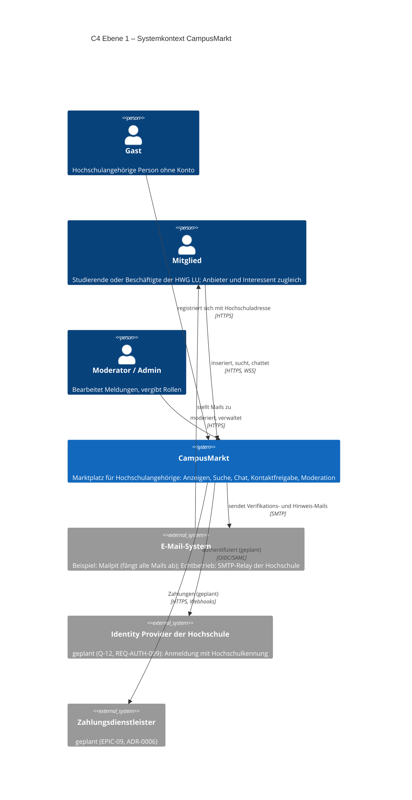

| Element | Art | Verantwortung | Bezug |
|---|---|---|---|
| Gast | Person | Registrierung mit Whitelist-Adresse | UC-01, REQ-AUTH-001 |
| Mitglied | Person | Anbieter und Interessent; Rollen „Käufer/Verkäufer“ sind kontextabhängig | UC-10 … UC-25 |
| Moderator / Admin | Person | Meldungen entscheiden, Rollen vergeben | UC-32, UC-42 |
| CampusMarkt | Softwaresystem (Scope dieses Dokuments) | Alle fachlichen Funktionen | alle REQ |
| E-Mail-System | Externes System | Zustellung transaktionaler Mails | REQ-NOTI-*, ADR-0005 |
| Identity Provider der Hochschule | Externes System, **geplant** | Anmeldung über die Hochschulkennung | Fallstudie FS-C3, Q-12 |
| Zahlungsdienstleister | Externes System, **geplant** | Zahlungsabwicklung ohne eigene Geldverwahrung | ADR-0006, REQ-ARCH-002 |

### 3.2 Technischer Kontext

| Schnittstelle | Protokoll | Daten | Richtung |
|---|---|---|---|
| Browser ↔ CampusMarkt | HTTP auf `localhost:8080` (Echtbetrieb: HTTPS) | SPA-Dateien, REST/JSON `/api/v1` | bidirektional |
| Browser ↔ CampusMarkt | WebSocket `/ws` | Chat-Ereignisse (JSON) | bidirektional |
| CampusMarkt → E-Mail-System | SMTP (`mailpit:1025`), per Umgebungsvariablen austauschbar | E-Mails | ausgehend |
| Browser → Mailpit-UI | HTTP `localhost:8025` | abgefangene E-Mails (nur Beispiel) | – |
| *(geplant)* CampusMarkt ↔ IdP | OIDC oder SAML | Identität, Hochschulkennung | bidirektional |
| *(geplant)* CampusMarkt ↔ PSP | HTTPS-API + signierte Webhooks | Zahlungen | bidirektional |

## 4. Lösungsstrategie

| Ziel / Problem | Lösungsansatz | ADR |
|---|---|---|
| Kleines Team, schnelle Iteration, später erweiterbar | **Modularer Monolith** mit klaren fachlichen Modulen, **ein** Anwendungs-Image | [ADR-0001](decisions/0001-modularer-monolith.md) |
| Ein Image, wenige Konzepte | **TypeScript**: React-SPA (Vite), ausgeliefert durch Fastify. PostgreSQL + Drizzle. Kein Redis, kein S3 | [ADR-0002](decisions/0002-tech-stack.md) |
| Vertrauen durch Hochschulzugehörigkeit | Eigene, schlanke Authentifizierung mit E-Mail-Verifikation und Domain-Whitelist, Sessions in Postgres | [ADR-0003](decisions/0003-authentifizierung.md) |
| Echtzeit-Chat | WebSocket, Postgres als Quelle der Wahrheit, Fan-out hinter einem `RealtimeBroker`-Port | [ADR-0004](decisions/0004-chat-echtzeit.md) |
| Zuverlässiger E-Mail-Versand | Jobs werden mit **pg-boss transaktional** eingereiht (Outbox-Muster), `MailPort` → Mailpit | [ADR-0005](decisions/0005-email-versand.md) |
| Bezahlung später ohne Umbau | **Ports & Adapters**: `PaymentPort`, Deal-Konzept und Domain Events schon im MVP | [ADR-0006](decisions/0006-bezahlung-erweiterungspunkt.md) |
| Bilder | Docker-Volume hinter `StoragePort`, Verarbeitung im Job | [ADR-0007](decisions/0007-bildspeicherung.md) |
| Suche ohne Zusatzinfrastruktur | **PostgreSQL-Volltextsuche** + `pg_trgm` | [ADR-0008](decisions/0008-suche-postgres.md) |
| API-Vertrag | **REST + OpenAPI 3.1** (Design-first), AsyncAPI für WebSocket | [ADR-0009](decisions/0009-api-rest-openapi.md) |
| Kein Hosting, trotzdem vorführbar | **Docker Compose**: `app` + `db` + `mailpit`, Seed-Daten mit Demo-Konten | [ADR-0010](decisions/0010-docker-demo-deployment.md) |
| Anmeldung über die Hochschulkennung (FS-C3) später ohne Umbau | Anmeldeverfahren hinter `IdentityProviderPort`; im Beispiel Hochschuladresse + Passwort | [ADR-0013](decisions/0013-anmeldung-identity-provider-port.md) |
| Kontaktdaten nur nach beidseitiger Zustimmung (FS-C1) | Zustimmungen als Zustand der Konversation; Adresse nur als Konversationsangabe, nie als Nachricht | REQ-CHAT-010 |
| Architektur verständlich und prüfbar dokumentieren | **C4-Modell** als Mermaid-C4-Diagramme, eine Ebene je Diagramm, in CI gerendert | [ADR-0012](decisions/0012-c4-notation.md) |

**Leitprinzip:** Alles, was im Beispiel bewusst einfacher gelöst ist (Fan-out, Storage, Mail, Rate-Limit-Store), steckt hinter einem **Port**. Ein späterer Echtbetrieb (EPIC-12) tauscht Adapter, nicht Fachlogik.

## 5. Bausteinsicht (C4 Ebene 2 und 3)

**Notation:** C4-Modell nach Simon Brown, als Mermaid-C4-Diagramme im Markdown ([ADR-0012](decisions/0012-c4-notation.md)). Jedes Diagramm zeigt genau **eine** Ebene und nennt sie im Titel (Guideline Kap. 02). Die Ebenen verfeinern sich: Das Softwaresystem aus 3.1 wird in 5.1 in Container zerlegt, die Container „Anwendung“ und „Web-App“ in 5.2 und 5.3 in Komponenten. Die vierte C4-Ebene (Code) wird bewusst nicht gezeichnet; sie ergibt sich aus dem Quellcode.

| C4-Begriff | Bedeutung im Projekt |
|---|---|
| Softwaresystem | CampusMarkt als Ganzes (Scope dieser Architektur) |
| Container | separat ausführbare bzw. Daten haltende Einheit: Web-App im Browser, Anwendungsprozess, Datenbank, Dateiablage. *Nicht zu verwechseln mit Docker-Containern* (siehe Verteilungssicht 7.1) |
| Komponente | Baustein innerhalb eines Containers mit klarer Schnittstelle: Fachmodul (`apps/server/src/modules/*`), Port, Adapter, eingehender Adapter |

### 5.1 C4 Ebene 2: Container

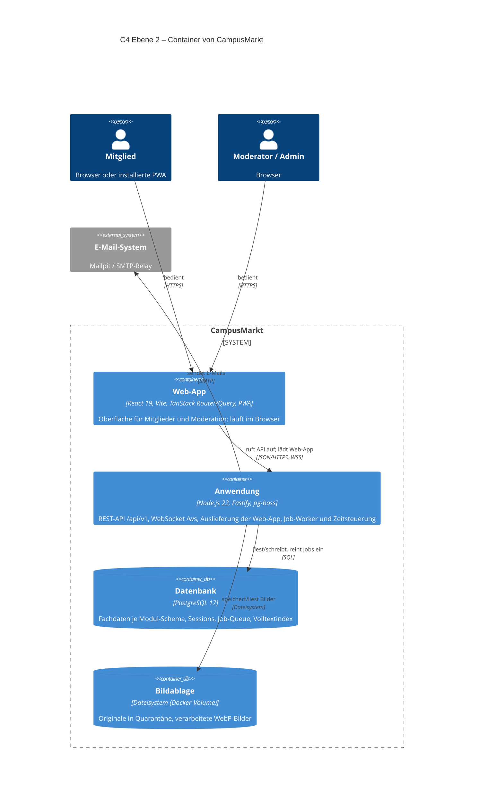

| Container | Technologie | Verantwortung | Qualitätsziele / Anforderungen | ADR |
|---|---|---|---|---|
| Web-App | React-SPA (Vite), PWA | Darstellung, Tastaturbedienung, Echtzeit-Empfang, Degradation auf Polling | REQ-A11Y-001/002, REQ-UX-001, REQ-CHAT-003 | 0002 |
| Anwendung | Node.js 22, Fastify, pg-boss | Fachlogik aller Module, Autorisierung, Jobs (E-Mail, Bilder, Fristen) | REQ-SEC-*, REQ-NOTI-005, REQ-OPS-* | 0001, 0002, 0004, 0005 |
| Datenbank | PostgreSQL 17 | Quelle der Wahrheit, transaktionale Outbox (Jobs im selben Commit), Volltextsuche | REQ-CHAT-004, REQ-SRCH-001, REQ-PERF-001 | 0005, 0008 |
| Bildablage | Docker-Volume `uploads` hinter `StoragePort` | Bilder außerhalb des Web-Roots, Auslieferung nur über die Anwendung | REQ-LST-003, REQ-SEC-007 | 0007 |

**Startmodi:** Die Anwendung kennt die Modi `all` (Standard im Beispiel), `api` und `worker`. Im Docker-Beispiel laufen API und Worker in **einem** Prozess mit getrennten Concurrency-Pools (Bulkhead). Für einen Echtbetrieb werden daraus zwei Container gleicher Codebasis, ohne Codeänderung.

### 5.2 C4 Ebene 3: Komponenten der Anwendung

Die Anwendung ist ein **modularer Monolith** (ADR-0001). Zwei Diagramme derselben Ebene: 5.2.1 zeigt die eingehenden Adapter und Fachmodule, 5.2.2 die Fachmodule und ihre Ports mit den Adaptern zur Infrastruktur.

#### 5.2.1 Eingehende Adapter und Fachmodule

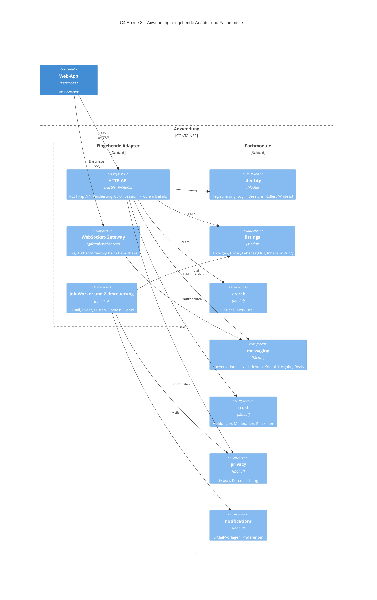

#### 5.2.2 Fachmodule, Ports und Adapter

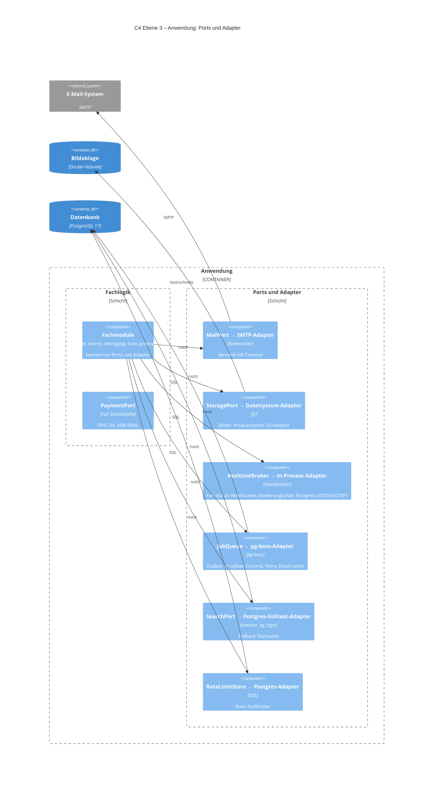

| Komponente | Ort im Code | Verantwortung | Wichtige Anforderungen |
|---|---|---|---|
| HTTP-API | `apps/server/src/platform/http/` + `routes.ts` je Modul | Validierung gegen den Vertrag (`packages/contracts`), Session, CSRF, Fehlerformat | REQ-SEC-004, REQ-SEC-006 |
| WebSocket-Gateway | `modules/messaging/routes.ts` (`websocketRoute`) | Echtzeit, Origin-Prüfung | REQ-CHAT-003 |
| Job-Worker und Zeitsteuerung | `platform/adapters/pg-boss-queue.ts`, `registerJobs` je Modul | Asynchrone Arbeit, Retry, Dead-Letter | REQ-NOTI-005, REQ-LST-008 |
| identity | `modules/identity/` | Zugang, BR-01, Rollen | REQ-AUTH-*, REQ-SEC-002…005, REQ-SEC-011 |
| listings | `modules/listings/` | Anzeigen und Bilder | REQ-LST-* |
| search | `modules/search/` | Suche, Merkliste | REQ-SRCH-* |
| messaging | `modules/messaging/` | Chat, **Kontaktfreigabe**, Deals | REQ-CHAT-*, REQ-PRIV-002 |
| trust | `modules/trust/` | Meldungen, Moderation, Blockieren | REQ-MOD-* |
| privacy | `modules/privacy/` | Export, Löschung über alle Module | REQ-ACC-002/003, REQ-PRIV-003 |
| notifications | `modules/notifications/` | Vorlagen, Präferenzen, Versand über MailPort | REQ-NOTI-* |
| Ports + Adapter | `platform/ports/`, `platform/adapters/` | Austauschbare Infrastruktur | REQ-ARCH-006 |
| PaymentPort | `modules/payments/payment-port.ts` | Erweiterungspunkt Bezahlung | REQ-ARCH-001/002 |

**Modulregeln (Fitness Functions, REQ-MAINT-002, geprüft mit `pnpm lint:deps`):**
1. Ein Modul hat ein öffentliches API (`index.ts`); alles andere ist intern.
2. Module greifen nie auf Tabellen anderer Module zu; jedes Modul hat ein eigenes Postgres-Schema.
3. Kommunikation zwischen Modulen synchron über das öffentliche API oder asynchron über Domain Events (Jobs im selben Commit).
4. `domain.ts` ist frei von Frameworks und Plattform.
5. Fachmodule kennen nur Ports, nie Adapter; die Plattform kennt keine Fachmodule.

### 5.3 C4 Ebene 3: Komponenten der Web-App

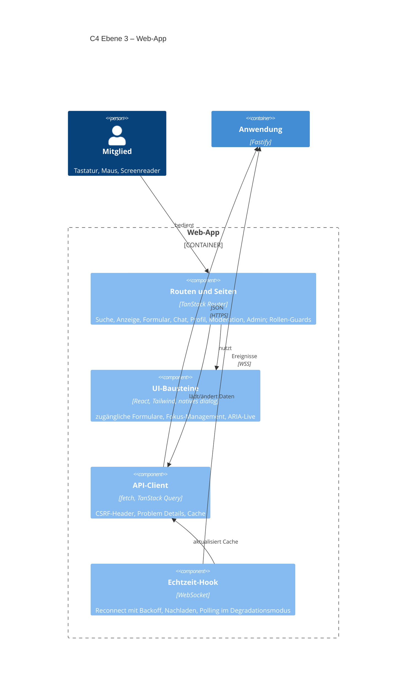

### 5.4 Fachliches Datenmodell (Auszug)

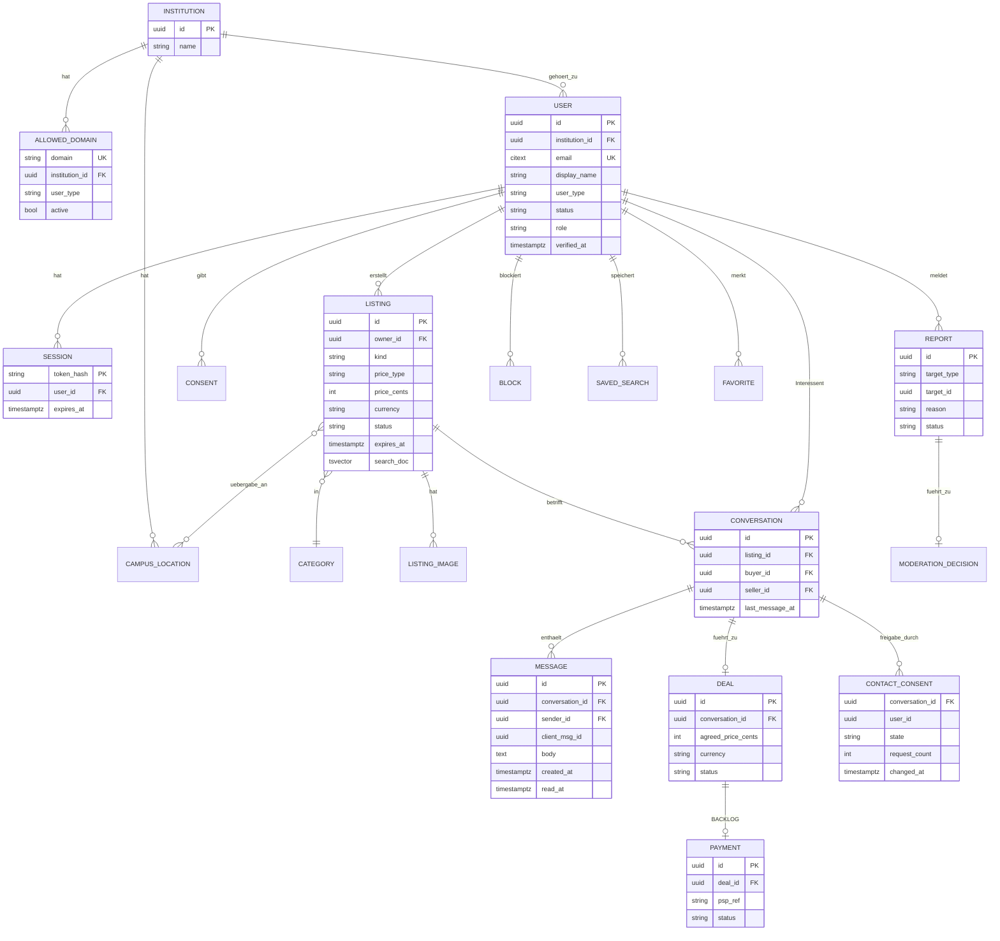

`CONTACT_CONSENT` hält je Teilnehmer und Konversation den Zustand der Kontaktfreigabe (REQ-CHAT-010); die Adresse selbst bleibt im Modul `identity` und wird nur bei beidseitiger Zustimmung über dessen öffentliches API gelesen.

Unique-Constraints (Auszug): `USER(email)` · `CONVERSATION(listing_id, buyer_id)` (REQ-CHAT-002) · `MESSAGE(conversation_id, client_msg_id)` (REQ-CHAT-004, Idempotenz) · `ALLOWED_DOMAIN(domain)`. Die Job-Tabellen verwaltet pg-boss in einem eigenen Schema `pgboss`.

## 6. Laufzeitsicht

### 6.1 Registrierung mit E-Mail-Verifikation

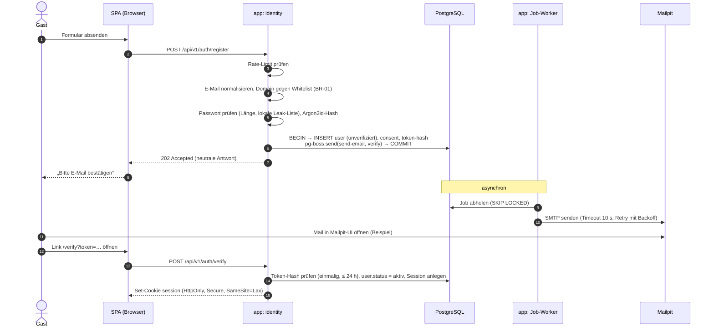

### 6.2 Chat-Nachricht senden

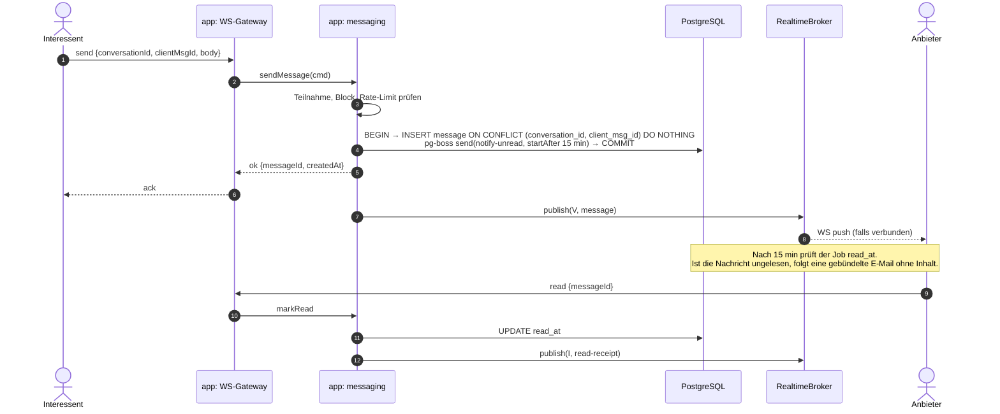

**Wiederherstellung nach Verbindungsabbruch:** Der Client sendet beim Reconnect `since=<lastMessageId>` und lädt Verpasstes per REST nach. Die Zustellung ist **at-least-once**, die Idempotenz entsteht über `client_msg_id` (REQ-CHAT-004).
**Skalierungspfad (nicht im Beispiel):** Der `RealtimeBroker`-Adapter wird gegen `PgNotifyAdapter` (Postgres `LISTEN/NOTIFY`) getauscht. Danach sind mehrere `api`-Instanzen möglich.

### 6.3 Anzeige mit Bildern veröffentlichen

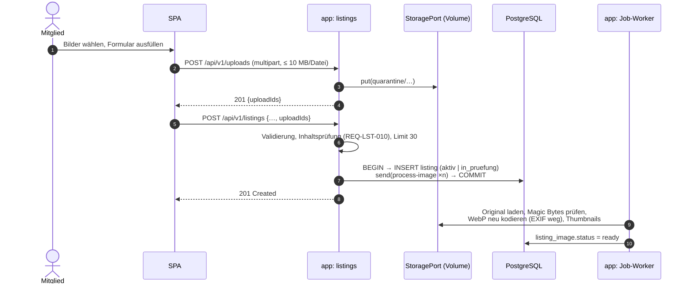

### 6.4 Kontaktdaten freigeben (UC-25, REQ-CHAT-010)

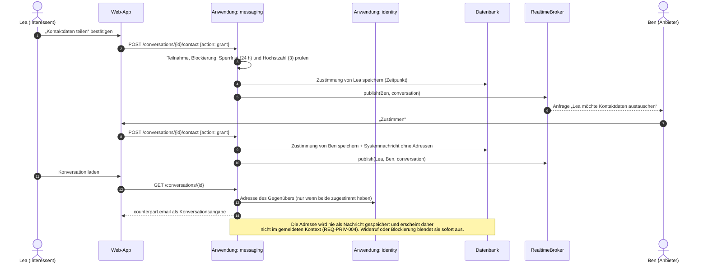

## 7. Verteilungssicht

### 7.1 C4 Verteilungsdiagramm: Docker-Beispiel (verbindlich für das Projekt)

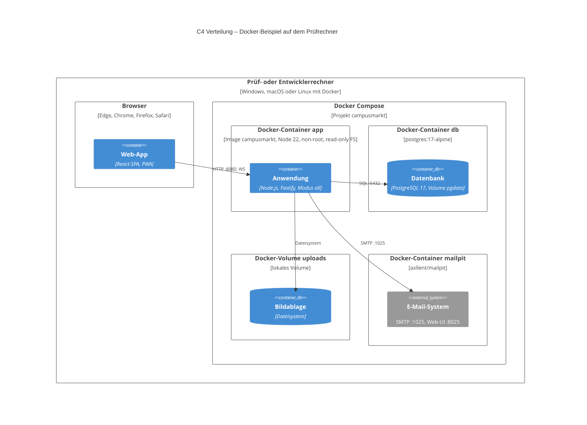

| Aspekt | Festlegung |
|---|---|
| Start | `docker compose up --build` |
| Start-Reihenfolge | `app` wartet per Healthcheck auf `db` |
| Migrationen | laufen beim Start automatisch, idempotent (REQ-OPS-005) |
| Seed-Daten | `SEED_DEMO=true`: Institution, Whitelist, Standorte, Kategorien, Demo-Konten, 30 Anzeigen, Chats, offene Meldung (REQ-DEMO-001) |
| Konfiguration | nur Umgebungsvariablen (`.env.example`), keine Secrets im Image |
| Health | `/health/live`, `/health/ready`, Docker-`HEALTHCHECK` |
| Logs | JSON auf stdout, ohne personenbezogene Daten |
| Reset | `docker compose down -v` |

| Umgebung | Zweck | Infrastruktur |
|---|---|---|
| `local` | Entwicklung | `compose.dev.yaml` (db + mailpit), App per `pnpm dev` |
| `ci` | Tests | gleiches Postgres-Image, Image-Build, Smoke- und E2E-Tests gegen das Compose-Setup |
| `demo` | Abgabe / Vorführung | `docker compose up` |

### 7.2 Ausblick Echtbetrieb (nicht Teil des Projekts, EPIC-12)
Gleiches Image. Getrennte `api`- und `worker`-Instanzen, managed Postgres mit PITR, echter SMTP-Relay (SPF/DKIM/DMARC), S3-Adapter, `PgNotifyAdapter`, Reverse Proxy mit TLS, OpenTelemetry. Dazu kommen die Betreiberpflichten (Impressum, Datenschutzerklärung, DSA-Prozesse). Keine Fachlogik ändert sich.

## 8. Querschnittliche Konzepte

### 8.1 Sicherheit
- **Authentifizierung:** serverseitige Sessions (gehashtes Opaque-Token in Postgres), Cookie `HttpOnly; Secure; SameSite=Lax`. Siehe ADR-0003.
- **Autorisierung:** zentrale Policy-Funktionen pro Ressource (`canEditListing(user, listing)`), *deny by default*, Testmatrix Rolle × Aktion.
- **Eingaben:** Validierung an der Grenze über die JSON-Schemas aus OpenAPI (Fastify). Ausgabe-Encoding durch React. Strikte CSP (die SPA kommt vom selben Origin).
- **Container-Härtung:** Non-root-User, Read-only-Root-FS, keine Secrets im Image, Image-Scan (Trivy) in CI, minimales Base-Image.
- **Supply Chain:** Lockfile, Renovate, SCA, Secret-Scan, SBOM (CycloneDX) in CI.
- **Pseudonymisierte IP-Adressen:** nur mit geheimem, regelmäßig gewechseltem Schlüssel abgeleitet, höchstens 7 Tage gespeichert (REQ-PRIV-002, REQ-SEC-005).
- **Kontaktfreigabe:** Adressen nur nach beidseitiger Zustimmung, nie als Nachrichtentext; Missbrauchsschutz über Sperrfrist und Höchstzahl der Anfragen (REQ-CHAT-010).
- **Demo-spezifisch:** Demo-Passwörter stehen nur in der Seed-Dokumentation und werden nur bei `SEED_DEMO=true` angelegt.

### 8.2 Zuverlässigkeit
- **Transaktionales Enqueue** (pg-boss im selben Commit) für alle Seiteneffekte. Kein Seiteneffekt geht verloren, keiner wird ohne Commit ausgeführt.
- **Timeouts** für alle externen Aufrufe (SMTP 10 s), **Retry** nur idempotent mit Backoff, Dead-Letter-Queue.
- **Graceful Shutdown** bei `SIGTERM` (`docker compose stop`): keine neuen Requests annehmen, WebSockets mit Reconnect-Hinweis schließen, laufende Jobs beenden (≤ 30 s).
- **Degradation:** Chat fällt auf Polling zurück. Suche fällt auf Titel-ILIKE zurück.

### 8.3 E-Mail-Konzept
- Templates (MJML → HTML + Text), deutsch und i18n-fähig.
- **Keine Chatinhalte** in E-Mails, nur Hinweise mit Link.
- Im Beispiel landen alle Mails in Mailpit. Damit ist auch die Registrierung mit echten Adressformaten wie `@studmail.hwg-lu.de` gefahrlos vorführbar, weil nichts das Rechnernetz verlässt.
- Zustellbarkeit (SPF/DKIM/DMARC, Bounces) ist N/A für das Beispiel → EPIC-12.

### 8.4 Datenschutz: Datenklassifikation und Löschfristen

> Verbindlich ist die Fristentabelle in [REQ-PRIV-003](../02-anforderungen/req/REQ-PRIV-003.md); die folgende Übersicht zeigt die Datenklassen.

Die Fristen sind fachlich umgesetzt (Jobs), auch wenn das Beispiel nicht produktiv betrieben wird. So zeigt das Projekt Privacy by Design.

| Datenkategorie | Klasse | Speicherdauer |
|---|---|---|
| E-Mail-Adresse, Passwort-Hash | vertraulich | bis Kontolöschung + 14 Tage Karenz |
| Anzeigen, Bilder | intern (nur Mitglieder) | bis Löschung durch Nutzer bzw. 90 Tage nach Ablauf |
| Chatnachrichten | **vertraulich** | bis 12 Monate nach der letzten Nachricht oder bis zur Löschung durch einen Teilnehmer (Q-7) |
| Meldungen + Moderationsentscheidungen | vertraulich | 12 Monate nach Abschluss |
| Audit-Log (Admin-Aktionen) | vertraulich | 24 Monate |
| IP-Hashes (Missbrauchsschutz) | vertraulich | 7 Tage |
| Anwendungs-Logs | intern, **ohne PII** | Container-Logs, nicht persistiert |

### 8.5 Erweiterungspunkt Bezahlung (ADR-0006)

**Kernaussagen:**
- Geld fließt **nur** über den PSP (Marktplatz- bzw. Split-Produkt). Die Plattform ist nie im Geldfluss (ZAG).
- KYC der Verkäufer übernimmt der PSP.
- `payments` hängt von `messaging` nur über Events ab. Umgekehrt gibt es **keine** Abhängigkeit.
- Bezahlung ist pro Deal **opt-in** und nie voreingestellt (Verbraucherrecht, vgl. KG Berlin / Vinted).
- Im Docker-Beispiel wäre ein **Fake-PSP-Adapter** (Sandbox-Simulation) ausreichend, um den Ablauf zu zeigen, ohne externe Konten.

### 8.6 Observability (Beispiel-Niveau)
Strukturierte JSON-Logs (pino) mit Korrelations-ID, `/metrics` im Prometheus-Format (Request-Latenzen, Job-Durchsatz, WS-Verbindungen), Health-Endpunkte. OpenTelemetry-Instrumentierung ist vorbereitet (per Umgebungsvariable aktivierbar), aber kein Bestandteil des Compose-Setups. Ein Compose-Profil `observability` mit Grafana ist Could.

### 8.7 Barrierefreiheit und UX
Kernabläufe sind vollständig per Tastatur bedienbar und werden automatisiert nur mit Tastatur durchlaufen; axe-core prüft die Kernseiten (REQ-A11Y-002, Fallstudie FS-C2). Komponentenbibliothek auf Basis zugänglicher Primitives (Radix bzw. shadcn/ui), axe-core in Komponententests und E2E, Tastaturbedienung, Fokus-Management im Chat (ARIA-Live-Region für neue Nachrichten).

## 9. Architekturentscheidungen

| ADR | Titel | Status |
|---|---|---|
| [0001](decisions/0001-modularer-monolith.md) | Modularer Monolith statt Microservices | Proposed |
| [0002](decisions/0002-tech-stack.md) | Tech-Stack: TypeScript, React-SPA + Fastify, PostgreSQL, pg-boss | Proposed |
| [0003](decisions/0003-authentifizierung.md) | Eigene Authentifizierung mit Hochschul-E-Mail-Verifikation | Proposed |
| [0004](decisions/0004-chat-echtzeit.md) | Chat über WebSocket, Fan-out hinter einem Port | Proposed |
| [0005](decisions/0005-email-versand.md) | E-Mail über transaktionale pg-boss-Jobs und MailPort | Proposed |
| [0006](decisions/0006-bezahlung-erweiterungspunkt.md) | Bezahlung als späteres Modul hinter PaymentPort | Proposed |
| [0007](decisions/0007-bildspeicherung.md) | Bilder auf Docker-Volume hinter StoragePort | Proposed |
| [0008](decisions/0008-suche-postgres.md) | Suche mit PostgreSQL-Volltext | Proposed |
| [0009](decisions/0009-api-rest-openapi.md) | REST + OpenAPI 3.1, Design-first | Proposed |
| [0010](decisions/0010-docker-demo-deployment.md) | Auslieferung als lokales Docker-Beispiel | **Accepted** |
| [0011](decisions/0011-mvp-umsetzung.md) | Umsetzungsentscheidungen im MVP (SQL ohne ORM, Schema-first-Vertrag, CSRF, HEIC) | Proposed |
| [0012](decisions/0012-c4-notation.md) | C4-Modell als Notation, Mermaid-C4-Diagramme | Proposed |
| [0013](decisions/0013-anmeldung-identity-provider-port.md) | Anmeldung hinter einem IdentityProviderPort (Hochschulkennung, Q-12) | Proposed |

## 10. Qualitätsszenarien

| ID | Merkmal | Szenario (Stimulus → Reaktion → Messgröße) |
|---|---|---|
| QS-1 | Sicherheit | Ein Angreifer registriert sich mit `x@hwg-lu.de.evil.com` → das System lehnt ab → 0 Konten mit nicht gelisteter Domain (Decision-Table-Test, REQ-AUTH-001) |
| QS-2 | Vertraulichkeit | Ein Mitglied ruft `GET /conversations/{fremde-id}` auf → 404 (keine Existenzpreisgabe) → 100 % der Autorisierungsmatrix grün |
| QS-3 | Zuverlässigkeit | Der Mailpit-Container wird während einer Registrierung gestoppt und nach 5 min neu gestartet → der Job bleibt in der Queue → Mail erscheint nach dem Neustart, 0 verloren |
| QS-4 | Zuverlässigkeit | Die WebSocket-Verbindung bricht ab (Browser offline) → Reconnect, verpasste Nachrichten werden nachgeladen → keine verlorene oder doppelte Nachricht, Reconnect < 5 s |
| QS-5 | Erweiterbarkeit | Ein PSP-Adapter wird ergänzt → nur das neue Modul `payments` und additive Migrationen → 0 Änderungen in `listings` und `identity` |
| QS-6 | Erweiterbarkeit | Hochschule B wird freigeschaltet → Eintrag in `institution` + `allowed_domain` → ohne neues Image, < 1 h Aufwand |
| QS-7 | Performance | Lasttest gegen das Docker-Beispiel (k6, 20 Such-req/s, 10.000 Seed-Anzeigen) → Such-p95 < 500 ms auf einem Standard-Laptop |
| QS-8 | Erweiterbarkeit | Echtbetrieb soll S3 statt Volume nutzen → neuer `StoragePort`-Adapter + Konfiguration → 0 Änderungen in Fachmodulen |
| QS-9 | Portabilität | Prüfer/in klont das Repo auf einem Rechner mit Docker → Image-Build ≤ 10 min (mit Internet) → `docker compose up` bis zum Login mit Demo-Konto ≤ 3 min, ohne Internet (REQ-OPS-003) |
| QS-10 | Vertraulichkeit | Lea stimmt der Kontaktfreigabe zu, Ben noch nicht → keiner sieht die Adresse des anderen; ein Moderator öffnet den gemeldeten Kontext → keine Adresse sichtbar (REQ-CHAT-010) |
| QS-11 | Benutzbarkeit | Ein Mitglied ohne Maus registriert sich, erstellt eine Anzeige und sendet eine Nachricht → alle Schritte nur mit Tastatur möglich, Fokus jederzeit sichtbar; axe-core meldet 0 Verstöße `serious`/`critical` (REQ-A11Y-002) |

## 11. Risiken und technische Schulden

| ID | Risiko | Eintritt / Auswirkung | Maßnahme |
|---|---|---|---|
| R-1 | Kritische Masse ist im Beispiel nicht erlebbar, die Plattform wirkt leer | hoch / mittel | Seed-Daten mit realistischen Anzeigen und Konversationen (REQ-DEMO-001) |
| R-2 | ~~Hochschul-Spamfilter blockieren Mails~~ | entfällt (Mailpit) | → EPIC-12 |
| R-3 | Exmatrikulierte behalten Postfächer | konzeptionell | Re-Verifikation alle 12 Monate (REQ-AUTH-007) ist umgesetzt und per Zeitsteuerung im Test vorführbar |
| R-4 | ~~Betreiberrolle ungeklärt~~ | entfällt (kein Hosting) | → EPIC-12 |
| R-5 | Eigene Auth ist fehleranfällig | mittel / hoch | Bewährte Bibliotheken, ASVS-L2-Checkliste, Tests (ADR-0003) |
| R-6 | Docker-Setup läuft auf Prüfrechnern nicht (ARM vs. x86, Ports belegt, Docker-Version) | mittel / **hoch** | Multi-Arch-Image (amd64 + arm64), Ports per `.env` änderbar, CI-Smoke-Test von `docker compose up`, README mit Troubleshooting |
| R-7 | Teamkapazität | mittel / mittel | Schlanker Stack (ADR-0010), MoSCoW konsequent anwenden |
| R-8 | Fallstudien-Constraint FS-C3 (Anmeldung über die Hochschulkennung) wird nicht anerkannt | mittel / hoch | Dokumentierte Abweichung, ADR-0013, Abstimmung mit Dozent/in (Q-12, Spike S-01) |
| R-9 | Mermaid-C4 ist experimentell, Layout begrenzt | mittel / niedrig | Kleine Diagramme, Prüfung in CI; Ausweg Structurizr DSL (ADR-0012) |

## 12. Glossar

| Begriff | Bedeutung |
|---|---|
| Anzeige | Angebot oder Gesuch eines Mitglieds |
| C4-Modell | Notation für Softwarearchitektur mit den Ebenen Systemkontext, Container, Komponente, Code (Simon Brown) |
| Container (C4) | Separat ausführbare oder Daten haltende Einheit eines Softwaresystems (Web-App, Anwendung, Datenbank); nicht gleichbedeutend mit Docker-Container |
| Kontaktfreigabe | Beidseitige Zustimmung zweier Konversationsteilnehmer, einander die Hochschul-E-Mail-Adresse anzuzeigen |
| Inhaltsprüfung | Automatischer Wortfilter vor der Veröffentlichung einer Anzeige |
| Angebot / Gesuch | Anzeigentyp: Ich biete etwas an / ich suche etwas |
| Preistyp | Festpreis, VB (Verhandlungsbasis), zu verschenken, Tausch |
| Übergabeort | Campus-Standort, an dem die Übergabe stattfinden kann |
| Konversation | Chatverlauf zwischen Anbieter und genau einem Interessenten zu genau einer Anzeige |
| Deal | Vereinbarung über einen Preis bzw. eine Übergabe innerhalb einer Konversation. Grundlage der späteren Bezahlung |
| Whitelist | Liste zugelassener E-Mail-Domains |
| Outbox-Muster | Seiteneffekte werden transaktional mit der Fachänderung gespeichert und danach asynchron verarbeitet (hier: pg-boss-Jobs) |
| Mailpit | Mail-Catcher für Entwicklung und Demo: nimmt SMTP an und zeigt die Mails in einer Weboberfläche, ohne sie zuzustellen |
| Port / Adapter | Schnittstelle der Fachlogik nach außen / austauschbare technische Implementierung |
| PSP | Payment Service Provider, Zahlungsdienstleister |
| DSA | Digital Services Act (EU-Verordnung 2022/2065) |
