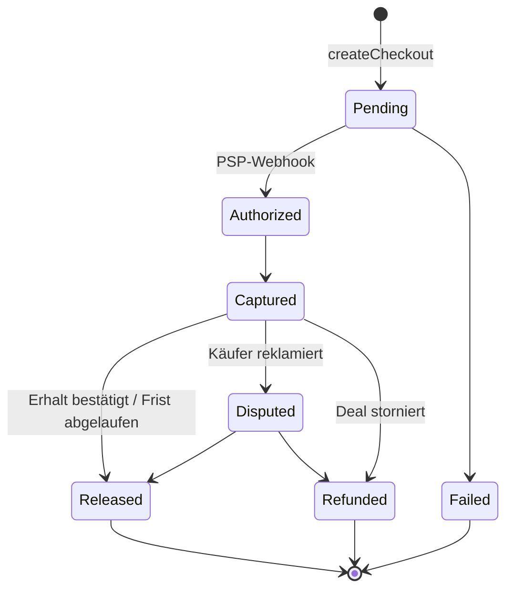

# ADR-0006: Bezahlung als späteres Modul hinter einem PaymentPort

- **Status:** Proposed
- **Datum:** 2026-10-20
- **Bezug:** REQ-ARCH-001/002, EPIC-09, QS-5

## Kontext
Bezahlung ist im MVP nicht enthalten, muss aber später **ohne Umbau** nachrüstbar sein. Rechtlich gilt: Wer fremde Gelder entgegennimmt und weiterleitet, erbringt potenziell Zahlungsdienste (ZAG, BaFin-Erlaubnis). Marktplätze lösen das über das Marktplatzprodukt eines lizenzierten PSP. Kleinanzeigen nutzt dafür Adyen, Vinted den eigenen Dienst Vinted Pay.

## Entscheidung
1. **Ab MVP:**
   - Fachkonzept **Deal** im Modul `messaging` (Reservierung bzw. angenommener Preisvorschlag) mit den Events `DealAgreed`, `DealCompleted`, `DealCancelled` über die Outbox.
   - Geldbeträge sind immer `amount_cents: integer` + `currency: char(3)`.
2. **Später (EPIC-09):** generische Webhook-Infrastruktur (Signaturprüfung, Idempotenz-Tabelle) und ein neues Modul `payments` mit
   - `PaymentPort` (`onboardSeller`, `createCheckout`, `releaseFunds`, `refund`, `getStatus`),
   - Adaptern pro PSP (Stripe Connect, Mangopay oder Adyen for Platforms, Auswahl per Spike PAY-01),
   - einem append-only **Ledger** und einem Zustandsautomaten pro Zahlung (siehe unten),
   - Idempotenzschlüsseln bei allen PSP-Aufrufen.
3. Die Plattform hält **nie** Gelder und speichert **keine** Kartendaten (PCI-Scope minimieren: gehostete Checkout-Seite bzw. Komponenten des PSP).
4. Bezahlung ist **opt-in pro Deal**. Der Käuferschutz ist nie voreingestellt.

## Konsequenzen
- (+) Das MVP enthält keinen toten Code für Zahlungen, nur fachlich sinnvolle Vorleistungen (Deal).
- (+) Der PSP ist austauschbar.
- (−) Das Deal-Konzept muss im MVP sorgfältig modelliert werden, obwohl es zunächst nur die Reservierung abbildet.
- Rechtliche Folgepflichten (DAC7/PStTG, AGB, Widerruf) werden im Spike PAY-02 geklärt.
