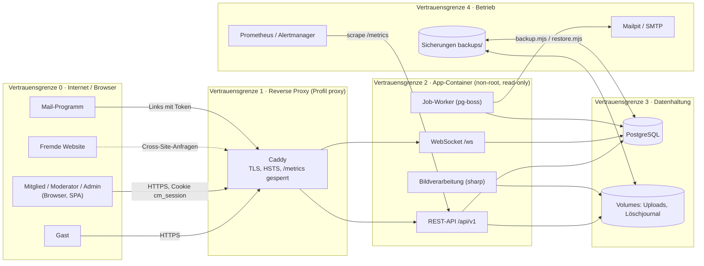
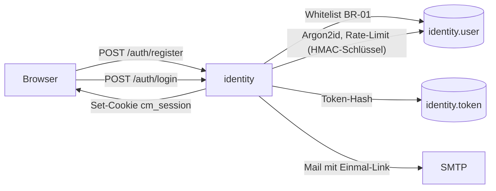
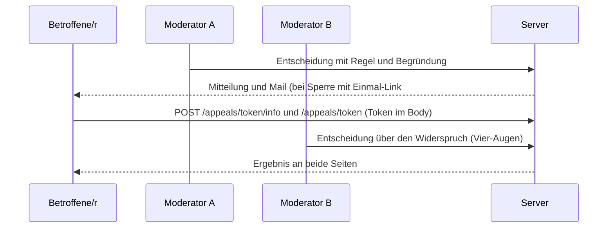

# Threat Model CampusMarkt (STRIDE)

> Nachweis `MAN-SEC-009` für [REQ-SEC-009](../02-anforderungen/req/REQ-SEC-009.md). Grundlage sind [Architektur v1.3](architektur.md) (Kap. 5, 6 und 8.1), die ADRs und der Code auf `feature/fallstudie-req-c4` (Stand 2026-10-26). Geprüft wurde mit dem [Übungs-Pentest](../05-umsetzung/nachweise/MAN-SEC-013.md) und der [ASVS-Checkliste](../05-umsetzung/nachweise/MAN-SEC-001.md).
>
> **Abweichung:** Ein Threat Model entsteht eigentlich vor der Umsetzung. Hier wurde es nachträglich erstellt (siehe REQ-SEC-009, Nachweis).

## 1. Methode

- **STRIDE je Ablauf:**
  - **S**poofing (Identität vortäuschen)
  - **T**ampering (Daten verändern)
  - **R**epudiation (Abstreiten von Handlungen)
  - **I**nformation Disclosure (Daten preisgeben)
  - **D**enial of Service (Dienst lahmlegen)
  - **E**levation of Privilege (Rechte ausweiten)
- **Zu jeder Bedrohung:**
  - Maßnahme mit Verweis auf Code, Anforderung oder ADR
  - Restrisiko
  - Status: ✅ umgesetzt und getestet · ◐ teilweise bzw. akzeptiert · ⬜ offen
- **Restrisiko:** gering, mittel oder hoch. Es ergibt sich aus Eintrittswahrscheinlichkeit und Schwere nach der Matrix im [Datenpannen-Prozess](../06-recht/datenpannen-prozess.md).
- **Angreifer:**
  - A1 anonymer Internetnutzer
  - A2 angemeldetes Mitglied (auch ein böswilliges)
  - A3 kompromittierter Moderator
  - A4 Person mit Zugriff auf Logs oder Sicherungen (Betrieb)
  - A5 fremde Website im Browser eines Mitglieds (CSRF, XS-Leaks)

## 2. Systemüberblick und Vertrauensgrenzen

| Grenze | Was sie trennt | Kontrollen an der Grenze |
|---|---|---|
| 0 → 1 | Internet ↔ Plattform | TLS und HSTS (ADR-0017); 308 von HTTP auf HTTPS; `/metrics` am Proxy 404 |
| 1 → 2 | Proxy ↔ App | Header des Proxys nur für genau einen Hop (`trustProxy`, `server.ts:61`); App-Port nur an `127.0.0.1` |
| 2 | Jede Anfrage | Sitzung (`resolveSession`), CSRF (`server.ts:99-104`), Schemaprüfung (TypeBox), `requireAuth`/`requireRole` (`auth.ts:21-33`), Wartungsmodus |
| 2 → 3 | App ↔ Daten | nur parametrisiertes SQL (`platform/sql.ts:25`); Modulgrenzen per dependency-cruiser (`CTRL-DEPCRUISE`) |
| 3 → 4 | Daten ↔ Betrieb | Sicherungen mit SHA-256-Manifest; Restore über temporäre DB (ADR-0018); Logs ohne IP, Query und Inhalte (REQ-OPS-002) |

## 3. Abläufe

### 3.1 Registrierung, Anmeldung, Passwort-Reset

| ID | STRIDE | Bedrohung | Maßnahme | Rest | Status |
|---|---|---|---|---|---|
| T-01 | S | Registrierung mit fremder bzw. nicht zugelassener Domain | Whitelist-Prüfung serverseitig (BR-01, `identity/domain.ts`), Konto erst nach Mail-Bestätigung aktiv (REQ-AUTH-001/002, AT-AUTH-001-2) | gering | ✅ |
| T-02 | S | Passwort erraten (Brute Force, Credential Stuffing) | 5 Fehlversuche je (Konto, IP) in 15 min, atomar gezählt (`identity/service.ts:247`); Argon2id m=19 MiB, t=2 (`:14`); Passwortregeln und Blockliste (REQ-SEC-003) | gering | ✅ (PT-AUTH-04) |
| T-03 | I | Konten erkennen über unterschiedliche Antworten oder Antwortzeiten bei Login, Registrierung, Reset | gleiche Antworten (202 bzw. 401 `invalid_credentials`), Dummy-Hash für unbekannte Adressen (`:72`, `:95`) | gering | ✅ (PT-AUTH-01…03) |
| T-04 | S | Session-Fixation, Diebstahl des Cookies | neues Token je Anmeldung (`newToken`, 256 Bit), Speicherung nur als Hash; Cookie `HttpOnly; Secure; SameSite=Lax` | gering | ✅ (PT-SESS-01/02) |
| T-05 | E | Sitzung bleibt nach Abmelden, Sperre, Rollen- oder Passwortwechsel gültig | Sitzungen werden serverseitig gelöscht (`identity/service.ts:282, 329, 454, 494, 515, 545`) | gering | ✅ (PT-SESS-03, AT-SEC-011-2) |
| T-06 | S | Bestätigungs- oder Reset-Link wird wiederverwendet oder erraten | 256-Bit-Token, nur als Hash gespeichert, einmalig, Ablauf (`identity/domain.ts:74-80`) | gering | ✅ (PT-TOK-01/02) |
| T-07 | D | Massenregistrierung, Mailflut | 3 je Adresse und 30 je IP und Stunde, Reset und erneutes Senden 3 je Adresse und Stunde; alle Schlüssel als HMAC-Pseudonym (ADR-0014) | gering | ✅ |
| T-08 | I | Adressen und IPs in Rate-Limit-Tabelle oder Logs | HMAC-SHA256 mit täglich rotiertem Schlüssel (`platform/pseudonym.ts`); Request-Log ohne IP und Query (`server.ts:271-283`) | gering | ✅ (behoben im Pentest: `reset:`/`resend:` enthielten noch Klartext) |
| T-09 | E | Dauerhafte Sitzung auf geteiltem Gerät (30 Tage absolut, keine Leerlaufgrenze) | Abmelden auf allen Geräten bei Passwortwechsel; Sitzungsliste im Datenexport | mittel | ◐ akzeptiert, siehe ASVS 3.3.2 |
| T-10 | S | Kein zweiter Faktor | Anmeldung später über das Hochschul-SSO mit dessen MFA (ADR-0013, Q-12) | mittel | ◐ akzeptiert |

### 3.2 Chat, Kontaktfreigabe, WebSocket

| ID | STRIDE | Bedrohung | Maßnahme | Rest | Status |
|---|---|---|---|---|---|
| T-11 | I/E | Fremde Konversation lesen oder schreiben (IDOR) | `participant()` prüft Teilnahme und liefert sonst 404 (`messaging/service.ts:98`) | gering | ✅ (PT-AC-02, AT-SEC-006) |
| T-12 | I | E-Mail-Adresse ohne beidseitige Zustimmung abgreifen | Sichtbarkeit als reine Funktion `contactView`; Adresse nie in Nachrichten (REQ-CHAT-010) | gering | ✅ (AT-CHAT-010…-4) |
| T-13 | S | Cross-Site WebSocket Hijacking | Origin-Prüfung beim Handshake (`messaging/routes.ts`, `isSameOrigin`) | gering | ✅ (PT-WS-02) |
| T-14 | D | Flut über WebSocket oder REST | `maxPayload` 16 KiB (`server.ts:68`), 60 Nachrichten pro Minute, 20 neue Konversationen pro Stunde, 20 Kontaktaktionen pro Stunde | gering | ✅ |
| T-15 | T | Wechsel zwischen Zustimmen und Widerrufen, um Systemnachrichten zu erzeugen | 24-h-Sperrfrist auch nach eigenem Widerruf (CR-02) | gering | ✅ |
| T-16 | I | Betrugsnachrichten mit Links oder IBAN | Sicherheitshinweis (REQ-CHAT-006), Melden und Blockieren | mittel | ◐ (Restrisiko Social Engineering) |

### 3.3 Bild-Upload

| ID | STRIDE | Bedrohung | Maßnahme | Rest | Status |
|---|---|---|---|---|---|
| T-17 | T/E | Schadcode als Bild (SVG, HTML, Polyglot) | Prüfung der Magic Bytes (`listings/domain.ts:64`); Neukodierung zu WebP ohne Metadaten; Auslieferung als `image/webp` mit `nosniff` | gering | ✅ (PT-UP-01…03) |
| T-18 | D | Dekompressionsbombe, sehr große Dateien | `limitInputPixels` 50 MP (`listings/service.ts:492`), 10 MB je Datei, höchstens 8 Dateien, `bodyLimit` 1 MB für JSON | gering | ✅ (PT-UP-04/05) |
| T-19 | I | Standortdaten (EXIF/GPS) | Metadaten verworfen (`rotate()` → `webp()`) | gering | ✅ (AT-LST-003-2) |
| T-20 | I | Bilder nicht sichtbarer Anzeigen über die Bild-ID abrufen | Sichtbarkeitsregel wie bei der Anzeige (`MEDIA_HIDDEN_STATUSES`, gesperrte Anbieter) | gering | ✅ (im Pentest behoben, PT-AC-11, AT-SEC-006) |
| T-21 | E | Pfad-Traversal | IDs per UUID-Schema; Speicher-Schlüssel serverseitig gebildet | gering | ✅ (PT-UP-06) |

### 3.4 Moderation, Widerspruch, Einmal-Link

| ID | STRIDE | Bedrohung | Maßnahme | Rest | Status |
|---|---|---|---|---|---|
| T-22 | E | Moderator entscheidet eigenen oder selbst gemeldeten Fall bzw. Widerspruch | `canReviewAppeal` schließt Entscheider, Widersprechende, Betroffene und Meldende aus (`trust/domain.ts:70`) | gering | ✅ (RV-C-01, AT-LEGAL-007-2) |
| T-23 | E | Mitglied ruft Moderations- oder Admin-Funktionen auf | `requireRole` (deny by default) | gering | ✅ (PT-AC-04/05) |
| T-24 | S | Widerspruch gegen fremde Entscheidung | Nur Beteiligte sind berechtigt, sonst 403 bzw. 404 | gering | ✅ (PT-AC-08) |
| T-25 | I | Einmal-Token in Logs, Browser-Verlauf oder Referer | Token nur im Fragment `#token=`, Abruf per POST, Logs ohne Query, `Referrer-Policy: same-origin` | gering | ✅ (RV-C-07) |
| T-26 | R | Moderator bestreitet Entscheidung | Audit-Log mit Begründung und Regel, unveränderlich (REQ-MOD-003) | gering | ✅ |
| T-27 | T | Rücknahme stellt falschen Zustand her oder entsperrt trotz anderer Sperre | Vorheriger Status gespeichert; Entsperren nur ohne weitere Sperre (RV-C-04/09) | gering | ✅ |

### 3.5 Admin, DAC7, Wartung

| ID | STRIDE | Bedrohung | Maßnahme | Rest | Status |
|---|---|---|---|---|---|
| T-28 | I | DAC7-Bericht mit Adressen gelangt an Unbefugte | nur Admin, Audit-Eintrag; JSON ohne Adresse, nur CSV (RV-C-12) | gering | ✅ |
| T-29 | T | Formel-Injektion im CSV | Zellen mit `= + - @ Tab CR` werden maskiert (`reporting/domain.ts:64`) | gering | ✅ (AT-LEGAL-009-2) |
| T-30 | D | Wartungsmodus umgehen bzw. Admin sperrt sich aus | Ausnahmenliste (`maintenance.ts`), Pfad-Tricks blockiert; Admin, Anmeldung und Status bleiben erreichbar | gering | ✅ (PT-MNT-01) |
| T-31 | I | API-Doku verrät Angriffsfläche | `/api/docs` nur mit `API_DOCS` bzw. im Demo-Modus | gering | ◐ im Demo-Modus akzeptiert |

### 3.6 Sicherung und Wiederherstellung

| ID | STRIDE | Bedrohung | Maßnahme | Rest | Status |
|---|---|---|---|---|---|
| T-32 | I | Sicherungen enthalten alle Personendaten | `backups/` ist in `.gitignore` und `.dockerignore`; Aufbewahrung höchstens 28 Tage; im Echtbetrieb verschlüsselt (ADR-0018) | mittel | ◐ (Verschlüsselung erst im Echtbetrieb) |
| T-33 | T | Manipulierte oder defekte Sicherung | SHA-256-Manifest, Projektprüfung, Restore in temporäre DB mit Rückfall | gering | ✅ (AT-AVAIL-003) |
| T-34 | I | Restore bringt gelöschte Daten zurück | Löschjournal außerhalb der DB, nach dem Restore erneut abgespielt | gering | ✅ (AT-AVAIL-003) |

### 3.7 Reverse Proxy und Betrieb

| ID | STRIDE | Bedrohung | Maßnahme | Rest | Status |
|---|---|---|---|---|---|
| T-35 | S | Gefälschtes `X-Forwarded-For` umgeht Rate-Limits | Vertrauen nur für genau einen Hop; ohne Proxy keine Auswertung | gering | ✅ |
| T-36 | I | `/metrics` und Monitoring öffentlich | Am Proxy 404, Prometheus und Alertmanager nur auf `127.0.0.1` | gering | ◐ (am App-Port lokal erreichbar, PT-INFO-02) |
| T-37 | T | Abhängigkeiten mit Schwachstellen | Renovate mit Sicherheitsupdates sofort; SCA-Scan in CI (B-06) | mittel | ◐ (B-06) |
| T-38 | E | Ausbruch aus dem Container | Image als `node`, Code gehört root, Dateisystem schreibgeschützt (REQ-SEC-010) | gering | ✅ (CTRL-IMAGE-INSPECT) |
| T-39 | I | Clickjacking, XS-Leaks, Spectre | CSP `frame-ancestors 'none'`, `X-Frame-Options: DENY`, COOP, CORP und COEP | gering | ✅ (im Pentest ergänzt, PT-HDR-01) |

## 4. Zusammenfassung

| Status | Anzahl |
|---|---|
| ✅ umgesetzt und getestet | 32 |
| ◐ teilweise bzw. akzeptiert | 7 |
| ⬜ offen | 0 |

Akzeptierte Restrisiken mit Begründung:
- **T-09 und T-10:** Sitzungsdauer ohne Leerlaufgrenze und fehlende MFA. Beides wird mit dem SSO der Hochschule gelöst.
- **T-16:** Social Engineering im Chat lässt sich technisch nicht ausschließen.
- **T-31 und T-36:** Demo-Komfort; im Echtbetrieb aus bzw. nicht veröffentlicht, siehe Go-live-Checkliste.
- **T-32:** Verschlüsselung der Sicherungen erst im Echtbetrieb.
- **T-37:** Sicherheitsscans in CI über B-06.

## 5. Pflege

Das Threat Model wird aktualisiert, sobald eine neue Vertrauensgrenze oder ein neuer externer Dienst hinzukommt. Beispiele sind SSO, die Bezahlfunktion (ADR-0006) und ein S3-Speicher. Das ist Teil der Definition of Done.

## Review-Vermerk

| Rolle | Name (fiktiv) | Datum | Ergebnis |
|---|---|---|---|
| security-lead | Dr. Erika Mustermann | 2026-10-26 | abgenommen; alle Bedrohungen haben eine Maßnahme oder eine begründete Risikoakzeptanz |
| architecture-lead | Max Mustermann | 2026-10-26 | Vertrauensgrenzen stimmen mit Architektur v1.3 überein |

## Änderungshistorie

| Version | Datum | Änderung |
|---|---|---|
| 1.0 | 2026-10-26 | Erstfassung (MAN-SEC-009), abgeglichen mit dem Übungs-Pentest |
