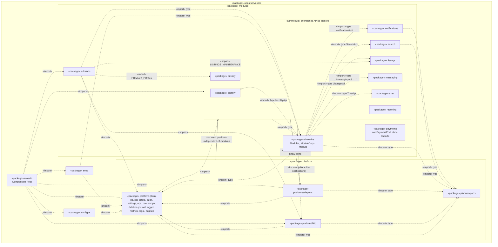
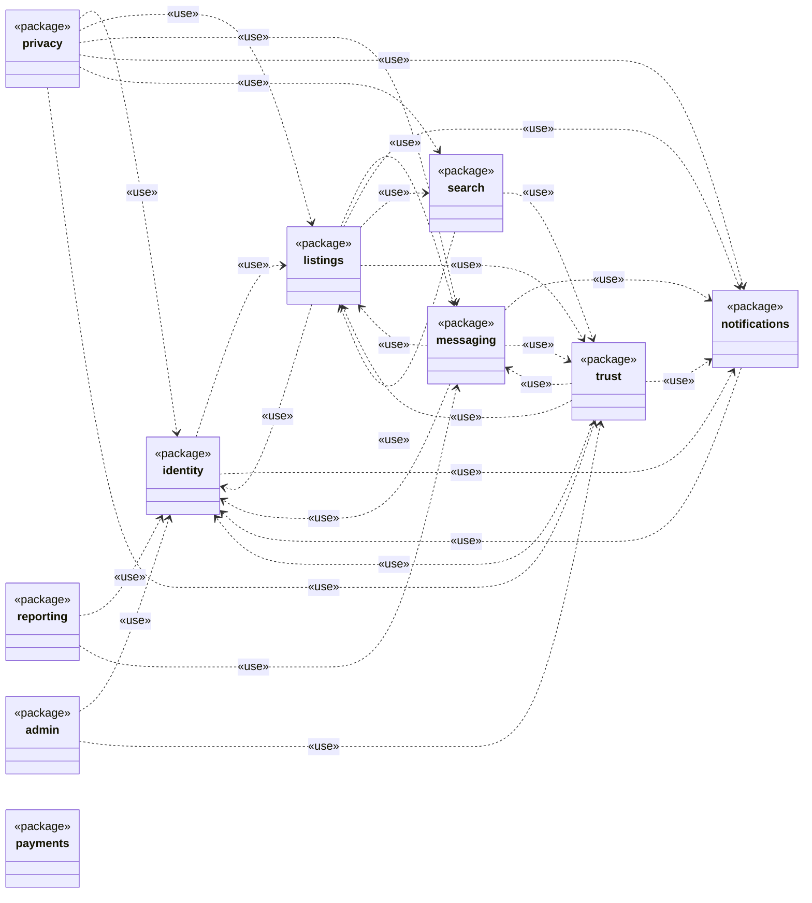
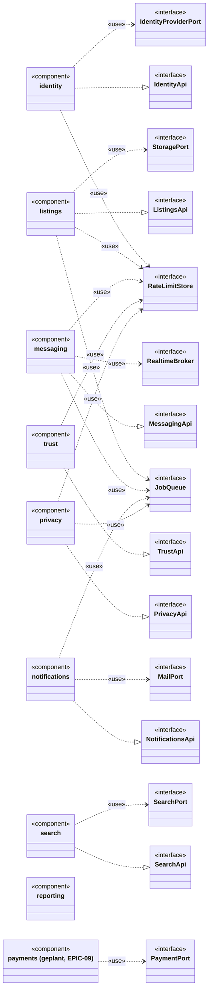
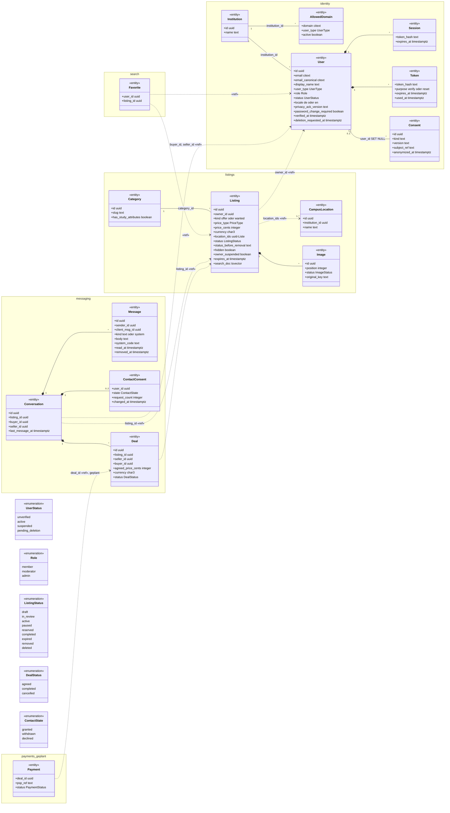
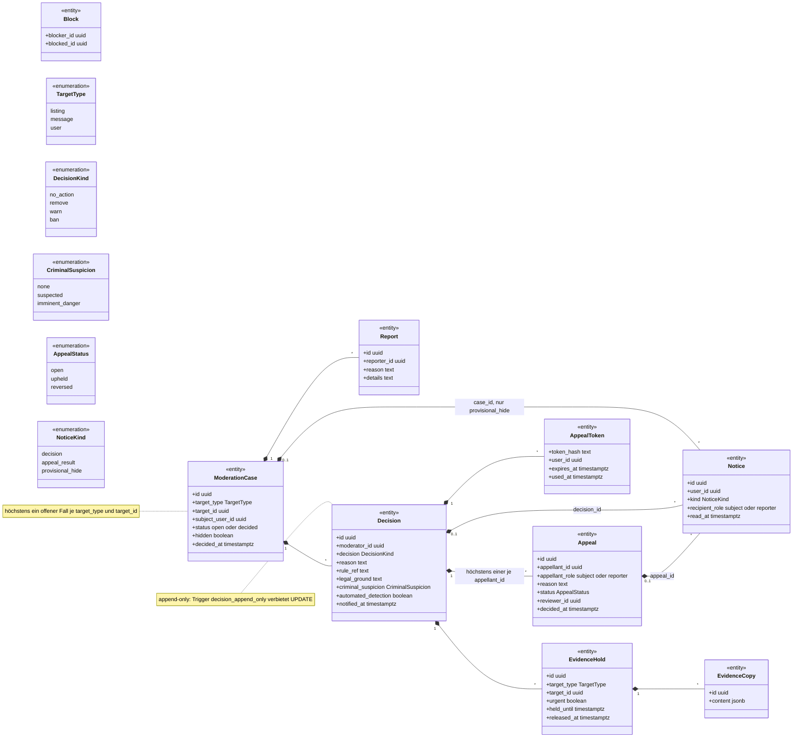
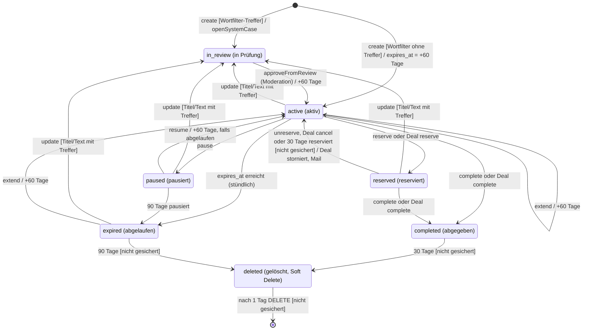
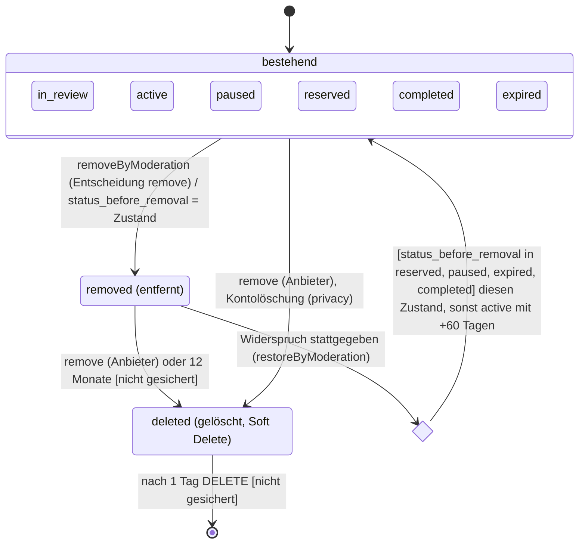
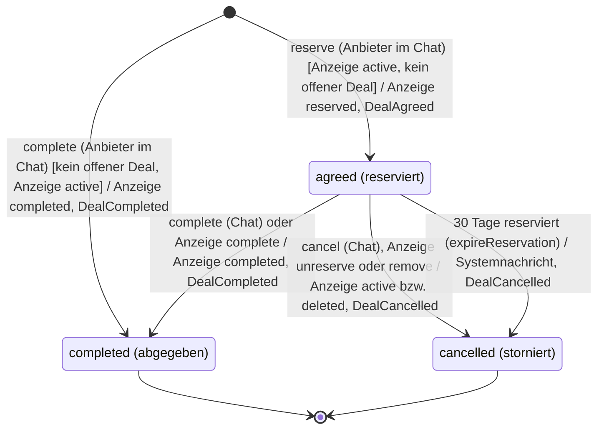
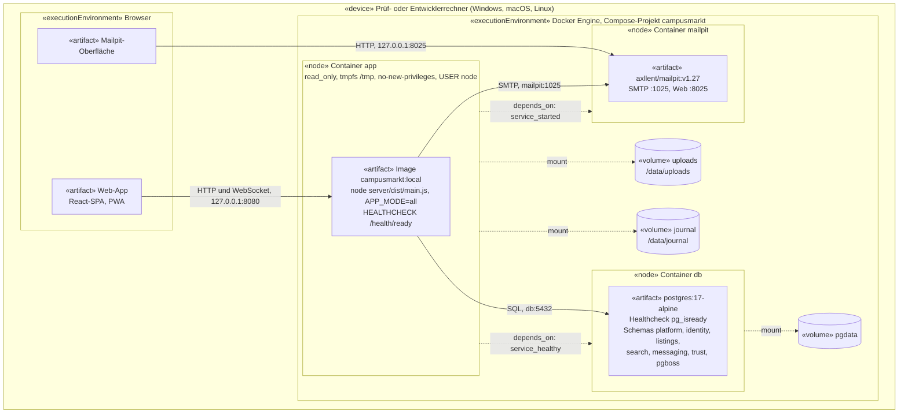

# UML-Sichten der Architektur CampusMarkt

> Ergänzung zur [Architekturdokumentation](architektur.md) (arc42, C4). Führend bleiben die C4-Sichten ([ADR-0012](decisions/0012-c4-notation.md)); diese Datei zeigt **dieselbe Architektur** zusätzlich in UML ([ADR-0023](decisions/0023-uml-sichten-ergaenzend-zu-c4.md)). Grundlage ist der Code (Version 0.4.1): `apps/server/src`, die Migrationen `apps/server/migrations/0001…0005` und `apps/server/.dependency-cruiser.cjs`. Wo die Architekturdokumentation vom Code abweicht, gilt hier der Code; die Abweichungen stehen in [Abschnitt 8](#8-abgleich).

## 1. Einordnung und Notation

Mermaid kennt kein eigenes UML-Paket-, Komponenten- oder Verteilungsdiagramm. Die Diagramme bilden die UML-Notation deshalb so nach:

| UML-Diagramm | Abschnitt | Mermaid | Abbildung der UML-Notation |
|---|---|---|---|
| Paketdiagramm (Importe) | 2.1 | `flowchart` mit Subgraphen | Subgraph = Paket (geschachtelt), Knoten mit `«package»`, gestrichelter Pfeil = Abhängigkeit `«import»`, Pfeil mit `x` = durch eine Regel verbotene Abhängigkeit |
| Paketdiagramm (Nutzung) | 2.2 | `classDiagram` | Klasse mit Stereotyp `<<package>>`, gestrichelter Pfeil `..>` = Abhängigkeit `«use»` |
| Komponentendiagramm | 3.1, 3.2 | `classDiagram` | `<<component>>` = Komponente, `<<interface>>` = Schnittstelle; Realisierung `..|>` = **bereitgestellte** Schnittstelle (Ball), Abhängigkeit `..>` mit `«use»` = **benötigte** Schnittstelle (Socket) |
| Klassendiagramm | 4.1, 4.2 | `classDiagram` mit `namespace` | Namespace = Postgres-Schema bzw. Modul, `<<entity>>` = Tabelle, `<<enumeration>>` = `CHECK`-Werteliste, Komposition `*--` = Fremdschlüssel mit `ON DELETE CASCADE`, Aggregation `o--` = `ON DELETE SET NULL`, Assoziation `--` = Fremdschlüssel ohne Kaskade, Abhängigkeit `..>` mit `«ref»` = Referenz per ID ohne Fremdschlüssel (modulübergreifend, Modulregel 2) |
| Zustandsdiagramm | 5.1, 5.2 | `stateDiagram-v2` | nativ: Zustände, Übergänge `Ereignis [Wächter] / Wirkung`, zusammengesetzter Zustand, Auswahl (`<<choice>>`) |
| Verteilungsdiagramm | 6 | `flowchart` mit Subgraphen | Subgraph = `«device»`, `«executionEnvironment»` bzw. Docker-Container als `«node»`, Knoten = `«artifact»` bzw. Volume, Kante = Kommunikationspfad mit Protokoll und Port |
| Sequenzdiagramm | 7 | `sequenceDiagram` | nativ; steht in der [Laufzeitsicht der Architektur](architektur.md#6-laufzeitsicht) |

Bezeichner im Diagramm sind die Namen aus dem Code (Ordner, Interfaces, Funktionen, Spalten- und Statuswerte). Fachliche deutsche Namen der Zustände stehen in Klammern bzw. in der [Übergangstabelle der Anforderungen](../02-anforderungen/02-anforderungen.md#4-zustandsmodell-anzeige-normativ).

## 2. Paketdiagramm

### 2.1 Pakete und Importe (statisch, dependency-cruiser)

Das Diagramm zeigt die Importe zwischen den Paketen von `apps/server/src`, wie dependency-cruiser sie sieht (`depcruise src`, Testdateien ausgenommen). Fachmodule importieren **einander nicht direkt**: Die öffentlichen APIs stehen als Typen in `modules/shared.ts` (`Modules`, `ModuleDeps`) und werden zur Laufzeit über `ModuleDeps.modules` gebunden (späte Bindung, ADR-0001). Die einzigen direkten Importe zwischen Modulordnern sind die Typ-Importe von `shared.ts` auf sechs `index.ts` und die Konstanten-Importe von `admin.ts` aus `listings/index.ts` und `privacy/index.ts`; beide gehen auf ein `index.ts` und sind damit nach Regel `module-internals` erlaubt.



Nicht gezeichnet sind reine Typ-Importe von `config.ts` (aus `shared.ts`, `identity`, `listings`, `platform/http`) und Importe innerhalb eines Pakets.

**Regeln aus `.dependency-cruiser.cjs`** (alle `severity: error`; was keine Regel verbietet, ist erlaubt):

| Regel | Von | Nach (verboten) | Im Diagramm |
|---|---|---|---|
| `module-internals` | `src/modules/<m>/` | Dateien eines **anderen** Modulordners außer dessen `index.ts` | alle Pfeile zwischen Modulordnern enden an einem `index.ts` |
| `modules-only-know-ports` | `src/modules/` | `src/platform/adapters/` | Pfeil mit `x` von den Fachmodulen zu `platform/adapters` |
| `no-infrastructure-libs-in-modules` | `src/modules/` | `node_modules/(nodemailer\|pg-boss\|pg)/` | externe Bibliotheken nicht gezeichnet |
| `no-payment-sdk-in-modules` | `src/modules/` | PSP-SDKs (stripe, mollie, @paypal, @adyen, braintree …) | `payments` enthält nur das Interface (ADR-0006) |
| `domain-is-pure` | `src/modules/*/domain.ts` | `src/platform/`, fastify, pg, pg-boss, sharp | Inhalt der Pakete, nicht gezeichnet |
| `platform-independent-of-modules` | `src/platform/` | `src/modules/` | Pfeil mit `x` von `platform` zu den Fachmodulen |

`main.ts` ist der einzige Ort, der Adapter importiert und mit den Ports verdrahtet; keine Regel begrenzt ihn.

### 2.2 Nutzungsbeziehungen zwischen den Fachmodulen (Laufzeit)

Welche Module einander tatsächlich aufrufen, sieht dependency-cruiser nicht, weil die Aufrufe über `deps.modules.<modul>.<funktion>` laufen. Das Diagramm zeigt jede Nutzung aus dem Code (`grep` auf `modules.<modul>.` in `apps/server/src/modules`, ohne Tests). `privacy` und `reporting` stehen nicht in `Modules` und werden von keinem Modul aufgerufen; `payments` hat keine Nutzung.



| Von | Nach | Aufgerufene Funktionen der öffentlichen API |
|---|---|---|
| identity | listings | `locationsExist` (Vorzugsorte im Profil) |
| identity | notifications | `email` (Verifikation, Konto existiert, Passwort zurücksetzen, Löschung geplant) |
| listings | identity | `allowedDomains`, `getPublicUsers` |
| listings | messaging | `onListingStatusChanged`, `findConversationId`, `expireReservation`, `publishSystemMessages` |
| listings | notifications | `email` (Ablauf-Erinnerung, Rückfall der Reservierung) |
| listings | search | `isFavorite` |
| listings | trust | `openSystemCase`, `heldTargetIds` |
| messaging | identity | `activeUserIds`, `getPublicUsers`, `getSharedContactAddresses`, `isActive` |
| messaging | listings | `summary`, `summaries`, `setStatusFromDeal` |
| messaging | notifications | `email` |
| messaging | trust | `blockRelations`, `isBlockedEither` |
| notifications | identity | `getContact`, `disableNotification` |
| search | listings | `cards`, `summary` |
| search | trust | `blockRelations` |
| trust | identity | `adminIds`, `getContact`, `getPublicUsers`, `suspend`, `unsuspend` |
| trust | listings | `approveFromReview`, `evidenceSnapshot`, `removeByModeration`, `restoreByModeration`, `setHidden`, `setOwnerSuspended`, `summary`, `summaries` |
| trust | messaging | `evidenceSnapshot`, `isParticipantOfMessage`, `messageContext`, `originalBody`, `removeByModeration`, `restoreByModeration` |
| trust | notifications | `email` |
| privacy | identity | `requestDeletion`, `deleteUser`, `deletionCandidate`, `dueDeletions`, `exportData`, `purgeExpired`, `replayDeletionRequest`, `replayDeletionCancel` |
| privacy | listings | `deleteAllForOwner`, `exportForUser`, `removeByModeration`, `restoreByModeration`, `replayDelete`, `replayImageDelete` |
| privacy | messaging | `deleteForUser`, `exportForUser`, `exportContactConsents`, `purgeInactiveConversations`, `purgeRemovedOriginals`, `removeByModeration`, `restoreByModeration` |
| privacy | notifications | `email` |
| privacy | search | `deleteForUser`, `exportForUser` |
| privacy | trust | `deleteForUser`, `exportForUser`, `protectedMessageIds`, `purgeExpired`, `purgeExpiredEvidence` |
| reporting | identity | `getContact`, `getPublicUsers` |
| reporting | messaging | `completedSales` |
| admin | identity | `getPublicUsers`, `endAllSessions` |
| admin | trust | `evidenceHolds`, `releaseEvidenceHold` |

Gegenseitige Nutzung (Zyklen auf Laufzeitebene, ohne Importzyklus): `identity ↔ listings`, `identity ↔ notifications`, `listings ↔ messaging`, `listings ↔ search`, `listings ↔ trust`, `messaging ↔ trust`. Die Zielrichtung für `listings ↔ messaging` (Entscheidung OE-1, B-39) steht in [Architektur 5.2.3](architektur.md#523-abhängigkeiten-zwischen-den-fachmodulen).

## 3. Komponentendiagramm

### 3.1 Fachmodule: bereitgestellte und benötigte Schnittstellen

Jedes Fachmodul ist eine Komponente. Es **stellt** sein öffentliches API (`Module<Api>.api`, Typ in `index.ts`) **bereit** und **benötigt** Ports aus `platform/ports` (über `ModuleDeps`) sowie die APIs anderer Module (siehe 2.2, hier nicht wiederholt). `MailPort` und `SearchPort` stehen nicht in `ModuleDeps`; `main.ts` übergibt sie nur an `notifications` bzw. `search`. Der `PaymentPort` ist im MVP nur als Schnittstelle vorhanden; die benötigende Komponente `payments` ist geplant (EPIC-09, ADR-0006).



| Komponente | Stellt bereit | Benötigt (Ports) | Weitere Plattformdienste aus `ModuleDeps` |
|---|---|---|---|
| identity | `IdentityApi` (= `IdentityService`) | `IdentityProviderPort` (intern durch das Passwortverfahren realisiert, ADR-0013), `RateLimitStore` | `database`, `pseudonym`, `journal`, `config` |
| listings | `ListingsApi` (= `ListingsService`) | `StoragePort`, `JobQueue` (Bilder, `listings-maintenance`), `RateLimitStore` | `database`, `journal` |
| messaging | `MessagingApi` (= `MessagingService`), zusätzlich die WebSocket-Route | `RealtimeBroker`, `JobQueue` (`deal-events`, ungelesene Nachrichten), `RateLimitStore` | `database`, `journal`, `metrics` |
| notifications | `NotificationsApi` (`email`), Abmelde-Routen | `MailPort`, `JobQueue` (`send-email`) | `metrics`, `config` |
| search | `SearchApi` | `SearchPort` | `database` |
| trust | `TrustApi` (= `TrustService`) | `RateLimitStore` (Widerspruch) | `database`, `config` |
| privacy | `PrivacyApi` (nur von `main.ts` für `replay-deletions` genutzt) | `JobQueue` (`privacy-purge`), `RateLimitStore` (`purge`) | `database` |
| reporting | kein API (`Module<Record<string, never>>`), nur Routen | – | `database` |
| admin (`admin.ts`) | nur Routen | `JobQueue` (`overview`, `enqueue`) | `database`, `settings`, `ops` |
| payments | – | `PaymentPort` (geplant) | – |

### 3.2 Ports und Adapter

Die Ports sind Interfaces; die Adapter sind Fabrikfunktionen, die ein Objekt mit dem Interface liefern (Realisierung). `main.ts` erzeugt die Adapter und gibt sie den Modulen. Für den `PaymentPort` gibt es im MVP **keinen** Adapter; vorgesehen sind Adapter je Zahlungsdienstleister (ADR-0006, [Architektur 8.5](architektur.md#85-erweiterungspunkt-bezahlung-adr-0006)).

```mermaid
classDiagram
    direction TB
    namespace platform_ports {
        class MailPort {
            <<interface>>
            +send(message) Promise~void~
            +verify() Promise~boolean~
        }
        class StoragePort {
            <<interface>>
            +put(key, data) Promise~void~
            +get(key) Promise~Buffer~
            +delete(key) Promise~void~
            +deletePrefix(prefix) Promise~void~
            +listOlderThan(prefix, olderThan) Promise~string[]~
        }
        class RealtimeBroker {
            <<interface>>
            +publish(userId, event) Promise~void~
            +subscribe(userId, listener) Unsubscribe
            +connectionCount() number
        }
        class JobQueue {
            <<interface>>
            +defineQueue(name, options)
            +enqueue(name, data, options, executor)
            +work(name, handler, options)
            +schedule(name, cron)
            +overview()
            +stop()
        }
        class SearchPort {
            <<interface>>
            +search(criteria) SearchHits
        }
        class RateLimitStore {
            <<interface>>
            +hit(key, limit, windowSeconds) RateLimitResult
            +reset(key)
            +purge(olderThanSeconds) number
        }
    }
    namespace platform_adapters {
        class createSmtpMail {
            <<component>>
            Nodemailer
        }
        class createFsStorage {
            <<component>>
            Dateisystem, Volume uploads
        }
        class createInProcessRealtime {
            <<component>>
            EventEmitter
        }
        class createPgBossQueue {
            <<component>>
            pg-boss, Dead-Letter-Queue
        }
        class createPgSearch {
            <<component>>
            tsvector, pg_trgm
        }
        class createPgRateLimit {
            <<component>>
            Tabelle platform.rate_limit
        }
    }
    namespace platform_http {
        class withRateLimitHeaders {
            <<component>>
            Dekorierer, RateLimit-Header
        }
    }
    namespace modules_identity {
        class IdentityProviderPort {
            <<interface>>
            +id string
            +begin() BeginResult
            +complete(input) VerifiedIdentity
        }
        class passwordProvider {
            <<component>>
            Passwortverfahren, Argon2id
        }
    }
    namespace modules_payments {
        class PaymentPort {
            <<interface>>
            +onboardSeller(input)
            +createCheckout(input)
            +releaseFunds(input)
            +refund(input)
            +getStatus(paymentRef) PaymentStatus
        }
    }
    class main_ts["main.ts"] {
        <<component>>
        Composition Root
    }
    createSmtpMail ..|> MailPort
    createFsStorage ..|> StoragePort
    createInProcessRealtime ..|> RealtimeBroker
    createPgBossQueue ..|> JobQueue
    createPgSearch ..|> SearchPort
    createPgRateLimit ..|> RateLimitStore
    withRateLimitHeaders ..|> RateLimitStore
    withRateLimitHeaders ..> RateLimitStore : «use» dekoriert
    passwordProvider ..|> IdentityProviderPort
    main_ts ..> createSmtpMail : «create»
    main_ts ..> createFsStorage : «create»
    main_ts ..> createInProcessRealtime : «create»
    main_ts ..> createPgBossQueue : «create»
    main_ts ..> createPgSearch : «create»
    main_ts ..> createPgRateLimit : «create»
    main_ts ..> withRateLimitHeaders : «create»
    note for PaymentPort "MVP: kein Adapter (ADR-0006, EPIC-09)"
```



| Port | Ort | Adapter im Docker-Beispiel | Austauschpfad (Echtbetrieb) | ADR |
|---|---|---|---|---|
| `MailPort` | `platform/ports/index.ts` | `createSmtpMail` (Nodemailer → Mailpit) | SMTP-Relay | 0005 |
| `StoragePort` | `platform/ports/index.ts` | `createFsStorage` (Volume `uploads`) | S3-Adapter | 0007 |
| `RealtimeBroker` | `platform/ports/index.ts` | `createInProcessRealtime` | `PgNotifyAdapter` | 0004 |
| `JobQueue` | `platform/ports/index.ts` | `createPgBossQueue` | – (pg-boss bleibt) | 0005 |
| `SearchPort` | `platform/ports/index.ts` | `createPgSearch` | – | 0008 |
| `RateLimitStore` | `platform/ports/index.ts` | `createPgRateLimit`, dekoriert durch `withRateLimitHeaders` (`platform/http`) | – | – |
| `IdentityProviderPort` | `modules/identity/identity-provider.ts` | `passwordProvider` in `modules/identity/service.ts` | OIDC/SAML-Adapter (S-01) | 0013 |
| `PaymentPort` | `modules/payments/payment-port.ts` | keiner | Adapter je PSP (EPIC-09) | 0006 |

## 4. Klassendiagramm des Fachmodells

Die Klassen sind die Tabellen der Migrationen (Stand `0005_nachweise_korrekturen.sql`) mit den fachlich wichtigen Spalten; Werte von `CHECK`-Bedingungen sind Aufzählungen. Namespaces entsprechen den Postgres-Schemas, die zugleich die Modulgrenzen sind. Plattform-Tabellen (`platform.audit_log`, `platform.rate_limit`, `platform.setting`, `platform.ip_pepper`) und `messaging.notification_state` sind nicht gezeichnet. Die ER-Sicht steht in [Architektur 5.4](architektur.md#54-fachliches-datenmodell-auszug).

### 4.1 Konten, Anzeigen, Merkliste, Chat und Deal



Wichtige Bedingungen aus den Migrationen: `User.email_canonical` eindeutig; `Conversation(listing_id, buyer_id)` eindeutig und `buyer_id <> seller_id`; `Message(conversation_id, client_msg_id)` eindeutig (Idempotenz); höchstens ein `Deal` mit `status = 'agreed'` je Anzeige (`deal_one_open_per_listing`); `ContactConsent` hat je Konversation und Teilnehmer eine Zeile (Primärschlüssel `conversation_id, user_id`); `Listing.price_cents` nur bei `fixed`/`negotiable` (1 … 1.000.000 Cent). `PriceType` = `fixed`, `negotiable`, `free`, `swap`; `ImageStatus` = `uploaded`, `processing`, `ready`, `failed`; `UserType` = `student`, `staff`; `PaymentStatus` siehe `payment-port.ts`. `Payment` ist geplant und hat noch keine Tabelle.

### 4.2 Moderation, DSA-Begründung, Widerspruch und Beweissicherung (Schema `trust`)



`target_id`, `subject_user_id`, `reporter_id`, `moderator_id`, `appellant_id`, `reviewer_id`, `user_id`, `blocker_id` und `blocked_id` sind Referenzen ohne Fremdschlüssel auf `identity.user`, `listings.listing` bzw. `messaging.message` (`«ref»`, aus Gründen der Lesbarkeit nicht gezeichnet). Die Vier-Augen-Regel (`reviewer_id` ≠ `Decision.moderator_id`) prüft die Anwendung, nicht die Datenbank.

## 5. Zustandsdiagramme

### 5.1 Anzeige (`listings.listing.status`)

Quelle: `modules/listings/domain.ts` (Aktionen des Anbieters), `modules/listings/service.ts` (Inhaltsprüfung, Deal, Moderation, Wartungslauf `maintenance()` stündlich) und die `CHECK`-Bedingung in `0001_init.sql`. Normativ ist die [Übergangstabelle Ü-1 … Ü-19](../02-anforderungen/02-anforderungen.md#4-zustandsmodell-anzeige-normativ). Der Wert `draft` ist in der Datenbank erlaubt, wird aber nie gesetzt (in R1 gibt es keine Entwürfe) und fehlt deshalb im Diagramm. „Ausgeblendet“ (`hidden`, `owner_suspended`) ist ein Merkmal, kein Zustand. Zur Lesbarkeit ist das Modell auf zwei Diagramme verteilt.

**a) Lebenszyklus durch Anbieter, Deal, Inhaltsprüfung und Zeitgeber**



**b) Moderation und Löschung**



„Nicht gesichert“ heißt: Die Anzeige hat keine aktive Beweissicherung (`trust.heldTargetIds('listing')`, REQ-LEGAL-008). Übergänge in `deleted` löschen Bilder und Dateien sofort; Löschungen und Wiederherstellungen schreiben ins Löschjournal.

### 5.2 Deal (`messaging.deal.status`)

Quelle: `MessagingService.deal`, `onListingStatusChanged` und `expireReservation` in `modules/messaging/service.ts`. Jeder Übergang reiht im selben Commit ein Domain Event in die Queue `deal-events` ein (`dealEvent`, mit eigener `eventId`); heute protokolliert ein Konsument es, später konsumiert das Modul `payments` es (ADR-0006).



Höchstens ein Deal je Anzeige ist `agreed` (Index `deal_one_open_per_listing`); nach `cancelled` kann in einer Konversation ein neuer Deal entstehen. Deals werden mit ihrer Konversation gelöscht (`ON DELETE CASCADE`). Der Zahlungszustand (Pending … Refunded) gehört zum geplanten Modul `payments` und steht in [ADR-0006](decisions/0006-bezahlung-erweiterungspunkt.md).

## 6. Verteilungsdiagramm: Docker-Beispiel

Quelle: `compose.yaml` (Standardstart ohne Profile, ADR-0010) und `docker/Dockerfile`. Die optionalen Profile `proxy` und `monitoring` zeigt [Architektur 7.3](architektur.md#73-optionale-betriebsprofile-proxy-und-monitoring-adr-0017--umgesetzt-b-54-b-55).



Die Ports 8080 und 8025 sind nur an `127.0.0.1` gebunden; SMTP (1025) und Postgres (5432) sind nur im Compose-Netz erreichbar. `docker compose down -v` entfernt alle drei Volumes.

## 7. Sequenzdiagramme

UML-Sequenzdiagramme werden nicht doppelt geführt. Sie stehen in der [Laufzeitsicht der Architektur (§6)](architektur.md#6-laufzeitsicht): Registrierung mit E-Mail-Verifikation (6.1), Chat-Nachricht senden (6.2), Anzeige mit Bildern veröffentlichen (6.3), Kontaktdaten freigeben (6.4), Widerspruch gegen eine Moderationsentscheidung (6.5) und Wartungsmodus (6.6). Die Teilnehmer dort entsprechen den Komponenten aus Abschnitt 3.

## 8. Abgleich

### 8.1 dependency-cruiser

`pnpm --filter @campusmarkt/server lint:deps` am 2026-11-13 auf `feature/r1-nachweise` (Version 0.4.1, mit den zu diesem Zeitpunkt nicht eingecheckten Änderungen im Arbeitsverzeichnis):

```text
✔ no dependency violations found (82 modules, 272 dependencies cruised)
```

Die Importkanten in 2.1 stammen aus `depcruise src --config .dependency-cruiser.cjs --output-type json`, verdichtet auf Paketebene. Ergebnis: Keine Kante verletzt eine Regel; kein Fachmodul importiert ein anderes Fachmodul direkt (nur `shared.ts` und `admin.ts` importieren `index.ts`-Dateien); `platform` importiert nichts aus `modules`; nur `main.ts` importiert `platform/adapters`. dependency-cruiser prüft **nicht** die Laufzeitnutzung aus 2.2 und nicht die Schemagrenzen im SQL (Modulregel 2, geplant B-38).

### 8.2 Abweichungen zwischen Architekturdokumentation und Code

Es gilt der Code; die Diagramme oben zeigen den Code. Die Architekturdokumentation und die Anforderungen sind (noch) nicht angepasst.

| # | Stelle in der Doku | Doku sagt | Code (gilt) |
|---|---|---|---|
| A-1 | [Architektur 5.2.3](architektur.md#523-abhängigkeiten-zwischen-den-fachmodulen), Tabelle und „Weitere Aufrufe“ | 12 Abhängigkeiten plus `trust → messaging`, `messaging`/`search → trust`, `listings → trust`, `listings → search` | Zusätzlich `identity → listings` (`locationsExist`), `identity → notifications` (Verifikations-, Reset- und Lösch-Mails), `listings → identity` (`allowedDomains`, `getPublicUsers`), `listings → notifications` (Ablauf-Erinnerung, Rückfall der Reservierung), `privacy → messaging`, `privacy → search`, `privacy → trust` (siehe 2.2) |
| A-2 | Architektur 5.2.3, Einleitung | `listings` ruft synchron `messaging.onListingStatusChanged` und `findConversationId` | zusätzlich `expireReservation` und `publishSystemMessages` (Rückfall nach 30 Tagen) |
| A-3 | Architektur 5.2.3, Modulregel 3 | Zyklus `listings ↔ messaging` | auf Laufzeitebene außerdem `identity ↔ listings`, `identity ↔ notifications`, `listings ↔ search`, `listings ↔ trust`, `messaging ↔ trust` (keine Importzyklen) |
| A-4 | Architektur 5.2.1 | `admin → messaging` („DAC7: abgeschlossene Deals je Verkäufer“) | `admin.ts` ruft `identity` und `trust` (Beweissicherungen); DAC7 liegt in `reporting → messaging.completedSales`. `admin → trust` fehlt im Diagramm |
| A-5 | Architektur 5.2.1 | HTTP-API ruft identity, listings, search, messaging, trust, privacy | Routen registrieren außerdem `notifications` (Abmeldung) und `reporting` (DAC7) |
| A-6 | Architektur 5.2.2, Kasten `JobQueue → pg-boss-Adapter` | „Outbox, Retry, Dead-Letter, publish/subscribe“ | `JobQueue` hat kein publish/subscribe (geplant B-40, wie in 5.2 Tabelle und 8.5 richtig vermerkt); `deal-events` ist eine Queue mit einem protokollierenden Konsumenten |
| A-7 | Architektur 5.2.2 | `RateLimitStore → Postgres-Adapter` | der Adapter wird in `main.ts` zusätzlich durch `withRateLimitHeaders` (`platform/http`) dekoriert |
| A-8 | [Architektur 5.4](architektur.md#54-fachliches-datenmodell-auszug), `CONTACT_CONSENT` | Spalte `last_request_at`; Sperrfrist ab „Zeitpunkt der letzten Anfrage“ | keine Spalte `last_request_at`; Migration 0002 hat `changed_at`, die Sperrfrist rechnet ab `changed_at` (`contactView` in `messaging/domain.ts`) |
| A-9 | Architektur 5.4, Unique-Constraints | `APPEAL(decision_id, appellant_id)` „(geplant)“ | umgesetzt in Migration 0003 als `appeal_once_per_person` (partiell: `WHERE appellant_id IS NOT NULL`) |
| A-10 | Architektur 5.4, ER-Diagramm | `DECISION ||--o| APPEAL` und zugleich `DECISION ||--o{ APPEAL` | mehrere Widersprüche je Entscheidung (je Person einer); richtig ist `o{` |
| A-11 | [Architektur 7.1](architektur.md#71-c4-verteilungsdiagramm-docker-beispiel-verbindlich-für-das-projekt) | Container `app` mit Volume `uploads` | zusätzlich Volume `journal` (`/data/journal`, Löschjournal, ADR-0018/0019); Ports nur an `127.0.0.1` gebunden |
| A-12 | [Architektur 9](architektur.md#9-architekturentscheidungen) | Liste endet bei ADR-0021 | ADR-0022 fehlte; mit diesem Stand ergänzt (zusammen mit ADR-0023) |
| A-13 | [Anforderungen, Ü-3](../02-anforderungen/02-anforderungen.md#4-zustandsmodell-anzeige-normativ) | bearbeiten mit Treffer aus aktiv, pausiert, reserviert | auch aus `expired` (in `EDITABLE_STATUSES`) |
| A-14 | Anforderungen, Ü-16 | löschen durch den Anbieter aus jedem Zustand **außer entfernt** | `remove()` lädt jede nicht gelöschte Anzeige des Anbieters, also auch `removed` |
| A-15 | Anforderungen, Übergangstabelle | kein Übergang aus `entfernt` zurück | `restoreByModeration` bei stattgegebenem Widerspruch (REQ-LEGAL-007): zurück in den Zustand vor der Entfernung bzw. `active` |
| A-16 | Anforderungen, Übergangstabelle | keine Entwürfe in R1 | `draft` ist im `CHECK` der Tabelle und in `EDITABLE_STATUSES` noch enthalten, wird aber nie gesetzt |
| A-17 | Architektur 8.5, Anforderungen Ü-15 | – | Entfernt die Moderation eine reservierte Anzeige, bleibt ein offener Deal `agreed` bestehen (`removeByModeration` ruft `messaging.onListingStatusChanged` nicht auf) |

A-1 bis A-11 und A-13 bis A-17 betreffen Dateien, die mit B-72 nicht geändert werden (Architektur-Abschnitte außerhalb von §5-Einleitung und §9, Anforderungskatalog). Sie sind als Befunde für die nächste Überarbeitung festgehalten.

## Änderungshistorie

| Version | Datum | Änderung |
|---|---|---|
| 1.0 | 2026-11-13 | Erstfassung (B-72): Paket-, Komponenten-, Klassen-, Zustands- und Verteilungsdiagramme in UML aus dem Code, Abgleich mit dependency-cruiser ([ADR-0023](decisions/0023-uml-sichten-ergaenzend-zu-c4.md)) |
