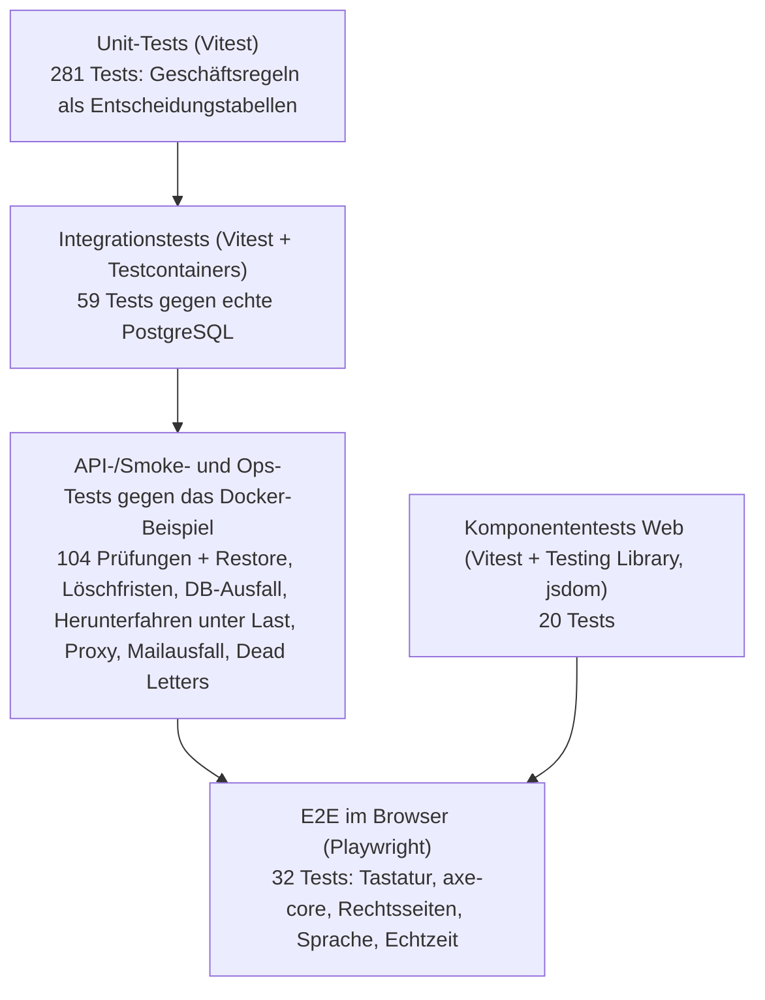
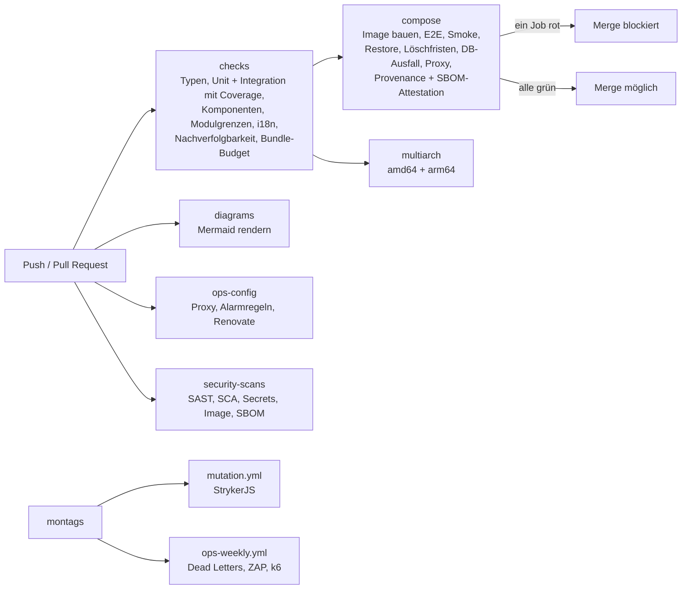

# Teststrategie

Diese Strategie setzt [Guideline Kap. 09](https://github.com/CaRo10Robert/dev_guideline/blob/main/09-testing-quality-automation.md) für CampusMarkt um. Grundregel: Was sich als Skript ausdrücken lässt, läuft als Skript in CI. Manuell bleiben nur Prüfungen, die Menschen brauchen (Screenreader, Usability, Reviews); sie stehen als `MAN-…` im [Nachweiskatalog](../02-anforderungen/nachweise.md).

## 1. Testpyramide

| Ebene | Prüft | Werkzeug | Ort | Läuft |
|---|---|---|---|---|
| Unit | reine Logik ohne Ein-/Ausgabe: Geschäftsregeln (`domain.ts`), Plattformbausteine (Paginierung, Rate-Limit-Header, Pseudonyme, Löschjournal), Grenzfälle als Tabelle | Vitest | `apps/server/src/**/*.test.ts` | jeder Push (Job `checks`) |
| Integration | Nahtstellen mit echter Datenbank: SQL, Transaktionen, Jobs, Löschläufe, Autorisierungsmatrix, Rate-Limits; vorgestellte Zeit per SQL | Vitest, Testcontainers (`postgres:17-alpine`, dieselbe Version wie im Docker-Beispiel, dort zusätzlich per Digest gepinnt) | `apps/server/src/**/*.integration.test.ts`, Harness in `apps/server/test/integration/` | jeder Push (Job `checks`) |
| Komponenten | React-Komponenten ohne Browser: Kontaktfreigabe, Fehlerseiten, Sprachwahl, Markdown, Hinweise, Basisbausteine | Vitest, React Testing Library, jsdom; `fetch` per `mockApi` ersetzt | `apps/web/src/**/*.test.tsx`, Hilfen in `apps/web/src/test/` | jeder Push (Job `checks`) |
| API/Smoke | Abläufe über HTTP gegen das laufende Docker-Beispiel inklusive Mailpit | Node-Skript | `scripts/smoke-test.mjs` | jeder Push (Job `compose`) |
| Ops | Betrieb: Restore mit Löschjournal, Löschfristen, Datenbankausfall, Herunterfahren unter Last (Last aus dem Docker-Netz), Proxy mit TLS/HSTS, Mailserver-Ausfall, Dead Letters | Node-Skripte | `tests/ops/` | Job `compose`; Mailausfall und Dead Letters wöchentlich mit verkürztem Wiederholungsplan (`MAIL_RETRY_DELAY_SECONDS=10`, Skala 1:12) |
| E2E | kritische Nutzerwege im Browser, Tastaturbedienung, Barrierefreiheit (axe-core), Speicherungen und fremde Hosts | Playwright (Chromium), `retries: 0` | `e2e/tests/` | jeder Push (Job `compose`) |

**Abgrenzung Unit ↔ Integration:** Integrationstests prüfen nicht erneut die Regeln, die Unit-Tests schon als Tabelle abdecken. Sie prüfen, dass Module, SQL und Jobs zusammenpassen, zum Beispiel dass der Rückfall reservierter Anzeigen den offenen Deal aufhebt und eine Mail auslöst.

## 2. Aufbau der Integrationstests

- `test/integration/global-setup.ts` startet je Lauf **einen** PostgreSQL-Container, wendet alle Migrationen auf eine Template-Datenbank an und gibt die Verbindung an die Testdateien weiter.
- `test/integration/harness.ts` klont je Testdatei eine eigene Datenbank aus dem Template. Dateien laufen parallel und hinterlassen keinen Zustand.
- Der Harness baut die echten Module und den echten HTTP-Server zusammen. Ersetzt sind nur Ports ohne Datenbank: Mail (`FakeMail` im Speicher), Job-Queue (`FakeJobs` im Speicher, führt eingereihte Jobs erst auf `drain()` aus, damit Tests auch den Zustand davor prüfen), Dateiablage im temporären Ordner. Dahinter stehen dieselben Ports wie im Docker-Beispiel (ADR-0010).
- **Ohne Docker:** In CI ist Docker Pflicht, ein Fehler beim Containerstart bricht den Lauf ab. Lokal ohne Docker werden die Integrationstests mit Hinweis übersprungen, und es gilt nur die Coverage-Schwelle der Unit-Tests. So sieht ein fehlender Test nie still grün aus.

## 3. Coverage und Mutationstests

| Kontrolle | Schwelle | Messwert | Nachweis |
|---|---|---|---|
| Zeilen der Fachmodule (`apps/server/src/modules`) | 86 % | 88,65 % (2026-11-07) | `CTRL-COVERAGE`, REQ-MAINT-001 Kriterium (1) ≥ 80 % |
| Zweige / Funktionen der Fachmodule | 70 % / 86 % | 71,99 % / 89,2 % | `CTRL-COVERAGE` |
| Geschäftsregeln (`domain.ts`) Zeilen, Zweige, Funktionen | je 95 % | 100 % / 99,4 % / 100 % | `CTRL-COVERAGE`, Guideline „≥ 95 % inkl. Zweige für kritische Pfade“ |
| Mutation-Score der Geschäftsregeln (StrykerJS) | 60 % | 73,8 % (2026-10-26) | `CTRL-MUTATION`, REQ-MAINT-001 Kriterium (2), wöchentlich in `mutation.yml` |

Schwellen liegen 2 Prozentpunkte unter dem Messwert, damit Rückschritte auffallen. Eine Absenkung braucht eine Begründung in REQ-MAINT-001. Unit- und Integrationstests laufen in einem Vitest-Lauf und gehen gemeinsam in die Messung ein. Damit ist der frühere Weg über `NODE_V8_COVERAGE` unter Smoke-Tests (B-64) nicht mehr nötig.

**MC/DC:** Zusammengesetzte Bedingungen, die über Zugriff oder Rechtsfolgen entscheiden (Kontaktfreigabe, Vier-Augen-Prinzip, Domain-Prüfung BR-01, Löschfristen), stehen als reine Funktionen in `domain.ts`. Ihre Tests sind Entscheidungstabellen mit einer Zeile je Bedingung. Ein eigenes MC/DC-Werkzeug gibt es nicht.

## 4. Nichtfunktionale Tests

| Art | Umsetzung | Grenze, die den Lauf scheitern lässt | Läuft | Nachweis |
|---|---|---|---|---|
| Last | k6 (Container, per Digest gepinnt) über `tests/load/run.mjs`: Suche, Chat, Anzeige anlegen, Registrierung; je 5 min nach 1 min Aufwärmen; Seed auf 10.000 Anzeigen | Schwellen aus REQ-PERF-001 bis -004 (p95/p99, 0 % 5xx, keine verlorenen Nachrichten/Mails) | wöchentlich (`ops-weekly.yml`, Job `load`) | `AT-PERF-001` bis `-004` |
| Bundle-Budget | `scripts/check-bundle.mjs` misst das JS gzip-komprimiert: Startbudget (Entry + `modulepreload`) und größter nachgeladener Chunk | initial 177 kB, Chunk 53 kB (Messung 2026-10-26 + ca. 10 %) | jeder Push (Job `checks`) | `CTRL-BUNDLE`, REQ-PERF-005 |
| Barrierefreiheit | axe-core in den E2E-Tests, Tastaturdurchläufe; Screenreader manuell | 0 `serious`/`critical` auf den Kernseiten | jeder Push | `AT-A11Y-*`, `MAN-A11Y-*` |
| DAST | ZAP-Baseline gegen das Docker-Beispiel, Regeln in `ops/zap/baseline.conf` | jede nicht ausgenommene Regel ist FAIL | wöchentlich (`ops-weekly.yml`, Job `zap`) | `MAN-SEC-001` |
| SAST, SCA, Secrets, Image | Semgrep, `pnpm audit`, gitleaks, Trivy, SBOM | hoch/kritisch | jeder Push (Job `security-scans`) | `CTRL-CI-SCAN` |
| Lieferkette | Build-Provenance und SBOM-Attestation des Image-Archivs (GitHub Attestations, SLSA Level 2), Actions und Images per Digest gepinnt (Renovate) | – | bei Push (Job `compose`) | `CTRL-CI-IMAGE`, EX-05 |

## 5. CI-Testgate

Ein roter Test wird nicht „ausnahmsweise“ übergangen. **Flaky Tests** gelten als Fehler: CI wiederholt Tests nicht automatisch (`retries: 0`). Ein flakiger Test wird behoben oder mit Backlog-Eintrag deaktiviert, nie still übersprungen (REQ-MAINT-001).

## 6. Testdaten

- **Keine echten Daten:** Alle Konten sind Demo- oder Testkonten mit `@hwg-lu.de`/`@studmail.hwg-lu.de`; Mails landen in Mailpit bzw. `FakeMail`.
- **Zeit:** Fristen werden nicht abgewartet, sondern per SQL vorgestellt (Zeitstempel zurückdatiert). Der Löschlauf wird danach direkt ausgelöst (`POST /admin/demo/run-due-jobs` im Docker-Beispiel, Modul-API im Harness).
- **Aufräumen:** Integrationstests nutzen je Datei eine geklonte Datenbank, Komponententests räumen DOM, `fetch`-Attrappen und `localStorage` nach jedem Test auf. Die Lasttests markieren ihre Anzeigen (`loadtest`) und entfernen sie mit `--cleanup`.
- **Grenzen anheben nur für Last:** `RATE_LIMIT_FACTOR=100` wirkt nur im Demo-Modus und nur im Lasttest-Job.

## 7. Bewusste Abweichungen von Guideline Kap. 09 (SHOULD)

| Empfehlung | Stand | Begründung |
|---|---|---|
| Contract Tests gegen abhängige Dienste | nicht vorhanden | Server und Web teilen sich die Verträge in `packages/contracts` (TypeBox); ein Bruch fällt bereits bei der Typprüfung im selben Monorepo auf. Externe Konsumenten gibt es nicht. |
| Visuelle Regressionstests | nicht vorhanden | kein Komponentenkatalog; Layoutfehler auf Mobilgeräten prüft AT-UX-001 (kein horizontales Scrollen bei 360 px). Kandidat für R2. |
| E2E gegen eine Preview-Umgebung | E2E gegen das Docker-Beispiel im CI-Job | Es gibt kein Hosting (ADR-0010); das Docker-Beispiel ist die Auslieferung. |
| Lasttests vor jedem performancekritischen Release | wöchentlich und auf Anforderung | rund 25 min Laufzeit je Durchgang; der Messkontext (Referenzrechner) ist ohnehin eine Labormessung. |

## 8. Lokal ausführen

| Befehl | Zweck |
|---|---|
| `pnpm --filter @campusmarkt/server test` | Unit- und Integrationstests mit Coverage (Docker nötig für Integration) |
| `pnpm --filter @campusmarkt/web test` | Komponententests |
| `pnpm --filter @campusmarkt/web build && node scripts/check-bundle.mjs` | Bundle-Budget |
| `docker compose up --build -d`, dann `node scripts/smoke-test.mjs` und `pnpm e2e` | Smoke- und E2E-Tests (einmalig `pnpm --filter @campusmarkt/e2e exec playwright install chromium`) |
| `RATE_LIMIT_FACTOR=100 docker compose up --build -d`, dann `node tests/load/run.mjs all` | Lasttests (ca. 25 min) |

## Änderungshistorie
| Version | Datum | Änderung |
|---|---|---|
| 1.0 | 2026-11-07 | Erstfassung: Testpyramide mit Integrations- und Komponententests, Coverage nach B-64, nichtfunktionale Tests, CI-Testgate, Abweichungen (Review v0.1 D-4) |
| 1.1 | 2026-11-13 | Ops-Tests ergänzt: Herunterfahren unter Last (AT-OPS-001-2, Job `compose`) und Mailserver-Ausfall (AT-NOTI-005, wöchentlich) |
