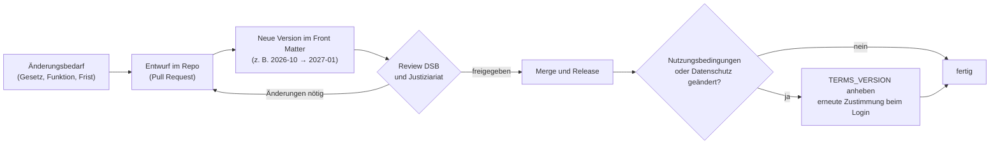

# Recht und Datenschutz (Übungsaufgabe)

> **Muster im Rahmen einer Übungsaufgabe – keine rechtsverbindlichen Angaben; vom Datenschutzbeauftragten der Hochschule zu prüfen.** Alle Betreiberangaben stehen als `[Platzhalter: …]` im Text (Entscheidung Q-23).

Dieser Ordner enthält die Prozessartefakte, die ein Betreiber für Datenschutz, Digital Services Act (DSA) und Steuermeldepflicht braucht. Die **Rechtstexte für Nutzerinnen und Nutzer** liegen als eine Quelle bei der App unter `apps/web/src/content/legal/` und werden dort angezeigt (ADR-0015).

## Inhalt

| Dokument | Zweck | Anforderung |
|---|---|---|
| [Rechtskataster](rechtskataster.md) | Norm → Pflicht → Umsetzung → Status | alle REQ-LEGAL-* |
| [Verzeichnis der Verarbeitungstätigkeiten](vvt.md) | Art. 30 DSGVO | REQ-LEGAL-011 |
| [Technische und organisatorische Maßnahmen](toms.md) | Art. 32 DSGVO | REQ-LEGAL-011 |
| [Auftragsverarbeitung](auftragsverarbeitung.md) | Art. 28 DSGVO | REQ-LEGAL-012 |
| [DSFA-Schwellwertanalyse](dsfa-schwellwertanalyse.md) | Art. 35 DSGVO | REQ-PRIV-007 |
| [Prozess Datenschutzverletzungen](datenpannen-prozess.md) | Art. 33/34 DSGVO | REQ-LEGAL-013 |
| [DSA-Prozesse](dsa-prozesse.md) | Art. 11, 12, 16, 17, 18, 20 DSA | REQ-LEGAL-005…008 |
| [DAC7-Konzept](dac7-konzept.md) | Plattformen-Steuertransparenzgesetz | REQ-LEGAL-009 |

Rechtstexte in der App (`apps/web/src/content/legal/`): Impressum (REQ-LEGAL-001), Datenschutzerklärung (REQ-LEGAL-002), Nutzungsbedingungen und Community-Regeln (REQ-LEGAL-003), Erklärung zur Barrierefreiheit (REQ-LEGAL-004), Kontakt (REQ-LEGAL-005).

## Rollen

| Rolle | Aufgabe | Im Muster |
|---|---|---|
| Verantwortlicher | trägt die Verantwortung nach Art. 24 DSGVO | [Platzhalter: Hochschule, vertreten durch die Präsidentin/den Präsidenten] |
| Datenschutzbeauftragte/r (DSB) | berät, prüft Texte und Verzeichnis, Ansprechperson für Betroffene und Aufsicht | [Platzhalter: Name, Kontakt] |
| Product Owner | pflegt Inhalte und stößt Änderungen an | Rolle `product-owner` im Team |
| Moderationsleitung | verantwortet DSA-Prozesse, Begründungen, Widersprüche | [Platzhalter: Organisationseinheit] |
| Informationssicherheit | TOMs, Datenpannen, Sicherheitslücken | Rolle `security-lead` |
| Justiziariat | Nutzungsbedingungen, Impressum, Haftung | [Platzhalter: Organisationseinheit] |

## Pflegeprozess für Rechtstexte

1. Jede Änderung läuft als Pull Request; der Diff zeigt genau, was sich geändert hat.
2. Die `version` im Front Matter wird angehoben, `last_updated` gesetzt.
3. DSB und Justiziariat geben frei (im Muster: Review im Pull Request).
4. Ändern sich Nutzungsbedingungen oder Datenschutzerklärung wesentlich, wird `TERMS_VERSION` auf die neue Version gesetzt. Alle Mitglieder stimmen beim nächsten Anmelden erneut zu (REQ-LEGAL-003, REQ-PRIV-001).
5. Verzeichnis (VVT) und TOMs werden bei jeder neuen Verarbeitung im selben Pull Request angepasst (Definition of Done).

## Vor einem Echtbetrieb

Alle Platzhalter ersetzen und die Texte prüfen lassen: siehe [Go-live-Checkliste](../07-betrieb/go-live-checkliste.md).

## Platzhalter-Domains

Einheitlich im ganzen Repository (Review v1.3, RV-R-10):

- **`hwg-lu.example`** für Postfächer und Stellen der Hochschule (z. B. `kontakt@hwg-lu.example`, `datenschutz@hwg-lu.example`, `security@hwg-lu.example`); passt zum Standardwert `SECURITY_CONTACT` im Code.
- **`campusmarkt.example`** für die Plattform selbst (Absenderdomain der E-Mails, öffentliche URL, Betriebs-Postfächer im Alarmierungsbeispiel).
- Echte Domains stehen nur in der Whitelist der Registrierung (`hwg-lu.de`, `studmail.hwg-lu.de`).
