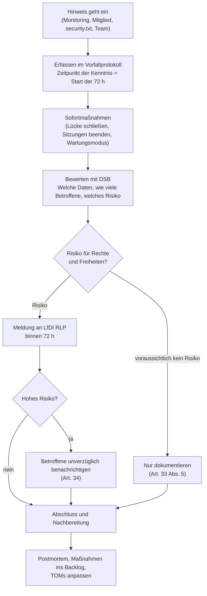

# Prozess bei Verletzungen des Schutzes personenbezogener Daten (Art. 33/34 DSGVO)

> **Muster im Rahmen einer Übungsaufgabe – fiktive Angaben, nicht rechtsverbindlich (Q-28).** Anforderung: REQ-LEGAL-013. Technische Störungen ohne Datenbezug folgen dem [Incident-Prozess](../07-betrieb/incident-prozess.md).

## Was ist eine Datenpanne?

Jede Verletzung der Sicherheit, die zur Vernichtung, zum Verlust, zur Veränderung oder zur unbefugten Offenlegung personenbezogener Daten führt (Art. 4 Nr. 12 DSGVO). Beispiele für CampusMarkt:

- Ein Fehler in der Autorisierung macht fremde Konversationen lesbar.
- E-Mail-Adressen werden ohne beidseitige Kontaktfreigabe angezeigt.
- Ein Backup-Archiv gelangt unverschlüsselt an Unbefugte.
- Ein Moderations- oder Admin-Konto wird übernommen.
- Ein Datenverlust, der nicht aus der Sicherung wiederhergestellt werden kann.

## Rollen und Erreichbarkeit

| Rolle | Aufgabe | Erreichbarkeit |
|---|---|---|
| Meldende Person (Team, Betrieb, Mitglied) | Hinweis sofort weitergeben | – |
| Betrieb / `security-lead` | Sofortmaßnahmen, Beweissicherung, technische Bewertung, Vorfallprotokoll | Rufbereitschaft laut [Betriebshandbuch](../07-betrieb/betriebshandbuch.md) und [Incident-Prozess](../07-betrieb/incident-prozess.md), auch am Wochenende (Bereitschaft +49 621 555-0199, fiktiv) |
| Datenschutzbeauftragte/r (DSB) | Risikobewertung, Beratung, Kontakt zur Aufsichtsbehörde | Paula Prüfer (fiktiv), datenschutz@hwg-lu.example, Vertretung: Jonas Vertreter (fiktiv) |
| Hochschulleitung (Verantwortlicher) | entscheidet über Meldung und Benachrichtigung, zeichnet die Meldung | Präsidentin Prof. Dr. Erika Mustermann (fiktiv); Vertretung: Vizepräsident Prof. Dr. Max Mustermann (fiktiv) |
| Pressestelle | Kommunikation bei öffentlichem Interesse | presse@hwg-lu.example (fiktiv) |

Die 72-Stunden-Frist läuft ab Kenntnis auch am Wochenende und an Feiertagen. Ist die Hochschulleitung nicht erreichbar, entscheidet die Vertretung (Vizepräsident, fiktiv; danach die Kanzlerin, fiktiv).

**Auftragsverarbeiter (Art. 33 Abs. 2):** Auftragsverarbeiter (Hosting, E-Mail-Versand) melden Verletzungen unverzüglich an datenschutz@hwg-lu.example; die Pflicht steht in jedem AV-Vertrag (siehe [Auftragsverarbeitung](auftragsverarbeitung.md)). Mit Eingang der Meldung beginnt die 72-Stunden-Frist des Verantwortlichen.

## Risikobewertung

Eintrittswahrscheinlichkeit eines Schadens für die Betroffenen × Schwere des möglichen Schadens:

| Wahrscheinlichkeit ↓ / Schwere → | gering (z. B. Anzeigentexte) | mittel (z. B. E-Mail-Adressen, Chatausschnitte) | hoch (z. B. vollständige Chats, Passwort-Hashes, Beweissicherung) |
|---|---|---|---|
| gering | kein Risiko → nur dokumentieren | Risiko → melden | Risiko → melden |
| mittel | Risiko → melden | Risiko → melden | hohes Risiko → melden und benachrichtigen |
| hoch | Risiko → melden | hohes Risiko → melden und benachrichtigen | hohes Risiko → melden und benachrichtigen |

Ist unklar, ob personenbezogene Daten betroffen sind, wird der Vorfall als Verletzung behandelt, bis das Gegenteil feststeht.

## Ablauf

| Schritt | Wer | Frist | Ergebnis |
|---|---|---|---|
| Erfassen | wer den Hinweis erhält | sofort | Eintrag im Vorfallprotokoll mit Zeitpunkt der Kenntnis |
| Sofortmaßnahmen | Betriebsteam / `security-lead` | sofort | Schaden begrenzt; Beweise gesichert (Logs, Audit-Log) |
| Bewerten | `security-lead` mit DSB | innerhalb von 24 h | Risikoeinstufung: kein / normales / hohes Risiko |
| Meldung an Aufsicht | Verantwortlicher (über DSB) | **spätestens 72 h** nach Kenntnis; Teilmeldung zulässig | Meldung über das Online-Formular der LfDI RLP (Übungsannahme) |
| Benachrichtigung Betroffener | Verantwortlicher | unverzüglich bei hohem Risiko | E-Mail an Betroffene, ggf. Hinweis auf der Statusseite |
| Dokumentation | `security-lead` | laufend | Vorfallprotokoll (auch ohne Meldung Pflicht) |
| Nachbereitung | Team | binnen 2 Wochen | Postmortem, Backlog-Einträge, angepasste TOMs |

## Vorlage: Meldung an die Aufsichtsbehörde

| Feld (Art. 33 Abs. 3) | Inhalt |
|---|---|
| Verantwortlicher, Kontakt DSB | Hochschule für Wirtschaft und Gesellschaft Ludwigshafen (HWG LU); DSB Paula Prüfer (fiktiv), datenschutz@hwg-lu.example |
| Zeitpunkt der Verletzung / der Kenntnis | |
| Art der Verletzung | Vertraulichkeit / Integrität / Verfügbarkeit |
| Kategorien und ungefähre Zahl der Betroffenen | |
| Kategorien und ungefähre Zahl der Datensätze | |
| Wahrscheinliche Folgen | |
| Ergriffene und geplante Maßnahmen | |
| Benachrichtigung der Betroffenen | ja (Datum) / nein (Begründung) |

## Vorlage: Dokumentation jeder Verletzung (Art. 33 Abs. 5)

Pflicht auch dann, wenn nicht gemeldet wird.

| Feld | Inhalt |
|---|---|
| Vorfallnummer, Zeitpunkt der Kenntnis, Erfasst von | |
| Fakten: Was ist passiert, seit wann, wie entdeckt? | |
| Betroffene Daten und Personen (Kategorien, ungefähre Zahl) | |
| Auswirkungen und Risikoeinstufung (Matrix oben) mit Begründung | |
| Ergriffene Abhilfemaßnahmen | |
| Meldung an die Aufsicht: ja (Datum, Aktenzeichen) / nein (Begründung) | |
| Benachrichtigung der Betroffenen: ja (Datum) / nein (Begründung nach Art. 34 Abs. 3) | |
| Freigabe durch die Hochschulleitung, Stellungnahme DSB | |

## Vorlage: Benachrichtigung Betroffener (Art. 34)

> Betreff: Wichtiger Hinweis zur Sicherheit Ihrer Daten bei CampusMarkt
>
> Am [Datum] haben wir festgestellt, dass [klare Beschreibung, was passiert ist]. Betroffen sind [welche Daten]. Mögliche Folgen: [z. B. Phishing-Mails]. Wir haben [Maßnahmen] ergriffen. Wir empfehlen Ihnen [z. B. Passwort ändern, auf verdächtige Mails achten]. Fragen beantwortet die/der Datenschutzbeauftragte: datenschutz@hwg-lu.example.

## Übung

Vor dem Echtbetrieb wird mindestens eine Übung (Planspiel) mit einem Szenario, z. B. „Datensicherung unverschlüsselt in falschem Speicher“, durchgespielt und protokolliert (Nachweis MAN-LEGAL-013, REQ-LEGAL-013). Danach empfohlen: einmal je Jahr.
