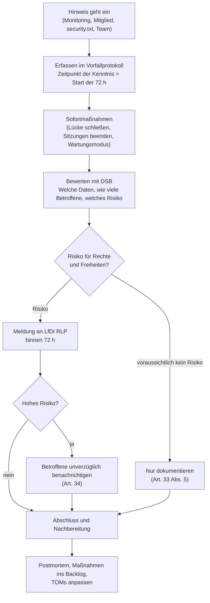

# Prozess bei Verletzungen des Schutzes personenbezogener Daten (Art. 33/34 DSGVO)

> **Muster im Rahmen einer Übungsaufgabe – keine rechtsverbindlichen Angaben; vom Datenschutzbeauftragten der Hochschule zu prüfen.** Anforderung: REQ-LEGAL-013. Technische Störungen ohne Datenbezug folgen dem [Incident-Prozess](../07-betrieb/incident-prozess.md).

## Was ist eine Datenpanne?

Jede Verletzung der Sicherheit, die zur Vernichtung, zum Verlust, zur Veränderung oder zur unbefugten Offenlegung personenbezogener Daten führt (Art. 4 Nr. 12 DSGVO). Beispiele für CampusMarkt:

- Ein Fehler in der Autorisierung macht fremde Konversationen lesbar.
- E-Mail-Adressen werden ohne beidseitige Kontaktfreigabe angezeigt.
- Ein Backup-Archiv gelangt unverschlüsselt an Unbefugte.
- Ein Moderations- oder Admin-Konto wird übernommen.
- Ein Datenverlust, der nicht aus der Sicherung wiederhergestellt werden kann.

## Ablauf

| Schritt | Wer | Frist | Ergebnis |
|---|---|---|---|
| Erfassen | wer den Hinweis erhält | sofort | Eintrag im Vorfallprotokoll mit Zeitpunkt der Kenntnis |
| Sofortmaßnahmen | Betriebsteam / `security-lead` | sofort | Schaden begrenzt; Beweise gesichert (Logs, Audit-Log) |
| Bewerten | `security-lead` mit DSB | innerhalb von 24 h | Risikoeinstufung: kein / normales / hohes Risiko |
| Meldung an Aufsicht | Verantwortlicher (über DSB) | **spätestens 72 h** nach Kenntnis; Teilmeldung zulässig | Meldung an [Platzhalter: LfDI RLP, Online-Formular] |
| Benachrichtigung Betroffener | Verantwortlicher | unverzüglich bei hohem Risiko | E-Mail an Betroffene, ggf. Hinweis auf der Statusseite |
| Dokumentation | `security-lead` | laufend | Vorfallprotokoll (auch ohne Meldung Pflicht) |
| Nachbereitung | Team | binnen 2 Wochen | Postmortem, Backlog-Einträge, angepasste TOMs |

## Vorlage: Meldung an die Aufsichtsbehörde

| Feld (Art. 33 Abs. 3) | Inhalt |
|---|---|
| Verantwortlicher, Kontakt DSB | [Platzhalter] |
| Zeitpunkt der Verletzung / der Kenntnis | |
| Art der Verletzung | Vertraulichkeit / Integrität / Verfügbarkeit |
| Kategorien und ungefähre Zahl der Betroffenen | |
| Kategorien und ungefähre Zahl der Datensätze | |
| Wahrscheinliche Folgen | |
| Ergriffene und geplante Maßnahmen | |
| Benachrichtigung der Betroffenen | ja (Datum) / nein (Begründung) |

## Vorlage: Benachrichtigung Betroffener (Art. 34)

> Betreff: Wichtiger Hinweis zur Sicherheit Ihrer Daten bei CampusMarkt
>
> Am [Datum] haben wir festgestellt, dass [klare Beschreibung, was passiert ist]. Betroffen sind [welche Daten]. Mögliche Folgen: [z. B. Phishing-Mails]. Wir haben [Maßnahmen] ergriffen. Wir empfehlen Ihnen [z. B. Passwort ändern, auf verdächtige Mails achten]. Fragen beantwortet die/der Datenschutzbeauftragte: [Platzhalter: E-Mail].

## Übung

Mindestens einmal je Semester wird ein Szenario (z. B. „Backup-Archiv auf öffentlichem Laufwerk“) als Planspiel durchgespielt und protokolliert [Platzhalter: Termin].
