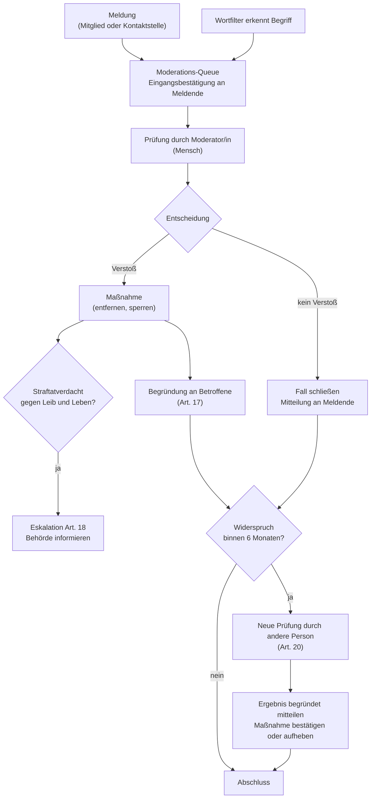

# Prozesse nach dem Digital Services Act (Verordnung (EU) 2022/2065)

> **Muster im Rahmen einer Übungsaufgabe – fiktive Angaben, nicht rechtsverbindlich (Q-28).** Anforderungen: REQ-LEGAL-005 … REQ-LEGAL-008, REQ-MOD-001 … REQ-MOD-003.

## Einordnung

CampusMarkt speichert Inhalte von Mitgliedern und macht sie anderen Mitgliedern zugänglich. Damit ist die Plattform ein **Hostingdienst** und eine **Online-Plattform** im Sinne des DSA. Ein Online-Marktplatz für Verbraucherverträge mit Unternehmern (Art. 30–32) liegt nicht vor, weil nur private Angebote erlaubt sind (Nutzungsbedingungen Abschnitt 3).

**Anwendbarkeit (Übungsannahmen, Q-28):** (1) Der DSA gilt für Vermittlungsdienste, die „Dienste der Informationsgesellschaft“ sind, also in der Regel gegen Entgelt erbracht werden. Annahme: CampusMarkt wird trotz Unentgeltlichkeit so behandelt; der DSA gilt. (2) Die Ausnahme für Kleinst- und Kleinunternehmen (Art. 19) setzt ein Unternehmen voraus; eine öffentliche Stelle ist kein KMU. Annahme: Art. 19 greift nicht, die Pflichten aus Art. 20 gelten (Entscheidung Q-22).

| Pflicht | Artikel | Umsetzung | Anforderung |
|---|---|---|---|
| Kontaktstelle für Behörden | 11 | Seite „Kontakt“, Sprachen Deutsch und Englisch | REQ-LEGAL-005 |
| Kontaktstelle für Nutzer | 12 | Seite „Kontakt“, nicht nur automatisiert | REQ-LEGAL-005 |
| Verständliche Nutzungsbedingungen inkl. Moderation | 14 | Nutzungsbedingungen, Community-Regeln | REQ-LEGAL-003 |
| Melde- und Abhilfeverfahren | 16 | „Melden“ an Anzeige, Nachricht, Profil; Eingangsbestätigung | REQ-MOD-001 |
| Begründung von Beschränkungen | 17 | Mitteilung an Betroffene mit allen Pflichtangaben | REQ-LEGAL-006 |
| Meldung von Straftaten | 18 | Kennzeichen „Straftatverdacht“, Eskalation | REQ-LEGAL-008 |
| Internes Beschwerdemanagement | 20 | Widerspruch im Konto, Vier-Augen-Prüfung | REQ-LEGAL-007 |
| Transparenzbericht | 15, 24 | jährlich, aus Audit-Log auswertbar | Echtbetrieb (erster Bericht fiktiv zum 2027-02-17) |

## Melde- und Abhilfeverfahren

Alle Schritte stehen im Audit-Log (REQ-MOD-003).

## Begründung an Betroffene (Art. 17)

Pflichtangaben je Mitteilung:
1. Art der Maßnahme (Anzeige entfernt, Nachricht entfernt, Konto gesperrt) und ggf. Dauer.
2. Tatsachen und Umstände, auf denen die Entscheidung beruht, einschließlich ob sie auf einer Meldung oder einem Filter beruht.
3. Ob automatisierte Mittel beteiligt waren (Wortfilter oder vorläufiges Ausblenden ab drei Meldungen: ja, nur zur Erkennung bzw. vorläufig; Entscheidung durch einen Menschen).
4. Bei behauptet rechtswidrigen Inhalten die Rechtsgrundlage mit Erläuterung, warum der Inhalt rechtswidrig ist (Art. 17 Abs. 3 lit. d; im System Pflichtfeld `legalGround`), sonst die verletzte vertragliche Regel (lit. e; Abschnitt der Nutzungs- bzw. Community-Regeln).
5. Rechtsbehelfe: Widerspruch im Konto (Art. 20), außergerichtliche Streitbeilegung (Art. 21), Gerichte.

**Vorlage (E-Mail und Hinweis im Konto):**

> Betreff: Ihre Anzeige „[Titel]“ wurde entfernt
>
> Wir haben Ihre Anzeige „[Titel]“ am [Datum] entfernt.
> **Grund:** Die Anzeige verstößt gegen [Regel, z. B. Community-Regeln, Abschnitt „Verbotene Artikel“: Prüfungslösungen].
> **Grundlage der Entscheidung:** [Meldung eines Mitglieds | automatische Erkennung eines Begriffs], geprüft und entschieden durch die Moderation. [Begründungstext der Moderation]
> **Ihre Möglichkeiten:** Sie können innerhalb von sechs Monaten in Ihrem Konto unter „Meine Mitteilungen“ Widerspruch einlegen (bei gesperrtem Konto über den Link in dieser E-Mail). Eine andere Person aus der Moderation prüft den Fall dann erneut. Außerdem steht Ihnen der Weg zu einer zertifizierten außergerichtlichen Streitbeilegungsstelle (Art. 21 DSA) und zu den Gerichten offen.

## Widerspruch (Art. 20)

| Regel | Festlegung |
|---|---|
| Wer darf widersprechen | Betroffene einer Maßnahme und Meldende, deren Meldung abgelehnt wurde |
| Frist | mindestens 6 Monate nach Mitteilung (Art. 20 Abs. 1) |
| Weg | elektronisch im Konto unter „Meine Mitteilungen“; bei gesperrtem Konto über einen Einmal-Link aus der E-Mail (Token nur im URL-Fragment, per POST übermittelt, gültig bis Fristende); ohne Konto über die Kontaktstelle |
| Begründung | 20 bis 2.000 Zeichen, gezählt ohne Leerzeichen am Rand |
| Prüfung | durch eine Person der Moderation, die weder die Erstentscheidung getroffen hat noch selbst Widersprechende, Betroffene oder Meldende ist (Vier-Augen-Prinzip, serverseitig geprüft, 403 `four_eyes`), nicht ausschließlich automatisiert; wer einen Fall gemeldet hat, entscheidet ihn auch nicht. Prüfende sehen bei entfernten Nachrichten den Originaltext, jeder Zugriff im Audit-Log |
| Ergebnis | bestätigt oder aufgehoben, begründet **beiden Seiten** mitgeteilt; bei Aufhebung wird die Maßnahme rückgängig gemacht (Anzeige mit vorherigem Status, Konto nur entsperrt, wenn keine andere Sperre besteht); ist der Inhalt nicht mehr vorhanden, 409 `restore_impossible` statt falscher Erfolgsmeldung |
| Bearbeitungsziel | 14 Tage nach Eingang (Übungsannahme Q-28) |

## Straftatverdacht (Art. 18)

Erlangt die Moderation Kenntnis von Informationen, die den Verdacht begründen, dass eine Straftat begangen wurde, wird oder werden könnte, die **eine Gefahr für das Leben oder die Sicherheit einer Person** darstellt (z. B. Bedrohung, Waffen- oder Drogenhandel mit Gewaltbezug):

1. Moderator/in setzt bei der Entscheidung das Kennzeichen „Straftatverdacht“ mit Begründung (Audit-Log); das System legt eine pseudonymisierte Kopie des Inhalts mit ± 5 Nachrichten Kontext an (Beweissicherung, höchstens 6 Monate; Originale werden fristgerecht gelöscht).
2. Die Moderationsleitung wird sofort informiert (Bereitschaft +49 621 555-0199, fiktiv).
3. Die Moderationsleitung informiert unverzüglich die zuständige Strafverfolgungsbehörde (Übungsannahme: Polizeipräsidium Rheinpfalz bzw. Zentrale Meldestelle für strafbare Inhalte im Internet beim BKA) mit allen verfügbaren Informationen.
4. Im Docker-Beispiel gibt es keine automatische Weitergabe; der Schritt ist manuell (Q-4).

## Mitteilungen an Meldende (Art. 16 Abs. 5)

Meldende erhalten die Entscheidung mit Begründung und den Hinweis auf ihre Rechtsbehelfe: Widerspruch gegen die Ablehnung ihrer Meldung (Art. 20), außergerichtliche Streitbeilegung (Art. 21) und den Rechtsweg. Die Identität der Meldenden wird Betroffenen nie mitgeteilt.

## Vorläufiges Ausblenden (REQ-MOD-004)

Ab drei Meldungen wird eine Anzeige automatisch vorläufig ausgeblendet. Die Betroffene erhält eine Mitteilung und eine E-Mail „vorläufig ausgeblendet, Prüfung läuft“ mit dem Hinweis auf die automatische Auslösung (Art. 14, 17 DSA). Der Fall wird vorrangig entschieden. Übungsannahme (Q-28): Die Mitteilung über das vorläufige Ausblenden gilt als Begründung nach Art. 17; die vollständige Begründung folgt mit der Entscheidung der Moderation.

## Transparenzbericht (Art. 15, 24)

Jährlich zum 17. Februar (Übungswert) erscheint ein Bericht mit der Anzahl der Meldungen je Grund, den Maßnahmen, Zahl und Ergebnis der Widersprüche, der mittleren Bearbeitungsdauer und dem Einsatz automatisierter Mittel. Seit 2025 gelten dafür verbindliche Vorlagen der Durchführungsverordnung (EU) 2024/2835 (Übungsannahme Q-28: anwendbar, Vorlagen werden genutzt). Die Zahlen lassen sich aus Audit-Log und Moderationsfällen ohne Personenbezug ermitteln; im Beispiel gibt es keinen Bericht.

## Kontaktstelle (Art. 11, 12)

Siehe Rechtstext `kontakt.de.md`. Anfragen werden im Muster per E-Mail bearbeitet (im Echtbetrieb: Ticketsystem der Hochschule, fiktiv „MusterTicket“); Meldungen ohne Konto werden von der Moderation manuell in die Queue übernommen.

