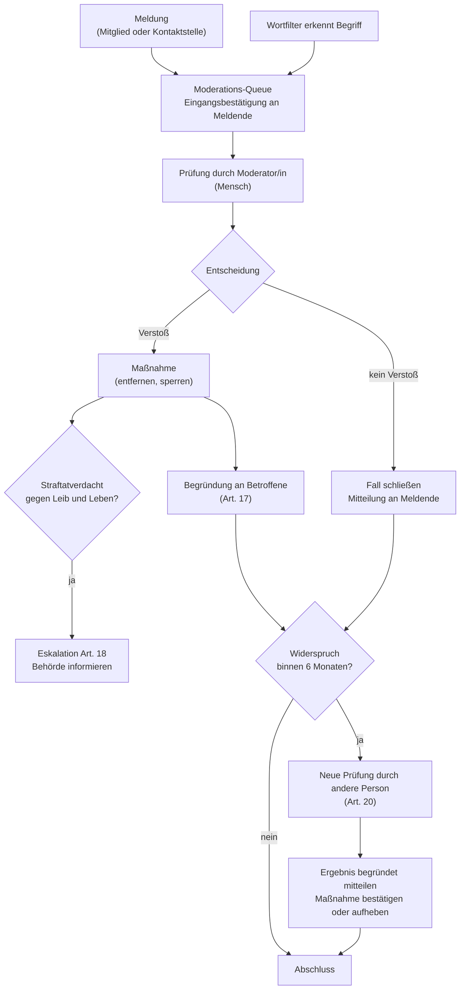

# Prozesse nach dem Digital Services Act (Verordnung (EU) 2022/2065)

> **Muster im Rahmen einer Übungsaufgabe – keine rechtsverbindlichen Angaben; vom Justiziariat der Hochschule zu prüfen.** Anforderungen: REQ-LEGAL-005 … REQ-LEGAL-008, REQ-MOD-001 … REQ-MOD-003.

## Einordnung

CampusMarkt speichert Inhalte von Mitgliedern und macht sie anderen Mitgliedern zugänglich. Damit ist die Plattform ein **Hostingdienst** und eine **Online-Plattform** im Sinne des DSA. Ein Online-Marktplatz für Verbraucherverträge mit Unternehmern (Art. 30–32) liegt nicht vor, weil nur private Angebote erlaubt sind (Nutzungsbedingungen Abschnitt 3).

Die Ausnahme für Kleinst- und Kleinunternehmen (Art. 19) setzt ein Unternehmen voraus. Ob sie für eine Hochschule gilt, ist offen [Platzhalter: vom Justiziariat zu klären]. Das Muster setzt die Pflichten aus Art. 20 deshalb vorsorglich um (Entscheidung Q-22).

| Pflicht | Artikel | Umsetzung | Anforderung |
|---|---|---|---|
| Kontaktstelle für Behörden | 11 | Seite „Kontakt“, Sprachen Deutsch und Englisch | REQ-LEGAL-005 |
| Kontaktstelle für Nutzer | 12 | Seite „Kontakt“, nicht nur automatisiert | REQ-LEGAL-005 |
| Verständliche Nutzungsbedingungen inkl. Moderation | 14 | Nutzungsbedingungen, Community-Regeln | REQ-LEGAL-003 |
| Melde- und Abhilfeverfahren | 16 | „Melden“ an Anzeige, Nachricht, Profil; Eingangsbestätigung | REQ-MOD-001 |
| Begründung von Beschränkungen | 17 | Mitteilung an Betroffene mit allen Pflichtangaben | REQ-LEGAL-006 |
| Meldung von Straftaten | 18 | Kennzeichen „Straftatverdacht“, Eskalation | REQ-LEGAL-008 |
| Internes Beschwerdemanagement | 20 | Widerspruch im Konto, Vier-Augen-Prüfung | REQ-LEGAL-007 |
| Transparenzbericht | 15, 24 | jährlich, aus Audit-Log auswertbar | Echtbetrieb [Platzhalter] |

## Melde- und Abhilfeverfahren

Alle Schritte stehen im Audit-Log (REQ-MOD-003).

## Begründung an Betroffene (Art. 17)

Pflichtangaben je Mitteilung:
1. Art der Maßnahme (Anzeige entfernt, Nachricht entfernt, Konto gesperrt) und ggf. Dauer.
2. Tatsachen und Umstände, auf denen die Entscheidung beruht, einschließlich ob sie auf einer Meldung oder einem Filter beruht.
3. Ob automatisierte Mittel beteiligt waren (Wortfilter: ja, nur zur Erkennung; Entscheidung durch einen Menschen).
4. Rechtsgrundlage bzw. verletzte Regel (Gesetz oder Abschnitt der Nutzungs- bzw. Community-Regeln).
5. Rechtsbehelfe: Widerspruch im Konto (Art. 20), außergerichtliche Streitbeilegung (Art. 21), Gerichte.

**Vorlage (E-Mail und Hinweis im Konto):**

> Betreff: Ihre Anzeige „[Titel]“ wurde entfernt
>
> Wir haben Ihre Anzeige „[Titel]“ am [Datum] entfernt.
> **Grund:** Die Anzeige verstößt gegen [Regel, z. B. Community-Regeln, Abschnitt „Verbotene Artikel“: Prüfungslösungen].
> **Grundlage der Entscheidung:** [Meldung eines Mitglieds | automatische Erkennung eines Begriffs], geprüft und entschieden durch die Moderation. [Begründungstext der Moderation]
> **Ihre Möglichkeiten:** Sie können innerhalb von sechs Monaten in Ihrem Konto unter „Entscheidungen“ Widerspruch einlegen. Eine andere Person aus der Moderation prüft den Fall dann erneut. Außerdem steht Ihnen der Weg zu einer zertifizierten außergerichtlichen Streitbeilegungsstelle (Art. 21 DSA) und zu den Gerichten offen.

## Widerspruch (Art. 20)

| Regel | Festlegung |
|---|---|
| Wer darf widersprechen | Betroffene einer Maßnahme und Meldende, deren Meldung abgelehnt wurde |
| Frist | mindestens 6 Monate nach Mitteilung (Art. 20 Abs. 1) |
| Weg | elektronisch im Konto; ohne Konto bzw. bei gesperrtem Konto über die Kontaktstelle |
| Prüfung | durch eine Person der Moderation, die an der Erstentscheidung nicht beteiligt war (Vier-Augen-Prinzip), nicht ausschließlich automatisiert |
| Ergebnis | bestätigt oder aufgehoben, begründet mitgeteilt; bei Aufhebung wird die Maßnahme rückgängig gemacht (z. B. Konto entsperrt) |
| Bearbeitungsziel | [Platzhalter: z. B. 14 Tage] |

## Straftatverdacht (Art. 18)

Erlangt die Moderation Kenntnis von Informationen, die den Verdacht begründen, dass eine Straftat begangen wurde, wird oder werden könnte, die **eine Gefahr für das Leben oder die Sicherheit einer Person** darstellt (z. B. Bedrohung, Waffen- oder Drogenhandel mit Gewaltbezug):

1. Moderator/in setzt bei der Entscheidung das Kennzeichen „Straftatverdacht“ mit Begründung (Audit-Log).
2. Die Moderationsleitung wird sofort informiert [Platzhalter: Bereitschaftsnummer].
3. Die Moderationsleitung informiert unverzüglich die zuständige Strafverfolgungsbehörde [Platzhalter: Polizeipräsidium bzw. Zentrale Meldestelle beim BKA] mit allen verfügbaren Informationen.
4. Im Docker-Beispiel gibt es keine automatische Weitergabe; der Schritt ist manuell (Q-4).

## Kontaktstelle (Art. 11, 12)

Siehe Rechtstext `kontakt.de.md`. Anfragen werden im Muster per E-Mail bearbeitet [Platzhalter: Ticketsystem der Hochschule]; Meldungen ohne Konto werden von der Moderation manuell in die Queue übernommen.

## Transparenzbericht

Jährlich [Platzhalter: Stichtag]: Anzahl der Meldungen je Grund, Maßnahmen, Zahl und Ergebnis der Widersprüche, mittlere Bearbeitungsdauer, Einsatz automatisierter Mittel. Die Zahlen lassen sich aus Audit-Log und Moderationsfällen ohne Personenbezug auswerten.
