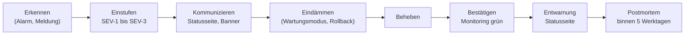

# Incident-Prozess

> **Muster im Rahmen einer Übungsaufgabe.** Anforderung: REQ-OPS-011. Sind personenbezogene Daten betroffen, gilt **zusätzlich** der [Datenpannen-Prozess](../06-recht/datenpannen-prozess.md) mit der 72-Stunden-Frist.

## Schweregrade

| Grad | Beschreibung | Beispiele |
|---|---|---|
| SEV-1 | Plattform nicht nutzbar oder Sicherheitsvorfall mit Datenbezug | App nicht erreichbar; fremde Konversationen lesbar |
| SEV-2 | wichtige Funktion gestört, Umgehung schwierig | keine E-Mails; Chat ohne Echtzeit; Upload schlägt fehl |
| SEV-3 | Beeinträchtigung mit Umgehung | Suche langsam; einzelne Jobs scheitern |

## Rollen

| Rolle | Aufgabe |
|---|---|
| Incident-Leitung | koordiniert, entscheidet, hält den Zeitstrahl fest |
| Technik | analysiert und behebt |
| Kommunikation | Statusseite, Ankündigungsbanner, ggf. E-Mail an Mitglieder |
| `security-lead` / DSB | bei Sicherheits- oder Datenschutzbezug |

Bei kleinen Teams kann eine Person mehrere Rollen übernehmen, nie aber Technik und Kommunikation bei SEV-1.

## Ablauf

## Kommunikation

- **Statusseite** (`/status`) zeigt den technischen Zustand automatisch.
- **Ankündigungsbanner** (Admin-Oberfläche) informiert Mitglieder über Störung und erwartete Dauer (REQ-OPS-006).
- Bei SEV-1 mit Datenbezug: Abstimmung mit DSB vor jeder Mitteilung an Mitglieder.

Textbaustein: „Derzeit ist [Funktion] gestört. Wir arbeiten an einer Lösung und melden uns bis [Uhrzeit] mit einem neuen Stand.“

## Postmortem-Vorlage

Ohne Schuldzuweisung (blameless):

| Abschnitt | Inhalt |
|---|---|
| Zusammenfassung | was, wann, wie lange, wer war betroffen |
| Zeitstrahl | Erkennen, Einstufen, Maßnahmen, Ende (mit Uhrzeiten) |
| Ursache | technische und organisatorische Ursache (5-Why) |
| Was gut lief / was nicht | |
| Maßnahmen | mit Backlog-ID, Verantwortlichem und Termin |
| Datenschutzbezug | ja/nein; wenn ja: Verweis auf Vorfallprotokoll |
