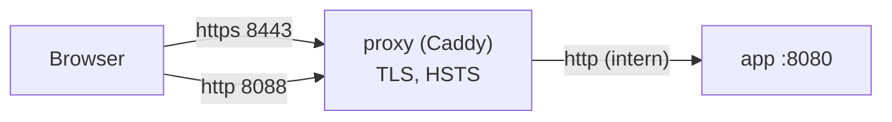

# TLS und Reverse Proxy

> **Muster im Rahmen einer Übungsaufgabe.** Anforderung: REQ-OPS-009; optionales Compose-Profil `proxy` (Q-27, ADR-0017).

## Aufbau



- Caddy terminiert TLS und leitet an `app` weiter; HTTP wird dauerhaft auf HTTPS umgeleitet (308).
- Konfiguration: `docker/caddy/Caddyfile` (`caddy:2.11.6-alpine`, `tls internal`, `admin off`).
- `/metrics` ist am Proxy gesperrt (404); Prometheus liest es intern.
- `app` vertraut den Kopfzeilen `X-Forwarded-*` nur bei `TRUST_PROXY=true` und nur für **genau einen** Proxy-Hop (Fastify `trustProxy: 1`), damit Rate-Limits die echte Client-IP sehen und gefälschte Ketten in `X-Forwarded-For` wirkungslos sind. Ohne die Variable sähe die App nur die IP des Proxys; die Registrierungsgrenze je IP träfe dann alle gemeinsam.
- WebSockets (`/ws`) werden durchgereicht.

## Einstellungen

| Thema | Docker-Beispiel | Echtbetrieb |
|---|---|---|
| Zertifikat | `tls internal` (lokale CA von Caddy; Browser warnt, bis die CA importiert ist) | Zertifikat des RZ oder ACME (Let's Encrypt / HARICA) [Platzhalter] |
| Protokolle | TLS 1.2 und 1.3 (Caddy-Standard) | wie Beispiel; Prüfung mit `testssl.sh`, Ziel Note A |
| HSTS | `Strict-Transport-Security: max-age=31536000` | zusätzlich `includeSubDomains` nach Prüfung aller Subdomains; Preload nur nach Abstimmung |
| Weitere Kopfzeilen | CSP, `X-Content-Type-Options`, `Referrer-Policy`, `X-Robots-Tag` setzt die App | wie Beispiel |
| Cookie | `Secure` (Standard `COOKIE_SECURE=true`) | wie Beispiel |
| Domain | `campusmarkt.localhost` (eigener Hostname, damit HSTS keine anderen Dienste auf `localhost` betrifft; Browser lösen `*.localhost` ohne Hosts-Datei auf) | [Platzhalter: campusmarkt.hwg-lu.example] |
| Ports | `PROXY_HTTPS_PORT` (Standard 8443), `PROXY_HTTP_PORT` (Standard 8088) | 443 / 80 |

## Starten im Beispiel

```bash
docker compose --env-file .env.proxy.example --profile proxy up -d
```

Die mitgelieferte Datei `.env.proxy.example` setzt `TRUST_PROXY=true`, `PUBLIC_URL=https://campusmarkt.localhost:8443` und die Proxy-Ports. Danach `https://campusmarkt.localhost:8443` öffnen; `http://campusmarkt.localhost:8088` leitet mit 308 dorthin um. `PUBLIC_URL` muss zur genutzten Adresse passen, damit Links in E-Mails stimmen.

Für den Test ohne Warnung das Root-Zertifikat der lokalen CA auslesen und im Browser als vertrauenswürdig importieren (nur auf dem eigenen Testrechner):

```bash
docker compose exec proxy cat /data/caddy/pki/authorities/local/root.crt > caddy-root.crt
```

**Automatischer Test (AT-OPS-009):** `node tests/ops/proxy-test.mjs [--project <name>] [--https-port 8443] [--http-port 8088]` prüft Zertifikat, Weiterleitung 308, HSTS-Header, gesperrtes `/metrics` und eine Anmeldung über HTTPS mit `Secure`-Cookie. Der Test verbindet sich über 127.0.0.1 und braucht kein DNS; er läuft in CI im Job `compose`.
