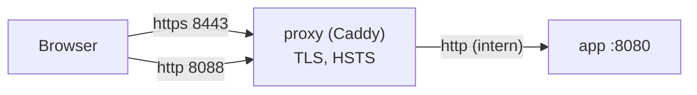

# TLS und Reverse Proxy

> **Muster im Rahmen einer Übungsaufgabe.** Anforderung: REQ-OPS-009; optionales Compose-Profil `proxy` (Q-27, ADR-0017).

## Aufbau

- Caddy terminiert TLS und leitet an `app` weiter; HTTP wird dauerhaft auf HTTPS umgeleitet (308).
- `app` vertraut den Kopfzeilen `X-Forwarded-*` nur vom Proxy (`TRUST_PROXY`, B-41), damit Rate-Limits die echte Client-IP sehen.
- WebSockets (`/ws`) werden durchgereicht.

## Einstellungen

| Thema | Docker-Beispiel | Echtbetrieb |
|---|---|---|
| Zertifikat | `tls internal` (lokale CA von Caddy; Browser warnt, bis die CA importiert ist) | Zertifikat des RZ oder ACME (Let's Encrypt / HARICA) [Platzhalter] |
| Protokolle | TLS 1.2 und 1.3 (Caddy-Standard) | wie Beispiel; Prüfung mit `testssl.sh`, Ziel Note A |
| HSTS | `Strict-Transport-Security: max-age=31536000` | zusätzlich `includeSubDomains` nach Prüfung aller Subdomains; Preload nur nach Abstimmung |
| Weitere Kopfzeilen | CSP, `X-Content-Type-Options`, `Referrer-Policy`, `X-Robots-Tag` setzt die App | wie Beispiel |
| Cookie | `Secure` (Standard `COOKIE_SECURE=true`) | wie Beispiel |
| Domain | `localhost` | [Platzhalter: campusmarkt.hochschule.example] |

## Starten im Beispiel

`docker compose --profile proxy up -d` → `https://localhost:8443`. Für den Test ohne Warnung: Root-Zertifikat aus dem Caddy-Volume exportieren und im Browser als vertrauenswürdig importieren (nur auf dem eigenen Testrechner).

`PUBLIC_URL` muss zur genutzten Adresse passen, damit Links in E-Mails stimmen (`PUBLIC_URL=https://localhost:8443`).
