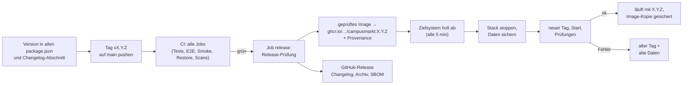

# Update-, Release- und Rollback-Prozess

> **Muster im Rahmen einer Übungsaufgabe.** Anforderungen: REQ-OPS-012 (Abhängigkeits-Updates), REQ-OPS-004 (versioniertes Image), REQ-SEC-008 (Sicherheitsprüfungen).

## Abhängigkeiten aktualisieren (Renovate)

Die Konfiguration `renovate.json` im Repo legt fest:

| Art | Rhythmus | Zusammenfassung | Automatisch mergen? |
|---|---|---|---|
| Sicherheitsupdates (Advisories) | sofort, ohne Mindestalter | einzeln, Label `sicherheit` | nein, aber Priorität „hoch“ |
| Patch- und Minor-Updates | wöchentlich, montags vor 6 Uhr (Europe/Berlin), erst ab 14 Tagen nach Veröffentlichung | gruppiert: „Entwicklungswerkzeuge“, „Frontend“, „Fastify“, „Tests“ | nur **Patch-Updates von Entwicklungsabhängigkeiten**, nach grüner CI (`automerge`, Plattform-Merge); alles andere nein |
| Major-Updates | wöchentlich im selben Fenster | einzeln, mit Changelog | nein |
| Container-Images (`Dockerfile`, `compose.yaml`) | wöchentlich | Minor, Patch und Digest gruppiert („Container-Images“), Hauptversionen einzeln; **PostgreSQL-Hauptversion nie automatisch** (Daten-Upgrade nötig) | nein |
| GitHub Actions | wöchentlich | auf Digest gepinnt, gruppiert | nein |

Versionen werden exakt gepinnt (`rangeStrategy: pin`), nach jedem Update läuft `pnpm dedupe`; höchstens 5 offene Update-Pull-Requests gleichzeitig. Die Konfiguration wird in CI mit `renovate-config-validator --strict` geprüft (Job `ops-config`, CTRL-RENOVATE).

Jeder Update-Pull-Request durchläuft die volle CI (Typprüfung, Unit-, E2E- und Smoke-Tests). Ein Mensch prüft und mergt, außer bei Patch-Updates von Entwicklungsabhängigkeiten.

**Werkzeug-Versionen in CI:** Die Versionen der Prüfwerkzeuge und Images in `.github/workflows/ci.yml` (Caddy, Prometheus, Alertmanager, Renovate-Validator) stehen zentral im `env`-Block und werden von Renovate über einen Regex-Manager aktualisiert. Ein CI-Schritt prüft, dass sie mit `compose.yaml` übereinstimmen.

**Sicherheitsscans in CI** (REQ-SEC-008, CTRL-CI-SCAN): Job `security-scans` mit Semgrep (SAST, SARIF), `pnpm audit --audit-level high` (SCA), gitleaks (Secrets, ganze Historie), Trivy (Image, HIGH/CRITICAL brechen ab) und SBOM (CycloneDX, Artefakt `security-reports`). Die Scanner-Images stehen ebenfalls im `env`-Block und werden von Renovate gepflegt. Ausnahmen nur begründet und befristet: `.gitleaks.toml` (bis 2027-04), `.trivyignore` mit `--ignore-unfixed` (bis 2027-01), `nosemgrep`-Kommentare mit Begründung.

**Abhängigkeits-Updates vom 2026-10-26** (Ersteinrichtung der Scans): sharp 0.35.5, @fastify/static 10.1.5, @fastify/swagger-ui 6.1.1, nodemailer 10.0.16 (eigene Typen, `@types/nodemailer` entfernt), vitest und @vitest/coverage-v8 4.1.11. Das Runtime-Image enthält seitdem weder npm, npx, corepack noch yarn.

**Weitere Workflows:** `mutation.yml` (StrykerJS, montags und auf Anforderung, CTRL-MUTATION) und `ops-weekly.yml` (Dead-Letter-Test bei Mailausfall, montags, CTRL-DLQ). Der Job `multiarch` baut amd64 und arm64 (REQ-PORT-002).

**Zeitziele (Beispiel):** kritische Sicherheitslücken in erreichbarem Code binnen 48 h, hohe binnen 7 Tagen, sonst mit dem nächsten wöchentlichen Update.

## Versionierung

- **SemVer** für die Anwendung (`MAJOR.MINOR.PATCH`); der Image-Tag entspricht der Version, zusätzlich `<version>-<commit-sha>` (beide Tags setzt CI).
- Ein Release entsteht aus `main` mit Tag `vX.Y.Z`; CI baut das Image aus sauberem Checkout, taggt es mit der Version aus `package.json` (`campusmarkt:<version>`) und legt es als `docker save`-Archiv `campusmarkt-<version>.tar.gz` für 7 Tage als Artefakt ab (Job `compose`, CTRL-CI-IMAGE). Eine Container-Registry ist für die Abgabe optional (Q-19); Releases gehen seit 2026-11-12 zusätzlich nach ghcr.io (siehe unten).
- Änderungen an Nutzungsbedingungen oder Datenschutzerklärung → `TERMS_VERSION` anheben ([Pflegeprozess](../06-recht/README.md#pflegeprozess-für-rechtstexte)).
- Datenbankmigrationen sind **additiv** und laufen beim Start automatisch (REQ-OPS-005); zerstörende Änderungen erst ein Release später (Expand-and-Contract).

## Release und Auslieferung

Seit 2026-11-12 automatisch (REQ-OPS-013, [ADR-0022](../03-architektur/decisions/0022-release-pipeline-tag-registry-pull.md)):

**So erstellt man ein Release:**
1. Version in allen `package.json` anheben (dieselbe SemVer-Version; `node tests/ops/release-check.mjs` prüft das).
2. Im `CHANGELOG.md` den Abschnitt `## [X.Y.Z] – JJJJ-MM-TT` anlegen.
3. Nach `main` mergen, die CI muss grün sein.
4. Tag setzen und pushen: `git tag -a vX.Y.Z -m "CampusMarkt X.Y.Z" && git push origin vX.Y.Z`.
5. Die CI läuft für den Tag. Der Job `release` veröffentlicht `ghcr.io/caro10robert/campusmarkt:X.Y.Z` und das GitHub-Release.
6. Das Zielsystem spielt die Version binnen etwa 5 Minuten selbst ein. Die Version zeigt `GET /health/live` an (`{"status":"ok","version":"X.Y.Z"}`).

**Vertrag für das Zielsystem:** In der Compose-Datei steht das Image mit festem Tag. Der App-Dienst trägt die Labels `caroai.release: auto` und `caroai.release.health: <URL der Bereitschaftsprüfung>`. Sicherung, Prüfung und Rückweg übernimmt der Abhol-Dienst des Zielsystems. In der Vorführumgebung CaRoNexus ist das `caroai_update.py --releases` (alle 5 Minuten).

## Ausrollen

1. Ankündigung, falls Wartung nötig ([Wartung](wartung-statusseite.md)).
2. Sicherung erstellen (`node scripts/backup.mjs`).
3. Neues Image starten; warten bis „healthy“.
4. Smoke-Test gegen die Umgebung.
5. Überwachung 30 min beobachten.

## Rollback

| Lage | Vorgehen |
|---|---|
| Fehler ohne Datenbankänderung | vorheriges Image-Tag starten |
| Migration additiv | vorheriges Image starten; die neue Spalte/Tabelle stört die alte Version nicht |
| Daten beschädigt | Wartungsmodus ankündigen, letzte Sicherung einspielen (`node scripts/restore.mjs backups/<Zeitstempel>`, stoppt die App während des Einspielens, [Restore](backup-restore.md)), Incident-Prozess |
